# MASTER TECHNICAL BLUEPRINT & SYSTEM DOCUMENTATION — SIMUKIM (`mahad-v2`)

> **Metode:** Dokumen ini dihasilkan dari *exhaustive static code analysis* terhadap arsip `mahad-v2.zip`. Seluruh isi proyek di luar `vendor/` dan `node_modules/` dipindai: 27 migrasi, 23 model, 12 enum, 15 service, 37 controller (termasuk 9 Breeze + 1 basis), 54 FormRequest, 8 policy, 3 export + 1 import, 2 command artisan, 172 file Blade, 3 modul JS, 26 file test, 1 workflow CI dan 2 dokumen `docs/`.
> **Aturan sumber kebenaran:** `README.md` **tidak** dijadikan acuan. Semua klaim di bawah dirujuk ke path file sumber. Di mana README berbeda dengan kode, kode yang diikuti (lihat §10.1).
> **Batas analisis (penting dibaca):** analisis bersifat **statis**. Tidak ada PHP/Composer di lingkungan analisis, sehingga kode **tidak dijalankan** dan test suite **tidak dieksekusi**. Kolom "Status Validasi Kode" pada §9.2 berarti *perilaku yang terbaca dari kode*, bukan hasil eksekusi test. Berkas `database/database.sqlite` di dalam zip **usang** (hanya berisi tabel bawaan Laravel dan 3 baris `migrations`), sehingga skema database diturunkan dari file migrasi, bukan dari berkas tersebut.
> **Konvensi path:** semua path relatif terhadap `mahad-v2/`.

## Daftar Isi

1. Profil Eksekutif Aplikasi
2. Anatomi Arsitektur & Tech Stack
3. Aktor, Autentikasi & RBAC
4. Database, Skema & Data Model
5. Fitur, Modul & Logika Bisnis
6. Pemodelan Diagram (Mermaid)
7. Routing, Endpoint & Antarmuka
8. Core Code Walkthrough
9. Keamanan & QA Matrix
10. Temuan Tambahan, Audit README vs Kode, Hidden Gems

---

## 1. PROFIL EKSEKUTIF APLIKASI (WHAT, WHY, WHO, & HOW)

### 1.1 Ini Aplikasi Apa (What)

- **Nama yang tertera di kode:** **SIMUKIM**. Bukti: `.env.example` `APP_NAME="SIMUKIM"`, `config/app.php` `'name' => env('APP_NAME','SIMUKIM')`, wordmark di `resources/views/components/sidebar.blade.php`. Tagline UI: "Ma'had Al-Jami'ah". `composer.json` memberi deskripsi paket "Muqim Asrama — Ma'had Al-Jami'ah V2".
- **Jenis platform:** aplikasi web monolit server-rendered berbasis **Laravel 12.69.3** (PHP ≥ 8.2) dengan Blade + Alpine.js + Tailwind CSS 3.4, dilengkapi *SPA-navigator* kustom (`resources/js/modules/spa-navigator.js`) yang menukar isi `<main>` tanpa reload penuh.
- **Definisi:** sistem informasi manajemen **pesantren kampus (Ma'had) UIN Siber Syekh Nurjati Cirebon** (domain `uinssc.ac.id` pada `config/services.php`) yang mengelola mahasantri *mukim*: hunian asrama (gedung→lantai→kamar→penempatan), pembinaan akademik (kelompok halaqah, kajian, presensi, penilaian, laporan bulanan tutor), kedisiplinan (perizinan & pelanggaran), agenda kegiatan, dan pelaporan/ekspor. Aplikasi terhubung ke dua sistem kampus: **Bridge API v2** (SSO login) dan **SAHAJA** (sumber data mahasantri mukim, tagihan BRIVA, alokasi kamar) lewat `app/Services/CampusApiService.php` & `CampusAuthService.php`.

### 1.2 Dibuat Buat Apa (Why)

Proses nyata yang didigitalkan (terbaca dari model/controller, bukan dari README):

| Proses manual                                                               | Cara sistem mengotomatiskan                                                                                      | Bukti kode                                                                      |
| :-------------------------------------------------------------------------- | :--------------------------------------------------------------------------------------------------------------- | :------------------------------------------------------------------------------ |
| Pembagian kamar lewat spreadsheet (rawan kelebihan kapasitas, salah gender) | Transaksi DB dengan `lockForUpdate()`, validasi gender zona kamar, kapasitas, status kamar; auto-assign massal | `app/Services/Fasilitas/PenempatanService.php`, `AutoPenempatanService.php` |
| Pendataan mahasantri dari kampus                                            | Sinkron massal "mukim" dari SAHAJA + auto-provisioning akun saat login pertama                                   | `CampusAuthService::syncAllMuqimMahasiswa`, `syncSahajaStudent`             |
| Pembagian rombongan belajar & penugasan tutor                               | Kelompok berkuota; 1 santri = 1 kelompok per periode; aturan 1 tutor = 1 kelompok untuk kajian tipe kelompok     | `app/Services/KelompokService.php`                                            |
| Rekap kehadiran & nilai kajian                                              | Presensi per sesi, komponen nilai berbobot, huruf mutu otomatis                                                  | `AbsensiService.php`, `PenilaianService.php`                                |
| Laporan kegiatan tutor                                                      | Laporan bulanan + 3–10 foto dokumentasi + review admin                                                          | `KelolaLaporanController.php`                                                 |
| Surat izin keluar asrama & catatan pelanggaran                              | Pencatatan izin (+bukti, cetak surat), pelanggaran berpoin, ekspor                                               | `PerizinanController`, `PelanggaranController`                              |
| Rekap untuk pimpinan                                                        | Ekspor PDF/Excel/CSV/cetak, termasuk "Laporan Eksekutif Terpadu" multi-sheet                                     | `MasterPelaporanService.php`, `PelaporanExportService.php`                  |

### 1.3 Buat Siapa Saja (Who)

Empat role Spatie (`database/seeders/DatabaseSeeder.php`, `app/Console`…): 

| Aktor                | Peran nyata (dari perilaku kode)                                                                                    | Mengapa butuh aplikasi                                          |
| :------------------- | :------------------------------------------------------------------------------------------------------------------ | :-------------------------------------------------------------- |
| **admin**      | Pengelola Ma'had: kelola pengguna, asrama, kelompok, kurikulum, review laporan, pelaporan, sinkron SAHAJA, reset DB | Satu-satunya role dengan akses penuh (`role:admin`)           |
| **mudabbir**   | Pembina asrama (juga punya profil `mahad_santri`, ditempatkan di kamar tipe `mudabbir`)                         | Memantau kamar, penempatan, izin & pelanggaran, agenda          |
| **tutor**      | Dosen/pengajar pengampu kajian per kelompok                                                                         | Presensi, nilai, laporan bulanan, melihat catatan santri binaan |
| **mahasantri** | Mahasiswa mukim                                                                                                     | Melihat kamar & jadwal, mengajukan izin, melihat presensi/nilai |

### 1.4 Fungsi Utama (Core Capabilities) & Alur End-to-End

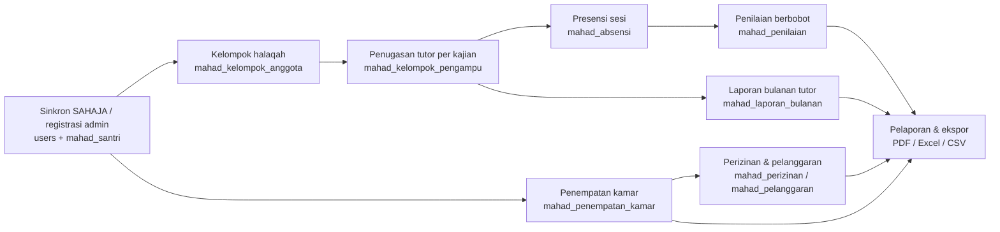

**Pilar fungsional (terverifikasi di kode):** (1) Fasilitas & hunian; (2) Kelompok & kajian; (3) Akademik (presensi/nilai/laporan); (4) Kedisiplinan (izin/pelanggaran); (5) Agenda kegiatan; (6) Pelaporan & ekspor; (7) Administrasi sistem (pengguna, sinkronisasi, cache, reset DB).

> **Catatan:** README mengklaim modul "Presensi Shalat Berjamaah 5 Waktu" dan "Absensi shalat". **Tidak ada** tabel, model, controller, maupun view untuk itu di kode; `AbsensiStatus` hanya dipakai untuk presensi kajian (`mahad_absensi`). Lihat §10.1.

---

## 2. ANATOMI ARSITEKTUR & TECH STACK

### 2.1 Pola Arsitektur & Alur Eksekusi

**Pola:** *Layered MVC monolith* di atas Laravel 12 dengan lapisan **Service** (15 kelas di `app/Services`) dan **FormRequest** (54 kelas). Autorisasi dilakukan **terutama oleh middleware `role:` Spatie pada route** (bukan Policy; lihat §9/§10). Tidak ada REST API publik; endpoint JSON hanya 4 (`fasilitas.monitoring.room`, `fasilitas.penempatan.available-rooms`, `fasilitas.penempatan.unassigned-santri`, `users.campus.lookup`) ditambah respons HTML parsial via header `X-SPA-Navigation`.

Konfigurasi bootstrap (`bootstrap/app.php`): routing `web` + `commands` + health `/up`; middleware web ditambah `App\Http\Middleware\SecurityHeaders`; **CSRF dikecualikan untuk `login`**; alias `role`, `permission`, `role_or_permission` (Spatie). `bootstrap/providers.php` hanya memuat `AppServiceProvider` yang mendaftarkan 6 Policy.

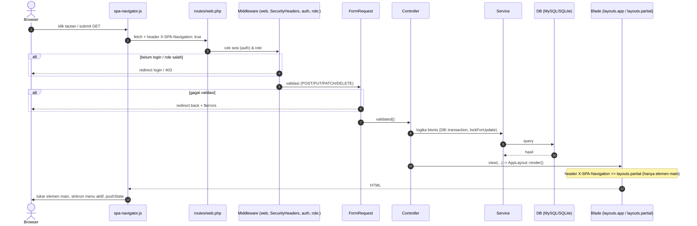

Bukti pemilihan layout: `app/View/Components/AppLayout.php` memeriksa `request()->header('X-SPA-Navigation') === 'true'` → `layouts.partial`, selain itu `layouts.app`. Cache halaman di klien: `Map` in-memory TTL 90 detik, dibersihkan saat ada submit non-GET.

### 2.2 Peta Direktori Lengkap

Pohon di bawah memuat seluruh berkas di luar `vendor/`, `node_modules/`, `public/build` dan direktori cache runtime. Berkas view dirinci per-file di §7.3 dan §7.5.

```text
├── .github/
│   └── workflows/
│       └── ci.yml
├── app/
│   ├── Console/
│   │   └── Commands/
│   │       ├── CleanSystemCache.php
│   │       └── ResetSahajaSync.php
│   ├── Enums/
│   │   ├── AbsensiStatus.php
│   │   ├── Gender.php
│   │   ├── KamarStatus.php
│   │   ├── KegiatanJenis.php
│   │   ├── KelasType.php
│   │   ├── LaporanStatus.php
│   │   ├── PelanggaranStatus.php
│   │   ├── PenempatanStatus.php
│   │   ├── PerizinanStatus.php
│   │   ├── SantriStatus.php
│   │   ├── TingkatPelanggaran.php
│   │   └── TipeRuang.php
│   ├── Exports/
│   │   ├── GenericArrayExport.php
│   │   ├── GenericArraySheetExport.php
│   │   └── MasterLaporanExport.php
│   ├── Http/
│   │   ├── Controllers/
│   │   │   ├── Admin/
│   │   │   │   ├── CacheManagementController.php
│   │   │   │   └── DatabaseResetController.php
│   │   │   ├── Auth/
│   │   │   │   ├── AuthenticatedSessionController.php
│   │   │   │   ├── ConfirmablePasswordController.php
│   │   │   │   ├── EmailVerificationNotificationController.php
│   │   │   │   ├── EmailVerificationPromptController.php
│   │   │   │   ├── NewPasswordController.php
│   │   │   │   ├── PasswordController.php
│   │   │   │   ├── PasswordResetLinkController.php
│   │   │   │   └── VerifyEmailController.php
│   │   │   ├── Fasilitas/
│   │   │   │   ├── GedungController.php
│   │   │   │   ├── KamarController.php
│   │   │   │   ├── KelolaController.php
│   │   │   │   ├── LantaiController.php
│   │   │   │   ├── MonitoringController.php
│   │   │   │   └── PenempatanController.php
│   │   │   ├── Kedisiplinan/
│   │   │   │   ├── PelanggaranController.php
│   │   │   │   └── PerizinanController.php
│   │   │   ├── Kegiatan/
│   │   │   │   └── KegiatanController.php
│   │   │   ├── Kelas/
│   │   │   │   ├── AbsensiController.php
│   │   │   │   ├── KelolaKelasNilaiController.php
│   │   │   │   ├── KelolaLaporanController.php
│   │   │   │   ├── MasterKelasController.php
│   │   │   │   └── SantriKelasController.php
│   │   │   ├── Kelompok/
│   │   │   │   ├── KelompokAnggotaController.php
│   │   │   │   ├── KelompokController.php
│   │   │   │   └── KelompokKajianController.php
│   │   │   ├── Pelaporan/
│   │   │   │   └── PelaporanController.php
│   │   │   ├── Tutor/
│   │   │   │   ├── TutorKajianController.php
│   │   │   │   └── TutorKedisiplinanController.php
│   │   │   ├── Controller.php
│   │   │   ├── DashboardController.php
│   │   │   ├── ProfileController.php
│   │   │   ├── SecureFileController.php
│   │   │   ├── UserCampusSyncController.php
│   │   │   ├── UserController.php
│   │   │   └── UserImportController.php
│   │   ├── Middleware/
│   │   │   └── SecurityHeaders.php
│   │   └── Requests/
│   │       ├── Admin/
│   │       │   ├── ClearCacheRequest.php
│   │       │   ├── ResetDatabaseRequest.php
│   │       │   ├── SwitchPeriodeRequest.php
│   │       │   └── SyncSahajaRequest.php
│   │       ├── Auth/
│   │       │   ├── LoginRequest.php
│   │       │   ├── PasswordResetLinkRequest.php
│   │       │   ├── ResetPasswordRequest.php
│   │       │   └── UpdatePasswordRequest.php
│   │       ├── Fasilitas/
│   │       │   ├── AssignBatchKamarRequest.php
│   │       │   ├── AssignKamarRequest.php
│   │       │   ├── AutoAssignKamarRequest.php
│   │       │   ├── BatchKamarRequest.php
│   │       │   ├── PindahKamarRequest.php
│   │       │   ├── StoreGedungRequest.php
│   │       │   ├── StoreKamarRequest.php
│   │       │   ├── StoreLantaiRequest.php
│   │       │   ├── UpdateGedungRequest.php
│   │       │   ├── UpdateKamarRequest.php
│   │       │   └── UpdateLantaiRequest.php
│   │       ├── Kedisiplinan/
│   │       │   ├── StorePelanggaranRequest.php
│   │       │   ├── StorePerizinanRequest.php
│   │       │   ├── UpdatePelanggaranRequest.php
│   │       │   ├── UpdateStatusPelanggaranRequest.php
│   │       │   └── UpdateStatusPerizinanRequest.php
│   │       ├── Kegiatan/
│   │       │   ├── StoreKegiatanRequest.php
│   │       │   └── UpdateKegiatanRequest.php
│   │       ├── Kelas/
│   │       │   ├── BulkUpdatePenilaianRequest.php
│   │       │   ├── CopyAbsensiRequest.php
│   │       │   ├── StoreAbsensiRequest.php
│   │       │   ├── StoreKelasJadwalRequest.php
│   │       │   ├── StoreKomponenNilaiRequest.php
│   │       │   ├── StoreLaporanBulananRequest.php
│   │       │   ├── StoreMasterKelasRequest.php
│   │       │   ├── UpdateLaporanStatusRequest.php
│   │       │   ├── UpdateMasterKelasRequest.php
│   │       │   └── UpdatePenilaianRequest.php
│   │       ├── Kelompok/
│   │       │   ├── AddKelompokAnggotaRequest.php
│   │       │   ├── AssignTutorRequest.php
│   │       │   ├── BatchKelompokRequest.php
│   │       │   ├── BulkAddKelompokAnggotaRequest.php
│   │       │   ├── ImportKelompokAnggotaRequest.php
│   │       │   ├── PindahKelompokRequest.php
│   │       │   ├── StoreKelompokRequest.php
│   │       │   └── UpdateKelompokRequest.php
│   │       ├── Pelaporan/
│   │       │   └── ExportPelaporanRequest.php
│   │       ├── Profile/
│   │       │   └── DeleteAccountRequest.php
│   │       ├── User/
│   │       │   ├── AssignCampusMudabbirRequest.php
│   │       │   ├── AssignCampusSantriRequest.php
│   │       │   ├── AssignCampusTutorRequest.php
│   │       │   ├── ImportUsersRequest.php
│   │       │   ├── StoreLocalUserRequest.php
│   │       │   ├── StoreUserRequest.php
│   │       │   └── UpdateUserRequest.php
│   │       └── ProfileUpdateRequest.php
│   ├── Imports/
│   │   └── UsersImport.php
│   ├── Models/
│   │   ├── Absensi.php
│   │   ├── Gedung.php
│   │   ├── Kamar.php
│   │   ├── Kegiatan.php
│   │   ├── Kelas.php
│   │   ├── KelasJadwal.php
│   │   ├── KelasKomponenNilai.php
│   │   ├── Kelompok.php
│   │   ├── KelompokAnggota.php
│   │   ├── KelompokPengampu.php
│   │   ├── Lantai.php
│   │   ├── LaporanBulanan.php
│   │   ├── LaporanBulananFoto.php
│   │   ├── Pelanggaran.php
│   │   ├── PelanggaranJenis.php
│   │   ├── PenempatanKamar.php
│   │   ├── Pengaturan.php
│   │   ├── Penilaian.php
│   │   ├── Periode.php
│   │   ├── Perizinan.php
│   │   ├── PerizinanJenis.php
│   │   ├── Santri.php
│   │   └── User.php
│   ├── Policies/
│   │   ├── AbsensiPolicy.php
│   │   ├── KamarPolicy.php
│   │   ├── KegiatanPolicy.php
│   │   ├── KelasPolicy.php
│   │   ├── PelanggaranPolicy.php
│   │   ├── PenempatanKamarPolicy.php
│   │   ├── PerizinanPolicy.php
│   │   └── UserPolicy.php
│   ├── Providers/
│   │   └── AppServiceProvider.php
│   ├── Services/
│   │   ├── Admin/
│   │   │   └── DatabaseResetService.php
│   │   ├── Fasilitas/
│   │   │   ├── AutoPenempatanService.php
│   │   │   └── PenempatanService.php
│   │   ├── AbsensiService.php
│   │   ├── AdminDashboardService.php
│   │   ├── CampusApiService.php
│   │   ├── CampusAuthService.php
│   │   ├── KegiatanScheduleService.php
│   │   ├── KelompokExportService.php
│   │   ├── KelompokService.php
│   │   ├── MasterKelasService.php
│   │   ├── MasterPelaporanService.php
│   │   ├── PelaporanExportService.php
│   │   ├── PenilaianService.php
│   │   └── UserExcelTemplateService.php
│   └── View/
│       └── Components/
│           ├── AppLayout.php
│           └── GuestLayout.php
├── bootstrap/
│   ├── cache/
│   │   ├── packages.php
│   │   └── services.php
│   ├── app.php
│   └── providers.php
├── config/
│   ├── activitylog.php
│   ├── app.php
│   ├── auth.php
│   ├── cache.php
│   ├── database.php
│   ├── dompdf.php
│   ├── excel.php
│   ├── filesystems.php
│   ├── logging.php
│   ├── mail.php
│   ├── permission.php
│   ├── queue.php
│   ├── services.php
│   └── session.php
├── database/
│   ├── factories/
│   │   └── UserFactory.php
│   ├── migrations/
│   │   ├── 0001_01_01_000000_create_users_table.php
│   │   ├── 0001_01_01_000001_create_cache_table.php
│   │   ├── 0001_01_01_000002_create_jobs_table.php
│   │   ├── 2026_10_06_144207_create_permission_tables.php
│   │   ├── 2026_10_06_150001_create_mahad_periode_table.php
│   │   ├── 2026_10_06_150002_create_mahad_santri_table.php
│   │   ├── 2026_10_06_150003_create_mahad_gedung_lantai_kamar_tables.php
│   │   ├── 2026_10_06_150004_create_mahad_penempatan_kamar_table.php
│   │   ├── 2026_10_06_150005_create_mahad_kelas_tables.php
│   │   ├── 2026_10_06_150006_create_mahad_absensi_table.php
│   │   ├── 2026_10_06_150007_create_mahad_laporan_bulanan_tables.php
│   │   ├── 2026_10_06_150008_create_mahad_penilaian_table.php
│   │   ├── 2026_10_06_150009_create_mahad_pelanggaran_tables.php
│   │   ├── 2026_10_06_150010_create_mahad_perizinan_tables.php
│   │   ├── 2026_10_06_150011_create_mahad_kegiatan_table.php
│   │   ├── 2026_10_07_140000_upgrade_mahad_schema.php
│   │   ├── 2026_10_08_130000_add_auth_source_to_users_table.php
│   │   ├── 2026_10_12_140000_add_performance_indexes_to_mahad_kamar.php
│   │   ├── 2026_10_12_150000_add_periode_id_to_perizinan_and_pelanggaran_tables.php
│   │   ├── 2026_10_15_150000_add_performance_covering_indexes.php
│   │   ├── 2026_10_19_082000_add_foto_to_mahad_santri_table.php
│   │   ├── 2026_10_27_073957_update_tipe_column_in_mahad_kelas_table.php
│   │   ├── 2026_10_27_230000_add_sahaja_columns_to_santri_and_periode_tables.php
│   │   ├── 2026_10_27_233000_drop_foto_from_mahad_santri_table.php
│   │   ├── 2026_11_03_130000_add_periode_id_to_mahad_santri_table.php
│   │   ├── 2026_11_04_115432_remove_banding_from_mahad_pelanggaran_table.php
│   │   └── 2026_11_05_070054_create_mahad_kelas_komponen_nilai_table.php
│   ├── seeders/
│   │   ├── DatabaseSeeder.php
│   │   └── DummyDataSeeder.php
│   └── database.sqlite
├── docs/
│   ├── BRIDGE_API_AUTH_INTEGRATION.md
│   └── DOKUMENTASI_SISTEM_LOGIN_SSO.md
├── public/
│   ├── build/   # 3 berkas (tidak dirinci)
│   ├── fonts/
│   │   ├── outfit-latin.woff2
│   │   └── plus-jakarta-sans-latin.woff2
│   ├── images/
│   │   ├── logo.png
│   │   ├── mahad-bg.jpg
│   │   └── mahad-bg.webp
│   ├── storage/
│   ├── .htaccess
│   ├── apple-touch-icon.png
│   ├── favicon-16x16.png
│   ├── favicon-32x32.png
│   ├── favicon.ico
│   ├── index.php
│   └── robots.txt
├── resources/
│   ├── css/
│   │   └── app.css
│   ├── js/
│   │   ├── modules/
│   │   │   ├── spa-navigator.js
│   │   │   └── theme.js
│   │   ├── app.js
│   │   └── bootstrap.js
│   └── views/
│       ├── admin/   # 9 berkas (tidak dirinci)
│       ├── auth/   # 6 berkas (tidak dirinci)
│       ├── components/   # 82 berkas (tidak dirinci)
│       ├── errors/   # 2 berkas (tidak dirinci)
│       ├── fasilitas/   # 4 berkas (tidak dirinci)
│       ├── kedisiplinan/   # 3 berkas (tidak dirinci)
│       ├── kegiatan/   # 4 berkas (tidak dirinci)
│       ├── kelas/   # 27 berkas (tidak dirinci)
│       ├── kelompok/   # 13 berkas (tidak dirinci)
│       ├── layouts/   # 3 berkas (tidak dirinci)
│       ├── pelaporan/   # 3 berkas (tidak dirinci)
│       ├── profile/   # 4 berkas (tidak dirinci)
│       ├── tutor/   # 4 berkas (tidak dirinci)
│       ├── users/   # 6 berkas (tidak dirinci)
│       ├── dashboard.blade.php
│       └── welcome.blade.php
├── routes/
│   ├── auth.php
│   ├── console.php
│   └── web.php
├── storage/
│   ├── app/
│   │   ├── private/
│   │   │   └── kelas_laporan/
│   │   │       ├── HWpUvj4AfmUVxtoWtnR7sOi8vi6rwgd4C3xgMeCy.png
│   │   │       ├── p0azA9PGgVj7pmxrvF0Ef6REGstGdOnH333LidSf.png
│   │   │       └── wHU5ARvC2N59wSun4li2Z6fwUkZA0Q4SZpOulSzc.png
│   │   └── public/
│   ├── framework/
│   │   ├── cache/
│   │   │   ├── data/   # 1 berkas (tidak dirinci)
│   │   │   └── laravel-excel/   # 54 berkas (tidak dirinci)
│   │   ├── sessions/
│   │   │   ├── Ec55LJbYYL4bdgj3fHwRA0LZIdT1EshEipnGoxkl
│   │   │   ├── V8UE9w1ZXlDiRXrVkQWS35AFo1SYKNS9pyg3Y3aT
│   │   │   └── VNbPHv3BxXq9L6HQKg079cj3YrvlPYIvnimXPyPx
│   │   ├── testing/
│   │   │   └── disks/
│   │   │       └── local/
│   │   │           └── kelas_laporan/
│   │   │               ├── qpQxmJUWoKl7RlKvz3MKBh9DdCXOn77ePG8r2LHG.jpg
│   │   │               ├── teGJOIrxr8eL72HWJ31kL6FoksoFieBguW8JcCTf.jpg
│   │   │               └── vv5p4UVQkCxVt4XPkdSSI9v7m7UBpLu5UPaOPn2e.jpg
│   │   ├── views/
│   │   │   ├── 045022fcb79ce4aef63c8e47e3785574.php
│   │   │   ├── 18faf4e8c5a306445b4560b07099a84a.php
│   │   │   ├── 2a7dd69089ea2a0808ea2e5e3ee64fa4.php
│   │   │   ├── 3e371b7bcce5794078e987683685f21a.php
│   │   │   ├── 42a43e4e36091b61dd9c2093c4390c1b.php
│   │   │   ├── 46d48fe0100371ecd87f5c53781f4f12.php
│   │   │   ├── 4f409f7982eb1172e659e491fe1858c9.php
│   │   │   ├── 58d4b97954a411c4d6f17ee3b232d126.php
│   │   │   ├── 5cee4d0cf96e2e7d8b88368bee0f73ac.php
│   │   │   ├── 665f70a978d4b49b7c879e86baa8b827.php
│   │   │   ├── 75d6f9ed55a17e762cea665c2ebd8847.php
│   │   │   ├── 779ef74eed105fe678cbf5d97f84be8f.php
│   │   │   ├── 7dc88f78dac65d05f81f253375fe9396.php
│   │   │   ├── 8e129de51a85ec4f9bb4bc2175d3f247.php
│   │   │   ├── 952e09749e47def14bb1b2ae438e1efe.php
│   │   │   ├── c06517973a83c313d94b6d5b5ae077c2.php
│   │   │   ├── c6aa40a8611e4d3985e0f6c83f6b0618.php
│   │   │   ├── c85a16e4cb178c1d2274a30b6e3734ab.php
│   │   │   ├── d1a384edfde90885e0ee4bc706718424.php
│   │   │   ├── d24e0cd3613f655c413c209642c82187.php
│   │   │   └── eba1f991ca4078538bc3fb0f444ed59e.php
│   │   └── cookie.txt
│   └── logs/
│       └── laravel.log
├── tests/
│   ├── Feature/
│   │   ├── Admin/
│   │   │   ├── CacheManagementTest.php
│   │   │   ├── DatabaseResetTest.php
│   │   │   └── PelaporanDanDashboardAdminTest.php
│   │   ├── Auth/
│   │   │   ├── AuthenticationTest.php
│   │   │   ├── CampusGatekeeperTest.php
│   │   │   ├── EmailVerificationTest.php
│   │   │   ├── PasswordConfirmationTest.php
│   │   │   ├── PasswordResetTest.php
│   │   │   ├── PasswordUpdateTest.php
│   │   │   ├── RegistrationTest.php
│   │   │   └── SahajaSyncAuthTest.php
│   │   ├── CampusApi/
│   │   │   ├── ApiErrorFallbackTest.php
│   │   │   ├── BridgeAuthIntegrationTest.php
│   │   │   ├── Milestone1ChallengerTest.php
│   │   │   └── SahajaMukimSyncIntegrationTest.php
│   │   ├── ExampleTest.php
│   │   ├── FasilitasMonitoringTest.php
│   │   ├── KegiatanIndexTest.php
│   │   ├── KelompokAkademikTest.php
│   │   ├── KelompokKajianTest.php
│   │   ├── ProfileTest.php
│   │   ├── RoleWorkflowTest.php
│   │   ├── SpaNavigationTest.php
│   │   └── TutorWorkflowTest.php
│   ├── Unit/
│   │   └── ExampleTest.php
│   └── TestCase.php

```

**Fungsi folder kunci:** `app/Services` (logika bisnis & integrasi kampus) · `app/Http/Requests` (validasi + sebagian otorisasi) · `app/Enums` (status & label UI) · `app/Exports`/`app/Imports` (Maatwebsite Excel) · `app/Policies` (terdaftar tetapi **tidak dipanggil**) · `resources/views/components` (komponen Blade atomik & modul) · `database/seeders` (data awal/dummy) · `docs/` (dokumen SSO) · `storage/app/private` (disk `local`: foto laporan, bukti izin) · `.github/workflows/ci.yml` (CI MySQL 8).

### 2.3 Inventaris Tech Stack, Environment & Dependencies
Versi eksak dari `composer.lock` dan `package-lock.json` (bukan rentang di manifest).
| Kategori | Teknologi/Package | Versi eksak (lock) | Konfigurasi | Kegunaan di aplikasi |
|:--|:--|:--|:--|:--|
| Backend | PHP | `^8.2` (composer.json) | — | Runtime; pakai enum backed, readonly property, match |
| Backend | laravel/framework | 12.69.3 | `config/app.php`, `bootstrap/app.php` | Routing, ORM, validasi, cache, view |
| Backend | laravel/breeze | 2.4.2 | `routes/auth.php` | Scaffold login/reset/verify (register dinonaktifkan: route tidak ada) |
| Backend | laravel/sanctum | 4.3.3 | — | **Terpasang tetapi tidak dipakai** (tidak ada `HasApiTokens`, tidak ada route API) |
| Backend | laravel/tinker | 2.11.1 | — | REPL |
| Backend | guzzlehttp/guzzle | 7.15.5 | `config/services.php` | Dasar `Http::` client ke Bridge/SAHAJA |
| Library | spatie/laravel-permission | 6.25.0 | `config/permission.php` (teams=false) | RBAC (role admin/tutor/mudabbir/mahasantri), middleware `role:` |
| Library | spatie/laravel-activitylog | 4.12.3 | `config/activitylog.php` | **Terpasang, tidak dipakai** (tak ada `LogsActivity`/`activity()` dan tak ada migrasi tabel `activity_log`) |
| Library | maatwebsite/excel | 3.1.70 | `config/excel.php` | Ekspor `.xlsx` (`GenericArrayExport`, `MasterLaporanExport`), import pengguna (`UsersImport`) |
| Library | phpoffice/phpspreadsheet | 1.30.7 | — | Template Excel manual (`UserExcelTemplateService`, `KelompokExportService`) |
| Library | barryvdh/laravel-dompdf | 3.1.2 | `config/dompdf.php` | PDF laporan & nilai |
| Library | dompdf/dompdf | 3.1.6 | `config/dompdf.php` | Mesin render PDF |
| DevTools | phpunit/phpunit | 11.5.56 | `phpunit.xml` | Test (SQLite `:memory:`) |
| DevTools | laravel/pint 1.32.1 · pail 1.2.7 · sail 1.68.0 · collision 8.9.5 · mockery 1.6.15 · fakerphp/faker 1.24.1 | lock | `composer.json` scripts | Lint, log tail, container dev, test runner, mock, faker |
| Frontend | alpinejs | 3.17.4 | `resources/js/app.js` | Reaktivitas (modal, tab, dropdown) |
| UI | tailwindcss | **3.4.19** | `tailwind.config.js`, `postcss.config.js` | Utility CSS; `darkMode: ['class','[data-theme="dark"]']` |
| UI | @tailwindcss/forms | 0.5.11 | `tailwind.config.js` | Gaya form |
| UI | @tailwindcss/vite | 4.3.3 | — | **Terpasang tetapi tidak dipakai** di `vite.config.js` (konflik versi dengan Tailwind 3) |
| Build | vite 6.4.3 · laravel-vite-plugin 1.3.0 | lock | `vite.config.js` | Bundling `resources/css/app.css`, `resources/js/app.js` |
| HTTP | axios | 1.20.0 | `resources/js/bootstrap.js` | Header `X-Requested-With` global |
| Tooling | concurrently 9.2.4 · autoprefixer 10.6.1 · postcss 8.5.28 · @playwright/test 1.64.1 | lock | `composer.json` `dev` script | Dev runner; Playwright terpasang tanpa test E2E di repo |
| Database | SQLite/MySQL | default kode `sqlite`; `.env` aktual `mysql` (`mahad-v2-sahaja`) | `config/database.php`, `.env`, `.env.example` | `.env.example` = SQLite, CI = MySQL 8.0, test = SQLite memory |
| Session/Cache/Queue | `database` (sesi, `.env`), `file` (cache), `sync` (queue) | — | `.env`, `config/session.php` | `.env.example` memakai sesi `file` |
| Font | Plus Jakarta Sans, Outfit (self-hosted `public/fonts/*.woff2`) | — | `resources/css/app.css` | Tipografi |
| Skrip operasional | `start.bat`, `start.ps1`, `stop.bat` | — | root | Menjalankan stack lokal Windows/XAMPP (`composer dev` → `php artisan serve --port=8080`) |

**Variabel lingkungan penting (`.env.example`):** `APP_NAME`, `APP_TIMEZONE=Asia/Jakarta` (⚠ tidak dipakai, lihat §10.4), `APP_LOCALE=id`, `DB_CONNECTION`, `CAMPUS_API_BASE_URL`, `BRIDGE_API_URL`, `CAMPUS_API_TIMEOUT`, `BRIDGE_API_TIMEOUT`, `CAMPUS_API_CONNECT_TIMEOUT`, `CAMPUS_API_VERIFY_SSL`, `CAMPUS_API_HEALTH_CACHE_TTL`, `SAHAJA_API_URL`, `SAHAJA_API_KEY`, `SAHAJA_API_TIMEOUT`, `SAHAJA_API_VERIFY_SSL`, `SESSION_*`, `QUEUE_CONNECTION`, `CACHE_STORE`, `MAIL_*`. Config `services.php` memaksa semua timeout ≤ 5 detik dan connect-timeout ≤ 1 detik (`min(5, …)`), `health_cache_ttl` ≥ 300 detik.

---

## 3. BEDAH AKTOR, AUTENTIKASI & ROLE-BASED ACCESS CONTROL (RBAC)

### 3.1 Mekanisme Autentikasi & Manajemen Sesi
**Berkas:** `routes/auth.php`, `app/Http/Controllers/Auth/AuthenticatedSessionController.php`, `app/Http/Requests/Auth/LoginRequest.php`, `app/Services/CampusAuthService.php`, `app/Services/CampusApiService.php`, `resources/views/auth/login.blade.php`.

**Login (hybrid lokal + SSO kampus):**
1. `POST /login` (middleware `guest`, **dikecualikan dari CSRF** di `bootstrap/app.php`) → `AuthenticatedSessionController@store` → `LoginRequest::authenticate()`.
2. `ensureIsNotRateLimited()`: maksimal **5 percobaan** per kunci `lower(identifier)|ip` (`RateLimiter`), memicu event `Lockout`.
3. Identifier diambil dari `username` ‖ `login_id` ‖ `email` (satu kolom UI; NIM, NIP, atau email). Kosong → `ValidationException`.
4. `CampusAuthService::authenticate($identifier,$password)`:
   a. Cari `users` berdasarkan `nomor_induk` **atau** `email`.
   b. Jika user lokal punya `password` dan `Hash::check` cocok → **login lokal berhasil** (termasuk untuk akun `campus` yang kebetulan punya hash, mis. hasil `DatabaseResetService`).
   c. Jika user ada dan `auth_source === 'local'` → gagal ("Username atau kata sandi … tidak sesuai").
   d. Selain itu → `CampusApiService::verifyCredentials()`: `POST {bridge}/api/v2/portal/login` (form `username`,`password`); bila gagal, coba `POST {sahaja}/api/v1/auth/login` (khusus dosen/tutor). Respons profil diperkaya via `GET {bridge}/api/v2/profil` (Bearer token).
   e. Jika user belum ada: coba `smartLookup` (cari di data mukim SAHAJA periode `20251`) → `syncSahajaStudent`; jika tidak ketemu → `upsertCampusRoleUser` dengan role `tutor` bila `user_type=pegawai`, selain itu `mahasantri`. Akun diberi `auth_source='campus'`, `password=NULL`, `email_verified_at=now()`.
   f. Data profil (nama, email, prodi, gender, kontak) disinkronkan; untuk role mahasantri/mudabbir `Santri::updateOrCreate`.
5. `Auth::login($user, remember)`; `RateLimiter::clear`. Controller lalu `session()->regenerate()` dan redirect ke `route('dashboard')`.
6. Token Bridge disimpan di sesi (`campus_token`, `campus_token_created_at`); token tutor SAHAJA di `sahaja_tutor_token`.

**Logout:** `POST /logout` (auth) → `Auth::guard('web')->logout()`, `session()->invalidate()`, `regenerateToken()`, redirect `/`. **Catatan:** `CampusApiService::logout()` (pencabutan token Bridge) **tidak dipanggil** oleh controller logout.

**Register:** tidak ada route. `tests/Feature/Auth/RegistrationTest.php` memverifikasi 404. Akun dibuat admin (§5.2) atau otomatis saat login SSO/sinkron.

**Password hashing:** cast `'password' => 'hashed'` pada `User` (bcrypt, `BCRYPT_ROUNDS=12`); seeder memakai `Hash::make`.

**Reset password / verifikasi email / konfirmasi password:** rute Breeze standar (`routes/auth.php`) dengan `throttle:6,1` pada verifikasi; `MAIL_MAILER=log` (email hanya ditulis ke log).

**Sesi & cookie:** `.env` aktual `SESSION_DRIVER=database` (tabel `sessions`), `SESSION_LIFETIME=120`, `SESSION_HTTP_ONLY=true`, `SESSION_SAME_SITE=lax`, `SESSION_SECURE_COOKIE=false`, `SESSION_ENCRYPT=false`. Redirect setelah login: selalu `dashboard`.

**Pemilihan role runtime:** seluruh kode memakai `$user->roles->first()->name` (default `mahasantri`) untuk dashboard, sidebar, bottom-nav, dan `SecureFileController`. Aplikasi mengandalkan asumsi **satu role per pengguna** (`syncRoles([...])` selalu dipakai saat membuat/ubah).

### 3.2 Matriks Aktor / Role & Hak Akses
Role dibuat di `DatabaseSeeder` (`Role::firstOrCreate`) dan `DummyDataSeeder`/`DatabaseResetService`; tidak ada *permission* granular (tabel `permissions` kosong; hanya role).

| Role | Identifier DB (`roles.name`) | Middleware pengaman | Navigasi Sidebar (`components/sidebar.blade.php`) | Bottom navbar mobile (`components/bottom-nav.blade.php`) |
|:--|:--|:--|:--|:--|
| Administrator | `admin` | `auth` + `role:admin` pada grup admin | **Ringkasan:** Dashboard · **Operasional:** Izin Santri, Pelanggaran Santri, Agenda Asrama · **Asrama:** Monitoring Kamar, Penempatan Santri, Data Asrama · **Kelas Saya** (hanya jika admin terdaftar di `mahad_kelompok_pengampu`): Presensi Kelas, Nilai Santri (`mode=saya`), Laporan Bulanan (`mode=saya`) · **Manajemen Kajian:** Rekap Presensi, Rekap Nilai, Review Laporan, Kelompok Kajian, Kurikulum Kajian · **Sistem:** Ekspor Laporan, Kelola Pengguna, Sinkron & Cache | Dashboard, Monitoring, Rekap Presensi, Izin Santri, Profil |
| Mudabbir | `mudabbir` | `auth`; `role:admin\|mudabbir` (+penempatan, pelanggaran, kegiatan CUD); `role:admin\|mudabbir\|tutor` (monitoring, kelompok baca) | **Ringkasan:** Dashboard, Agenda Asrama · **Asrama & Kedisiplinan:** Monitoring Kamar, Izin Santri, Pelanggaran Santri | Dashboard, Monitoring, Izin Santri, Pelanggaran, Agenda Asrama |
| Tutor | `tutor` | `auth`; `role:admin\|tutor` (kelas.absensi, kelas.nilai, kelas.laporan, tutor.*) | **Ringkasan:** Dashboard, Agenda · **Kelas Saya:** Presensi Kelas (`tutor.kajian.index`), Nilai Santri, Laporan Bulanan · **Kedisiplinan:** Catatan Santri (`tutor.kedisiplinan.index`) | Dashboard, Presensi Kelas, Laporan Bulanan, Catatan Santri, Agenda |
| Mahasantri | `mahasantri` | `auth`; `role:mahasantri\|admin\|mudabbir` pada `kelas.santri.index` | **Ringkasan:** Dashboard, Agenda · **Aktivitas:** Perizinan, Catatan Disiplin (`kedisiplinan.perizinan.index?tab=pelanggaran`), Kelas Saya (`kelas.santri.index`) | Dashboard, Kelas Saya, Perizinan, Agenda, Profil |

**Status aktif menu:** sidebar memakai `request()->routeIs($prefix)` atau closure `is_active` (mis. `kelas.nilai.*` dengan `mode`); setelah navigasi SPA, `syncNavLinks()` di `spa-navigator.js` menghitung ulang kelas aktif (bandingkan path + `mode` + `tab`).

**Hak akses fungsional per role (berdasarkan middleware route + pemeriksaan di controller/FormRequest):**
| Modul | admin | mudabbir | tutor | mahasantri |
|:--|:--:|:--:|:--:|:--:|
| Dashboard (`/dashboard`) | ✔ (statistik global) | ✔ (ringkasan asrama + kelompok read-only) | ✔ (jadwal mengajar) | ✔ (kamar, jadwal, nilai) |
| Profil (`/profile`) | ✔ | ✔ | ✔ | ✔ |
| Kelola Pengguna, Impor, Sinkron SAHAJA, Cache, Reset DB | ✔ | ✖ | ✖ | ✖ |
| Monitoring kamar | ✔ | ✔ | ✔ | ✖ |
| Kelola Asrama (gedung/lantai/kamar) | ✔ | ✖ | ✖ | ✖ |
| Penempatan kamar (+kartu) | ✔ | ✔ | ✖ | ✖ |
| Kelompok: lihat & detail kajian | ✔ | ✔ (baca) | ✔ (baca) | ✖ |
| Kelompok: CRUD, anggota, penugasan tutor, ekspor | ✔ | ✖ | ✖ | ✖ |
| Kurikulum/Master Kajian & jadwal sesi | ✔ | ✖ | ✖ | ✖ |
| Presensi, Rekap presensi | ✔ | ✖ | ✔ (hanya kelompok yang diampu) | ✖ |
| Nilai & komponen nilai | ✔ | ✖ | ✔ (⚠ bulk-update/komponen tanpa cek pengampu, lihat §10.4) | ✖ |
| Laporan bulanan: buat/ubah/hapus | ✔ | ✖ | ✔ | ✖ |
| Laporan bulanan: ubah status (review) | ✔ | ✖ | ✖ | ✖ |
| Portal "Kajian Saya" & "Catatan Santri" | ✔ | ✖ | ✔ | ✖ |
| Portal akademik santri (`kelas.santri.index`) | ✔ (menampilkan santri sampel) | ✔ | ✖ | ✔ |
| Agenda: lihat | ✔ | ✔ | ✔ | ✔ |
| Agenda: tambah/ubah | ✔ | ⚠ route izinkan, FormRequest `authorize()` hanya admin → 403 | ✖ | ✖ |
| Agenda: hapus/toggle | ✔ | ✔ | ✖ | ✖ |
| Perizinan: index/store/export/cetak/destroy | ✔ | ✔ | ⚠ **tanpa batasan role** | ✔ (dibatasi ke milik sendiri pada index/cetak/destroy; ⚠ ekspor tidak dibatasi) |
| Perizinan: ubah status | ✔ | ✔ | ✖ | ✖ |
| Pelanggaran: index/CRUD/status/ekspor | ✔ | ✔ | ✖ | ✖ |
| Pelanggaran: hapus | ✔ | ✖ | ✖ | ✖ |
| Pelaporan & ekspor terpadu | ✔ | ✖ | ✖ | ✖ |
| `secure-file` (berkas privat) | ✔ | ✔ | laporan-kelas | bukti-perizinan milik sendiri |

### 3.3 Policy (terdaftar, tidak dipanggil)
`AppServiceProvider::boot()` mendaftarkan `KelasPolicy`, `KamarPolicy`, `PenempatanKamarPolicy`, `PerizinanPolicy`, `PelanggaranPolicy`, `UserPolicy`. Pencarian `authorize(`, `Gate::allows`, `@can`, `->can(` di `app/` dan `resources/` **tidak menemukan satu pun pemanggilan**; otorisasi nyata hanya dari middleware route, `authorize()` FormRequest, dan pengecekan manual di controller. `KegiatanPolicy` dan `AbsensiPolicy` tidak terdaftar eksplisit. `KelasPolicy` & `AbsensiPolicy` memakai `$kelas->tutor_id` yang **tidak ada** pada tabel `mahad_kelas` (kode mati/bug laten).

---

## 4. BEDAH DATABASE, SKEMA & DATA MODEL

> **Sumber:** 27 file `database/migrations/*` digabung berurutan (termasuk `ALTER`). Total **35 tabel** (24 domain+infrastruktur aplikasi, 5 Spatie, 6 infrastruktur Laravel). Skema bawaan SQLite di zip tidak dipakai (usang). Catatan lintas-driver: beberapa `ALTER ... MODIFY COLUMN` hanya berjalan pada MySQL (`2026_10_07_140000`, `2026_10_27_073957`, `2026_11_04_115432`); pada SQLite hal itu tidak berlaku (lihat §10.4).

### 4.1 Entity Relationship Diagram (ERD)

```mermaid
erDiagram
    users ||--o| mahad_santri : "profil 1:1"
    mahad_periode |o--o{ mahad_santri : "periode_id"
    users ||--o{ model_has_roles : "model_id (polimorfik)"
    roles ||--o{ model_has_roles : "role_id"
    roles ||--o{ role_has_permissions : "role_id"
    permissions ||--o{ role_has_permissions : "permission_id"
    permissions ||--o{ model_has_permissions : "permission_id"
    mahad_gedung ||--o{ mahad_lantai : "gedung_id"
    mahad_lantai ||--o{ mahad_kamar : "lantai_id"
    mahad_periode ||--o{ mahad_penempatan_kamar : "periode_id"
    mahad_santri ||--o{ mahad_penempatan_kamar : "santri_id"
    mahad_kamar ||--o{ mahad_penempatan_kamar : "kamar_id"
    users ||--o{ mahad_penempatan_kamar : "assigned_by"
    mahad_periode ||--o{ mahad_kelompok : "periode_id"
    mahad_kelompok ||--o{ mahad_kelompok_anggota : "kelompok_id"
    mahad_santri ||--o{ mahad_kelompok_anggota : "santri_id"
    mahad_periode ||--o{ mahad_kelas : "periode_id"
    mahad_kelas ||--o{ mahad_kelas_jadwal : "kelas_id"
    mahad_kelompok ||--o{ mahad_kelompok_pengampu : "kelompok_id"
    mahad_kelas ||--o{ mahad_kelompok_pengampu : "kelas_id"
    users ||--o{ mahad_kelompok_pengampu : "tutor_id"
    mahad_kelas ||--o{ mahad_kelas_komponen_nilai : "kelas_id"
    mahad_kelompok |o--o{ mahad_kelas_komponen_nilai : "kelompok_id"
    mahad_kelompok ||--o{ mahad_absensi : "kelompok_id"
    mahad_kelas ||--o{ mahad_absensi : "kelas_id"
    mahad_kelas_jadwal |o--o{ mahad_absensi : "jadwal_id"
    mahad_santri ||--o{ mahad_absensi : "santri_id"
    users ||--o{ mahad_absensi : "input_by"
    mahad_kelompok ||--o{ mahad_penilaian : "kelompok_id"
    mahad_kelas ||--o{ mahad_penilaian : "kelas_id"
    mahad_santri ||--o{ mahad_penilaian : "santri_id"
    users ||--o{ mahad_penilaian : "input_by"
    mahad_periode ||--o{ mahad_laporan_bulanan : "periode_id"
    mahad_kelompok |o--o{ mahad_laporan_bulanan : "kelompok_id"
    mahad_kelas |o--o{ mahad_laporan_bulanan : "kelas_id"
    users ||--o{ mahad_laporan_bulanan : "tutor_id / reviewed_by"
    mahad_laporan_bulanan ||--o{ mahad_laporan_bulanan_foto : "laporan_id"
    mahad_pelanggaran_jenis ||--o{ mahad_pelanggaran : "jenis_pelanggaran_id"
    mahad_periode ||--o{ mahad_pelanggaran : "periode_id"
    mahad_santri ||--o{ mahad_pelanggaran : "santri_id"
    users ||--o{ mahad_pelanggaran : "input_by"
    mahad_perizinan_jenis ||--o{ mahad_perizinan : "jenis_perizinan_id"
    mahad_periode ||--o{ mahad_perizinan : "periode_id"
    mahad_santri ||--o{ mahad_perizinan : "santri_id"
    users ||--o{ mahad_perizinan : "input_by"
    mahad_periode |o--o{ mahad_kegiatan : "periode_id"
    users ||--o{ mahad_kegiatan : "created_by"
    users {
        bigint id PK
        varchar nomor_induk
        varchar name
        varchar email
        enum auth_source
        timestamp email_verified_at
        varchar password
        varchar remember_token
        timestamp created_at
    }
    password_reset_tokens {
        varchar email PK
        varchar token
        timestamp created_at
    }
    sessions {
        varchar id PK
        bigint user_id FK
        varchar ip_address
        text user_agent
        longtext payload
        int last_activity
    }
    cache {
        varchar key PK
        mediumtext value
        int expiration
    }
    cache_locks {
        varchar key PK
        varchar owner
        int expiration
    }
    jobs {
        bigint id PK
        varchar queue
        longtext payload
        tinyint attempts
        int reserved_at
        int available_at
        int created_at
    }
    job_batches {
        varchar id PK
        varchar name
        int total_jobs
        int pending_jobs
        int failed_jobs
        longtext failed_job_ids
        mediumtext options
        int cancelled_at
        int created_at
        int finished_at
    }
    failed_jobs {
        bigint id PK
        varchar uuid
        text connection
        text queue
        longtext payload
        longtext exception
        timestamp failed_at
    }
    permissions {
        bigint id PK
        varchar name
        varchar guard_name
        timestamp created_at
    }
    roles {
        bigint id PK
        varchar name
        varchar guard_name
        timestamp created_at
    }
    model_has_roles {
        bigint role_id PK
        varchar model_type PK
        bigint model_id PK
    }
    model_has_permissions {
        bigint permission_id PK
        varchar model_type PK
        bigint model_id PK
    }
    role_has_permissions {
        bigint permission_id PK
        bigint role_id PK
    }
    mahad_periode {
        bigint id PK
        varchar kode
        bigint academic_period_id
        varchar nama
        date tanggal_mulai
        date tanggal_selesai
        boolean is_active
        timestamp created_at
    }
    mahad_santri {
        bigint id PK
        bigint user_id FK
        bigint periode_id FK
        varchar nomor_induk
        enum gender
        varchar prodi
        varchar fakultas
        tinyint semester
        varchar angkatan
        varchar no_hp
        varchar wa_santri
        text alamat
        varchar nama_wali
        varchar no_hp_wali
        varchar hp_ayah
        varchar email_ayah
        varchar hp_ibu
        varchar email_ibu
        varchar briva_number
        varchar bsb_customer_id
        varchar status_pembayaran
        int nominal_tagihan
        enum status
        timestamp created_at
    }
    mahad_gedung {
        bigint id PK
        varchar kode
        varchar nama
        enum gender_khusus
        text deskripsi
        boolean is_active
        timestamp created_at
    }
    mahad_lantai {
        bigint id PK
        bigint gedung_id FK
        tinyint nomor_lantai
        tinyint kapasitas_kamar_standar
        timestamp created_at
    }
    mahad_kamar {
        bigint id PK
        bigint lantai_id FK
        varchar nomor_kamar
        enum tipe_ruang
        enum gender
        tinyint kapasitas_maks
        enum status
        text catatan
        timestamp created_at
    }
    mahad_penempatan_kamar {
        bigint id PK
        bigint periode_id FK
        bigint santri_id FK
        bigint kamar_id FK
        date tanggal_masuk
        date tanggal_keluar
        enum status
        text catatan
        bigint assigned_by FK
        timestamp created_at
    }
    mahad_kelompok {
        bigint id PK
        bigint periode_id FK
        varchar nama
        varchar kode
        smallint kapasitas
        boolean is_active
        text keterangan
        timestamp created_at
    }
    mahad_kelompok_anggota {
        bigint id PK
        bigint kelompok_id FK
        bigint santri_id FK
        date tanggal_masuk
        timestamp created_at
    }
    mahad_kelas {
        bigint id PK
        bigint periode_id FK
        varchar nama
        varchar tipe
        boolean is_active
        text deskripsi
        timestamp created_at
    }
    mahad_kelas_jadwal {
        bigint id PK
        bigint kelas_id FK
        varchar nama_sesi
        enum hari
        time jam_mulai
        time jam_selesai
        varchar ruangan
        timestamp created_at
    }
    mahad_kelompok_pengampu {
        bigint id PK
        bigint kelompok_id FK
        bigint kelas_id FK
        bigint tutor_id FK
        timestamp created_at
    }
    mahad_kelas_komponen_nilai {
        bigint id PK
        bigint kelas_id FK
        bigint kelompok_id FK
        varchar nama
        decimal bobot
        boolean is_absensi
        boolean is_fixed
        smallint urutan
        timestamp created_at
    }
    mahad_absensi {
        bigint id PK
        bigint kelompok_id FK
        bigint kelas_id FK
        bigint jadwal_id FK
        bigint santri_id FK
        date tanggal
        enum status
        varchar catatan
        bigint input_by FK
        timestamp created_at
    }
    mahad_penilaian {
        bigint id PK
        bigint kelompok_id FK
        bigint kelas_id FK
        bigint santri_id FK
        json nilai_komponen
        decimal nilai_angka
        varchar nilai_huruf
        text catatan
        bigint input_by FK
        timestamp created_at
    }
    mahad_laporan_bulanan {
        bigint id PK
        bigint periode_id FK
        bigint kelompok_id FK
        bigint kelas_id FK
        bigint tutor_id FK
        tinyint bulan
        smallint tahun
        text catatan
        enum status
        text catatan_admin
        bigint reviewed_by FK
        timestamp reviewed_at
        timestamp created_at
    }
    mahad_laporan_bulanan_foto {
        bigint id PK
        bigint laporan_id FK
        varchar file_path
        varchar file_name
        int file_size
        varchar caption
        timestamp created_at
    }
    mahad_pelanggaran_jenis {
        bigint id PK
        varchar nama
        smallint poin_default
        varchar sanksi_default
        text deskripsi
        boolean is_active
        timestamp created_at
    }
    mahad_pelanggaran {
        bigint id PK
        bigint periode_id FK
        bigint santri_id FK
        bigint jenis_pelanggaran_id FK
        date tanggal
        smallint poin
        text deskripsi
        varchar hukuman
        enum status
        bigint input_by FK
        timestamp created_at
    }
    mahad_perizinan_jenis {
        bigint id PK
        varchar nama
        boolean butuh_bukti
        smallint batas_hari_maks
        text deskripsi
        boolean is_active
        timestamp created_at
    }
    mahad_perizinan {
        bigint id PK
        bigint periode_id FK
        bigint santri_id FK
        bigint jenis_perizinan_id FK
        date tanggal_mulai
        date tanggal_selesai
        text alasan
        varchar file_bukti
        enum status
        bigint input_by FK
        timestamp created_at
    }
    mahad_kegiatan {
        bigint id PK
        bigint periode_id FK
        varchar nama
        enum jenis
        enum hari
        time jam_mulai
        time jam_selesai
        varchar lokasi
        text deskripsi
        date tanggal_mulai
        date tanggal_selesai
        boolean is_active
        bigint created_by FK
        timestamp created_at
    }
    mahad_pengaturan {
        bigint id PK
        varchar key
        text value
        varchar kategori
        timestamp created_at
    }
```

**Kardinalitas penting:** `users 1—0..1 mahad_santri` (UNIQUE `user_id`); `mahad_santri 1—N mahad_penempatan_kamar` (satu aktif per periode — ditegakkan di service, bukan constraint); `mahad_kelompok N—N mahad_santri` via `mahad_kelompok_anggota` (satu kelompok per periode — ditegakkan di `KelompokService`); `mahad_kelompok N—N mahad_kelas` via `mahad_kelompok_pengampu` (UNIQUE (kelompok,kelas), menyimpan tutor); `users N—N roles` via `model_has_roles`. Tidak ada tabel `mahad_nilai`, `mahad_kamar_penempatan`, `mahad_kegiatan_presensi` seperti pada ERD README.

### 4.2 Kamus Data (Data Dictionary) Seluruh Tabel

#### 4.2.1 `users`

*Migrasi:* 0001_01_01_000000_create_users_table; 2026_10_08_130000_add_auth_source_to_users_table

| No | Nama Field/Kolom            | Tipe Data & Length             | Constraint (PK, FK, Nullable, Unique, Default, Enum) | Relasi ke Tabel Lain | Fungsi Kolom                                                            |
| -: | :-------------------------- | :----------------------------- | :--------------------------------------------------- | :------------------- | :---------------------------------------------------------------------- |
|  1 | `id`                      | BIGINT UNSIGNED AUTO_INCREMENT | PK                                                   | —                   | Identitas internal akun.                                                |
|  2 | `nomor_induk`             | VARCHAR(50)                    | NULLABLE, UNIQUE, INDEX                              | —                   | NIM mahasiswa / NIP dosen / ID admin; dipakai sebagai identifier login. |
|  3 | `name`                    | VARCHAR(255)                   | NOT NULL                                             | —                   | Nama lengkap.                                                           |
|  4 | `email`                   | VARCHAR(255)                   | NOT NULL, UNIQUE                                     | —                   | Email (sering digenerate `{nim}@student.uinssc.ac.id`).               |
|  5 | `auth_source`             | ENUM('local','campus')         | NOT NULL, DEFAULT 'local', INDEX                     | —                   | Sumber autentikasi: lokal (hash di DB) atau SSO kampus (password NULL). |
|  6 | `email_verified_at`       | TIMESTAMP                      | NULLABLE                                             | —                   | Waktu verifikasi email.                                                 |
|  7 | `password`                | VARCHAR(255)                   | NULLABLE (diubah oleh migrasi 2026_10_08)            | —                   | Hash bcrypt; NULL untuk akun campus.                                    |
|  8 | `remember_token`          | VARCHAR(100)                   | NULLABLE                                             | —                   | Token remember-me.                                                      |
|  9 | `created_at / updated_at` | TIMESTAMP                      | NULLABLE                                             | —                   | Timestamp Eloquent.                                                     |

#### 4.2.2 `password_reset_tokens`

*Migrasi:* 0001_01_01_000000_create_users_table

| No | Nama Field/Kolom | Tipe Data & Length | Constraint (PK, FK, Nullable, Unique, Default, Enum) | Relasi ke Tabel Lain            | Fungsi Kolom           |
| -: | :--------------- | :----------------- | :--------------------------------------------------- | :------------------------------ | :--------------------- |
|  1 | `email`        | VARCHAR(255)       | PK                                                   | logis ke users.email (tanpa FK) | Kunci token reset.     |
|  2 | `token`        | VARCHAR(255)       | NOT NULL                                             | —                              | Hash token reset.      |
|  3 | `created_at`   | TIMESTAMP          | NULLABLE                                             | —                              | Waktu pembuatan token. |

#### 4.2.3 `sessions`

*Migrasi:* 0001_01_01_000000_create_users_table

| No | Nama Field/Kolom  | Tipe Data & Length | Constraint (PK, FK, Nullable, Unique, Default, Enum) | Relasi ke Tabel Lain | Fungsi Kolom              |
| -: | :---------------- | :----------------- | :--------------------------------------------------- | :------------------- | :------------------------ |
|  1 | `id`            | VARCHAR(255)       | PK                                                   | —                   | ID sesi.                  |
|  2 | `user_id`       | BIGINT UNSIGNED    | NULLABLE, INDEX (bukan FK constraint)                | logis ke users.id    | Pemilik sesi.             |
|  3 | `ip_address`    | VARCHAR(45)        | NULLABLE                                             | —                   | IP klien.                 |
|  4 | `user_agent`    | TEXT               | NULLABLE                                             | —                   | User-Agent.               |
|  5 | `payload`       | LONGTEXT           | NOT NULL                                             | —                   | Data sesi serial.         |
|  6 | `last_activity` | INT                | NOT NULL, INDEX                                      | —                   | Epoch aktivitas terakhir. |

#### 4.2.4 `cache`

*Migrasi:* 0001_01_01_000001_create_cache_table

| No | Nama Field/Kolom | Tipe Data & Length | Constraint (PK, FK, Nullable, Unique, Default, Enum) | Relasi ke Tabel Lain | Fungsi Kolom       |
| -: | :--------------- | :----------------- | :--------------------------------------------------- | :------------------- | :----------------- |
|  1 | `key`          | VARCHAR(255)       | PK                                                   | —                   | Kunci cache.       |
|  2 | `value`        | MEDIUMTEXT         | NOT NULL                                             | —                   | Nilai serial.      |
|  3 | `expiration`   | INT                | NOT NULL                                             | —                   | Epoch kedaluwarsa. |

#### 4.2.5 `cache_locks`

*Migrasi:* 0001_01_01_000001_create_cache_table

| No | Nama Field/Kolom | Tipe Data & Length | Constraint (PK, FK, Nullable, Unique, Default, Enum) | Relasi ke Tabel Lain | Fungsi Kolom       |
| -: | :--------------- | :----------------- | :--------------------------------------------------- | :------------------- | :----------------- |
|  1 | `key`          | VARCHAR(255)       | PK                                                   | —                   | Kunci lock.        |
|  2 | `owner`        | VARCHAR(255)       | NOT NULL                                             | —                   | Pemilik lock.      |
|  3 | `expiration`   | INT                | NOT NULL                                             | —                   | Epoch kedaluwarsa. |

#### 4.2.6 `jobs`

*Migrasi:* 0001_01_01_000002_create_jobs_table

| No | Nama Field/Kolom | Tipe Data & Length | Constraint (PK, FK, Nullable, Unique, Default, Enum) | Relasi ke Tabel Lain | Fungsi Kolom      |
| -: | :--------------- | :----------------- | :--------------------------------------------------- | :------------------- | :---------------- |
|  1 | `id`           | BIGINT UNSIGNED    | PK                                                   | —                   | ID job.           |
|  2 | `queue`        | VARCHAR(255)       | NOT NULL, INDEX                                      | —                   | Nama antrean.     |
|  3 | `payload`      | LONGTEXT           | NOT NULL                                             | —                   | Payload job.      |
|  4 | `attempts`     | TINYINT UNSIGNED   | NOT NULL                                             | —                   | Jumlah percobaan. |
|  5 | `reserved_at`  | INT UNSIGNED       | NULLABLE                                             | —                   | Waktu reservasi.  |
|  6 | `available_at` | INT UNSIGNED       | NOT NULL                                             | —                   | Waktu tersedia.   |
|  7 | `created_at`   | INT UNSIGNED       | NOT NULL                                             | —                   | Waktu dibuat.     |

#### 4.2.7 `job_batches`

*Migrasi:* 0001_01_01_000002_create_jobs_table

| No | Nama Field/Kolom   | Tipe Data & Length | Constraint (PK, FK, Nullable, Unique, Default, Enum) | Relasi ke Tabel Lain | Fungsi Kolom  |
| -: | :----------------- | :----------------- | :--------------------------------------------------- | :------------------- | :------------ |
|  1 | `id`             | VARCHAR(255)       | PK                                                   | —                   | ID batch.     |
|  2 | `name`           | VARCHAR(255)       | NOT NULL                                             | —                   | Nama batch.   |
|  3 | `total_jobs`     | INT                | NOT NULL                                             | —                   | Total job.    |
|  4 | `pending_jobs`   | INT                | NOT NULL                                             | —                   | Job tertunda. |
|  5 | `failed_jobs`    | INT                | NOT NULL                                             | —                   | Job gagal.    |
|  6 | `failed_job_ids` | LONGTEXT           | NOT NULL                                             | —                   | ID job gagal. |
|  7 | `options`        | MEDIUMTEXT         | NULLABLE                                             | —                   | Opsi batch.   |
|  8 | `cancelled_at`   | INT                | NULLABLE                                             | —                   | Dibatalkan.   |
|  9 | `created_at`     | INT                | NOT NULL                                             | —                   | Dibuat.       |
| 10 | `finished_at`    | INT                | NULLABLE                                             | —                   | Selesai.      |

#### 4.2.8 `failed_jobs`

*Migrasi:* 0001_01_01_000002_create_jobs_table

| No | Nama Field/Kolom | Tipe Data & Length | Constraint (PK, FK, Nullable, Unique, Default, Enum) | Relasi ke Tabel Lain | Fungsi Kolom |
| -: | :--------------- | :----------------- | :--------------------------------------------------- | :------------------- | :----------- |
|  1 | `id`           | BIGINT UNSIGNED    | PK                                                   | —                   | ID.          |
|  2 | `uuid`         | VARCHAR(255)       | NOT NULL, UNIQUE                                     | —                   | UUID job.    |
|  3 | `connection`   | TEXT               | NOT NULL                                             | —                   | Koneksi.     |
|  4 | `queue`        | TEXT               | NOT NULL                                             | —                   | Antrean.     |
|  5 | `payload`      | LONGTEXT           | NOT NULL                                             | —                   | Payload.     |
|  6 | `exception`    | LONGTEXT           | NOT NULL                                             | —                   | Stack error. |
|  7 | `failed_at`    | TIMESTAMP          | NOT NULL, DEFAULT CURRENT_TIMESTAMP                  | —                   | Waktu gagal. |

#### 4.2.9 `permissions`

*Migrasi:* 2026_10_06_144207_create_permission_tables (spatie/laravel-permission; teams=false)

| No | Nama Field/Kolom            | Tipe Data & Length | Constraint (PK, FK, Nullable, Unique, Default, Enum) | Relasi ke Tabel Lain | Fungsi Kolom |
| -: | :-------------------------- | :----------------- | :--------------------------------------------------- | :------------------- | :----------- |
|  1 | `id`                      | BIGINT UNSIGNED    | PK                                                   | —                   | ID izin.     |
|  2 | `name`                    | VARCHAR(255)       | NOT NULL                                             | —                   | Nama izin.   |
|  3 | `guard_name`              | VARCHAR(255)       | NOT NULL, UNIQUE(name,guard_name)                    | —                   | Guard.       |
|  4 | `created_at / updated_at` | TIMESTAMP          | NULLABLE                                             | —                   | Timestamp.   |

#### 4.2.10 `roles`

*Migrasi:* 2026_10_06_144207_create_permission_tables

| No | Nama Field/Kolom            | Tipe Data & Length | Constraint (PK, FK, Nullable, Unique, Default, Enum) | Relasi ke Tabel Lain | Fungsi Kolom |
| -: | :-------------------------- | :----------------- | :--------------------------------------------------- | :------------------- | :----------- |
|  1 | `id`                      | BIGINT UNSIGNED    | PK                                                   | —                   | ID role.     |
|  2 | `name`                    | VARCHAR(255)       | NOT NULL (admin, tutor, mudabbir, mahasantri)        | —                   | Nama role.   |
|  3 | `guard_name`              | VARCHAR(255)       | NOT NULL, UNIQUE(name,guard_name)                    | —                   | Guard.       |
|  4 | `created_at / updated_at` | TIMESTAMP          | NULLABLE                                             | —                   | Timestamp.   |

#### 4.2.11 `model_has_roles`

*Migrasi:* 2026_10_06_144207_create_permission_tables

| No | Nama Field/Kolom | Tipe Data & Length | Constraint (PK, FK, Nullable, Unique, Default, Enum) | Relasi ke Tabel Lain  | Fungsi Kolom                       |
| -: | :--------------- | :----------------- | :--------------------------------------------------- | :-------------------- | :--------------------------------- |
|  1 | `role_id`      | BIGINT UNSIGNED    | PK(composite), FK→roles.id ON DELETE CASCADE        | roles                 | Role yang diberikan.               |
|  2 | `model_type`   | VARCHAR(255)       | PK(composite)                                        | polymorfik            | Kelas model (`App\Models\User`). |
|  3 | `model_id`     | BIGINT UNSIGNED    | PK(composite), INDEX(model_id,model_type)            | users.id (polimorfik) | Pemegang role.                     |

#### 4.2.12 `model_has_permissions`

*Migrasi:* 2026_10_06_144207_create_permission_tables

| No | Nama Field/Kolom  | Tipe Data & Length | Constraint (PK, FK, Nullable, Unique, Default, Enum) | Relasi ke Tabel Lain | Fungsi Kolom   |
| -: | :---------------- | :----------------- | :--------------------------------------------------- | :------------------- | :------------- |
|  1 | `permission_id` | BIGINT UNSIGNED    | PK(composite), FK→permissions.id CASCADE            | permissions          | Izin langsung. |
|  2 | `model_type`    | VARCHAR(255)       | PK(composite)                                        | polimorfik           | Kelas model.   |
|  3 | `model_id`      | BIGINT UNSIGNED    | PK(composite), INDEX                                 | polimorfik           | Pemegang izin. |

#### 4.2.13 `role_has_permissions`

*Migrasi:* 2026_10_06_144207_create_permission_tables

| No | Nama Field/Kolom  | Tipe Data & Length | Constraint (PK, FK, Nullable, Unique, Default, Enum) | Relasi ke Tabel Lain | Fungsi Kolom |
| -: | :---------------- | :----------------- | :--------------------------------------------------- | :------------------- | :----------- |
|  1 | `permission_id` | BIGINT UNSIGNED    | PK(composite), FK→permissions.id CASCADE            | permissions          | Izin.        |
|  2 | `role_id`       | BIGINT UNSIGNED    | PK(composite), FK→roles.id CASCADE                  | roles                | Role.        |

#### 4.2.14 `mahad_periode`

*Migrasi:* 2026_10_06_150001; 2026_10_12_150000 (data); 2026_10_27_230000

| No | Nama Field/Kolom            | Tipe Data & Length | Constraint (PK, FK, Nullable, Unique, Default, Enum) | Relasi ke Tabel Lain            | Fungsi Kolom                                              |
| -: | :-------------------------- | :----------------- | :--------------------------------------------------- | :------------------------------ | :-------------------------------------------------------- |
|  1 | `id`                      | BIGINT UNSIGNED    | PK                                                   | —                              | ID periode.                                               |
|  2 | `kode`                    | VARCHAR(20)        | NOT NULL, UNIQUE                                     | —                              | Kode periode (mis. `20261`).                            |
|  3 | `academic_period_id`      | BIGINT UNSIGNED    | NULLABLE, INDEX                                      | ID periode di SAHAJA (tanpa FK) | Rujukan ke sistem kampus.                                 |
|  4 | `nama`                    | VARCHAR(100)       | NOT NULL                                             | —                              | Nama semester.                                            |
|  5 | `tanggal_mulai`           | DATE               | NOT NULL                                             | —                              | Mulai.                                                    |
|  6 | `tanggal_selesai`         | DATE               | NOT NULL                                             | —                              | Selesai.                                                  |
|  7 | `is_active`               | BOOLEAN            | NOT NULL, DEFAULT 0, INDEX                           | —                              | Penanda periode aktif (satu aktif via `switchPeriode`). |
|  8 | `created_at / updated_at` | TIMESTAMP          | NULLABLE                                             | —                              | Timestamp.                                                |

#### 4.2.15 `mahad_santri`

*Migrasi:* 2026_10_06_150002; 2026_10_15_150000; 2026_10_19 (foto, lalu di-drop 2026_10_27_233000); 2026_10_27_230000; 2026_11_03_130000

| No | Nama Field/Kolom            | Tipe Data & Length       | Constraint (PK, FK, Nullable, Unique, Default, Enum)                                   | Relasi ke Tabel Lain | Fungsi Kolom                            |
| -: | :-------------------------- | :----------------------- | :------------------------------------------------------------------------------------- | :------------------- | :-------------------------------------- |
|  1 | `id`                      | BIGINT UNSIGNED          | PK                                                                                     | —                   | ID santri.                              |
|  2 | `user_id`                 | BIGINT UNSIGNED          | NOT NULL, UNIQUE, FK→users.id RESTRICT                                                | users (1:1)          | Akun pemilik profil.                    |
|  3 | `periode_id`              | BIGINT UNSIGNED          | NULLABLE, FK→mahad_periode.id SET NULL                                                | mahad_periode        | Periode tempat santri terdaftar.        |
|  4 | `nomor_induk`             | VARCHAR(50)              | NOT NULL, UNIQUE, INDEX; composite INDEX idx_santri_status_noinduk(status,nomor_induk) | —                   | NIM.                                    |
|  5 | `gender`                  | ENUM('L','P')            | NOT NULL, INDEX                                                                        | —                   | Jenis kelamin (L=Ikhwan, P=Akhwat).     |
|  6 | `prodi`                   | VARCHAR(100)             | NULLABLE                                                                               | —                   | Program studi.                          |
|  7 | `fakultas`                | VARCHAR(100)             | NULLABLE                                                                               | —                   | Fakultas.                               |
|  8 | `semester`                | TINYINT UNSIGNED         | NOT NULL, DEFAULT 1                                                                    | —                   | Semester.                               |
|  9 | `angkatan`                | VARCHAR(10)              | NULLABLE                                                                               | —                   | Tahun angkatan.                         |
| 10 | `no_hp`                   | VARCHAR(25)              | NULLABLE                                                                               | —                   | HP santri.                              |
| 11 | `wa_santri`               | VARCHAR(25)              | NULLABLE                                                                               | —                   | WhatsApp.                               |
| 12 | `alamat`                  | TEXT                     | NULLABLE                                                                               | —                   | Alamat.                                 |
| 13 | `nama_wali`               | VARCHAR(100)             | NULLABLE                                                                               | —                   | Nama wali.                              |
| 14 | `no_hp_wali`              | VARCHAR(25)              | NULLABLE                                                                               | —                   | HP wali.                                |
| 15 | `hp_ayah`                 | VARCHAR(25)              | NULLABLE                                                                               | —                   | HP ayah.                                |
| 16 | `email_ayah`              | VARCHAR(100)             | NULLABLE                                                                               | —                   | Email ayah.                             |
| 17 | `hp_ibu`                  | VARCHAR(25)              | NULLABLE                                                                               | —                   | HP ibu.                                 |
| 18 | `email_ibu`               | VARCHAR(100)             | NULLABLE                                                                               | —                   | Email ibu.                              |
| 19 | `briva_number`            | VARCHAR(30)              | NULLABLE, INDEX                                                                        | —                   | Nomor virtual account BRIVA.            |
| 20 | `bsb_customer_id`         | VARCHAR(30)              | NULLABLE                                                                               | —                   | ID customer BSB.                        |
| 21 | `status_pembayaran`       | VARCHAR(20)              | NOT NULL, DEFAULT 'Belum Bayar', INDEX                                                 | —                   | Status tagihan ('Lunas'/'Belum Bayar'). |
| 22 | `nominal_tagihan`         | INT UNSIGNED             | NOT NULL, DEFAULT 1500000                                                              | —                   | Nominal tagihan.                        |
| 23 | `status`                  | ENUM('aktif','nonaktif') | NOT NULL, DEFAULT 'aktif', INDEX                                                       | —                   | Status keaktifan.                       |
| 24 | `created_at / updated_at` | TIMESTAMP                | NULLABLE                                                                               | —                   | Timestamp.                              |

#### 4.2.16 `mahad_gedung`

*Migrasi:* 2026_10_06_150003

| No | Nama Field/Kolom            | Tipe Data & Length     | Constraint (PK, FK, Nullable, Unique, Default, Enum) | Relasi ke Tabel Lain | Fungsi Kolom               |
| -: | :-------------------------- | :--------------------- | :--------------------------------------------------- | :------------------- | :------------------------- |
|  1 | `id`                      | BIGINT UNSIGNED        | PK                                                   | —                   | ID gedung.                 |
|  2 | `kode`                    | VARCHAR(20)            | NOT NULL, UNIQUE                                     | —                   | Kode (prefix nomor kamar). |
|  3 | `nama`                    | VARCHAR(100)           | NOT NULL                                             | —                   | Nama gedung.               |
|  4 | `gender_khusus`           | ENUM('L','P','campur') | NOT NULL, DEFAULT 'campur'                           | —                   | Peruntukan gender.         |
|  5 | `deskripsi`               | TEXT                   | NULLABLE                                             | —                   | Deskripsi.                 |
|  6 | `is_active`               | BOOLEAN                | NOT NULL, DEFAULT 1, INDEX                           | —                   | Aktif.                     |
|  7 | `created_at / updated_at` | TIMESTAMP              | NULLABLE                                             | —                   | Timestamp.                 |

#### 4.2.17 `mahad_lantai`

*Migrasi:* 2026_10_06_150003

| No | Nama Field/Kolom            | Tipe Data & Length | Constraint (PK, FK, Nullable, Unique, Default, Enum)                   | Relasi ke Tabel Lain | Fungsi Kolom          |
| -: | :-------------------------- | :----------------- | :--------------------------------------------------------------------- | :------------------- | :-------------------- |
|  1 | `id`                      | BIGINT UNSIGNED    | PK                                                                     | —                   | ID lantai.            |
|  2 | `gedung_id`               | BIGINT UNSIGNED    | NOT NULL, FK→mahad_gedung.id RESTRICT; UNIQUE(gedung_id,nomor_lantai) | mahad_gedung         | Gedung induk.         |
|  3 | `nomor_lantai`            | TINYINT UNSIGNED   | NOT NULL                                                               | —                   | Nomor lantai.         |
|  4 | `kapasitas_kamar_standar` | TINYINT UNSIGNED   | NOT NULL, DEFAULT 24                                                   | —                   | Jumlah kamar standar. |
|  5 | `created_at / updated_at` | TIMESTAMP          | NULLABLE                                                               | —                   | Timestamp.            |

#### 4.2.18 `mahad_kamar`

*Migrasi:* 2026_10_06_150003; 2026_10_07_140000 (MySQL only); 2026_10_12_140000

| No | Nama Field/Kolom            | Tipe Data & Length                                                                   | Constraint (PK, FK, Nullable, Unique, Default, Enum)                            | Relasi ke Tabel Lain | Fungsi Kolom                       |
| -: | :-------------------------- | :----------------------------------------------------------------------------------- | :------------------------------------------------------------------------------ | :------------------- | :--------------------------------- |
|  1 | `id`                      | BIGINT UNSIGNED                                                                      | PK                                                                              | —                   | ID kamar.                          |
|  2 | `lantai_id`               | BIGINT UNSIGNED                                                                      | NOT NULL, FK→mahad_lantai.id RESTRICT; UNIQUE(lantai_id,nomor_kamar)           | mahad_lantai         | Lantai.                            |
|  3 | `nomor_kamar`             | VARCHAR(20)                                                                          | NOT NULL, INDEX                                                                 | —                   | Nomor kamar (format `KODE-LNN`). |
|  4 | `tipe_ruang`              | ENUM('kamar','mudabbir','wc','tangga','kantor','dapur','kantin','jemuran','koridor') | NOT NULL, DEFAULT 'kamar'. Nilai 'mudabbir' hanya ditambahkan pada driver MySQL | —                   | Jenis ruang.                       |
|  5 | `gender`                  | ENUM('L','P')                                                                        | NOT NULL, DEFAULT 'L'; INDEX(gender,tipe_ruang)                                 | —                   | Zona gender.                       |
|  6 | `kapasitas_maks`          | TINYINT UNSIGNED                                                                     | NOT NULL, DEFAULT 4                                                             | —                   | Jumlah bed.                        |
|  7 | `status`                  | ENUM('tersedia','penuh','perbaikan','nonaktif')                                      | NOT NULL, DEFAULT 'tersedia', INDEX                                             | —                   | Status ruang.                      |
|  8 | `catatan`                 | TEXT                                                                                 | NULLABLE                                                                        | —                   | Catatan.                           |
|  9 | `created_at / updated_at` | TIMESTAMP                                                                            | NULLABLE                                                                        | —                   | Timestamp.                         |

#### 4.2.19 `mahad_penempatan_kamar`

*Migrasi:* 2026_10_06_150004; 2026_10_15_150000

| No | Nama Field/Kolom            | Tipe Data & Length              | Constraint (PK, FK, Nullable, Unique, Default, Enum)                                                | Relasi ke Tabel Lain | Fungsi Kolom                   |
| -: | :-------------------------- | :------------------------------ | :-------------------------------------------------------------------------------------------------- | :------------------- | :----------------------------- |
|  1 | `id`                      | BIGINT UNSIGNED                 | PK                                                                                                  | —                   | ID penempatan.                 |
|  2 | `periode_id`              | BIGINT UNSIGNED                 | NOT NULL, FK→mahad_periode.id RESTRICT; INDEX(periode_id,status)                                   | mahad_periode        | Periode.                       |
|  3 | `santri_id`               | BIGINT UNSIGNED                 | NOT NULL, FK→mahad_santri.id RESTRICT; INDEX(santri_id,status)                                     | mahad_santri         | Penghuni.                      |
|  4 | `kamar_id`                | BIGINT UNSIGNED                 | NOT NULL, FK→mahad_kamar.id RESTRICT; INDEX(kamar_id,status), idx_pk_status_kamar(status,kamar_id) | mahad_kamar          | Kamar.                         |
|  5 | `tanggal_masuk`           | DATE                            | NOT NULL                                                                                            | —                   | Tanggal masuk.                 |
|  6 | `tanggal_keluar`          | DATE                            | NULLABLE                                                                                            | —                   | Tanggal keluar/pindah.         |
|  7 | `status`                  | ENUM('aktif','pindah','keluar') | NOT NULL, DEFAULT 'aktif', INDEX                                                                    | —                   | Status.                        |
|  8 | `catatan`                 | TEXT                            | NULLABLE                                                                                            | —                   | Catatan (juga riwayat pindah). |
|  9 | `assigned_by`             | BIGINT UNSIGNED                 | NOT NULL, FK→users.id RESTRICT                                                                     | users                | Penetap.                       |
| 10 | `created_at / updated_at` | TIMESTAMP                       | NULLABLE                                                                                            | —                   | Timestamp.                     |

#### 4.2.20 `mahad_kelompok`

*Migrasi:* 2026_10_06_150005

| No | Nama Field/Kolom            | Tipe Data & Length | Constraint (PK, FK, Nullable, Unique, Default, Enum)                                          | Relasi ke Tabel Lain | Fungsi Kolom   |
| -: | :-------------------------- | :----------------- | :-------------------------------------------------------------------------------------------- | :------------------- | :------------- |
|  1 | `id`                      | BIGINT UNSIGNED    | PK                                                                                            | —                   | ID kelompok.   |
|  2 | `periode_id`              | BIGINT UNSIGNED    | NOT NULL, FK→mahad_periode.id RESTRICT; UNIQUE(periode_id,nama); INDEX(periode_id,is_active) | mahad_periode        | Periode.       |
|  3 | `nama`                    | VARCHAR(100)       | NOT NULL                                                                                      | —                   | Nama kelompok. |
|  4 | `kode`                    | VARCHAR(30)        | NULLABLE                                                                                      | —                   | Kode.          |
|  5 | `kapasitas`               | SMALLINT UNSIGNED  | NOT NULL, DEFAULT 30                                                                          | —                   | Kuota anggota. |
|  6 | `is_active`               | BOOLEAN            | NOT NULL, DEFAULT 1, INDEX                                                                    | —                   | Aktif.         |
|  7 | `keterangan`              | TEXT               | NULLABLE (diakses model sebagai `deskripsi`)                                                | —                   | Keterangan.    |
|  8 | `created_at / updated_at` | TIMESTAMP          | NULLABLE                                                                                      | —                   | Timestamp.     |

#### 4.2.21 `mahad_kelompok_anggota`

*Migrasi:* 2026_10_06_150005

| No | Nama Field/Kolom            | Tipe Data & Length | Constraint (PK, FK, Nullable, Unique, Default, Enum)                   | Relasi ke Tabel Lain | Fungsi Kolom   |
| -: | :-------------------------- | :----------------- | :--------------------------------------------------------------------- | :------------------- | :------------- |
|  1 | `id`                      | BIGINT UNSIGNED    | PK                                                                     | —                   | ID.            |
|  2 | `kelompok_id`             | BIGINT UNSIGNED    | NOT NULL, FK→mahad_kelompok.id CASCADE; UNIQUE(kelompok_id,santri_id) | mahad_kelompok       | Kelompok.      |
|  3 | `santri_id`               | BIGINT UNSIGNED    | NOT NULL, FK→mahad_santri.id RESTRICT; INDEX                          | mahad_santri         | Anggota.       |
|  4 | `tanggal_masuk`           | DATE               | NULLABLE (tidak ada di `$fillable`)                                  | —                   | Tanggal masuk. |
|  5 | `created_at / updated_at` | TIMESTAMP          | NULLABLE                                                               | —                   | Timestamp.     |

#### 4.2.22 `mahad_kelas`

*Migrasi:* 2026_10_06_150005; 2026_10_27_073957

| No | Nama Field/Kolom            | Tipe Data & Length | Constraint (PK, FK, Nullable, Unique, Default, Enum)                                               | Relasi ke Tabel Lain | Fungsi Kolom |
| -: | :-------------------------- | :----------------- | :------------------------------------------------------------------------------------------------- | :------------------- | :----------- |
|  1 | `id`                      | BIGINT UNSIGNED    | PK                                                                                                 | —                   | ID kajian.   |
|  2 | `periode_id`              | BIGINT UNSIGNED    | NOT NULL, FK→mahad_periode.id RESTRICT; UNIQUE(periode_id,nama); INDEX(periode_id,tipe,is_active) | mahad_periode        | Periode.     |
|  3 | `nama`                    | VARCHAR(100)       | NOT NULL                                                                                           | —                   | Nama kajian. |
|  4 | `tipe`                    | VARCHAR(50)        | NOT NULL, DEFAULT 'kelompok', INDEX (nilai valid via enum PHP `KelasType`)                       | —                   | Tipe kajian. |
|  5 | `is_active`               | BOOLEAN            | NOT NULL, DEFAULT 1, INDEX                                                                         | —                   | Aktif.       |
|  6 | `deskripsi`               | TEXT               | NULLABLE                                                                                           | —                   | Deskripsi.   |
|  7 | `created_at / updated_at` | TIMESTAMP          | NULLABLE                                                                                           | —                   | Timestamp.   |

#### 4.2.23 `mahad_kelas_jadwal`

*Migrasi:* 2026_10_06_150005

| No | Nama Field/Kolom            | Tipe Data & Length                                             | Constraint (PK, FK, Nullable, Unique, Default, Enum)       | Relasi ke Tabel Lain | Fungsi Kolom |
| -: | :-------------------------- | :------------------------------------------------------------- | :--------------------------------------------------------- | :------------------- | :----------- |
|  1 | `id`                      | BIGINT UNSIGNED                                                | PK                                                         | —                   | ID sesi.     |
|  2 | `kelas_id`                | BIGINT UNSIGNED                                                | NOT NULL, FK→mahad_kelas.id CASCADE; INDEX(kelas_id,hari) | mahad_kelas          | Kajian.      |
|  3 | `nama_sesi`               | VARCHAR(100)                                                   | NOT NULL                                                   | —                   | Nama sesi.   |
|  4 | `hari`                    | ENUM('Senin','Selasa','Rabu','Kamis','Jumat','Sabtu','Minggu') | NOT NULL                                                   | —                   | Hari.        |
|  5 | `jam_mulai`               | TIME                                                           | NOT NULL                                                   | —                   | Mulai.       |
|  6 | `jam_selesai`             | TIME                                                           | NOT NULL                                                   | —                   | Selesai.     |
|  7 | `ruangan`                 | VARCHAR(100)                                                   | NULLABLE (tidak ada di `$fillable` model)                | —                   | Ruang.       |
|  8 | `created_at / updated_at` | TIMESTAMP                                                      | NULLABLE                                                   | —                   | Timestamp.   |

#### 4.2.24 `mahad_kelompok_pengampu`

*Migrasi:* 2026_10_06_150005

| No | Nama Field/Kolom            | Tipe Data & Length | Constraint (PK, FK, Nullable, Unique, Default, Enum)                  | Relasi ke Tabel Lain | Fungsi Kolom    |
| -: | :-------------------------- | :----------------- | :-------------------------------------------------------------------- | :------------------- | :-------------- |
|  1 | `id`                      | BIGINT UNSIGNED    | PK                                                                    | —                   | ID.             |
|  2 | `kelompok_id`             | BIGINT UNSIGNED    | NOT NULL, FK→mahad_kelompok.id CASCADE; UNIQUE(kelompok_id,kelas_id) | mahad_kelompok       | Kelompok.       |
|  3 | `kelas_id`                | BIGINT UNSIGNED    | NOT NULL, FK→mahad_kelas.id CASCADE; INDEX(kelas_id,tutor_id)        | mahad_kelas          | Kajian.         |
|  4 | `tutor_id`                | BIGINT UNSIGNED    | NOT NULL, FK→users.id RESTRICT                                       | users                | Tutor pengampu. |
|  5 | `created_at / updated_at` | TIMESTAMP          | NULLABLE                                                              | —                   | Timestamp.      |

#### 4.2.25 `mahad_kelas_komponen_nilai`

*Migrasi:* 2026_11_05_070054

| No | Nama Field/Kolom            | Tipe Data & Length | Constraint (PK, FK, Nullable, Unique, Default, Enum)              | Relasi ke Tabel Lain | Fungsi Kolom                     |
| -: | :-------------------------- | :----------------- | :---------------------------------------------------------------- | :------------------- | :------------------------------- |
|  1 | `id`                      | BIGINT UNSIGNED    | PK                                                                | —                   | ID komponen.                     |
|  2 | `kelas_id`                | BIGINT UNSIGNED    | NOT NULL, FK→mahad_kelas.id CASCADE; INDEX(kelas_id,kelompok_id) | mahad_kelas          | Kajian.                          |
|  3 | `kelompok_id`             | BIGINT UNSIGNED    | NULLABLE, FK→mahad_kelompok.id CASCADE                           | mahad_kelompok       | Khusus kelompok (NULL = global). |
|  4 | `nama`                    | VARCHAR(100)       | NOT NULL                                                          | —                   | Nama komponen.                   |
|  5 | `bobot`                   | DECIMAL(5,2)       | NOT NULL, DEFAULT 25.00                                           | —                   | Bobot.                           |
|  6 | `is_absensi`              | BOOLEAN            | NOT NULL, DEFAULT 0                                               | —                   | Komponen otomatis dari absensi.  |
|  7 | `is_fixed`                | BOOLEAN            | NOT NULL, DEFAULT 0                                               | —                   | Tidak boleh dihapus.             |
|  8 | `urutan`                  | SMALLINT UNSIGNED  | NOT NULL, DEFAULT 0                                               | —                   | Urutan.                          |
|  9 | `created_at / updated_at` | TIMESTAMP          | NULLABLE                                                          | —                   | Timestamp.                       |

#### 4.2.26 `mahad_absensi`

*Migrasi:* 2026_10_06_150006; 2026_10_15_150000

| No | Nama Field/Kolom            | Tipe Data & Length                              | Constraint (PK, FK, Nullable, Unique, Default, Enum)                                                                                                                                  | Relasi ke Tabel Lain | Fungsi Kolom                     |
| -: | :-------------------------- | :---------------------------------------------- | :------------------------------------------------------------------------------------------------------------------------------------------------------------------------------------ | :------------------- | :------------------------------- |
|  1 | `id`                      | BIGINT UNSIGNED                                 | PK                                                                                                                                                                                    | —                   | ID.                              |
|  2 | `kelompok_id`             | BIGINT UNSIGNED                                 | NOT NULL, FK→mahad_kelompok.id CASCADE                                                                                                                                               | mahad_kelompok       | Kelompok.                        |
|  3 | `kelas_id`                | BIGINT UNSIGNED                                 | NOT NULL, FK→mahad_kelas.id CASCADE                                                                                                                                                  | mahad_kelas          | Kajian.                          |
|  4 | `jadwal_id`               | BIGINT UNSIGNED                                 | NULLABLE, FK→mahad_kelas_jadwal.id SET NULL                                                                                                                                          | mahad_kelas_jadwal   | Sesi.                            |
|  5 | `santri_id`               | BIGINT UNSIGNED                                 | NOT NULL, FK→mahad_santri.id RESTRICT                                                                                                                                                | mahad_santri         | Santri.                          |
|  6 | `tanggal`                 | DATE                                            | NOT NULL, INDEX                                                                                                                                                                       | —                   | Tanggal.                         |
|  7 | `status`                  | ENUM('hadir','izin','sakit','alfa','terlambat') | NOT NULL, INDEX (tidak memuat 'sakit_tambahan' milik enum PHP)                                                                                                                        | —                   | Status.                          |
|  8 | `catatan`                 | VARCHAR(255)                                    | NULLABLE                                                                                                                                                                              | —                   | Catatan.                         |
|  9 | `input_by`                | BIGINT UNSIGNED                                 | NOT NULL, FK→users.id RESTRICT                                                                                                                                                       | users                | Penginput.                       |
| 10 | `(constraint)`            | —                                              | UNIQUE uq_absensi_klp_kls_jdw_st_tgl(kelompok_id,kelas_id,jadwal_id,santri_id,tanggal); INDEX idx_absensi_klp_kls_tgl_st; INDEX idx_absensi_kelas_tgl_status(kelas_id,tanggal,status) | —                   | Cegah duplikat & percepat rekap. |
| 11 | `created_at / updated_at` | TIMESTAMP                                       | NULLABLE                                                                                                                                                                              | —                   | Timestamp.                       |

#### 4.2.27 `mahad_penilaian`

*Migrasi:* 2026_10_06_150008; 2026_11_05_070054

| No | Nama Field/Kolom            | Tipe Data & Length | Constraint (PK, FK, Nullable, Unique, Default, Enum)                                                   | Relasi ke Tabel Lain | Fungsi Kolom                   |
| -: | :-------------------------- | :----------------- | :----------------------------------------------------------------------------------------------------- | :------------------- | :----------------------------- |
|  1 | `id`                      | BIGINT UNSIGNED    | PK                                                                                                     | —                   | ID.                            |
|  2 | `kelompok_id`             | BIGINT UNSIGNED    | NOT NULL, FK→mahad_kelompok.id CASCADE                                                                | mahad_kelompok       | Kelompok.                      |
|  3 | `kelas_id`                | BIGINT UNSIGNED    | NOT NULL, FK→mahad_kelas.id CASCADE                                                                   | mahad_kelas          | Kajian.                        |
|  4 | `santri_id`               | BIGINT UNSIGNED    | NOT NULL, FK→mahad_santri.id RESTRICT; UNIQUE uq_penilaian_klp_kls_st(kelompok_id,kelas_id,santri_id) | mahad_santri         | Santri.                        |
|  5 | `nilai_komponen`          | JSON               | NULLABLE                                                                                               | —                   | Peta `{komponen_id: nilai}`. |
|  6 | `nilai_angka`             | DECIMAL(5,2)       | NULLABLE                                                                                               | —                   | Nilai akhir tertimbang.        |
|  7 | `nilai_huruf`             | VARCHAR(5)         | NULLABLE                                                                                               | —                   | Huruf mutu.                    |
|  8 | `catatan`                 | TEXT               | NULLABLE                                                                                               | —                   | Catatan.                       |
|  9 | `input_by`                | BIGINT UNSIGNED    | NOT NULL, FK→users.id RESTRICT                                                                        | users                | Penginput.                     |
| 10 | `created_at / updated_at` | TIMESTAMP          | NULLABLE                                                                                               | —                   | Timestamp.                     |

#### 4.2.28 `mahad_laporan_bulanan`

*Migrasi:* 2026_10_06_150007

| No | Nama Field/Kolom            | Tipe Data & Length                                   | Constraint (PK, FK, Nullable, Unique, Default, Enum)                | Relasi ke Tabel Lain | Fungsi Kolom   |
| -: | :-------------------------- | :--------------------------------------------------- | :------------------------------------------------------------------ | :------------------- | :------------- |
|  1 | `id`                      | BIGINT UNSIGNED                                      | PK                                                                  | —                   | ID.            |
|  2 | `periode_id`              | BIGINT UNSIGNED                                      | NOT NULL, FK→mahad_periode.id RESTRICT                             | mahad_periode        | Periode.       |
|  3 | `kelompok_id`             | BIGINT UNSIGNED                                      | NULLABLE, FK→mahad_kelompok.id SET NULL                            | mahad_kelompok       | Kelompok.      |
|  4 | `kelas_id`                | BIGINT UNSIGNED                                      | NULLABLE, FK→mahad_kelas.id SET NULL                               | mahad_kelas          | Kajian.        |
|  5 | `tutor_id`                | BIGINT UNSIGNED                                      | NOT NULL, FK→users.id RESTRICT                                     | users                | Tutor.         |
|  6 | `bulan`                   | TINYINT UNSIGNED                                     | NOT NULL                                                            | —                   | 1–12.         |
|  7 | `tahun`                   | SMALLINT UNSIGNED                                    | NOT NULL                                                            | —                   | Tahun.         |
|  8 | `catatan`                 | TEXT                                                 | NOT NULL                                                            | —                   | Narasi.        |
|  9 | `status`                  | ENUM('draft','menunggu_review','direview','selesai') | NOT NULL, DEFAULT 'menunggu_review', INDEX                          | —                   | Status review. |
| 10 | `catatan_admin`           | TEXT                                                 | NULLABLE                                                            | —                   | Catatan admin. |
| 11 | `reviewed_by`             | BIGINT UNSIGNED                                      | NULLABLE, FK→users.id SET NULL                                     | users                | Reviewer.      |
| 12 | `reviewed_at`             | TIMESTAMP                                            | NULLABLE                                                            | —                   | Waktu review.  |
| 13 | `(index)`                 | —                                                   | INDEX(periode_id,tutor_id,bulan,tahun); INDEX(kelompok_id,kelas_id) | —                   | —             |
| 14 | `created_at / updated_at` | TIMESTAMP                                            | NULLABLE                                                            | —                   | Timestamp.     |

#### 4.2.29 `mahad_laporan_bulanan_foto`

*Migrasi:* 2026_10_06_150007

| No | Nama Field/Kolom            | Tipe Data & Length | Constraint (PK, FK, Nullable, Unique, Default, Enum) | Relasi ke Tabel Lain  | Fungsi Kolom            |
| -: | :-------------------------- | :----------------- | :--------------------------------------------------- | :-------------------- | :---------------------- |
|  1 | `id`                      | BIGINT UNSIGNED    | PK                                                   | —                    | ID.                     |
|  2 | `laporan_id`              | BIGINT UNSIGNED    | NOT NULL, FK→mahad_laporan_bulanan.id CASCADE       | mahad_laporan_bulanan | Laporan.                |
|  3 | `file_path`               | VARCHAR(255)       | NOT NULL                                             | —                    | Path di disk `local`. |
|  4 | `file_name`               | VARCHAR(255)       | NOT NULL                                             | —                    | Nama tampilan.          |
|  5 | `file_size`               | INT UNSIGNED       | NOT NULL                                             | —                    | Ukuran byte.            |
|  6 | `caption`                 | VARCHAR(255)       | NULLABLE                                             | —                    | Keterangan.             |
|  7 | `created_at / updated_at` | TIMESTAMP          | NULLABLE                                             | —                    | Timestamp.              |

#### 4.2.30 `mahad_pelanggaran_jenis`

*Migrasi:* 2026_10_06_150009

| No | Nama Field/Kolom            | Tipe Data & Length | Constraint (PK, FK, Nullable, Unique, Default, Enum) | Relasi ke Tabel Lain | Fungsi Kolom |
| -: | :-------------------------- | :----------------- | :--------------------------------------------------- | :------------------- | :----------- |
|  1 | `id`                      | BIGINT UNSIGNED    | PK                                                   | —                   | ID.          |
|  2 | `nama`                    | VARCHAR(100)       | NOT NULL, UNIQUE                                     | —                   | Jenis.       |
|  3 | `poin_default`            | SMALLINT UNSIGNED  | NOT NULL, DEFAULT 0                                  | —                   | Poin.        |
|  4 | `sanksi_default`          | VARCHAR(150)       | NULLABLE                                             | —                   | Sanksi.      |
|  5 | `deskripsi`               | TEXT               | NULLABLE                                             | —                   | Deskripsi.   |
|  6 | `is_active`               | BOOLEAN            | NOT NULL, DEFAULT 1                                  | —                   | Aktif.       |
|  7 | `created_at / updated_at` | TIMESTAMP          | NULLABLE                                             | —                   | Timestamp.   |

#### 4.2.31 `mahad_pelanggaran`

*Migrasi:* 2026_10_06_150009; 2026_10_12_150000; 2026_11_04_115432

| No | Nama Field/Kolom            | Tipe Data & Length                                                     | Constraint (PK, FK, Nullable, Unique, Default, Enum)                                                     | Relasi ke Tabel Lain    | Fungsi Kolom |
| -: | :-------------------------- | :--------------------------------------------------------------------- | :------------------------------------------------------------------------------------------------------- | :---------------------- | :----------- |
|  1 | `id`                      | BIGINT UNSIGNED                                                        | PK                                                                                                       | —                      | ID.          |
|  2 | `periode_id`              | BIGINT UNSIGNED                                                        | NOT NULL, DEFAULT id periode aktif saat migrasi, FK→mahad_periode.id RESTRICT; INDEX(periode_id,status) | mahad_periode           | Periode.     |
|  3 | `santri_id`               | BIGINT UNSIGNED                                                        | NOT NULL, FK→mahad_santri.id RESTRICT; INDEX(santri_id,status)                                          | mahad_santri            | Pelanggar.   |
|  4 | `jenis_pelanggaran_id`    | BIGINT UNSIGNED                                                        | NOT NULL, FK→mahad_pelanggaran_jenis.id RESTRICT                                                        | mahad_pelanggaran_jenis | Jenis.       |
|  5 | `tanggal`                 | DATE                                                                   | NOT NULL, INDEX                                                                                          | —                      | Tanggal.     |
|  6 | `poin`                    | SMALLINT UNSIGNED                                                      | NOT NULL, DEFAULT 0                                                                                      | —                      | Poin.        |
|  7 | `deskripsi`               | TEXT                                                                   | NULLABLE                                                                                                 | —                      | Kronologi.   |
|  8 | `hukuman`                 | VARCHAR(255)                                                           | NULLABLE                                                                                                 | —                      | Sanksi.      |
|  9 | `status`                  | ENUM('terdaftar','selesai')  (MySQL; di SQLite tetap memuat 'banding') | NOT NULL, DEFAULT 'terdaftar', INDEX                                                                     | —                      | Status.      |
| 10 | `input_by`                | BIGINT UNSIGNED                                                        | NOT NULL, FK→users.id RESTRICT                                                                          | users                   | Penginput.   |
| 11 | `(dihapus)`               | —                                                                     | kolom `catatan_banding` di-drop 2026_11_04                                                             | —                      | —           |
| 12 | `created_at / updated_at` | TIMESTAMP                                                              | NULLABLE                                                                                                 | —                      | Timestamp.   |

#### 4.2.32 `mahad_perizinan_jenis`

*Migrasi:* 2026_10_06_150010

| No | Nama Field/Kolom            | Tipe Data & Length | Constraint (PK, FK, Nullable, Unique, Default, Enum) | Relasi ke Tabel Lain | Fungsi Kolom |
| -: | :-------------------------- | :----------------- | :--------------------------------------------------- | :------------------- | :----------- |
|  1 | `id`                      | BIGINT UNSIGNED    | PK                                                   | —                   | ID.          |
|  2 | `nama`                    | VARCHAR(100)       | NOT NULL, UNIQUE                                     | —                   | Jenis izin.  |
|  3 | `butuh_bukti`             | BOOLEAN            | NOT NULL, DEFAULT 0                                  | —                   | Wajib bukti. |
|  4 | `batas_hari_maks`         | SMALLINT UNSIGNED  | NULLABLE                                             | —                   | Batas hari.  |
|  5 | `deskripsi`               | TEXT               | NULLABLE                                             | —                   | Deskripsi.   |
|  6 | `is_active`               | BOOLEAN            | NOT NULL, DEFAULT 1                                  | —                   | Aktif.       |
|  7 | `created_at / updated_at` | TIMESTAMP          | NULLABLE                                             | —                   | Timestamp.   |

#### 4.2.33 `mahad_perizinan`

*Migrasi:* 2026_10_06_150010; 2026_10_12_150000

| No | Nama Field/Kolom            | Tipe Data & Length                     | Constraint (PK, FK, Nullable, Unique, Default, Enum)                                                     | Relasi ke Tabel Lain  | Fungsi Kolom                          |
| -: | :-------------------------- | :------------------------------------- | :------------------------------------------------------------------------------------------------------- | :-------------------- | :------------------------------------ |
|  1 | `id`                      | BIGINT UNSIGNED                        | PK                                                                                                       | —                    | ID.                                   |
|  2 | `periode_id`              | BIGINT UNSIGNED                        | NOT NULL, DEFAULT id periode aktif saat migrasi, FK→mahad_periode.id RESTRICT; INDEX(periode_id,status) | mahad_periode         | Periode.                              |
|  3 | `santri_id`               | BIGINT UNSIGNED                        | NOT NULL, FK→mahad_santri.id RESTRICT; INDEX(santri_id,status)                                          | mahad_santri          | Pemohon.                              |
|  4 | `jenis_perizinan_id`      | BIGINT UNSIGNED                        | NOT NULL, FK→mahad_perizinan_jenis.id RESTRICT                                                          | mahad_perizinan_jenis | Jenis.                                |
|  5 | `tanggal_mulai`           | DATE                                   | NOT NULL; INDEX(tanggal_mulai,tanggal_selesai)                                                           | —                    | Mulai.                                |
|  6 | `tanggal_selesai`         | DATE                                   | NOT NULL                                                                                                 | —                    | Selesai.                              |
|  7 | `alasan`                  | TEXT                                   | NOT NULL                                                                                                 | —                    | Alasan.                               |
|  8 | `file_bukti`              | VARCHAR(255)                           | NULLABLE                                                                                                 | —                    | Path bukti (`bukti_perizinan/...`). |
|  9 | `status`                  | ENUM('berlaku','selesai','dibatalkan') | NOT NULL, DEFAULT 'berlaku', INDEX                                                                       | —                    | Status.                               |
| 10 | `input_by`                | BIGINT UNSIGNED                        | NOT NULL, FK→users.id RESTRICT                                                                          | users                 | Penginput.                            |
| 11 | `created_at / updated_at` | TIMESTAMP                              | NULLABLE                                                                                                 | —                    | Timestamp.                            |

#### 4.2.34 `mahad_kegiatan`

*Migrasi:* 2026_10_06_150011; 2026_10_12_150000

| No | Nama Field/Kolom            | Tipe Data & Length      | Constraint (PK, FK, Nullable, Unique, Default, Enum)                 | Relasi ke Tabel Lain | Fungsi Kolom                     |
| -: | :-------------------------- | :---------------------- | :------------------------------------------------------------------- | :------------------- | :------------------------------- |
|  1 | `id`                      | BIGINT UNSIGNED         | PK                                                                   | —                   | ID.                              |
|  2 | `periode_id`              | BIGINT UNSIGNED         | NULLABLE, FK→mahad_periode.id SET NULL; INDEX(periode_id,is_active) | mahad_periode        | Periode (NULL = lintas periode). |
|  3 | `nama`                    | VARCHAR(150)            | NOT NULL                                                             | —                   | Nama.                            |
|  4 | `jenis`                   | ENUM('rutin','khusus')  | NOT NULL, INDEX                                                      | —                   | Jenis.                           |
|  5 | `hari`                    | ENUM('Senin'..'Minggu') | NULLABLE                                                             | —                   | Hari (rutin).                    |
|  6 | `jam_mulai`               | TIME                    | NULLABLE                                                             | —                   | Mulai.                           |
|  7 | `jam_selesai`             | TIME                    | NULLABLE                                                             | —                   | Selesai.                         |
|  8 | `lokasi`                  | VARCHAR(150)            | NULLABLE                                                             | —                   | Lokasi.                          |
|  9 | `deskripsi`               | TEXT                    | NULLABLE                                                             | —                   | Deskripsi.                       |
| 10 | `tanggal_mulai`           | DATE                    | NULLABLE                                                             | —                   | Mulai (khusus).                  |
| 11 | `tanggal_selesai`         | DATE                    | NULLABLE; INDEX(tanggal_mulai,tanggal_selesai)                       | —                   | Selesai.                         |
| 12 | `is_active`               | BOOLEAN                 | NOT NULL, DEFAULT 1, INDEX; INDEX(is_active,jenis)                   | —                   | Aktif.                           |
| 13 | `created_by`              | BIGINT UNSIGNED         | NOT NULL, FK→users.id RESTRICT                                      | users                | Pembuat.                         |
| 14 | `created_at / updated_at` | TIMESTAMP               | NULLABLE                                                             | —                   | Timestamp.                       |

#### 4.2.35 `mahad_pengaturan`

*Migrasi:* 2026_10_07_140000

| No | Nama Field/Kolom            | Tipe Data & Length | Constraint (PK, FK, Nullable, Unique, Default, Enum) | Relasi ke Tabel Lain | Fungsi Kolom      |
| -: | :-------------------------- | :----------------- | :--------------------------------------------------- | :------------------- | :---------------- |
|  1 | `id`                      | BIGINT UNSIGNED    | PK                                                   | —                   | ID.               |
|  2 | `key`                     | VARCHAR(60)        | NOT NULL, UNIQUE                                     | —                   | Kunci pengaturan. |
|  3 | `value`                   | TEXT               | NULLABLE                                             | —                   | Nilai.            |
|  4 | `kategori`                | VARCHAR(50)        | NOT NULL, DEFAULT 'umum'                             | —                   | Kategori.         |
|  5 | `created_at / updated_at` | TIMESTAMP          | NULLABLE                                             | —                   | Timestamp.        |

### 4.3 Relasi ORM / Model Logic

Direktori `app/Models` (23 model). Tidak ada `$guarded`; semua model memakai `$fillable`. Tidak ada `Model::shouldBeStrict()`, sehingga atribut non-fillable **dibuang diam-diam** pada mass-assignment.

| Model (file)           | Tabel                          | Relasi (nama fungsi)                                                                                                                                                                                                                                   | `$fillable`                                                                                                                                                                                                                                         | Casts                                                                                   | Scope / Accessor / Mutator / method lain                                                                                                                                                |
| :--------------------- | :----------------------------- | :----------------------------------------------------------------------------------------------------------------------------------------------------------------------------------------------------------------------------------------------------- | :---------------------------------------------------------------------------------------------------------------------------------------------------------------------------------------------------------------------------------------------------- | :-------------------------------------------------------------------------------------- | :-------------------------------------------------------------------------------------------------------------------------------------------------------------------------------------- |
| `User`               | `users`                      | `santri()` hasOne Santri; `kelompokPengampu()`, `kelasTutor()`, `halaqahBinaan()` (ketiganya hasMany KelompokPengampu via `tutor_id`); trait `HasRoles` (Spatie)                                                                           | `nomor_induk, name, email, auth_source, password`                                                                                                                                                                                                   | `email_verified_at` datetime, `password` hashed                                     | `getAvatarUrlAttribute` (→ `santri->foto_url`), `getInitialsAttribute`                                                                                                           |
| `Santri`             | `mahad_santri`               | `user()`, `periode()`, `penempatanKamar()` hasMany, `penempatanAktif()` hasOne (status aktif + periode aktif), `kelompokAnggota()` hasMany, `kelompok()` hasOneThrough, `absensi()`, `penilaian()`, `pelanggaran()`, `perizinan()` | `user_id, periode_id, nomor_induk, gender, prodi, fakultas, semester, angkatan, no_hp, wa_santri, alamat, nama_wali, no_hp_wali, hp_ayah, email_ayah, hp_ibu, email_ibu, briva_number, bsb_customer_id, status_pembayaran, nominal_tagihan, status` | `gender`→Gender, `status`→SantriStatus, `semester` int, `nominal_tagihan` int | `getNimAttribute`, `getKontakDaruratOrtuAttribute`, `getFotoUrlAttribute` (**selalu null**), `isMudabbir()`                                                               |
| `Periode`            | `mahad_periode`              | `penempatanKamar()`, `kelas()`, `laporanBulanan()`, `perizinan()`, `pelanggaran()`, `kegiatan()` (hasMany)                                                                                                                                 | `kode, academic_period_id, nama, tanggal_mulai, tanggal_selesai, is_active`                                                                                                                                                                         | tanggal date, `is_active` bool                                                        | `getActive()` (cache `active_periode` 300 dtk; fallback periode dengan `tanggal_mulai` terbaru), `getActiveId()`, hook `saved/deleted` → `Cache::forget('active_periode')` |
| `Gedung`             | `mahad_gedung`               | `lantai()` hasMany                                                                                                                                                                                                                                   | `kode, nama, gender_khusus, deskripsi, is_active`                                                                                                                                                                                                   | `is_active` bool                                                                      | —                                                                                                                                                                                      |
| `Lantai`             | `mahad_lantai`               | `gedung()` belongsTo, `kamar()` hasMany                                                                                                                                                                                                            | `gedung_id, nomor_lantai, kapasitas_kamar_standar`                                                                                                                                                                                                  | —                                                                                      | —                                                                                                                                                                                      |
| `Kamar`              | `mahad_kamar`                | `lantai()`, `gedung()` hasOneThrough, `penempatanKamar()`, `penempatanAktif()` (filter periode aktif)                                                                                                                                          | `lantai_id, nomor_kamar, tipe_ruang, gender, kapasitas_maks, status, catatan`                                                                                                                                                                       | `status`→KamarStatus, `gender`→Gender, `tipe_ruang`→TipeRuang                  | `jumlahTerisi()`, `kapasitasTersisa()`                                                                                                                                              |
| `PenempatanKamar`    | `mahad_penempatan_kamar`     | `periode()`, `santri()`, `kamar()`, `assignedBy()`                                                                                                                                                                                             | `periode_id, santri_id, kamar_id, tanggal_masuk, tanggal_keluar, status, catatan, assigned_by`                                                                                                                                                      | tanggal date, `status`→PenempatanStatus                                              | —                                                                                                                                                                                      |
| `Kelompok`           | `mahad_kelompok`             | `periode()`, `anggota()` hasMany KelompokAnggota, `santri()` belongsToMany, `pengampu()`, `absensi()`, `penilaian()`, `laporan()`                                                                                                        | `periode_id, nama, kode, kapasitas, is_active, keterangan, deskripsi`                                                                                                                                                                               | `is_active` bool, `kapasitas` int                                                   | `scopeActive`, `scopeForPeriode`, accessor/mutator `deskripsi` ↔ kolom `keterangan`, `getJumlahAnggotaAttribute`, `getSisaKapasitasAttribute`                              |
| `KelompokAnggota`    | `mahad_kelompok_anggota`     | `kelompok()`, `santri()`                                                                                                                                                                                                                           | `kelompok_id, santri_id` (tanpa `tanggal_masuk`)                                                                                                                                                                                                  | —                                                                                      | —                                                                                                                                                                                      |
| `KelompokPengampu`   | `mahad_kelompok_pengampu`    | `kelompok()`, `kelas()`, `tutor()` (User)                                                                                                                                                                                                        | `kelompok_id, kelas_id, tutor_id`                                                                                                                                                                                                                   | —                                                                                      | —                                                                                                                                                                                      |
| `Kelas`              | `mahad_kelas`                | `periode()`, `jadwal()` (urut `hari`), `pengampu()`, `absensi()`, `penilaian()`, `laporan()`                                                                                                                                             | `periode_id, nama, tipe, is_active, deskripsi`                                                                                                                                                                                                      | `tipe`→KelasType, `is_active` bool                                                 | `scopeActive`, `scopeForPeriode`, `scopeOfType`, `getJumlahPertemuanAttribute`                                                                                                  |
| `KelasJadwal`        | `mahad_kelas_jadwal`         | `kelas()`                                                                                                                                                                                                                                            | `kelas_id, nama_sesi, hari, jam_mulai, jam_selesai` (tanpa `ruangan`)                                                                                                                                                                             | —                                                                                      | `getWaktuFormattedAttribute`                                                                                                                                                          |
| `KelasKomponenNilai` | `mahad_kelas_komponen_nilai` | `kelas()`, `kelompok()`                                                                                                                                                                                                                            | `kelas_id, kelompok_id, nama, bobot, is_absensi, is_fixed, urutan`                                                                                                                                                                                  | `bobot` decimal:2, bool, int                                                          | `static defaultKomponen()` → 4 komponen: Absensi/Tugas/UTS/UAS masing-masing bobot 25                                                                                                |
| `Absensi`            | `mahad_absensi`              | `kelompok()`, `kelas()`, `jadwal()`, `santri()`, `inputBy()`                                                                                                                                                                                 | `kelompok_id, kelas_id, jadwal_id, santri_id, tanggal, status, catatan, input_by`                                                                                                                                                                   | `tanggal` date, `status`→AbsensiStatus                                             | `scopeForTanggal`, `scopeForKelompok`, `scopeForKelas`                                                                                                                            |
| `Penilaian`          | `mahad_penilaian`            | `kelompok()`, `kelas()`, `santri()`, `inputBy()`                                                                                                                                                                                               | `kelompok_id, kelas_id, santri_id, nilai_komponen, nilai_angka, nilai_huruf, catatan, input_by`                                                                                                                                                     | `nilai_komponen` array, `nilai_angka` decimal:2                                     | —                                                                                                                                                                                      |
| `LaporanBulanan`     | `mahad_laporan_bulanan`      | `periode()`, `kelompok()`, `kelas()`, `tutor()`, `reviewer()`, `foto()`                                                                                                                                                                    | `periode_id, kelompok_id, kelas_id, tutor_id, bulan, tahun, catatan, status, catatan_admin, reviewed_by, reviewed_at`                                                                                                                               | `status`→LaporanStatus, `reviewed_at` datetime                                     | `scopeMenungguReview`, `scopeForPeriode`, `getNamaBulanAttribute`                                                                                                                 |
| `LaporanBulananFoto` | `mahad_laporan_bulanan_foto` | `laporan()`                                                                                                                                                                                                                                          | `laporan_id, file_path, file_name, file_size, caption`                                                                                                                                                                                              | —                                                                                      | —                                                                                                                                                                                      |
| `PelanggaranJenis`   | `mahad_pelanggaran_jenis`    | `pelanggaran()`                                                                                                                                                                                                                                      | `nama, poin_default, sanksi_default, deskripsi, is_active`                                                                                                                                                                                          | bool                                                                                    | —                                                                                                                                                                                      |
| `Pelanggaran`        | `mahad_pelanggaran`          | `periode()`, `santri()`, `jenisPelanggaran()`, `inputBy()` (**tidak ada `penindak()`**)                                                                                                                                                | `periode_id, santri_id, jenis_pelanggaran_id, tanggal, poin, deskripsi, hukuman, status, input_by`                                                                                                                                                  | `tanggal` date, `poin` int, `status`→PelanggaranStatus                           | —                                                                                                                                                                                      |
| `PerizinanJenis`     | `mahad_perizinan_jenis`      | `perizinan()`                                                                                                                                                                                                                                        | `nama, butuh_bukti, batas_hari_maks, deskripsi, is_active`                                                                                                                                                                                          | bool                                                                                    | —                                                                                                                                                                                      |
| `Perizinan`          | `mahad_perizinan`            | `periode()`, `santri()`, `jenisPerizinan()`, `inputBy()`                                                                                                                                                                                       | `periode_id, santri_id, jenis_perizinan_id, tanggal_mulai, tanggal_selesai, alasan, file_bukti, status, input_by`                                                                                                                                   | tanggal date, `status`→PerizinanStatus                                               | —                                                                                                                                                                                      |
| `Kegiatan`           | `mahad_kegiatan`             | `periode()`, `createdBy()`                                                                                                                                                                                                                         | `periode_id, nama, jenis, hari, jam_mulai, jam_selesai, lokasi, deskripsi, tanggal_mulai, tanggal_selesai, is_active, created_by`                                                                                                                   | `jenis`→KegiatanJenis, tanggal date, bool                                            | `scopeActive`, `scopeForPeriode`, `scopeRutin`, `scopeKhusus`                                                                                                                   |
| `Pengaturan`         | `mahad_pengaturan`           | —                                                                                                                                                                                                                                                     | `key, value, kategori`                                                                                                                                                                                                                              | —                                                                                      | `static get($key,$default)`, `static set($key,$value,$kategori)` (updateOrCreate)                                                                                                   |

**Enum PHP (`app/Enums`, 12 berkas):** `AbsensiStatus` (hadir, izin, sakit, alfa, terlambat, **sakit_tambahan**), `Gender` (L,P), `KamarStatus` (tersedia, penuh, perbaikan, nonaktif), `KegiatanJenis` (rutin, khusus), `KelasType` (kelompok, masal, lainnya, quran, kitab), `LaporanStatus` (draft, menunggu_review, direview, selesai), `PelanggaranStatus` (terdaftar, selesai), `PenempatanStatus` (aktif, pindah, keluar), `PerizinanStatus` (berlaku, selesai, dibatalkan), `SantriStatus` (aktif, nonaktif), `TingkatPelanggaran` (ringan, sedang, berat — **tidak dipakai di mana pun**), `TipeRuang` (kamar, mudabbir, wc, tangga, kantor, dapur, kantin, jemuran, koridor). Setiap enum menyediakan `label()` dan `variant()`/`badgeClass()` untuk UI.

### 4.4 Analisis Seeders & Data Awal

**`database/seeders/DatabaseSeeder.php`** (idempotent, `firstOrCreate`):

- Role: `admin`, `tutor`, `mudabbir`, `mahasantri`.
- Akun admin: `nomor_induk=NIP-ADM01`, email `admin@uinssc.ac.id`, **password `password`**, `auth_source=local`.
- Periode: `20261` ("2026 Ganjil", aktif, `academic_period_id=3`) dan `20251` ("Semester Ganjil 2025/2026", nonaktif).
- `Pengaturan`: `nama_mahad`, `nama_kepala`, `nip_kepala`, `alamat`, `telepon`, `email`, `jam_malam=21:30`, `maks_santri_per_kamar=4` (hanya `nama_mahad`, `nama_kepala`, `nip_kepala`, `alamat` yang dibaca kode, untuk cetak surat/laporan).
- Master izin (3): *Izin Sakit / Rawat Inap* (bukti, 7 hari), *Izin Pulang Keperluan Keluarga* (4 hari), *Dispensasi Tugas / Lomba Kampus* (bukti, 5 hari).
- Master pelanggaran (3): *Terlambat Jam Malam Asrama (>21.30 WIB)* 5 poin, *Tidak Mengikuti Shalat Berjamaah Subuh / Isya* 10 poin, *Pelanggaran Ketertiban & Norma Asrama* 25 poin.
- **Tidak membuat gedung/lantai/kamar.** (README mengklaim 192 kamar hasil seeder; tidak ada di kode seeder — hanya mungkin dibuat via UI "Tambah Gedung" yang menghasilkan 24 kamar × lantai.)

**`database/seeders/DummyDataSeeder.php`** (dalam `DB::transaction`, hanya jika dijalankan manual): 5 tutor `nip1..nip5` (`tutor{i}@uinssc.ac.id`), 6 mudabbir `mdb1..mdb6` (3 L, 3 P, juga `Santri`), 20 mahasantri `mhs1..mhs20` (10 L, 10 P), semua password `password`, `auth_source=local`; penempatan kamar otomatis ke kamar yang **sudah ada** (butuh kamar), 1 kajian "Tahsin Al-Qur'an & Tajwid", kelompok `KLP-01`, pengampu tutor pertama, 20 penilaian (nilai dari array statis), 80 presensi (4 sesi × 20; tanggal `2026-10-0{1..4}`), 4 pelanggaran, 4 perizinan; diakhiri `Cache::flush()`.
**`DatabaseResetService::seedStarterData()`** membuat data awal berbeda (periode `20251`, 4 akun contoh `auth_source=campus` dengan password `password`).
**Migrasi sebagai pembawa data:** `2026_10_07_140000` menyisipkan 6 baris `mahad_pengaturan` dengan kunci `nama_mahad, kepala_mahad, nip_kepala, alamat_mahad, kontak_mahad, jam_malam`; `2026_10_12_150000` meng-update `mahad_periode` `id=1` dan menyisipkan periode 2025/2026 (data-migration rapuh, bergantung pada ID).
**Factory:** hanya `database/factories/UserFactory.php`.

---

## 5. BEDAH FITUR, MODUL & LOGIKA BISNIS (END-TO-END)

Format tiap modul: **Aktor · File (route → controller@method → model → view) · Input & Validasi · Logika · Output/Efek samping**. Nama route lengkap ada di §7.1.

### 5.1 Autentikasi & Sesi

Lihat §3.1 (alur lengkap). **File:** `routes/auth.php`; `AuthenticatedSessionController@create/store/destroy`; `LoginRequest`; `CampusAuthService`; `CampusApiService`; view `auth/login.blade.php`, `auth/forgot-password`, `reset-password`, `verify-email`, `confirm-password`. **Validasi login:** `password` required string; `username|login_id|email` nullable string (minimal salah satu terisi). **Output:** redirect `dashboard`; error validasi pada field `email`/`login_id`/`username`.

### 5.2 Manajemen Pengguna (admin)

**File:** `UserController` (index, create, store, storeLocal, show, edit, update, destroy, toggleSantriStatus), `UserCampusSyncController`, `UserImportController`, `UsersImport`, `UserExcelTemplateService`; view `users/index|create|edit|show`, `users/partials/*`, `components/users/*`; request `StoreUserRequest`, `StoreLocalUserRequest`, `UpdateUserRequest`, `AssignCampus{Santri,Mudabbir,Tutor}Request`, `ImportUsersRequest`.

- **Daftar (`users.index`):** filter `search` (maks 50 char, `strip_tags`), `role` (all/mahasantri/mudabbir/tutor/admin), `auth_source`, `status`, `periode_filter` (`active`/`all`), `per_page` (15/25/50/100). Mode `active` menampilkan admin+tutor serta santri pada periode aktif. Hitung role di-cache `users_role_counts_{filter}_{periodeId}` 3600 dtk.
- **Buat (`users.store`):** validasi `role in(mahasantri,mudabbir,tutor,admin)`, `auth_source in(campus,local)`, `nomor_induk` unique ≤50, `name` ≤255, `email` unique nullable, `password` wajib bila `local` (min 6). Logika (transaksi): `User::updateOrCreate(nomor_induk)`; password di-hash hanya untuk `local`, selain itu `NULL`; `syncRoles([role])`; bila mahasantri/mudabbir → `Santri::updateOrCreate` (gender default `L`, prodi default `Umum`, angkatan dari 2 digit awal NIM, `periode_id` periode aktif). Email default `{nim}@student.uinssc.ac.id` (santri) atau `{nim}@uinssc.ac.id`. Hapus cache hitungan. Redirect `users.index?role=…`.
- **`users.store.local`:** validasi `StoreLocalUserRequest` (password required min 6, email unique) lalu *membangun ulang* `StoreUserRequest` secara manual dan memanggil `store()`.
- **Ubah (`users.update`):** unique email/nomor_induk (ignore diri), role wajib; bila role baru admin/tutor dan user punya santri → hapus baris `mahad_kelompok_anggota`; bila mahasantri/mudabbir → `Santri::updateOrCreate`. Password opsional (min 6).
- **Hapus:** tidak boleh menghapus diri sendiri; transaksi: hapus `penempatanKamar` santri, santri, lalu user (⚠ FK `RESTRICT` dari absensi/penilaian/pelanggaran/perizinan akan melempar `QueryException` tanpa penanganan; log `laravel.log` mencatat FK error serupa).
- **`toggle.status`:** balik `aktif`↔`nonaktif` pada `mahad_santri`.
- **Lookup kampus (`users.campus.lookup`, JSON):** `id|nim|nip` → `smartLookup` (cari NIM/nama di data mukim periode `20251`); respons `found`, `source_type`, `data`+`local_registered`,`local_role`.
- **Assign santri/mudabbir/tutor (`users.assign.*`):** `CampusAuthService::assignSantri/assignMudabbir/assignTutor` → `syncSahajaStudent` atau `upsertCampusRoleUser` (`auth_source=campus`).
- **Sinkron massal (`users.sync.santri`):** `syncAllMuqimMahasiswa()` (lihat §5.19).
- **Impor Excel (`users.import`):** `file` xlsx/xls/csv ≤4 MB, `role`. `UsersImport::collection`: lewati baris kosong/placeholder `[Wajib]`/`[Opsional]`; NIM yang sudah ada dilewati; per baris transaksi → `User::create` (`auth_source = password ? local : campus`), `syncRoles`, dan `Santri::create` untuk santri/mudabbir, melengkapi data dari `smartLookup`. Pesan sukses menyebut jumlah diimpor & NIM yang dilewati. **Template (`users.import.template`):** `UserExcelTemplateService::generateTemplate($role)` (sheet per role; kolom teks `@`).

### 5.3 Dashboard Terpadu

`DashboardController@index` memilih data berdasarkan `roles->first()->name`; view `dashboard.blade.php` merender `components/dashboard/{admin|mudabbir|tutor|mahasantri}`. Rumus metrik rinci di §7.4.

### 5.4 Profil

`ProfileController@edit/update/destroy`; `ProfileUpdateRequest` (`name` sometimes ≤255, `email` unique lowercase, `no_hp` ≤25), `UpdatePasswordRequest` (via `PasswordController@update`), `DeleteAccountRequest` (`current_password`). Akun `campus` **tidak** boleh mengubah nama/email (hanya `no_hp`); email berubah → `email_verified_at=NULL`. Hapus akun: `Auth::logout()`, `$user->delete()`, invalidate sesi (⚠ tanpa transaksi/pembersihan relasi).

### 5.5 Kelola Asrama (admin): Gedung · Lantai · Kamar

**File:** `Fasilitas/KelolaController@index` (tab `gedung|lantai|kamar`, view mode `per_lantai|table|daftar`), `GedungController`, `LantaiController`, `KamarController`; request `Store/UpdateGedungRequest`, `Store/UpdateLantaiRequest`, `Store/UpdateKamarRequest`, `BatchKamarRequest`; view `fasilitas/kelola/index` + `components/fasilitas/kelola/*`.

- **Tambah gedung:** `kode` unique ≤20 (di-uppercase), `nama` ≤100, `gender_khusus in(L,P,campur)`, `jumlah_lantai` 1–10, `gender_blocks` (JSON blok `{dari,sampai,gender}` bila `campur`). Transaksi: buat `Gedung`; **lantai bernomor 2…(jumlah+1)** (lantai 1 dilewati), tiap lantai `kapasitas_kamar_standar=24` dan **24 kamar** bernomor `sprintf("%s-%d%02d", kode, lantai, k)`, tipe `kamar`, kapasitas 4, status `tersedia`, gender menurut gedung/blok. Hapus cache `all_gedung_tree`, `total_lantai_count`, `total_kamar_count`, `dashboard_stats`.
- **Ubah gedung:** kode/nama/gender/deskripsi. **Hapus gedung:** transaksi: hapus penempatan, kamar, lantai, gedung (**hapus permanen termasuk riwayat penempatan**).
- **Tambah lantai:** `nomor_lantai` 2–20, `jumlah_kamar` 0–50 (default 24), `gender`, `kapasitas_maks` 1–10; tolak jika nomor lantai sudah ada; buat kamar otomatis. **Ubah/hapus lantai** serupa (hapus mengikutkan kamar+penempatan).
- **Tambah/ubah kamar:** `nomor_kamar` ≤20 unik per lantai, `gender`, `kapasitas_maks` 1–10, `tipe_ruang` (9 nilai), `status` (4 nilai), `catatan`. **Hapus kamar:** hapus penempatan lalu kamar.
- **Batch kamar (`kamar.batch`):** `prefix` ≤10, `nomor_mulai/selesai` 1–999 (`gte`), `padding` 1–3, `gender`, `kapasitas_maks` 1–10, `tipe_ruang in(kamar,mudabbir)`; lewati nomor yang ada; catatan "Dibuat via Batch Generator".
- **Index:** filter `gender`, `tipe_ruang(kamar|mudabbir)`, `status(tersedia|penuh|perbaikan|kosong)`, `search`, `gedung_id`, `lantai_id` (divalidasi konsistensi), statistik `total_kamar,total_bed,total_terisi,total_perbaikan,total_penuh,total_kosong,total_tersedia` (okupan dihitung pada **periode aktif**), paginasi 24.

### 5.6 Monitoring Asrama (admin, mudabbir, tutor)

`MonitoringController@index` & `roomDetail` (JSON). Filter `gender`, `tipe_ruang`, `status`, `search` (nomor kamar atau nama/NIM penghuni), `gedung_id`, `lantai_id`, `per_page` (12/24/48/96). Statistik: total gedung/kamar/kapasitas/terisi/sisa bed/okupansi/perbaikan. ⚠ Filter `tipe_ruang` hanya menerima `reguler|khusus` — nilai tersebut **tidak ada** pada enum DB (`kamar,mudabbir,…`), sehingga filter ini selalu menghasilkan 0 baris; ⚠ okupansi di sini tidak difilter periode (berbeda dari Kelola). `roomDetail` mengembalikan JSON penghuni (nama, NIM, prodi, angkatan, no_hp, tanggal masuk) dipakai `components/room-detail-modal.blade.php` (fetch).

### 5.7 Penempatan Kamar (admin, mudabbir)

**File:** `PenempatanController`, `PenempatanService`, `AutoPenempatanService`; request `AssignKamarRequest`, `AssignBatchKamarRequest`, `PindahKamarRequest`, `AutoAssignKamarRequest`; view `fasilitas/penempatan/index|kartu` + `components/fasilitas/penempatan/*`.

- **Index:** tab `aktif|unassigned|riwayat`; filter `search`, `gedung_id`, `gender`, `role(mudabbir|mahasantri)`. KPI di-cache `penempatan_kpi_counts_{periodeId}` 3600 dtk (`aktif`, `unassigned`, `riwayat`). Tab `unassigned` memuat santri aktif periode aktif tanpa penempatan + kamar tersedia (`getAvailableRoomsQuery`).
- **Assign (`assign`):** validasi `santri_id`, `kamar_id`, `tanggal_masuk` date, `catatan` ≤500. **Service (transaksi):** periode aktif wajib → `Santri lockForUpdate` → tolak jika sudah punya penempatan aktif di periode itu → `Kamar lockForUpdate` → tolak bila status `perbaikan|nonaktif` → tolak bila gender santri ≠ gender kamar → hitung penghuni aktif periode; tolak bila ≥ `kapasitas_maks` → `PenempatanKamar::create(status aktif)` → bila penuh set kamar `penuh` → hapus cache KPI. (⚠ tidak memeriksa `tipe_ruang`, sehingga WC/koridor dapat dipilih bila id dikirim.)
- **Assign batch:** `santri_ids[]` min 1 ke satu kamar; total ≤ sisa slot; semua santri `aktif`, gender cocok, belum bertempat; pembuatan atomik; kamar `penuh` bila terpenuhi.
- **Auto-assign (`auto-assign`):** untuk tiap santri aktif periode aktif tanpa kamar, transaksi terpisah: target tipe `mudabbir` untuk mudabbir (fallback tipe apa saja) atau `kamar` untuk lainnya; pilih kamar sama gender, bukan perbaikan/nonaktif, hunian < kapasitas, urut hunian terkecil, `lockForUpdate`; catatan "Penempatan otomatis sistem."; hasil `berhasil/gagal/pesan_gagal` (tiga pesan pertama ditampilkan).
- **Pindah (`pindah`):** `kamar_tujuan_id`, `tanggal_pindah`, `alasan_pindah` ≤500. Penempatan lama → status `pindah` + `tanggal_keluar`, catatan ditambah "[Pindah ke K.x: alasan]"; baris baru `aktif` dibuat; kamar lama `penuh`→`tersedia`; kamar baru → `penuh` bila penuh.
- **Keluar (`keluar`):** status `keluar`, `tanggal_keluar=today`, kamar `penuh`→`tersedia`.
- **Kartu (`kartu`):** halaman cetak `fasilitas/penempatan/kartu.blade.php`.
- **JSON:** `available-rooms` (id, nomor, tipe, gender, gedung, lantai, kapasitas, terisi, sisa) dan `unassigned-santri` (maks 500; ⚠ `is_mudabbir` dibandingkan dengan `$s->status === 'mudabbir'` sehingga selalu `false`).

### 5.8 Kelompok Mahasantri (halaqah)

**File:** `Kelompok/KelompokController`, `KelompokAnggotaController`, `KelompokKajianController`; `KelompokService`, `KelompokExportService`; request `Store/UpdateKelompokRequest`, `BatchKelompokRequest`, `AddKelompokAnggotaRequest`, `BulkAddKelompokAnggotaRequest`, `ImportKelompokAnggotaRequest`, `PindahKelompokRequest`, `AssignTutorRequest`; view `kelompok/index|show|anggota-create`, `kelompok/kajian/show`, partials & modals.

- **Index (admin|tutor|mudabbir):** filter `search`, `filter_kapasitas(penuh|tersedia|kosong)`, `filter_tutor(lengkap|belum_lengkap|kosong)`; statistik total kelompok/kapasitas/santri terbagi; jumlah santri belum berkelompok (santri aktif non-admin/tutor yang tidak ada di kelompok periode).
- **Buat / batch / ubah / hapus (admin):** `nama` ≤100 unik per periode, `kapasitas` 1–200 (ubah 1–500). Batch: `prefix`,`jumlah` 1–100,`nomor_mulai`,`kapasitas` → nama `"{prefix} {n}"`, lewati duplikat. Hapus ditolak bila masih ada anggota.
- **Tambah anggota:** `KelompokService::addAnggota` (transaksi + `lockForUpdate` kelompok): tolak role admin/tutor, tolak bila kapasitas penuh, tolak bila santri sudah di kelompok lain **pada periode yang sama**. Bulk: lewati yang sudah terdaftar/role terlarang/melebihi slot, `insert` massal.
- **Impor CSV:** `file_import` xlsx/xls/csv/txt ≤5 MB, namun parser memakai `fgetcsv` (hanya CSV benar-benar bekerja); kolom 1 = NIM; baris 1 header dilewati; template via `import.template` (CSV).
- **Pindah:** hapus keanggotaan di semua kelompok periode target lalu buat di kelompok tujuan (cek kuota).
- **Detail kajian & penugasan tutor:** `KelompokKajianController@show` (404 bila periode kelompok ≠ periode kelas); daftar kandidat tutor (role `tutor|admin`) dengan flag konflik. `KelompokService::assignTutor`: untuk tipe `kelompok|quran|kitab`, **satu tutor hanya boleh mengampu satu kelompok per kajian per periode** (tipe `masal`/`lainnya` tidak dibatasi); `updateOrCreate(kelompok,kelas)`. `unassignTutor` menghapus baris pengampu.
- **Ekspor (`kelompok.export`):** parameter `format` diabaikan; selalu `.xlsx` "Ringkasan Kelompok" (No, Nama, Kode, Kapasitas, Jumlah Anggota, Sisa Slot, Pengampu).
- ⚠ **Bug:** `KelompokAnggotaController@store` memakai `orWhereHas('user', fn($q)=>$q->where('username',…))` padahal tabel `users` tidak punya kolom `username` → query SQL gagal bila jalur `nim` dipakai (lihat §10.4).

### 5.9 Master Kajian & Jadwal Sesi (admin)

**File:** `MasterKelasController`, `MasterKelasService`; `Store/UpdateMasterKelasRequest`, `StoreKelasJadwalRequest`; view `kelas/master/*`.

- **Buat:** `nama` ≤100, `tipe` ∈ enum `KelasType`, `deskripsi` ≤500, `sesi[]` (`nama_sesi`, `hari` Senin–Minggu, `jam_mulai`, `jam_selesai`, `ruangan`); `siklus` & `jumlah_pertemuan` divalidasi tetapi dibuang. Transaksi: `Kelas::create` + sesi. **Ubah:** sinkronisasi sesi (update berdasarkan `id`, buat baru, hapus yang tidak disertakan); `is_active` dari checkbox. **Hapus:** `Kelas::delete` (cascade jadwal/pengampu/absensi/penilaian/komponen via FK).
- **Sesi tunggal:** `jadwal.store/update/destroy` (`jam_selesai after jam_mulai`).
- ⚠ Kolom `ruangan` divalidasi di request kelas tetapi `KelasJadwal::$fillable` tidak memuatnya → nilai tidak tersimpan.

### 5.10 Presensi Kajian & Rekap (admin, tutor)

**File:** `Kelas/AbsensiController@index/store/copyYesterday/rekap`, `AbsensiService`; `StoreAbsensiRequest`, `CopyAbsensiRequest`; view `kelas/absensi/index|rekap`, `partials/kajian-list`.

- **Index:** daftar pasangan (kelompok, kajian) dari `mahad_kelompok_pengampu` pada periode aktif (tutor non-admin hanya miliknya). Setelah memilih `kelompok_id`+`kelas_id` (`abort 403` jika bukan pengampu), tampil anggota, pilihan `jadwal_id`, `tanggal` (default hari ini), peta presensi tanggal tsb, flag data kemarin (untuk "salin"), statistik (`total_input, hadir, izin, sakit, alfa, terlambat`) dan 20 riwayat sesi terakhir.
- **Simpan (`store`):** `kelompok_id`,`kelas_id` exists; `jadwal_id` nullable; `tanggal` date; `catatan_sesi` ≤500; `items[].santri_id` exists, `items[].status` ∈ `AbsensiStatus` (**6 nilai termasuk `sakit_tambahan`**), `items[].catatan` ≤255. Cek pengampu bila tutor. `updateOrCreate` per santri pada kunci (kelompok,kelas,jadwal,santri,tanggal); `catatan = catatan_sesi ?? catatan item`. Redirect ke index dengan filter, flash "Presensi N mahasantri berhasil disimpan." ⚠ `santri_id` tidak dicek sebagai anggota kelompok; tanggal masa depan diterima; `sakit_tambahan` tidak ada pada ENUM DB (gagal simpan).
- **Salin (`copy`):** salin presensi `from_tanggal` → `to_tanggal` (catatan diberi prefiks "(Salinan)").
- **Rekap (`rekap`):** pilih bulan/tahun/kelompok/kajian; jumlah per status (`SUM(status="hadir")`, `izin`, `sakit`, `alfa`, `terlambat`) dan total per santri.

### 5.11 Penilaian (admin, tutor)

**File:** `Kelas/KelolaKelasNilaiController`, `PenilaianService`, `KelasKomponenNilai`; view `kelas/nilai/*`.

- **Lembar nilai (`index?kelompok_id&kelas_id`):** mode "saya" untuk tutor (cek pengampu → 403). Komponen = `mahad_kelas_komponen_nilai` global atau khusus kelompok; bila kosong dibuat otomatis 4 default (Absensi, Tugas, UTS, UAS @25). Persentase absensi otomatis = `hadir / total_tanggal_sesi × 100` (100 bila belum ada sesi).
- **Simpan massal (`nilai.bulk`):** `nilai[santri_id][komponen][komponen_id]` & `catatan`. Nilai akhir = Σ(nilai × bobot / Σbobot), dibulatkan 2 desimal, **hanya jika ada komponen non-absensi yang diisi** (selain itu `NULL`). Huruf (`toHuruf`): ≥90 A, ≥80 A-, ≥75 B+, ≥70 B, ≥65 B-, ≥60 C+, ≥55 C, ≥50 C-, ≥45 D, selain itu E. `Penilaian::updateOrCreate`. ⚠ Route tidak memakai `BulkUpdatePenilaianRequest` (tanpa validasi rentang 0–100) dan tidak ada cek pengampu.
- **Komponen:** `nilai.komponen.store` (`nama` ≤50, `bobot` 1–100; `is_fixed=false`) dan `.destroy` (tolak jika `is_absensi|is_fixed`).
- **Daftar rapor santri (admin):** `getSantriRaporList` mengagregasi nilai per santri (rata-rata, predikat).
- **Ekspor (`nilai.export/{format}`):** `pdf` (DomPDF `kelas/nilai/export-pdf`) atau selain itu HTML dari `kelas/nilai/export-excel` yang dikirim dengan nama `.xlsx` dan `Content-Type: application/vnd.ms-excel` (⚠ bukan berkas XLSX asli).
- ⚠ Route `PUT /dashboard/kelas/nilai/{penilaian}` (`kelas.nilai.update`) menunjuk method `update` yang **tidak ada** di controller → error 500 bila dipanggil.

### 5.12 Laporan Bulanan Tutor

**File:** `Kelas/KelolaLaporanController`, `StoreLaporanBulananRequest`, `UpdateLaporanStatusRequest`; `LaporanBulanan`, `LaporanBulananFoto`; view `kelas/laporan/index|kelas|create|edit|show`.

- **Index:** tutor melihat miliknya; admin semua (filter `status`, `bulan`), paginasi 15; statistik `total/menunggu/direview/selesai`; daftar kajian saya dengan laporan bulan ini.
- **Create:** `computeMonthlyAnalytics` menghitung sesi, persentase hadir dan menyusun **narasi otomatis** (bulan, jumlah sesi, % kehadiran, rincian).
- **Simpan (`store`):** `kelompok_id`,`kelas_id`,`bulan` 1–12,`tahun` 2020–2035 (default tahun ini),`catatan` min 7 karakter,`foto[]` **3–10 berkas** (`image`, jpeg/png/jpg/webp, ≤2 MB). Transaksi: jika laporan (kelompok,kelas,tutor,bulan,tahun) sudah ada → update `catatan`, status → `menunggu_review`, hapus foto lama; selain itu buat baru. Foto disimpan di disk `local` folder `kelas_laporan` dengan nama acak 40 karakter. ⚠ `store` tidak memverifikasi tutor sebagai pengampu kelompok tsb.
- **Ubah/hapus:** hanya pemilik atau admin dan hanya saat status `menunggu_review`; `update` memakai request yang sama (**foto tetap wajib min 3** meski tidak ingin mengganti). Hapus membersihkan file foto.
- **Review (`laporan.status`, admin):** `status` ∈ `LaporanStatus`, `catatan_admin` ≤1000 → set `reviewed_by`, `reviewed_at`. Hanya `menunggu_review` yang dapat diubah/dihapus tutor.
- ⚠ `show` tidak membatasi kepemilikan (tutor dapat membuka laporan tutor lain bila tahu ID).

### 5.13 Portal Akademik Mahasantri ("Kelas Saya")

`Kelas/SantriKelasController@index` (role `mahasantri|admin|mudabbir`): kelompok terakhir santri, anggota (NIM, nama, prodi, gender, kamar), jadwal gabungan pengampu→kajian→sesi, riwayat presensi dan rekap (`hadir/izin/sakit(+sakit_tambahan)/alfa(+terlambat)`, persen hadir), rekap nilai per kajian dengan rincian komponen. Admin tanpa profil santri melihat santri sampel. ⚠ Memanggil `$s->penempatanAktif?->first()` pada relasi `hasOne` (memanggil `first()` pada model → query tanpa filter) sehingga data kamar teman sekelompok dapat salah.

### 5.14 Portal Tutor

`Tutor/TutorKajianController@index/show` (kartu kajian: santri, sesi, sudah dinilai; jadwal mengajar; detail dengan status laporan bulan ini — ⚠ label dipetakan dari nilai `disetujui|menunggu|ditolak` yang tidak ada di enum, sehingga selalu "Belum Terkirim") dan `Tutor/TutorKedisiplinanController@index` (izin & pelanggaran santri binaan, tab `perizinan|pelanggaran`, paginasi 15; read-only).

### 5.15 Agenda & Kegiatan Asrama

**File:** `Kegiatan/KegiatanController`, `KegiatanScheduleService`, `Store/UpdateKegiatanRequest`; view `kegiatan/*`, `components/kegiatan/*`.

- **Index (semua role login):** `jenis` (`rutin|khusus|kelas`), `search`, `bulan`, `tahun`, `view` (default `calendar`). Menggabungkan `Kegiatan` aktif periode aktif (atau `periode_id` NULL) dengan jadwal kajian: untuk mahasantri → kajian kelompoknya; untuk tutor → kajian yang diampu; selain itu semua kajian aktif. `buildWeeklySchedule` membentuk jadwal mingguan (`DAYS = Minggu..Sabtu`) + daftar `khusus`.
- **CUD:** `nama` ≤150; `jenis` ∈ KegiatanJenis; `hari` wajib bila rutin; `tanggal_mulai` wajib bila khusus; `jam_mulai/jam_selesai` `H:i` (`after`); `lokasi` ≤150; `deskripsi` ≤1000; `is_active`. `toggle` membalik `is_active`. ⚠ FormRequest `authorize()` admin-only walau route mengizinkan `admin|mudabbir`.

### 5.16 Perizinan Mahasantri

**File:** `Kedisiplinan/PerizinanController`, `StorePerizinanRequest`, `UpdateStatusPerizinanRequest`, `PelaporanExportService::exportPerizinan`; view `kedisiplinan/perizinan/index|cetak`, `components/kedisiplinan/perizinan-*`.

- **Index:** filter `status`, `jenis_id`, `search`; mahasantri hanya melihat izin miliknya (plus tab pelanggaran miliknya, ⚠ `with('penindak')` pada `Pelanggaran` **tidak ada** → error bagi mahasantri); statistik total/berlaku/selesai/dibatalkan; pilihan santri di-cache `active_santri_select_list_{periode}` 3600 dtk.
- **Simpan (`store`):** `santri_id` (dipaksa ke santri sendiri bila mahasantri), `jenis_perizinan_id`, `tanggal_mulai`, `tanggal_selesai after_or_equal`, `alasan` ≤1000, `file_bukti` pdf/jpg/jpeg/png ≤2 MB (disimpan `local:bukti_perizinan/izin_{time}_{uniqid}.{ext}`). Status awal **langsung `berlaku`** (tidak ada tahap persetujuan). ⚠ `butuh_bukti` dan `batas_hari_maks` pada jenis izin **tidak divalidasi**.
- **Status (`status`):** `admin|mudabbir`; nilai `selesai|dibatalkan`. **Hapus:** mahasantri hanya miliknya dan hanya saat `berlaku`; peran lain bebas (⚠ tutor dapat menghapus), file bukti ikut dihapus. **Cetak:** surat izin `perizinan/cetak.blade.php` memakai `Pengaturan` (`nama_mahad,nama_kepala,nip_kepala,alamat`). **Ekspor:** `scope`, `bulan`, `format` (default pdf), `status`.

### 5.17 Pelanggaran (admin, mudabbir)

**File:** `Kedisiplinan/PelanggaranController`, `Store/UpdatePelanggaranRequest`, `UpdateStatusPelanggaranRequest`; view `kedisiplinan/pelanggaran/index`, `components/kedisiplinan/pelanggaran-*`, `top-violators-card`.

- **Index:** filter `status(terdaftar|selesai)`, `jenis_id`, `search`; statistik (total, bulan ini, terdaftar, selesai) dan **5 pelanggar teratas** (`GROUP BY santri`). ⚠ Rumus "bulan ini" memakai `DATE_FORMAT(tanggal,"%Y-%m")` (fungsi MySQL; gagal di SQLite).
- **Simpan:** `santri_id`, `jenis_pelanggaran_id`, `tanggal`, `poin` 1–100 (bila kosong → `poin_default` jenis, default 5), `deskripsi` wajib ≤1000, `hukuman` ≤255, `status`. **Ubah/status/hapus** (hapus admin-only). Tingkat ringan/sedang/berat pada laporan dihitung dari poin (≤5 ringan, ≥20 berat), bukan enum `TingkatPelanggaran`.

### 5.18 Pusat Pelaporan & Ekspor (admin)

`Pelaporan/PelaporanController@index/export`, `MasterPelaporanService`, `PelaporanExportService`, `Exports/*`; view `pelaporan/index|print|master_print`, `components/pelaporan/*`.

- **Request:** `tipe` ∈ `semua|master|kehadiran|okupansi|pelanggaran|perizinan|nilai`; `format` ∈ `excel|csv|print|pdf`; `periode_id`; `rentang` ∈ `periode|bulanan`; `bulan` `YYYY-MM`; `kategori`, `kelas_id`, `gedung_id`, `status` (bebas ≤50).
- **Master (`semua|master`):** `exportMaster` menyusun ringkasan eksekutif (total kamar, penghuni, okupansi %, rata nilai, rata kehadiran, total pelanggaran, total izin) dan 5 dataset. `excel` → `.xlsx` multi-sheet (`Ringkasan Eksekutif`, `Hunian Asrama`, `Akademik & Nilai`, `Presensi Pembelajaran`, `Kedisiplinan`, `Perizinan`); `print` → view HTML; `pdf` → DomPDF A4 portrait `Laporan_Eksekutif_Terpadu_{timestamp}.pdf`. Parameter `kategori` diterima tetapi tidak dipakai.
- **Modul satuan:** kehadiran, okupansi, pelanggaran, perizinan, nilai → `renderOrStream`: `excel` (`GenericArrayExport`), `csv` (BOM UTF-8), `print`, `pdf`.

### 5.19 Sinkron SAHAJA, Periode & Cache (admin)

`Admin/CacheManagementController`, `SyncSahajaRequest`, `SwitchPeriodeRequest`, `ClearCacheRequest`; view `admin/cache/index` + 8 partial.

- **Index:** statistik direktori cache/view, statistik lokal periode aktif (total santri, sudah/belum berkamar, lunas/belum, ikhwan/akhwat), ringkasan SAHAJA (`fetchSahajaSummary`, cache 600 dtk), waktu & jumlah sinkron terakhir (cache 30 hari), daftar periode.
- **Sinkron (`admin.cache.sahaja.sync`):** `kode_periode`, `status_pembayaran ∈ all|Lunas|Belum Bayar`, `gender ∈ all|L|P` → `syncAllMuqimMahasiswa`: tentukan/ buat `Periode`, set aktif (periode lain nonaktif), hapus cache terkait, `GET {sahaja}/api/mahasantri/mukim` (fallback `/api/v1/mahasantri/mukim`) dengan `per_page=all` dan header `X-API-KEY`; untuk tiap mahasiswa `syncSahajaStudent` (transaksi): upsert `User` (campus) + `Santri` (kontak, wali, BRIVA, tagihan, `periode_id`), role `mahasantri` (kecuali admin/mudabbir), dan bila `alokasi_kamar.is_allocated` buat Gedung/Lantai/Kamar bila perlu serta `PenempatanKamar` (`updateOrCreate` santri+periode). Laporan rekonsiliasi di-flash ke sesi.
- **Pindah periode (`admin.cache.periode.switch`):** set satu periode aktif, hapus cache `active_periode`, `penempatan_kpi_counts`.
- **Bersihkan cache (`admin.cache.clear`):** `type ∈ all|data|views|routes|config|prune|key`; memanggil `app:clean-cache`, `view:clear`, `route:clear`, `config:clear` atau `Cache::forget($key)`.
- **Reset database (`admin.cache.reset.database`):** lihat §5.20.

### 5.20 Reset Database Total (admin)

`DatabaseResetController@reset`, `ResetDatabaseRequest` (kata sandi admin harus cocok `Hash::check` dan teks konfirmasi persis `RESET-DATABASE`), `DatabaseResetService::resetToFreshStarter`: matikan FK → `DB::table($t)->delete()` pada 22 tabel → seed starter (admin dari akun saat ini, periode `20251`, 4 akun contoh, 2 jenis pelanggaran, 3 jenis izin) → `Cache::flush()` + `view/route/config:clear`; lalu logout & invalidasi sesi. ⚠ Daftar tabel memuat nama yang tidak ada (`mahad_kelas_anggota`, `mahad_kelas_grup`) tetapi **tidak** memuat `mahad_kelompok`, `mahad_kelompok_anggota`, `mahad_kelompok_pengampu`, `mahad_kelas_jadwal`, `mahad_kelas_komponen_nilai`, `mahad_pengaturan` → data yatim tertinggal (§10.4).

### 5.21 Berkas Privat (`SecureFileController@show`)

`GET /secure-file/{category}/{filename}` (auth). Nama file harus `basename` dan cocok `^[a-zA-Z0-9_\-\.]+$` (400 bila tidak); kategori `santri-foto`→`santri_foto`, `bukti-perizinan`→`bukti_perizinan`, `laporan-kelas`→`kelas_laporan` (selain itu 404). Otorisasi: `bukti-perizinan` untuk admin/mudabbir, mahasantri hanya jika `file_bukti LIKE %filename` miliknya; `laporan-kelas` untuk admin/tutor/mudabbir; `santri-foto` tanpa pemeriksaan. Pencarian berkas: disk `local` (`storage/app/private`), lalu `storage/app/…`, lalu `storage/app/public/…` (legacy); foto santri hilang → SVG avatar placeholder. Respons memakai `Cache-Control: private`, `X-Content-Type-Options: nosniff`.

### 5.22 Integrasi Kampus (Bridge & SAHAJA)

`CampusApiService`: klien HTTP dengan timeout ≤5 dtk, connect ≤1 dtk, `withoutVerifying()` bila `*_VERIFY_SSL=false`; endpoint Bridge `/api/v2/portal/login`, `/api/v2/profil`, `/api/v2/logout`; SAHAJA `/api/mahasantri/mukim`, `/api/v1/auth/login`, `/api/v1/auth/logout`; health-check berbasis socket probe 50 ms dan cache `campus_api_health_status`. `fetchActivePeriode()`/`fetchPeriodes()` **hard-coded** (`20261`, `20251`) — bukan panggilan API; `smartLookup` selalu mencari pada periode `'20251'`. Dokumentasi pendamping: `docs/BRIDGE_API_AUTH_INTEGRATION.md`, `docs/DOKUMENTASI_SISTEM_LOGIN_SSO.md` (menyebut file `campus-api/Bridge API v2 (Auth & Profil).json` dan `components/users/modal-santri.blade.php` yang **tidak ada** di zip).

### 5.23 Command Artisan & Scheduler

- `app:clean-cache {--all} {--prune} {--views}` (`CleanSystemCache`): flush semua cache + view/route/config, atau pangkas berkas cache kedaluwarsa (baca 10 digit epoch di awal berkas `storage/framework/cache/data`).
- `sahaja:reset-sync {--force}` (`ResetSahajaSync`): hapus user `campus` non-admin beserta santri & penempatannya.
- `mahad:cek-santri {nim?}` (closure di `routes/console.php`): cetak JSON 10 pengguna/santri terbaru.
- `inspire` (bawaan). **Jadwal:** `app:clean-cache --prune` harian 02:00; `cache:prune-stale-tags` tiap jam.

### 5.24 Infrastruktur Frontend

`resources/js/app.js` (Alpine + tema + SPA), `modules/theme.js` (kunci `localStorage`/cookie `sahaja_theme`, kelas `dark` + `data-theme`), `modules/spa-navigator.js` (intersep tautan/GET-form di area `/dashboard*` & `/profile*`; bypass untuk `/login /logout /password /export /template /secure-file /cetak`; header `X-SPA-Navigation`; progress bar; timeout 5 dtk dengan fallback hard-navigation; cache in-memory 90 dtk; eksekusi ulang `<script>` inline; `popstate`), `resources/css/app.css` (token tema `--primary`, dll.). Landing publik: `welcome.blade.php` + `components/welcome/*`. Error khusus: `errors/403`, `errors/419`.

---

## 6. PEMODELAN DIAGRAM ALUR SISTEM (MERMAID.JS)

### 6.1 Diagram Use Case / Peta Interaksi Aktor

```mermaid
flowchart LR
  ADM(["Admin"]):::a
  MDB(["Mudabbir"]):::m
  TUT(["Tutor"]):::t
  MHS(["Mahasantri"]):::s
  SSO[("Bridge API / SAHAJA")]:::x

  subgraph UC_Umum["Umum"]
    L1(("Login SSO / lokal"))
    L2(("Dashboard sesuai role"))
    L3(("Kelola profil"))
    L4(("Lihat agenda"))
  end
  subgraph UC_Sys["Administrasi Sistem"]
    A1(("Kelola pengguna"))
    A2(("Impor Excel pengguna"))
    A3(("Sinkron SAHAJA"))
    A4(("Pindah periode aktif"))
    A5(("Bersihkan cache"))
    A6(("Reset database"))
  end
  subgraph UC_Asrama["Asrama"]
    F1(("Kelola gedung-lantai-kamar"))
    F2(("Monitoring kamar"))
    F3(("Penempatan / pindah / keluar"))
    F4(("Auto-assign kamar"))
    F5(("Cetak kartu kamar"))
  end
  subgraph UC_Kajian["Kajian & Akademik"]
    K1(("Kelola kelompok & anggota"))
    K2(("Kelola kurikulum & sesi"))
    K3(("Tugaskan tutor"))
    K4(("Input presensi"))
    K5(("Rekap presensi"))
    K6(("Input & ekspor nilai"))
    K7(("Buat laporan bulanan"))
    K8(("Review laporan"))
    K9(("Lihat kelas saya"))
    K10(("Catatan santri binaan"))
  end
  subgraph UC_Disiplin["Kedisiplinan"]
    D1(("Ajukan / catat izin"))
    D2(("Ubah status izin"))
    D3(("Cetak surat izin"))
    D4(("Catat pelanggaran"))
  end
  subgraph UC_Lapor["Pelaporan"]
    P1(("Ekspor laporan terpadu"))
    P2(("Kelola agenda"))
  end

  ADM --- L1 & L2 & L3 & L4 & A1 & A2 & A3 & A4 & A5 & A6 & F1 & F2 & F3 & F4 & F5 & K1 & K2 & K3 & K4 & K5 & K6 & K7 & K8 & D1 & D2 & D3 & D4 & P1 & P2
  MDB --- L1 & L2 & L3 & L4 & F2 & F3 & F4 & F5 & D1 & D2 & D3 & D4 & P2 & K9
  TUT --- L1 & L2 & L3 & L4 & F2 & K4 & K5 & K6 & K7 & K10
  MHS --- L1 & L2 & L3 & L4 & K9 & D1 & D3
  L1 -.-> SSO
  A3 -.-> SSO
  classDef a fill:#fde68a,stroke:#92400e
  classDef m fill:#bfdbfe,stroke:#1e3a8a
  classDef t fill:#bbf7d0,stroke:#166534
  classDef s fill:#fbcfe8,stroke:#9d174d
  classDef x fill:#e5e7eb,stroke:#374151
```

> Catatan: Mudabbir terhubung ke `K9` karena route `kelas.santri.index` mengizinkan `mahasantri|admin|mudabbir`; Tutor tidak punya menu perizinan, tetapi route perizinan tidak dibatasi role (lihat §10.4).

### 6.2 Spesifikasi Use Case (fitur utama)

| ID    | Use case                  | Aktor                     | Pre-condition                                              | Main flow                                                                                                           | Alternative / error flow                                                                       | Post-condition                                                       |
| :---- | :------------------------ | :------------------------ | :--------------------------------------------------------- | :------------------------------------------------------------------------------------------------------------------ | :--------------------------------------------------------------------------------------------- | :------------------------------------------------------------------- |
| UC-01 | Login                     | Semua                     | Akun ada atau terdaftar di kampus                          | Isi NIM/NIP/email + sandi → cek lokal → bila tidak, Bridge/SAHAJA → provisioning → `Auth::login` → dashboard | Kredensial salah → pesan gagal; >5 percobaan → Lockout; API kampus down → hanya login lokal | Sesi aktif, `session()->regenerate()`                              |
| UC-02 | Sinkron SAHAJA            | Admin                     | Periode ada/dibuat; `SAHAJA_API_KEY` valid               | Pilih periode & filter → tarik data mukim → upsert user/santri/kamar → set periode aktif                         | API gagal → pesan error, tidak ada perubahan; baris gagal dilaporkan                          | Data santri & penempatan selaras, cache dibersihkan                  |
| UC-03 | Penempatan kamar          | Admin/Mudabbir            | Periode aktif; santri aktif tanpa kamar; kamar sama gender | Pilih santri+kamar+tanggal → transaksi dengan kunci baris → simpan                                                | Kamar penuh/perbaikan/gender salah/santri sudah bertempat → pesan error, rollback             | `mahad_penempatan_kamar` aktif; status kamar `penuh` bila terisi |
| UC-04 | Pindah kamar              | Admin/Mudabbir            | Santri punya penempatan aktif                              | Pilih kamar tujuan+alasan → penempatan lama `pindah` → baris baru `aktif`                                     | Tujuan tidak valid → error                                                                    | Riwayat tersimpan, status kamar diperbarui                           |
| UC-05 | Kelola kelompok & anggota | Admin                     | Periode aktif                                              | Buat kelompok → tambah anggota (satu/massal/CSV) → pindah                                                         | Kapasitas penuh, santri sudah di kelompok lain, role admin/tutor → ditolak                    | `mahad_kelompok_anggota` terisi                                    |
| UC-06 | Penugasan tutor           | Admin                     | Kelompok & kajian ada                                      | Pilih tutor → cek konflik → `updateOrCreate` pengampu                                                           | Tutor sudah mengampu kelompok lain pada kajian bertipe kelompok → ditolak                     | Baris `mahad_kelompok_pengampu`                                    |
| UC-07 | Input presensi            | Tutor/Admin               | Tutor pengampu kelompok-kajian                             | Pilih kelompok, kajian, sesi, tanggal → tandai status → simpan                                                    | Bukan pengampu → 403; status tak valid → error validasi                                      | `mahad_absensi` upsert per santri/tanggal                          |
| UC-08 | Input nilai               | Tutor/Admin               | Kelompok & komponen ada                                    | Isi nilai per komponen → hitung tertimbang → huruf                                                                | —                                                                                             | `mahad_penilaian` upsert                                           |
| UC-09 | Laporan bulanan           | Tutor                     | Tutor pengampu                                             | Pilih bulan → narasi otomatis → unggah 3–10 foto → simpan `menunggu_review`                                   | Foto <3/>10, tipe salah, >2 MB → validasi gagal                                               | Laporan + foto; admin kemudian mengubah status                       |
| UC-10 | Ajukan izin               | Mahasantri/Admin/Mudabbir | Jenis izin aktif                                           | Isi tanggal, alasan, bukti → simpan status `berlaku`                                                             | Tanggal selesai < mulai / bukti tidak valid → error                                           | `mahad_perizinan` (status `berlaku`); dapat dicetak              |
| UC-11 | Catat pelanggaran         | Admin/Mudabbir            | Santri & jenis ada                                         | Isi data & poin → simpan                                                                                           | Validasi gagal                                                                                 | `mahad_pelanggaran` status `terdaftar`                           |
| UC-12 | Ekspor laporan            | Admin                     | Data tersedia                                              | Pilih tipe/format/periode → bangun dataset → unduh/cetak                                                          | Format tak valid → error                                                                      | Berkas PDF/XLSX/CSV/HTML                                             |
| UC-13 | Reset database            | Admin                     | Sandi admin & teks `RESET-DATABASE` benar                | Hapus data → seed starter → bersihkan cache → logout                                                             | Sandi/konfirmasi salah → ditolak                                                              | DB kembali ke data awal                                              |

### 6.3 Activity Diagram / Flowchart Proses Bisnis (8 alur)

**A. Login hybrid & provisioning**

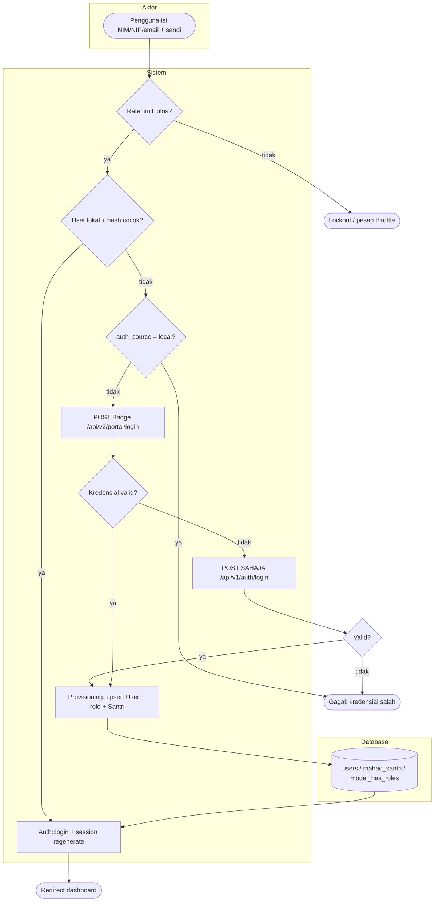

**B. Sinkron massal SAHAJA**

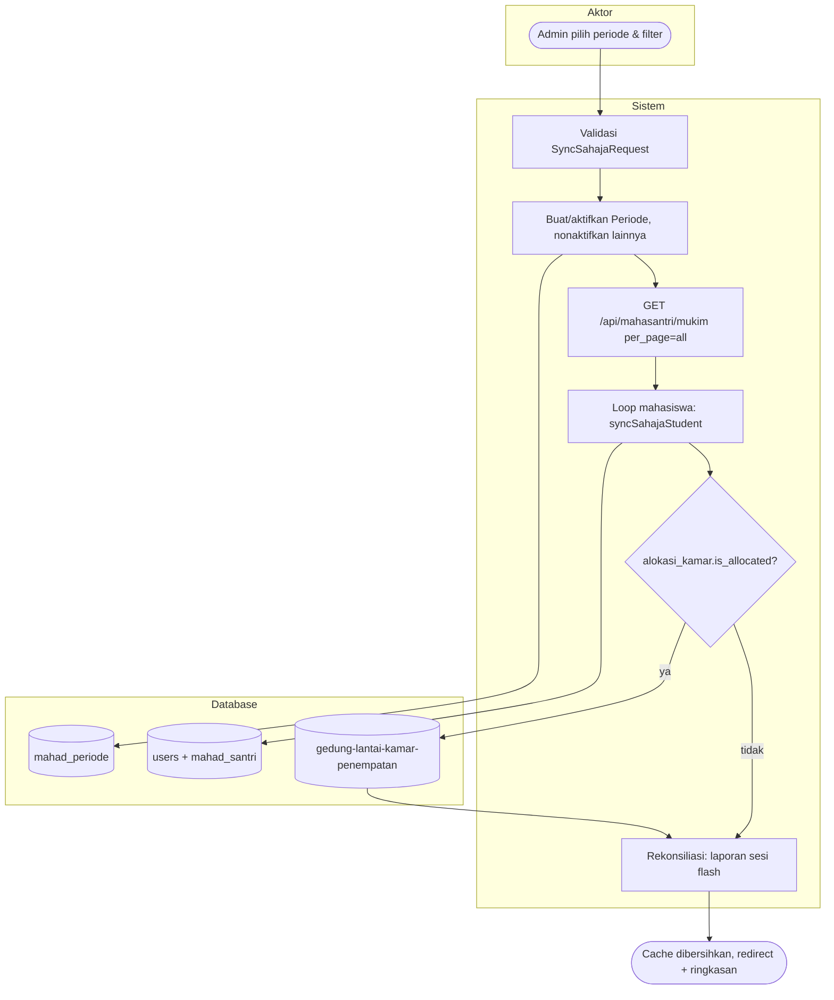

**C. Penempatan kamar (atomik)**

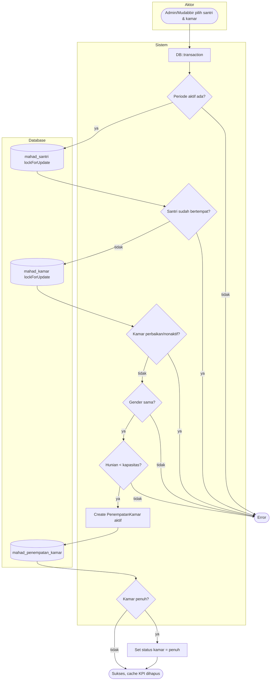

**D. Kelompok → penugasan tutor**

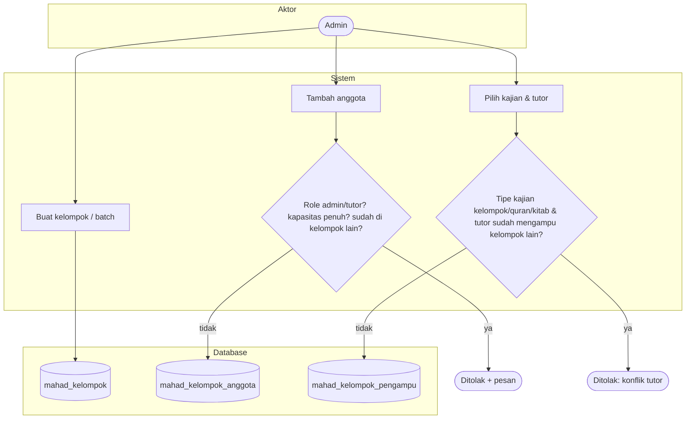

**E. Presensi → penilaian**

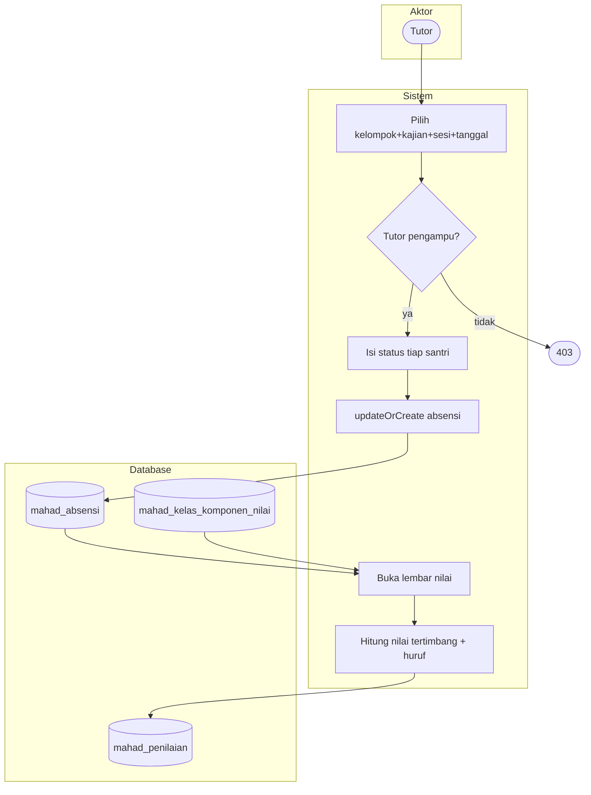

**F. Laporan bulanan & review**

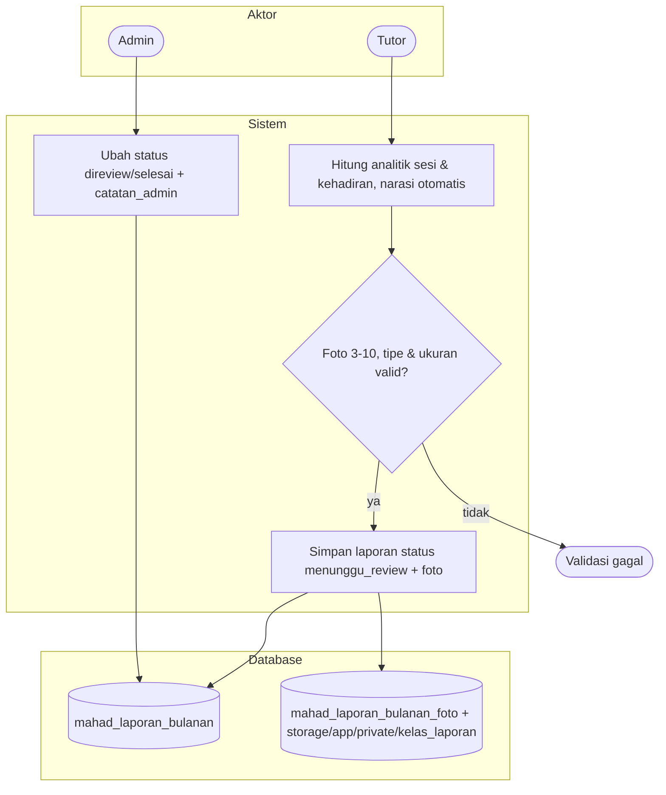

**G. Perizinan**

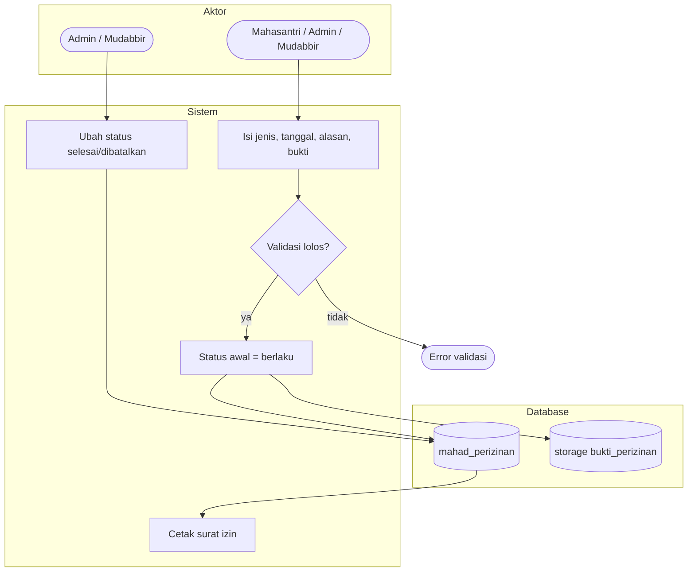

**H. Pelaporan & ekspor terpadu**

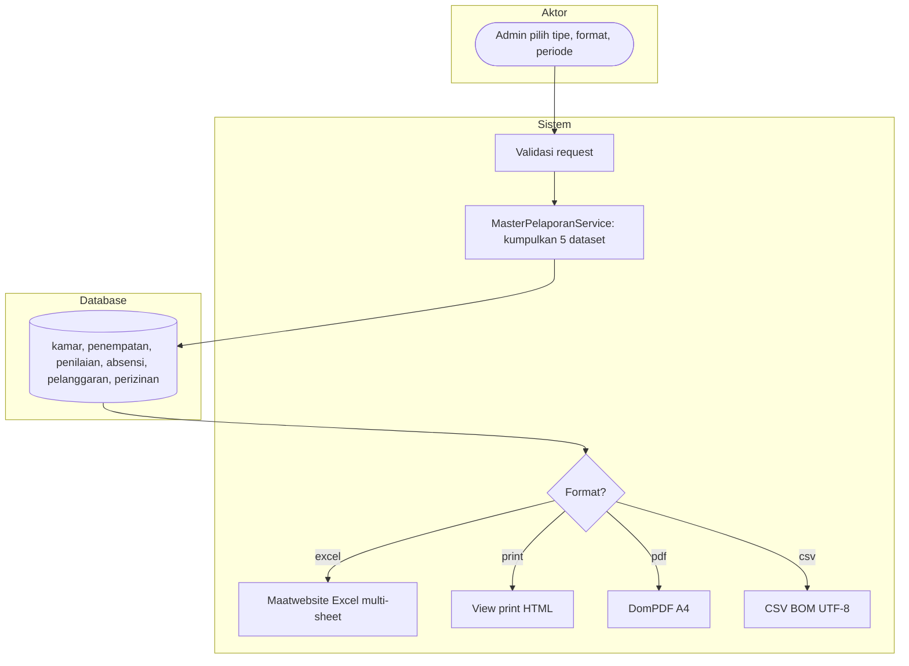

---

## 7. BEDAH ROUTING, ENDPOINT & ANTARMUKA (UI/UX)

### 7.1 Tabel Master Routing & Endpoint (100% route)

Total **145** route dari `routes/web.php` dan `routes/auth.php` (+ `/up` health dari `bootstrap/app.php`). Seluruh grup `Route::middleware(['auth'])` ditulis eksplisit pada kolom middleware; `web` selalu aktif beserta `SecurityHeaders`. Prefix URI dan nama route sudah digabung dari grup `prefix()/name()`. Route legacy tanpa nama (#119–#131) hanya mengalihkan/aliasing URL lama.

|  No | HTTP Method | URI Path                                                         | Route Name                                 | Controller @ Method                                       | Middleware / Guard                              | Deskripsi Fungsi                                                                        |
| --: | :---------- | :--------------------------------------------------------------- | :----------------------------------------- | :-------------------------------------------------------- | :---------------------------------------------- | :-------------------------------------------------------------------------------------- |
|   1 | GET         | `/`                                                            | `home`                                   | `Closure → view('welcome')`                            | `web`                                         | Landing page publik                                                                     |
|   2 | GET         | `/secure-file/{category}/{filename}`                           | `secure.file`                            | `SecureFileController@show`                             | `web`, `auth`                               | Menyajikan berkas privat (foto laporan, bukti izin) dengan pemeriksaan role/kepemilikan |
|   3 | GET         | `/profile`                                                     | `profile.edit`                           | `ProfileController@edit`                                | `web`, `auth`                               | Form profil pengguna                                                                    |
|   4 | PATCH       | `/profile`                                                     | `profile.update`                         | `ProfileController@update`                              | `web`, `auth`                               | Simpan profil (akun campus hanya no_hp)                                                 |
|   5 | DELETE      | `/profile`                                                     | `profile.destroy`                        | `ProfileController@destroy`                             | `web`, `auth`                               | Hapus akun sendiri (konfirmasi sandi)                                                   |
|   6 | GET         | `/dashboard`                                                   | `dashboard`                              | `DashboardController@index`                             | `web`, `auth`                               | Dashboard sesuai role pengguna                                                          |
|   7 | GET         | `/dashboard/admin/users`                                       | `users.index`                            | `UserController@index`                                  | `web`, `auth`, `role:admin`               | Daftar pengguna + filter + statistik role                                               |
|   8 | GET         | `/dashboard/admin/users/create`                                | `users.create`                           | `UserController@create`                                 | `web`, `auth`, `role:admin`               | Form tambah pengguna                                                                    |
|   9 | POST        | `/dashboard/admin/users`                                       | `users.store`                            | `UserController@store`                                  | `web`, `auth`, `role:admin`               | Buat pengguna (campus/lokal) + role + profil santri                                     |
|  10 | POST        | `/dashboard/admin/users/store-local`                           | `users.store.local`                      | `UserController@storeLocal`                             | `web`, `auth`, `role:admin`               | Buat pengguna lokal (password wajib)                                                    |
|  11 | GET         | `/dashboard/admin/users/campus-lookup`                         | `users.campus.lookup`                    | `UserCampusSyncController@lookupCampus`                 | `web`, `auth`, `role:admin`               | JSON: cari NIM/NIP di data kampus                                                       |
|  12 | POST        | `/dashboard/admin/users/assign-santri`                         | `users.assign.santri`                    | `UserCampusSyncController@assignCampusSantri`           | `web`, `auth`, `role:admin`               | Daftarkan mahasantri dari data kampus                                                   |
|  13 | POST        | `/dashboard/admin/users/assign-mudabbir`                       | `users.assign.mudabbir`                  | `UserCampusSyncController@assignCampusMudabbir`         | `web`, `auth`, `role:admin`               | Daftarkan mudabbir dari data kampus                                                     |
|  14 | POST        | `/dashboard/admin/users/assign-tutor`                          | `users.assign.tutor`                     | `UserCampusSyncController@assignCampusTutor`            | `web`, `auth`, `role:admin`               | Daftarkan tutor dari data kampus                                                        |
|  15 | POST        | `/dashboard/admin/users/sync-santri`                           | `users.sync.santri`                      | `UserCampusSyncController@syncAllMuqimMahasiswa`        | `web`, `auth`, `role:admin`               | Sinkron massal mahasantri mukim dari SAHAJA                                             |
|  16 | POST        | `/dashboard/admin/users/import`                                | `users.import`                           | `UserImportController@import`                           | `web`, `auth`, `role:admin`               | Impor pengguna dari Excel/CSV                                                           |
|  17 | GET         | `/dashboard/admin/users/import/template`                       | `users.import.template`                  | `UserImportController@downloadTemplate`                 | `web`, `auth`, `role:admin`               | Unduh template impor per role                                                           |
|  18 | PATCH       | `/dashboard/admin/users/{user}/toggle-status`                  | `users.toggle.status`                    | `UserController@toggleSantriStatus`                     | `web`, `auth`, `role:admin`               | Ubah status aktif/nonaktif santri                                                       |
|  19 | GET         | `/dashboard/admin/users/{user}/edit`                           | `users.edit`                             | `UserController@edit`                                   | `web`, `auth`, `role:admin`               | Form ubah pengguna                                                                      |
|  20 | GET         | `/dashboard/admin/users/{user}`                                | `users.show`                             | `UserController@show`                                   | `web`, `auth`, `role:admin`               | Detail pengguna                                                                         |
|  21 | PUT         | `/dashboard/admin/users/{user}`                                | `users.update`                           | `UserController@update`                                 | `web`, `auth`, `role:admin`               | Ubah pengguna & role                                                                    |
|  22 | DELETE      | `/dashboard/admin/users/{user}`                                | `users.destroy`                          | `UserController@destroy`                                | `web`, `auth`, `role:admin`               | Hapus pengguna (kecuali diri sendiri)                                                   |
|  23 | GET         | `/dashboard/admin/cache`                                       | `admin.cache.index`                      | `CacheManagementController@index`                       | `web`, `auth`, `role:admin`               | Halaman Sinkron & Optimasi Sistem                                                       |
|  24 | POST        | `/dashboard/admin/cache/clear`                                 | `admin.cache.clear`                      | `CacheManagementController@clear`                       | `web`, `auth`, `role:admin`               | Bersihkan cache (all/data/views/routes/config/prune/key)                                |
|  25 | POST        | `/dashboard/admin/cache/switch-periode`                        | `admin.cache.periode.switch`             | `CacheManagementController@switchPeriode`               | `web`, `auth`, `role:admin`               | Ganti periode aktif                                                                     |
|  26 | POST        | `/dashboard/admin/cache/sync-sahaja`                           | `admin.cache.sahaja.sync`                | `CacheManagementController@syncSahaja`                  | `web`, `auth`, `role:admin`               | Sinkron data SAHAJA per periode                                                         |
|  27 | POST        | `/dashboard/admin/cache/reset-database`                        | `admin.cache.reset.database`             | `DatabaseResetController@reset`                         | `web`, `auth`, `role:admin`               | Reset total database (sandi + teks RESET-DATABASE)                                      |
|  28 | GET         | `/dashboard/fasilitas/monitoring`                              | `fasilitas.monitoring.index`             | `MonitoringController@index`                            | `web`, `auth`, `role:admin                  | mudabbir                                                                                |
|  29 | GET         | `/dashboard/fasilitas/monitoring/room/{kamar}`                 | `fasilitas.monitoring.room`              | `MonitoringController@roomDetail`                       | `web`, `auth`, `role:admin                  | mudabbir                                                                                |
|  30 | GET         | `/dashboard/fasilitas/kelola`                                  | `fasilitas.kelola.index`                 | `KelolaController@index`                                | `web`, `auth`, `role:admin`               | Kelola Asrama (tab gedung/lantai/kamar)                                                 |
|  31 | POST        | `/dashboard/fasilitas/kelola/gedung`                           | `fasilitas.kelola.gedung.store`          | `GedungController@store`                                | `web`, `auth`, `role:admin`               | Tambah gedung + lantai + 24 kamar/lantai                                                |
|  32 | PUT         | `/dashboard/fasilitas/kelola/gedung/{gedung}`                  | `fasilitas.kelola.gedung.update`         | `GedungController@update`                               | `web`, `auth`, `role:admin`               | Ubah gedung                                                                             |
|  33 | DELETE      | `/dashboard/fasilitas/kelola/gedung/{gedung}`                  | `fasilitas.kelola.gedung.destroy`        | `GedungController@destroy`                              | `web`, `auth`, `role:admin`               | Hapus gedung beserta lantai, kamar, penempatan                                          |
|  34 | POST        | `/dashboard/fasilitas/kelola/lantai`                           | `fasilitas.kelola.lantai.store`          | `LantaiController@store`                                | `web`, `auth`, `role:admin`               | Tambah lantai + kamar otomatis                                                          |
|  35 | PUT         | `/dashboard/fasilitas/kelola/lantai/{lantai}`                  | `fasilitas.kelola.lantai.update`         | `LantaiController@update`                               | `web`, `auth`, `role:admin`               | Ubah lantai                                                                             |
|  36 | DELETE      | `/dashboard/fasilitas/kelola/lantai/{lantai}`                  | `fasilitas.kelola.lantai.destroy`        | `LantaiController@destroy`                              | `web`, `auth`, `role:admin`               | Hapus lantai                                                                            |
|  37 | POST        | `/dashboard/fasilitas/kelola/kamar`                            | `fasilitas.kelola.kamar.store`           | `KamarController@store`                                 | `web`, `auth`, `role:admin`               | Tambah kamar                                                                            |
|  38 | PUT         | `/dashboard/fasilitas/kelola/kamar/{kamar}`                    | `fasilitas.kelola.kamar.update`          | `KamarController@update`                                | `web`, `auth`, `role:admin`               | Ubah kamar                                                                              |
|  39 | DELETE      | `/dashboard/fasilitas/kelola/kamar/{kamar}`                    | `fasilitas.kelola.kamar.destroy`         | `KamarController@destroy`                               | `web`, `auth`, `role:admin`               | Hapus kamar                                                                             |
|  40 | POST        | `/dashboard/fasilitas/kelola/kamar-batch`                      | `fasilitas.kelola.kamar.batch`           | `KamarController@batch`                                 | `web`, `auth`, `role:admin`               | Generator kamar massal                                                                  |
|  41 | GET         | `/dashboard/fasilitas/penempatan`                              | `fasilitas.penempatan.index`             | `PenempatanController@index`                            | `web`, `auth`, `role:admin                  | mudabbir`                                                                               |
|  42 | GET         | `/dashboard/fasilitas/penempatan/available-rooms`              | `fasilitas.penempatan.available-rooms`   | `PenempatanController@getAvailableRooms`                | `web`, `auth`, `role:admin                  | mudabbir`                                                                               |
|  43 | GET         | `/dashboard/fasilitas/penempatan/unassigned-santri`            | `fasilitas.penempatan.unassigned-santri` | `PenempatanController@getUnassignedSantri`              | `web`, `auth`, `role:admin                  | mudabbir`                                                                               |
|  44 | POST        | `/dashboard/fasilitas/penempatan/assign`                       | `fasilitas.penempatan.assign`            | `PenempatanController@assign`                           | `web`, `auth`, `role:admin                  | mudabbir`                                                                               |
|  45 | POST        | `/dashboard/fasilitas/penempatan/assign-batch`                 | `fasilitas.penempatan.assign-batch`      | `PenempatanController@assignBatch`                      | `web`, `auth`, `role:admin                  | mudabbir`                                                                               |
|  46 | POST        | `/dashboard/fasilitas/penempatan/auto-assign`                  | `fasilitas.penempatan.auto-assign`       | `PenempatanController@autoAssign`                       | `web`, `auth`, `role:admin                  | mudabbir`                                                                               |
|  47 | POST        | `/dashboard/fasilitas/penempatan/{penempatan}/pindah`          | `fasilitas.penempatan.pindah`            | `PenempatanController@pindah`                           | `web`, `auth`, `role:admin                  | mudabbir`                                                                               |
|  48 | POST        | `/dashboard/fasilitas/penempatan/{penempatan}/keluar`          | `fasilitas.penempatan.keluar`            | `PenempatanController@keluar`                           | `web`, `auth`, `role:admin                  | mudabbir`                                                                               |
|  49 | GET         | `/dashboard/fasilitas/penempatan/{penempatan}/kartu`           | `fasilitas.penempatan.kartu`             | `PenempatanController@cetakKartu`                       | `web`, `auth`, `role:admin                  | mudabbir`                                                                               |
|  50 | GET         | `/dashboard/kelompok`                                          | `kelompok.index`                         | `KelompokController@index`                              | `web`, `auth`, `role:admin                  | tutor                                                                                   |
|  51 | POST        | `/dashboard/kelompok`                                          | `kelompok.store`                         | `KelompokController@store`                              | `web`, `auth`, `role:admin`               | Buat kelompok                                                                           |
|  52 | POST        | `/dashboard/kelompok/batch`                                    | `kelompok.batch`                         | `KelompokController@batch`                              | `web`, `auth`, `role:admin`               | Buat kelompok massal                                                                    |
|  53 | GET         | `/dashboard/kelompok/export/{format}`                          | `kelompok.export`                        | `KelompokController@export`                             | `web`, `auth`, `role:admin`               | Ekspor ringkasan kelompok (.xlsx)                                                       |
|  54 | GET         | `/dashboard/kelompok/import/template`                          | `kelompok.import.template`               | `KelompokAnggotaController@downloadTemplate`            | `web`, `auth`, `role:admin`               | Unduh template CSV anggota                                                              |
|  55 | GET         | `/dashboard/kelompok/{kelompok}`                               | `kelompok.show`                          | `KelompokController@show`                               | `web`, `auth`, `role:admin                  | tutor                                                                                   |
|  56 | PUT         | `/dashboard/kelompok/{kelompok}`                               | `kelompok.update`                        | `KelompokController@update`                             | `web`, `auth`, `role:admin`               | Ubah kelompok                                                                           |
|  57 | DELETE      | `/dashboard/kelompok/{kelompok}`                               | `kelompok.destroy`                       | `KelompokController@destroy`                            | `web`, `auth`, `role:admin`               | Hapus kelompok (kosong saja)                                                            |
|  58 | GET         | `/dashboard/kelompok/{kelompok}/kajian/{kelas}`                | `kelompok.kajian.show`                   | `KelompokKajianController@show`                         | `web`, `auth`, `role:admin                  | tutor                                                                                   |
|  59 | POST        | `/dashboard/kelompok/{kelompok}/kajian/{kelas}/assign-tutor`   | `kelompok.kajian.assign.tutor`           | `KelompokKajianController@assignTutor`                  | `web`, `auth`, `role:admin`               | Tugaskan tutor pada kajian-kelompok                                                     |
|  60 | DELETE      | `/dashboard/kelompok/{kelompok}/kajian/{kelas}/unassign-tutor` | `kelompok.kajian.unassign.tutor`         | `KelompokKajianController@unassignTutor`                | `web`, `auth`, `role:admin`               | Cabut penugasan tutor                                                                   |
|  61 | POST        | `/dashboard/kelompok/{kelompok}/assign-tutor`                  | `kelompok.assign.tutor`                  | `KelompokController@assignTutor`                        | `web`, `auth`, `role:admin`               | Tugaskan tutor (jalur lama dari halaman kelompok)                                       |
|  62 | GET         | `/dashboard/kelompok/{kelompok}/anggota/tambah`                | `kelompok.anggota.create`                | `KelompokAnggotaController@create`                      | `web`, `auth`, `role:admin`               | Form tambah anggota                                                                     |
|  63 | POST        | `/dashboard/kelompok/{kelompok}/anggota/bulk`                  | `kelompok.anggota.bulk`                  | `KelompokAnggotaController@storeBulk`                   | `web`, `auth`, `role:admin`               | Tambah anggota massal                                                                   |
|  64 | POST        | `/dashboard/kelompok/{kelompok}/anggota`                       | `kelompok.anggota.store`                 | `KelompokAnggotaController@store`                       | `web`, `auth`, `role:admin`               | Tambah anggota (id/NIM)                                                                 |
|  65 | POST        | `/dashboard/kelompok/{kelompok}/anggota/import`                | `kelompok.anggota.import`                | `KelompokAnggotaController@import`                      | `web`, `auth`, `role:admin`               | Impor anggota dari CSV                                                                  |
|  66 | POST        | `/dashboard/kelompok/{kelompok}/anggota/{santri}/pindah`       | `kelompok.anggota.pindah`                | `KelompokAnggotaController@pindah`                      | `web`, `auth`, `role:admin`               | Pindah anggota ke kelompok lain                                                         |
|  67 | DELETE      | `/dashboard/kelompok/{kelompok}/anggota/{santri}`              | `kelompok.anggota.destroy`               | `KelompokAnggotaController@destroy`                     | `web`, `auth`, `role:admin`               | Keluarkan anggota                                                                       |
|  68 | GET         | `/dashboard/kelas/santri`                                      | `kelas.santri.index`                     | `SantriKelasController@index`                           | `web`, `auth`, `role:mahasantri             | admin                                                                                   |
|  69 | GET         | `/dashboard/kelas/master`                                      | `kelas.master.index`                     | `MasterKelasController@index`                           | `web`, `auth`, `role:admin`               | Daftar kurikulum kajian                                                                 |
|  70 | GET         | `/dashboard/kelas/master/create`                               | `kelas.master.create`                    | `MasterKelasController@create`                          | `web`, `auth`, `role:admin`               | Form kajian baru                                                                        |
|  71 | POST        | `/dashboard/kelas/master`                                      | `kelas.master.store`                     | `MasterKelasController@store`                           | `web`, `auth`, `role:admin`               | Simpan kajian + sesi                                                                    |
|  72 | GET         | `/dashboard/kelas/master/{kelas}/edit`                         | `kelas.master.edit`                      | `MasterKelasController@edit`                            | `web`, `auth`, `role:admin`               | Form ubah kajian                                                                        |
|  73 | PUT         | `/dashboard/kelas/master/{kelas}`                              | `kelas.master.update`                    | `MasterKelasController@update`                          | `web`, `auth`, `role:admin`               | Ubah kajian + sinkron sesi                                                              |
|  74 | DELETE      | `/dashboard/kelas/master/{kelas}`                              | `kelas.master.destroy`                   | `MasterKelasController@destroy`                         | `web`, `auth`, `role:admin`               | Hapus kajian                                                                            |
|  75 | POST        | `/dashboard/kelas/master/{kelas}/jadwal`                       | `kelas.master.jadwal.store`              | `MasterKelasController@storeJadwal`                     | `web`, `auth`, `role:admin`               | Tambah sesi                                                                             |
|  76 | PUT         | `/dashboard/kelas/master/jadwal/{jadwal}`                      | `kelas.master.jadwal.update`             | `MasterKelasController@updateJadwal`                    | `web`, `auth`, `role:admin`               | Ubah sesi                                                                               |
|  77 | DELETE      | `/dashboard/kelas/master/jadwal/{jadwal}`                      | `kelas.master.jadwal.destroy`            | `MasterKelasController@destroyJadwal`                   | `web`, `auth`, `role:admin`               | Hapus sesi                                                                              |
|  78 | GET         | `/dashboard/kelas/absensi`                                     | `kelas.absensi.index`                    | `AbsensiController@index`                               | `web`, `auth`, `role:admin                  | tutor`                                                                                  |
|  79 | POST        | `/dashboard/kelas/absensi`                                     | `kelas.absensi.store`                    | `AbsensiController@store`                               | `web`, `auth`, `role:admin                  | tutor`                                                                                  |
|  80 | POST        | `/dashboard/kelas/absensi/copy`                                | `kelas.absensi.copy`                     | `AbsensiController@copyYesterday`                       | `web`, `auth`, `role:admin                  | tutor`                                                                                  |
|  81 | GET         | `/dashboard/kelas/absensi/rekap`                               | `kelas.absensi.rekap`                    | `AbsensiController@rekap`                               | `web`, `auth`, `role:admin                  | tutor`                                                                                  |
|  82 | GET         | `/dashboard/kelas/nilai`                                       | `kelas.nilai.index`                      | `KelolaKelasNilaiController@index`                      | `web`, `auth`, `role:admin                  | tutor`                                                                                  |
|  83 | GET         | `/dashboard/kelas/nilai/export/{format}`                       | `kelas.nilai.export`                     | `KelolaKelasNilaiController@export`                     | `web`, `auth`, `role:admin                  | tutor`                                                                                  |
|  84 | PUT         | `/dashboard/kelas/nilai/{penilaian}`                           | `kelas.nilai.update`                     | `KelolaKelasNilaiController@update`                     | `web`, `auth`, `role:admin                  | tutor`                                                                                  |
|  85 | POST        | `/dashboard/kelas/nilai/{kelompok}/{kelas}/bulk`               | `kelas.nilai.bulk`                       | `KelolaKelasNilaiController@bulkUpdate`                 | `web`, `auth`, `role:admin                  | tutor`                                                                                  |
|  86 | POST        | `/dashboard/kelas/nilai/komponen`                              | `kelas.nilai.komponen.store`             | `KelolaKelasNilaiController@storeKomponen`              | `web`, `auth`, `role:admin                  | tutor`                                                                                  |
|  87 | DELETE      | `/dashboard/kelas/nilai/komponen/{komponen}`                   | `kelas.nilai.komponen.destroy`           | `KelolaKelasNilaiController@destroyKomponen`            | `web`, `auth`, `role:admin                  | tutor`                                                                                  |
|  88 | GET         | `/dashboard/kelas/laporan`                                     | `kelas.laporan.index`                    | `KelolaLaporanController@index`                         | `web`, `auth`, `role:admin                  | tutor`                                                                                  |
|  89 | GET         | `/dashboard/kelas/laporan/kelas/{kelompok}/{kelas}`            | `kelas.laporan.kelas`                    | `KelolaLaporanController@showKelas`                     | `web`, `auth`, `role:admin                  | tutor`                                                                                  |
|  90 | GET         | `/dashboard/kelas/laporan/kelas/{kelompok}/{kelas}/create`     | `kelas.laporan.create`                   | `KelolaLaporanController@create`                        | `web`, `auth`, `role:admin                  | tutor`                                                                                  |
|  91 | POST        | `/dashboard/kelas/laporan`                                     | `kelas.laporan.store`                    | `KelolaLaporanController@store`                         | `web`, `auth`, `role:admin                  | tutor`                                                                                  |
|  92 | GET         | `/dashboard/kelas/laporan/{laporan}`                           | `kelas.laporan.show`                     | `KelolaLaporanController@show`                          | `web`, `auth`, `role:admin                  | tutor`                                                                                  |
|  93 | GET         | `/dashboard/kelas/laporan/{laporan}/edit`                      | `kelas.laporan.edit`                     | `KelolaLaporanController@edit`                          | `web`, `auth`, `role:admin                  | tutor`                                                                                  |
|  94 | PUT         | `/dashboard/kelas/laporan/{laporan}`                           | `kelas.laporan.update`                   | `KelolaLaporanController@update`                        | `web`, `auth`, `role:admin                  | tutor`                                                                                  |
|  95 | DELETE      | `/dashboard/kelas/laporan/{laporan}`                           | `kelas.laporan.destroy`                  | `KelolaLaporanController@destroy`                       | `web`, `auth`, `role:admin                  | tutor`                                                                                  |
|  96 | PATCH       | `/dashboard/kelas/laporan/{laporan}/status`                    | `kelas.laporan.status`                   | `KelolaLaporanController@updateStatus`                  | `web`, `auth`, `role:admin`               | Review: ubah status + catatan admin                                                     |
|  97 | GET         | `/dashboard/kegiatan`                                          | `kegiatan.index`                         | `KegiatanController@index`                              | `web`, `auth`                               | Agenda (kalender/daftar) gabungan kegiatan + jadwal kajian                              |
|  98 | POST        | `/dashboard/kegiatan`                                          | `kegiatan.store`                         | `KegiatanController@store`                              | `web`, `auth`, `role:admin                  | mudabbir`                                                                               |
|  99 | PUT         | `/dashboard/kegiatan/{kegiatan}`                               | `kegiatan.update`                        | `KegiatanController@update`                             | `web`, `auth`, `role:admin                  | mudabbir`                                                                               |
| 100 | DELETE      | `/dashboard/kegiatan/{kegiatan}`                               | `kegiatan.destroy`                       | `KegiatanController@destroy`                            | `web`, `auth`, `role:admin                  | mudabbir`                                                                               |
| 101 | PATCH       | `/dashboard/kegiatan/{kegiatan}/toggle`                        | `kegiatan.toggle`                        | `KegiatanController@toggleStatus`                       | `web`, `auth`, `role:admin                  | mudabbir`                                                                               |
| 102 | GET         | `/dashboard/kedisiplinan/perizinan`                            | `kedisiplinan.perizinan.index`           | `PerizinanController@index`                             | `web`, `auth`                               | Daftar perizinan (+tab pelanggaran bagi mahasantri)                                     |
| 103 | POST        | `/dashboard/kedisiplinan/perizinan`                            | `kedisiplinan.perizinan.store`           | `PerizinanController@store`                             | `web`, `auth`                               | Simpan perizinan + bukti                                                                |
| 104 | GET         | `/dashboard/kedisiplinan/perizinan/export`                     | `kedisiplinan.perizinan.export`          | `PerizinanController@export`                            | `web`, `auth`                               | Ekspor perizinan                                                                        |
| 105 | PATCH       | `/dashboard/kedisiplinan/perizinan/{perizinan}/status`         | `kedisiplinan.perizinan.status`          | `PerizinanController@updateStatus`                      | `web`, `auth`, `role:admin                  | mudabbir`                                                                               |
| 106 | DELETE      | `/dashboard/kedisiplinan/perizinan/{perizinan}`                | `kedisiplinan.perizinan.destroy`         | `PerizinanController@destroy`                           | `web`, `auth`                               | Hapus perizinan                                                                         |
| 107 | GET         | `/dashboard/kedisiplinan/perizinan/{perizinan}/cetak`          | `kedisiplinan.perizinan.cetak`           | `PerizinanController@cetak`                             | `web`, `auth`                               | Cetak surat izin                                                                        |
| 108 | GET         | `/dashboard/kedisiplinan/pelanggaran`                          | `kedisiplinan.pelanggaran.index`         | `PelanggaranController@index`                           | `web`, `auth`, `role:admin                  | mudabbir`                                                                               |
| 109 | POST        | `/dashboard/kedisiplinan/pelanggaran`                          | `kedisiplinan.pelanggaran.store`         | `PelanggaranController@store`                           | `web`, `auth`, `role:admin                  | mudabbir`                                                                               |
| 110 | GET         | `/dashboard/kedisiplinan/pelanggaran/export`                   | `kedisiplinan.pelanggaran.export`        | `PelanggaranController@export`                          | `web`, `auth`, `role:admin                  | mudabbir`                                                                               |
| 111 | PUT         | `/dashboard/kedisiplinan/pelanggaran/{pelanggaran}`            | `kedisiplinan.pelanggaran.update`        | `PelanggaranController@update`                          | `web`, `auth`, `role:admin                  | mudabbir`                                                                               |
| 112 | PATCH       | `/dashboard/kedisiplinan/pelanggaran/{pelanggaran}/status`     | `kedisiplinan.pelanggaran.status`        | `PelanggaranController@updateStatus`                    | `web`, `auth`, `role:admin                  | mudabbir`                                                                               |
| 113 | DELETE      | `/dashboard/kedisiplinan/pelanggaran/{pelanggaran}`            | `kedisiplinan.pelanggaran.destroy`       | `PelanggaranController@destroy`                         | `web`, `auth`, `role:admin                  | mudabbir`, `role:admin`                                                               |
| 114 | GET         | `/dashboard/tutor/kajian`                                      | `tutor.kajian.index`                     | `TutorKajianController@index`                           | `web`, `auth`, `role:admin                  | tutor`                                                                                  |
| 115 | GET         | `/dashboard/tutor/kajian/{kelompok}/{kelas}`                   | `tutor.kajian.show`                      | `TutorKajianController@show`                            | `web`, `auth`, `role:admin                  | tutor`                                                                                  |
| 116 | GET         | `/dashboard/tutor/kedisiplinan`                                | `tutor.kedisiplinan.index`               | `TutorKedisiplinanController@index`                     | `web`, `auth`, `role:admin                  | tutor`                                                                                  |
| 117 | GET         | `/dashboard/pelaporan`                                         | `pelaporan.index`                        | `PelaporanController@index`                             | `web`, `auth`, `role:admin`               | Pusat pelaporan                                                                         |
| 118 | GET         | `/dashboard/pelaporan/export`                                  | `pelaporan.export`                       | `PelaporanController@export`                            | `web`, `auth`, `role:admin`               | Ekspor/cetak laporan terpadu                                                            |
| 119 | GET         | `/admin/users`                                                 | —                                         | `Closure → redirect users.index`                       | `web`, `auth`                               | Alias legacy: redirect ke users.index                                                   |
| 120 | GET         | `/admin/cache`                                                 | —                                         | `CacheManagementController@index`                       | `web`, `auth`, `role:admin`               | Halaman Sinkron & Optimasi Sistem                                                       |
| 121 | POST        | `/admin/cache/clear`                                           | —                                         | `CacheManagementController@clear`                       | `web`, `auth`, `role:admin`               | Bersihkan cache (all/data/views/routes/config/prune/key)                                |
| 122 | POST        | `/admin/cache/switch-periode`                                  | —                                         | `CacheManagementController@switchPeriode`               | `web`, `auth`, `role:admin`               | Ganti periode aktif                                                                     |
| 123 | POST        | `/admin/cache/sync-sahaja`                                     | —                                         | `CacheManagementController@syncSahaja`                  | `web`, `auth`, `role:admin`               | Sinkron data SAHAJA per periode                                                         |
| 124 | POST        | `/admin/cache/reset-database`                                  | —                                         | `DatabaseResetController@reset`                         | `web`, `auth`, `role:admin`               | Reset total database (sandi + teks RESET-DATABASE)                                      |
| 125 | GET         | `/fasilitas/monitoring`                                        | —                                         | `Closure → redirect fasilitas.monitoring.index`        | `web`, `auth`                               | Alias legacy: redirect ke fasilitas.monitoring.index                                    |
| 126 | GET         | `/fasilitas/kelola`                                            | —                                         | `Closure → redirect fasilitas.kelola.index`            | `web`, `auth`                               | Alias legacy: redirect ke fasilitas.kelola.index                                        |
| 127 | GET         | `/fasilitas/penempatan`                                        | —                                         | `Closure → redirect fasilitas.penempatan.index`        | `web`, `auth`                               | Alias legacy: redirect ke fasilitas.penempatan.index                                    |
| 128 | GET         | `/kegiatan`                                                    | —                                         | `KegiatanController@index`                              | `web`, `auth`                               | Agenda (kalender/daftar) gabungan kegiatan + jadwal kajian                              |
| 129 | GET         | `/kedisiplinan/perizinan`                                      | —                                         | `Closure → redirect kedisiplinan.perizinan.index`      | `web`, `auth`                               | Alias legacy: redirect ke kedisiplinan.perizinan.index                                  |
| 130 | GET         | `/kedisiplinan/pelanggaran`                                    | —                                         | `Closure → redirect kedisiplinan.pelanggaran.index`    | `web`, `auth`                               | Alias legacy: redirect ke kedisiplinan.pelanggaran.index                                |
| 131 | GET         | `/pelaporan`                                                   | —                                         | `Closure → redirect pelaporan.index`                   | `web`, `auth`                               | Alias legacy: redirect ke pelaporan.index                                               |
| 132 | GET         | `/login`                                                       | `login`                                  | `AuthenticatedSessionController@create`                 | `web`, `guest`                              | Form login                                                                              |
| 133 | POST        | `/login`                                                       | —                                         | `AuthenticatedSessionController@store`                  | `web`, `guest`                              | Proses login hybrid                                                                     |
| 134 | GET         | `/forgot-password`                                             | `password.request`                       | `PasswordResetLinkController@create`                    | `web`, `guest`                              | Form lupa sandi                                                                         |
| 135 | POST        | `/forgot-password`                                             | `password.email`                         | `PasswordResetLinkController@store`                     | `web`, `guest`                              | Kirim tautan reset                                                                      |
| 136 | GET         | `/reset-password/{token}`                                      | `password.reset`                         | `NewPasswordController@create`                          | `web`, `guest`                              | Form sandi baru                                                                         |
| 137 | POST        | `/reset-password`                                              | `password.store`                         | `NewPasswordController@store`                           | `web`, `guest`                              | Simpan sandi baru                                                                       |
| 138 | GET         | `/verify-email`                                                | `verification.notice`                    | `EmailVerificationPromptController (invokable)`         | `web`, `auth`                               | Halaman pemberitahuan verifikasi                                                        |
| 139 | GET         | `/verify-email/{id}/{hash}`                                    | `verification.verify`                    | `VerifyEmailController (invokable)`                     | `web`, `auth`, `signed`, `throttle:6,1` | Verifikasi email (signed)                                                               |
| 140 | POST        | `/email/verification-notification`                             | `verification.send`                      | `EmailVerificationNotificationController@store`         | `web`, `auth`, `throttle:6,1`             | Kirim ulang verifikasi email                                                            |
| 141 | GET         | `/confirm-password`                                            | `password.confirm`                       | `ConfirmablePasswordController@show`                    | `web`, `auth`                               | Form konfirmasi sandi                                                                   |
| 142 | POST        | `/confirm-password`                                            | —                                         | `ConfirmablePasswordController@store`                   | `web`, `auth`                               | Proses konfirmasi sandi                                                                 |
| 143 | PUT         | `/password`                                                    | `password.update`                        | `PasswordController@update`                             | `web`, `auth`                               | Ubah sandi                                                                              |
| 144 | POST        | `/logout`                                                      | `logout`                                 | `AuthenticatedSessionController@destroy`                | `web`, `auth`                               | Logout                                                                                  |
| 145 | GET         | `/up`                                                          | —                                         | `Framework health endpoint (bootstrap/app.php health:)` | `web (framework)`                             | Health check Laravel                                                                    |

### 7.2 Anatomi Layout, Navigasi & Komponen UI

**Master layout (`resources/views/layouts/app.blade.php`, kelas `App\View\Components\AppLayout`):**

- `<head>`: meta viewport, inline script anti-FOUC tema (membaca `sahaja_theme` dan menetapkan kelas `dark` + `data-theme`), `@vite(['resources/css/app.css','resources/js/app.js'])`.
- Struktur: `components/sidebar` (desktop, sticky, lebar tetap) · `components/header` (judul halaman, toggle tema, menu profil/logout) · `<main>` berisi `{{ $slot }}` dan banner flash `session('success')`/`session('error')` · `components/bottom-nav` (mobile, fixed bottom).
- `layouts/partial.blade.php`: hanya `<main>` + `<title>`; dipilih bila header `X-SPA-Navigation: true`. `layouts/guest.blade.php`: layout login/reset (kartu terpusat, toggle tema).
- Aksesibilitas/responsif: kelas utilitas Tailwind breakpoints `sm/md/lg`; sidebar tersembunyi di mobile digantikan bottom-nav.

**Navigasi per role** (kondisi *active state* memakai `request()->routeIs()` atau closure khusus; setelah navigasi SPA diperbarui oleh `syncNavLinks()`):

| Role       | Sidebar                                                                                                                                                                                                                                                                                                                                                                                                                                                                                                                                    | Bottom navbar                                                                                                                           |
| :--------- | :----------------------------------------------------------------------------------------------------------------------------------------------------------------------------------------------------------------------------------------------------------------------------------------------------------------------------------------------------------------------------------------------------------------------------------------------------------------------------------------------------------------------------------------- | :-------------------------------------------------------------------------------------------------------------------------------------- |
| admin      | Ringkasan (`dashboard`) · Operasional (`kedisiplinan.perizinan.*`, `kedisiplinan.pelanggaran.*`, `kegiatan.*`) · Asrama (`fasilitas.monitoring.*`, `fasilitas.penempatan.*`, `fasilitas.kelola.*`) · Kelas Saya bersyarat (admin sebagai pengampu): `kelas.absensi.*`, `kelas.nilai.*?mode=saya`, `kelas.laporan.*?mode=saya` · Manajemen Kajian (`kelas.absensi.rekap`, `kelas.nilai.*`, `kelas.laporan.*`, `kelompok.*`, `kelas.master.*`) · Sistem (`pelaporan.*`, `users.*`, `admin.cache.*`) | `dashboard`, `fasilitas.monitoring.index`, `kelas.absensi.rekap`, `kedisiplinan.perizinan.index`, `profile.edit`              |
| mudabbir   | `dashboard`, `kegiatan.index` · `fasilitas.monitoring.index`, `kedisiplinan.perizinan.index`, `kedisiplinan.pelanggaran.index`                                                                                                                                                                                                                                                                                                                                                                                                  | `dashboard`, `fasilitas.monitoring.index`, `kedisiplinan.perizinan.index`, `kedisiplinan.pelanggaran.index`, `kegiatan.index` |
| tutor      | `dashboard`, `kegiatan.index` · `tutor.kajian.index` (Presensi Kelas), `kelas.nilai.index`, `kelas.laporan.index` · `tutor.kedisiplinan.index`                                                                                                                                                                                                                                                                                                                                                                               | `dashboard`, `tutor.kajian.index`, `kelas.laporan.index`, `tutor.kedisiplinan.index`, `kegiatan.index`                        |
| mahasantri | `dashboard`, `kegiatan.index` · `kedisiplinan.perizinan.index`, `kedisiplinan.perizinan.index?tab=pelanggaran`, `kelas.santri.index`                                                                                                                                                                                                                                                                                                                                                                                            | `dashboard`, `kelas.santri.index`, `kedisiplinan.perizinan.index`, `kegiatan.index`, `profile.edit`                           |

> Catatan: mudabbir memiliki hak route untuk Penempatan, Kelompok (baca) dan Monitoring, tetapi **Penempatan tidak ada di sidebar/bottom-nav mudabbir** (hanya dapat dibuka via URL).

**Komponen UI inti** (inventaris lengkap §7.5): `page-header`, `kpi-card`, `stat-card`, `search-input`, `modal`, `confirm-dialog`, `badge`, `status-badge`, `gender-badge`, `role-badge`, `empty-state`, `card`, `kamar-card`, `tab-switcher`, `table-container`, `room-detail-modal`, tombol & input Breeze (`primary-button`, `secondary-button`, `danger-button`, `text-input`, `input-label`, `input-error`, `auth-session-status`), `dashboard/*` (4 role), `fasilitas/*`, `kelompok/*`, `kelas/*`, `kedisiplinan/*`, `kegiatan/*`, `pelaporan/*`, `users/*`, `admin/cache/*`, `welcome/*`.

### 7.2.1 Ringkasan JavaScript & AJAX di Seluruh Aplikasi

Tidak ada library chart; grafik berupa bar CSS. Frontend: Alpine.js `x-data` inline pada hampir seluruh halaman (modal, tab, dropdown, filter). Seluruh pemanggilan `fetch` (7 titik): `components/room-detail-modal.blade.php` (→ `fasilitas.monitoring.room`), `users/create.blade.php` (→ `users.campus.lookup`), `components/fasilitas/penempatan/modal-assign.blade.php` & `modal-batch-assign.blade.php` & `modal-pindah.blade.php` (→ `available-rooms` / `unassigned-santri`), dan `fasilitas/penempatan/index.blade.php` (muat ulang daftar). Skrip inline `<script>` dipakai pada beberapa komponen (tercantum "blok `<script>`" di §7.3). Navigasi antarhalaman ditangani `spa-navigator.js` (§5.24).

### 7.3 Bedah Detail Setiap Halaman (View-by-View Breakdown)

> Tabel di bawah dihasilkan dengan memindai **seluruh** file `resources/views/**/*.blade.php` (172 file) dan menggabungkan elemen dari komponen/partial yang dipanggil secara rekursif (`<x-...>`, `@include`). Kolom tabel diambil dari tag `<th>`, field dari atribut `name=` pada `input/select/textarea`, route dari pemanggilan `route('...')`, dan AJAX dari `fetch(...)`. Kartu metrik dashboard dijelaskan di §7.4.

#### Direktori `resources/views/`

**`resources/views/dashboard.blade.php`** (98 baris)

- Dirender oleh: `app/Http/Controllers/DashboardController.php`
- Komponen/partial yang dipakai: `dashboard/mudabbir`, `dashboard/tutor`, `dashboard/mahasantri`, `dashboard/admin`, `kpi-card`, `search-input`
- Judul/label UI: Dashboard; Kapasitas Kamar; Mahasantri Mukim; Izin Keluar Aktif; Menunggu Pembinaan; Hapus pencarian; Presensi Terlaksana; Laporan Bulanan; Okupansi Asrama; Halaqah & Kelas; Kedisiplinan
- Field input: `{{ $name }}(text)`
- Route yang dipanggil: `fasilitas.monitoring.index`, `kedisiplinan.perizinan.index`, `kedisiplinan.pelanggaran.index`, `kegiatan.index`, `kelompok.show`, `kelas.absensi.index`, `kelas.laporan.index`, `tutor.kajian.index`, `kelas.nilai.index`, `tutor.kedisiplinan.index`, `kelas.santri.index`, `fasilitas.penempatan.index`, `kelompok.index`, `fasilitas.kelola.index`, `pelaporan.index`, `users.index`, `admin.cache.index`
- Frontend: Alpine.js (`x-data`)

**`resources/views/welcome.blade.php`** (48 baris)

- Dirender oleh: `routes/web.php`
- Komponen/partial yang dipakai: `welcome/navbar`, `welcome/hero`, `welcome/features`, `welcome/footer`
- Judul/label UI: currentTheme === 'dark' ? 'Mode Terang' : 'Mode Gelap'; Menu
- Route yang dipanggil: `home`, `dashboard`, `login`
- Frontend: Alpine.js (`x-data`) ; 1 blok `<script>`

#### Direktori `resources/views/admin/`

**`resources/views/admin/cache/index.blade.php`** (180 baris)

- Dirender oleh: `app/Http/Controllers/Admin/CacheManagementController.php`
- Komponen/partial yang dipakai: `page-header`, `admin/cache/partials/comparison-matrix`, `admin/cache/partials/danger-zone`
- Judul/label UI: Sinkron & Optimasi Sistem; Kelola Cache & Optimasi Sistem; Breadcrumb; Sinkronisasi Pangkalan Kampus
- Kolom tabel: Indikator Data | Pangkalan Asrama (Aplikasi) | Pangkalan Kampus (SAHAJA) | Status Keselarasan
- Field input: `type(hidden)`, `kode_periode(hidden)`, `admin_password(password)`, `confirmation(text)`
- Route yang dipanggil: `admin.cache.clear`, `admin.cache.sahaja.sync`, `dashboard`, `admin.cache.reset.database`
- Frontend: Alpine.js (`x-data`)

**`resources/views/admin/cache/partials/comparison-matrix.blade.php`** (213 baris)

- Dirender oleh: *tidak dirender langsung oleh controller (di-include / dipanggil via komponen / layout)*
- Judul/label UI: Sinkronisasi Pangkalan Kampus
- Kolom tabel: Indikator Data | Pangkalan Asrama (Aplikasi) | Pangkalan Kampus (SAHAJA) | Status Keselarasan
- Field input: `kode_periode(hidden)`
- Route yang dipanggil: `admin.cache.sahaja.sync`
- Frontend: Alpine.js (`x-data`)

**`resources/views/admin/cache/partials/danger-zone.blade.php`** (140 baris)

- Dirender oleh: *tidak dirender langsung oleh controller (di-include / dipanggil via komponen / layout)*
- Field input: `admin_password(password)`, `confirmation(text)`
- Route yang dipanggil: `admin.cache.reset.database`
- Frontend: Alpine.js (`x-data`)

**`resources/views/admin/cache/partials/keys-table.blade.php`** (92 baris)

- Dirender oleh: *tidak dirender langsung oleh controller (di-include / dipanggil via komponen / layout)*
- Komponen/partial yang dipakai: `badge`
- Kolom tabel: Nama Key | Deskripsi & Fungsi | TTL | Status Saat Ini | Aksi
- Field input: `type(hidden)`, `key(hidden)`
- Route yang dipanggil: `admin.cache.clear`
- Frontend: Alpine.js (`x-data`)

**`resources/views/admin/cache/partials/periode-manager.blade.php`** (67 baris)

- Dirender oleh: *tidak dirender langsung oleh controller (di-include / dipanggil via komponen / layout)*
- Field input: `periode_id(radio)`
- Route yang dipanggil: `admin.cache.periode.switch`
- Frontend: Alpine.js (`x-data`)

**`resources/views/admin/cache/partials/quick-actions.blade.php`** (69 baris)

- Dirender oleh: *tidak dirender langsung oleh controller (di-include / dipanggil via komponen / layout)*
- Field input: `type(hidden)`
- Route yang dipanggil: `admin.cache.clear`
- Frontend: Alpine.js (`x-data`)

**`resources/views/admin/cache/partials/sahaja-reconciliation.blade.php`** (190 baris)

- Dirender oleh: *tidak dirender langsung oleh controller (di-include / dipanggil via komponen / layout)*
- Field input: `periode_id(select)`, `kode_periode(hidden)`, `status_pembayaran(select)`, `gender(select)`
- Route yang dipanggil: `admin.cache.periode.switch`, `admin.cache.sahaja.sync`
- Frontend: Alpine.js (`x-data`)

**`resources/views/admin/cache/partials/sahaja-student-table.blade.php`** (216 baris)

- Dirender oleh: *tidak dirender langsung oleh controller (di-include / dipanggil via komponen / layout)*
- Komponen/partial yang dipakai: `search-input`
- Judul/label UI: Hapus pencarian
- Kolom tabel: Mahasantri | Program Studi | Kamar Asrama | Billing BRIVA | Status Sinkronisasi
- Field input: `{{ $name }}(text)`
- Frontend: Alpine.js (`x-data`)

**`resources/views/admin/cache/partials/stats-kpi.blade.php`** (54 baris)

- Dirender oleh: *tidak dirender langsung oleh controller (di-include / dipanggil via komponen / layout)*
- Komponen/partial yang dipakai: `kpi-card`
- Judul/label UI: Driver Cache; Ukuran Cache Data; Compiled Views; Driver Sesi
- Frontend: Alpine.js (`x-data`)

#### Direktori `resources/views/auth/`

**`resources/views/auth/confirm-password.blade.php`** (28 baris)

- Dirender oleh: `app/Http/Controllers/Auth/ConfirmablePasswordController.php`
- Komponen/partial yang dipakai: `input-label`, `text-input`, `input-error`, `primary-button`
- Route yang dipanggil: `password.confirm`
- Frontend: Alpine.js (`x-data`)

**`resources/views/auth/forgot-password.blade.php`** (26 baris)

- Dirender oleh: `app/Http/Controllers/Auth/PasswordResetLinkController.php`
- Komponen/partial yang dipakai: `auth-session-status`, `input-label`, `text-input`, `input-error`, `primary-button`
- Route yang dipanggil: `password.email`
- Frontend: Alpine.js (`x-data`)

**`resources/views/auth/login.blade.php`** (213 baris)

- Dirender oleh: `app/Http/Controllers/Auth/AuthenticatedSessionController.php`
- Komponen/partial yang dipakai: `auth/partials/login-demo-accounts`
- Judul/label UI: Masuk — SIMUKIM — Ma'had Al-Jami'ah; currentTheme === 'dark' ? 'Mode Terang' : 'Mode Gelap'; Lihat kata sandi
- Field input: `login_id(hidden)`, `username(text)`, `password(showPass ? 'text' : 'password')`
- Route yang dipanggil: `home`
- Frontend: Alpine.js (`x-data`)

**`resources/views/auth/partials/login-demo-accounts.blade.php`** (40 baris)

- Dirender oleh: *tidak dirender langsung oleh controller (di-include / dipanggil via komponen / layout)*
- Frontend: Alpine.js (`x-data`)

**`resources/views/auth/reset-password.blade.php`** (40 baris)

- Dirender oleh: `app/Http/Controllers/Auth/NewPasswordController.php`
- Komponen/partial yang dipakai: `input-label`, `text-input`, `input-error`, `primary-button`
- Field input: `token(hidden)`
- Route yang dipanggil: `password.store`, `token`
- Frontend: Alpine.js (`x-data`)

**`resources/views/auth/verify-email.blade.php`** (32 baris)

- Dirender oleh: `app/Http/Controllers/Auth/EmailVerificationPromptController.php`
- Komponen/partial yang dipakai: `primary-button`
- Route yang dipanggil: `verification.send`, `logout`
- Frontend: Alpine.js (`x-data`)

#### Direktori `resources/views/errors/`

**`resources/views/errors/403.blade.php`** (59 baris)

- Dirender oleh: *tidak dirender langsung oleh controller (di-include / dipanggil via komponen / layout)*
- Route yang dipanggil: `dashboard`, `logout`
- Frontend: Alpine.js (`x-data`)

**`resources/views/errors/419.blade.php`** (55 baris)

- Dirender oleh: *tidak dirender langsung oleh controller (di-include / dipanggil via komponen / layout)*
- Route yang dipanggil: `login`, `home`
- Frontend: Alpine.js (`x-data`)

#### Direktori `resources/views/fasilitas/`

**`resources/views/fasilitas/kelola/index.blade.php`** (84 baris)

- Dirender oleh: `app/Http/Controllers/Fasilitas/KelolaController.php`
- Komponen/partial yang dipakai: `page-header`, `tab-switcher`, `fasilitas/kelola/kamar-tab`, `fasilitas/kelola/lantai-tab`, `fasilitas/kelola/gedung-tab`, `fasilitas/kelola/modal-gedung`, `fasilitas/kelola/modal-lantai`, `fasilitas/kelola/modal-edit-lantai`, `fasilitas/kelola/modal-kamar`, `fasilitas/kelola/modal-batch`, `room-detail-modal`, `fasilitas/kelola/kamar-stats`, `fasilitas/kelola/kamar-filters`, `fasilitas/kelola/kamar-table-flat`, `fasilitas/kelola/kamar-grid-lantai`, `kpi-card`, `search-input`, `table-container`, `fasilitas/kelola/kamar-table-flat-desktop`, `fasilitas/kelola/kamar-table-flat-mobile`, `gender-badge`, `status-badge`, `badge`, `kamar-card`
- Judul/label UI: Kelola Asrama; Breadcrumb; Total Kamar; Kamar Tersedia; Terisi Penuh; Okupansi Bed; {{ $g->nama }}; Tampilan Grup Per Lantai; Tampilan Tabel Flat; Hapus pencarian; {{ $p->santri->user->name ?? 'Santri' }}; Lihat Detail & Penghuni; Edit Kamar; Hapus Unit Kamar; Hapus Kamar; {{ $penempatan->santri->user->name ?? 'Mahasantri' }}; Edit Lantai; Hapus Lantai; Hapus Unit Lantai; Edit Gedung; Hapus Gedung; Hapus Gedung Asrama; Edit Lantai {{ $lantai->nomor_lantai }}; Hapus Lantai {{ $lantai->nomor_lantai }}; Hapus Blok; Konfirmasi Batch Generator; Tutup Popup
- Kolom tabel: No. Kamar | Lokasi (Gedung & Lt) | Gender | Kapasitas | Penghuni Aktif | Tipe Ruang | Status | Aksi
- Field input: `tab(hidden)`, `view(hidden)`, `gedung_id(select)`, `lantai_id(select)`, `gender(select)`, `tipe_ruang(select)`, `status(select)`, `{{ $name }}(text)`, `_method(hidden)`, `kode(text)`, `nama(text)`, `gender_khusus(select)`, `jumlah_lantai(number)`, `gender_blocks(hidden)`, `is_active(select)`, `deskripsi(textarea)`, `gedung_id(hidden)`, `nomor_lantai(number)`, `jumlah_kamar(number)`, `kapasitas_maks(number)`, `kapasitas_kamar_standar(number)`, `nomor_kamar(text)`, `catatan(text)`, `prefix(text)`, `padding(select)`, `nomor_mulai(number)`, `nomor_selesai(number)`
- Route yang dipanggil: `fasilitas.kelola.index`, `dashboard`, `fasilitas.kelola.kamar.destroy`, `fasilitas.kelola.lantai.destroy`, `fasilitas.kelola.gedung.destroy`, `fasilitas.monitoring.index`, `fasilitas.kelola.gedung.store`, `fasilitas.kelola.lantai.store`, `fasilitas.kelola.kamar.store`, `fasilitas.kelola.kamar.batch`, `fasilitas.monitoring.room`, `fasilitas.penempatan.index`
- Frontend: Alpine.js (`x-data`) ; fetch → `targetUrl`

**`resources/views/fasilitas/monitoring/index.blade.php`** (65 baris)

- Dirender oleh: `app/Http/Controllers/Fasilitas/MonitoringController.php`
- Komponen/partial yang dipakai: `page-header`, `fasilitas/monitoring/stats`, `tab-switcher`, `fasilitas/monitoring/filters`, `fasilitas/monitoring/table`, `fasilitas/monitoring/grid`, `room-detail-modal`, `kpi-card`, `search-input`, `table-container`, `gender-badge`, `badge`, `empty-state`, `kamar-card`
- Judul/label UI: Monitoring Asrama; Breadcrumb; Total Kapasitas; Terisi (Okupansi); Bed Tersedia; Kamar Perbaikan; {{ $g->nama }}; Hapus pencarian; {{ $p->santri->user->name ?? 'Santri' }}; Lihat Detail Kamar & Penghuni; Tidak ada kamar ditemukan; {{ $penempatan->santri->user->name ?? 'Mahasantri' }}; Edit Kamar; Hapus Kamar; Hapus Unit Kamar; Tutup Popup
- Kolom tabel: No. Kamar | Lokasi | Gender | Kapasitas | Penghuni Aktif | Tipe Ruang | Status | Aksi
- Field input: `view(hidden)`, `gedung_id(select)`, `lantai_id(select)`, `gender(select)`, `tipe_ruang(select)`, `status(select)`, `{{ $name }}(text)`
- Route yang dipanggil: `fasilitas.penempatan.index`, `dashboard`, `fasilitas.monitoring.index`, `fasilitas.kelola.kamar.destroy`, `fasilitas.monitoring.room`
- Frontend: Alpine.js (`x-data`) ; fetch → `targetUrl`

**`resources/views/fasilitas/penempatan/index.blade.php`** (246 baris)

- Dirender oleh: `app/Http/Controllers/Fasilitas/PenempatanController.php`
- Komponen/partial yang dipakai: `page-header`, `fasilitas/penempatan/nav-tabs`, `tab-switcher`, `search-input`, `fasilitas/penempatan/table-unassigned`, `fasilitas/penempatan/table-kamar-available`, `fasilitas/penempatan/table-riwayat`, `fasilitas/penempatan/table-aktif`, `fasilitas/penempatan/modal-assign`, `fasilitas/penempatan/modal-batch-assign`, `fasilitas/penempatan/modal-pindah`, `table-container`, `role-badge`, `gender-badge`, `badge`, `status-badge`
- Judul/label UI: Penempatan Mahasantri; Penempatan Otomatis; Breadcrumb; Hapus pencarian; {{ $p->catatan }}; Cetak Kartu Tinggal; Pindah / Mutasi Kamar; Checkout / Keluar Asrama; Konfirmasi Checkout; Hapus; Konfirmasi Pindah Kamar
- Kolom tabel: No | Mahasantri | Gender | Aksi | Unit &amp; Lokasi Asrama | Zonasi Gender | Daya Tampung &amp; Kuota | Penghuni Terdaftar | Aksi Penempatan | Kamar | Periode Tinggal | Status | Tgl Masuk
- Field input: `tanggal_masuk(hidden)`, `{{ $name }}(text)`, `santri_id(hidden)`, `kamar_id(radio)`, `tanggal_masuk(date)`, `catatan(text)`, `kamar_id(select)`, `santri_ids[](checkbox)`, `kamar_baru_id(radio)`, `tanggal_pindah(date)`, `alasan(text)`
- Route yang dipanggil: `fasilitas.penempatan.auto-assign`, `fasilitas.monitoring.index`, `dashboard`, `fasilitas.penempatan.index`, `fasilitas.penempatan.kartu`, `fasilitas.penempatan.keluar`, `fasilitas.penempatan.available-rooms`, `fasilitas.penempatan.assign`, `fasilitas.penempatan.unassigned-santri`, `fasilitas.penempatan.assign-batch`
- Frontend: Alpine.js (`x-data`) ; fetch → `url.toString(`, `url`, `'{{ route('fasilitas.penempatan.unassigned-santri'`, `'{{ route('fasilitas.penempatan.available-rooms'`

**`resources/views/fasilitas/penempatan/kartu.blade.php`** (144 baris)

- Dirender oleh: `app/Http/Controllers/Fasilitas/PenempatanController.php`
- Route yang dipanggil: `fasilitas.penempatan.index`
- Frontend: Alpine.js (`x-data`)

#### Direktori `resources/views/kedisiplinan/`

**`resources/views/kedisiplinan/pelanggaran/index.blade.php`** (165 baris)

- Dirender oleh: `app/Http/Controllers/Kedisiplinan/PelanggaranController.php`
- Komponen/partial yang dipakai: `page-header`, `stat-card`, `kedisiplinan/top-violators-card`, `search-input`, `tab-switcher`, `kedisiplinan/pelanggaran-table`, `kedisiplinan/pelanggaran-modal`, `kedisiplinan/pelanggaran-detail-modal`, `kedisiplinan/pelanggaran-edit-modal`, `kedisiplinan/export-dialog`, `table-container`, `empty-state`
- Judul/label UI: Kedisiplinan & Pelanggaran; Total Kasus; Kasus Bulan Ini; Belum Dilaksanakan; Selesai Dilaksanakan; Ekspor Data Kedisiplinan; Breadcrumb; Hapus pencarian; {{ $pel->hukuman ?: $pel->deskripsi }}; Lihat Detail Kasus; Edit Catatan Pelanggaran; Tandai Selesai Dibina; Hapus Kasus Pelanggaran; Hapus Catatan Pelanggaran; Tidak Ada Data Pelanggaran; Catat Kasus Pertama
- Kolom tabel: No | Mahasantri | Tanggal | Tingkat Pelanggaran | Sanksi / Tindakan | Status | Aksi
- Field input: `status(hidden)`, `jenis_id(select)`, `{{ $name }}(text)`, `poin(hidden)`, `santri_id(hidden)`, `jenis_pelanggaran_id(select)`, `tanggal(date)`, `hukuman(text)`, `status(radio)`, `deskripsi(textarea)`, `status(select)`, `scope(radio)`, `bulan(month)`
- Route yang dipanggil: `kedisiplinan.pelanggaran.index`, `kedisiplinan.pelanggaran.export`, `dashboard`, `kedisiplinan.pelanggaran.status`, `kedisiplinan.pelanggaran.destroy`, `kedisiplinan.pelanggaran.store`
- Kondisi role di view: `'admin'`
- Frontend: Alpine.js (`x-data`)

**`resources/views/kedisiplinan/perizinan/cetak.blade.php`** (156 baris)

- Dirender oleh: `app/Http/Controllers/Kedisiplinan/PerizinanController.php`
- Frontend: Alpine.js (`x-data`)

**`resources/views/kedisiplinan/perizinan/index.blade.php`** (166 baris)

- Dirender oleh: `app/Http/Controllers/Kedisiplinan/PerizinanController.php`
- Komponen/partial yang dipakai: `page-header`, `stat-card`, `search-input`, `tab-switcher`, `kedisiplinan/perizinan-table`, `table-container`, `kedisiplinan/perizinan-modal`, `kedisiplinan/perizinan-detail-modal`, `kedisiplinan/export-dialog`, `empty-state`
- Judul/label UI: Perizinan & Kedisiplinan; Total Pengajuan; Sedang Berlaku; Telah Kembali; Dibatalkan; Ekspor Data Perizinan Santri; Breadcrumb; Hapus pencarian; Lihat Detail Izin; Cetak Surat Izin; Tandai Santri Telah Kembali; Hapus Data Perizinan; Hapus Data Izin; Tidak Ada Data Perizinan; Ajukan Izin Pertama
- Kolom tabel: Tanggal | Pelanggaran | Kronologi | Sanksi / Pembinaan | Status | No | Mahasantri | Kamar | Kategori | Jadwal &amp; Durasi | Aksi
- Field input: `status(hidden)`, `jenis_id(select)`, `{{ $name }}(text)`, `santri_id(hidden)`, `jenis_perizinan_id(select)`, `tanggal_mulai(date)`, `tanggal_selesai(date)`, `alasan(textarea)`, `scope(radio)`, `bulan(month)`
- Route yang dipanggil: `kedisiplinan.perizinan.index`, `kedisiplinan.perizinan.export`, `dashboard`, `kedisiplinan.perizinan.cetak`, `kedisiplinan.perizinan.status`, `kedisiplinan.perizinan.destroy`, `kedisiplinan.perizinan.store`
- Kondisi role di view: `'admin'`
- Frontend: Alpine.js (`x-data`)

#### Direktori `resources/views/kegiatan/`

**`resources/views/kegiatan/index.blade.php`** (105 baris)

- Dirender oleh: `app/Http/Controllers/Kegiatan/KegiatanController.php`
- Komponen/partial yang dipakai: `page-header`, `tab-switcher`, `kegiatan/calendar`, `search-input`, `kegiatan/modal-create`, `kegiatan/table`, `kegiatan/calendar-header`, `kegiatan/calendar-agenda`, `kegiatan/partials/day-tabs`, `kegiatan/partials/khusus-feed`
- Judul/label UI: Agenda & Jadwal Terpadu; Breadcrumb; Klik tanggal {{ $day }} untuk melihat agenda; [Rutin] {{ $ev->nama }} ({{ $jamStr }}); [Khusus] {{ $ev->nama }} ({{ $jamStr }}); Bulan Sebelumnya; Bulan Berikutnya; Hapus pencarian; Toggle Status; Hapus Kegiatan Rutin; Hapus; Hapus Kegiatan Khusus
- Field input: `view(hidden)`, `jenis(select)`, `{{ $name }}(text)`, `nama(text)`, `jenis(radio)`, `hari(select)`, `tanggal_mulai(date)`, `tanggal_selesai(date)`, `jam_mulai(time)`, `jam_selesai(time)`, `lokasi(text)`, `deskripsi(textarea)`
- Route yang dipanggil: `kegiatan.index`, `dashboard`, `kegiatan.store`, `kelas.master.index`, `kegiatan.toggle`, `kegiatan.destroy`
- Kondisi role di view: `'admin'`
- Frontend: Alpine.js (`x-data`)

**`resources/views/kegiatan/partials/day-tabs.blade.php`** (44 baris)

- Dirender oleh: *tidak dirender langsung oleh controller (di-include / dipanggil via komponen / layout)*
- Frontend: Alpine.js (`x-data`)

**`resources/views/kegiatan/partials/khusus-feed.blade.php`** (80 baris)

- Dirender oleh: *tidak dirender langsung oleh controller (di-include / dipanggil via komponen / layout)*
- Judul/label UI: Hapus Kegiatan Khusus; Hapus
- Route yang dipanggil: `kegiatan.destroy`
- Kondisi role di view: `'admin'`
- Frontend: Alpine.js (`x-data`)

**`resources/views/kegiatan/table.blade.php`** (202 baris)

- Dirender oleh: *tidak dirender langsung oleh controller (di-include / dipanggil via komponen / layout)*
- Komponen/partial yang dipakai: `kegiatan/partials/day-tabs`, `kegiatan/partials/khusus-feed`
- Judul/label UI: Toggle Status; Hapus Kegiatan Rutin; Hapus; Hapus Kegiatan Khusus
- Route yang dipanggil: `kelas.master.index`, `kegiatan.toggle`, `kegiatan.destroy`
- Kondisi role di view: `'admin'`
- Frontend: Alpine.js (`x-data`)

#### Direktori `resources/views/kelas/`

**`resources/views/kelas/absensi/index.blade.php`** (241 baris)

- Dirender oleh: `app/Http/Controllers/Kelas/AbsensiController.php`
- Komponen/partial yang dipakai: `page-header`, `table-container`, `kelas/absensi/partials/kajian-list`
- Judul/label UI: Presensi Kajian Santri; Presensi Harian Mahasantri; {{ $selectedKelas->nama }}; Breadcrumb
- Kolom tabel: No | Mahasantri | Kamar | Status Kehadiran | Status | Tanggal | Sesi Pertemuan | Hadir | Izin | Sakit | Alfa | Total | Aksi
- Field input: `kelompok_id(hidden)`, `kelas_id(hidden)`, `jadwal_id(hidden)`, `tanggal(hidden)`, `catatan_sesi(text)`, `items[{{ $idx }}][santri_id](hidden)`, `items[{{ $idx }}][status](radio)`, `items[{{ $idx }}][status](select)`
- Route yang dipanggil: `kelas.absensi.index`, `kelas.absensi.rekap`, `kelas.absensi.store`, `dashboard`
- Frontend: Alpine.js (`x-data`)

**`resources/views/kelas/absensi/partials/kajian-list.blade.php`** (56 baris)

- Dirender oleh: *tidak dirender langsung oleh controller (di-include / dipanggil via komponen / layout)*
- Route yang dipanggil: `kelas.absensi.index`, `kelas.absensi.rekap`
- Frontend: Alpine.js (`x-data`)

**`resources/views/kelas/absensi/rekap.blade.php`** (157 baris)

- Dirender oleh: `app/Http/Controllers/Kelas/AbsensiController.php`
- Komponen/partial yang dipakai: `page-header`, `table-container`
- Judul/label UI: Rekap Kehadiran Bulanan; Breadcrumb
- Kolom tabel: No | Mahasantri | Total Pertemuan | Hadir | Izin | Sakit | Alfa | Telat | % Kehadiran | H/I/S/A | %
- Field input: `kelompok_id(select)`, `kelas_id(select)`, `bulan(select)`
- Route yang dipanggil: `kelas.absensi.index`, `kelas.absensi.rekap`, `dashboard`
- Frontend: Alpine.js (`x-data`)

**`resources/views/kelas/laporan/create.blade.php`** (218 baris)

- Dirender oleh: `app/Http/Controllers/Kelas/KelolaLaporanController.php`
- Komponen/partial yang dipakai: `page-header`
- Judul/label UI: Buat Laporan Bulanan — {{ $kelas->nama }}; Kirim Laporan Bulanan; item.name; Breadcrumb
- Field input: `kelompok_id(hidden)`, `kelas_id(hidden)`, `foto[](file)`, `bulan(select)`, `catatan(textarea)`
- Route yang dipanggil: `tutor.kajian.index`, `kelas.laporan.index`, `kelas.laporan.kelas`, `kelas.laporan.store`, `dashboard`
- Frontend: Alpine.js (`x-data`)

**`resources/views/kelas/laporan/edit.blade.php`** (182 baris)

- Dirender oleh: `app/Http/Controllers/Kelas/KelolaLaporanController.php`
- Komponen/partial yang dipakai: `page-header`
- Judul/label UI: Edit Laporan Bulanan — {{ $kelas->nama }}; Edit Laporan Bulanan; Breadcrumb
- Field input: `kelompok_id(hidden)`, `kelas_id(hidden)`, `bulan(hidden)`, `tahun(hidden)`, `foto[](file)`, `catatan(textarea)`
- Route yang dipanggil: `tutor.kajian.index`, `kelas.laporan.index`, `kelas.laporan.kelas`, `kelas.laporan.update`, `secure.file`, `dashboard`
- Frontend: Alpine.js (`x-data`)

**`resources/views/kelas/laporan/index.blade.php`** (201 baris)

- Dirender oleh: `app/Http/Controllers/Kelas/KelolaLaporanController.php`
- Komponen/partial yang dipakai: `page-header`, `table-container`, `badge`, `kpi-card`
- Judul/label UI: Laporan Bulanan Kegiatan Kajian; Laporan Bulanan Tutor; Total Laporan; Menunggu Review; Sedang Direview; Selesai Diverifikasi; Breadcrumb
- Kolom tabel: Kelompok Halaqah | Mata Kajian | Jadwal Sesi | Status Bulan Ini (…) | Total Terkirim | Aksi | Tutor | Kelompok | Kajian | Bulan / Tahun | Status
- Field input: `status(select)`, `bulan(select)`
- Route yang dipanggil: `tutor.kajian.index`, `kelas.laporan.kelas`, `kelas.laporan.index`, `kelas.laporan.show`, `dashboard`
- Kondisi role di view: `'tutor'`, `'admin'`
- Frontend: Alpine.js (`x-data`)

**`resources/views/kelas/laporan/kelas.blade.php`** (162 baris)

- Dirender oleh: `app/Http/Controllers/Kelas/KelolaLaporanController.php`
- Komponen/partial yang dipakai: `page-header`, `badge`
- Judul/label UI: Laporan Bulanan — {{ $kelas->nama }}; {{ $kelas->nama }}; Hapus Laporan Bulanan; Breadcrumb
- Route yang dipanggil: `tutor.kajian.index`, `kelas.laporan.index`, `kelas.laporan.create`, `secure.file`, `kelas.laporan.show`, `kelas.laporan.edit`, `kelas.laporan.destroy`, `dashboard`
- Frontend: Alpine.js (`x-data`)

**`resources/views/kelas/laporan/show.blade.php`** (153 baris)

- Dirender oleh: `app/Http/Controllers/Kelas/KelolaLaporanController.php`
- Komponen/partial yang dipakai: `page-header`, `card`, `badge`, `input-label`
- Judul/label UI: 'Laporan: ' . $laporan->nama_bulan . ' ' . $laporan->tahun; Breadcrumb
- Field input: `status(hidden)`, `catatan_admin(textarea)`
- Route yang dipanggil: `kelas.laporan.index`, `secure.file`, `kelas.laporan.status`, `dashboard`
- Kondisi role di view: `'admin'`
- Frontend: Alpine.js (`x-data`)

**`resources/views/kelas/master/create.blade.php`** (97 baris)

- Dirender oleh: `app/Http/Controllers/Kelas/MasterKelasController.php`
- Komponen/partial yang dipakai: `page-header`, `kelas/master/partials/form-kajian-info`, `kelas/master/partials/form-kajian-sesi`
- Judul/label UI: Tambah Kajian Baru; Breadcrumb
- Field input: `nama(text)`, `tipe(select)`, `siklus(select)`, `jumlah_pertemuan(number)`, `deskripsi(textarea)`, `'sesi['+idx+'][nama_sesi]'(text)`, `'sesi['+idx+'][hari]'(select)`, `'sesi['+idx+'][jam_mulai]'(time)`, `'sesi['+idx+'][jam_selesai]'(time)`, `'sesi['+idx+'][ruangan]'(text)`
- Route yang dipanggil: `kelas.master.index`, `kelas.master.store`, `dashboard`
- Frontend: Alpine.js (`x-data`)

**`resources/views/kelas/master/edit.blade.php`** (87 baris)

- Dirender oleh: `app/Http/Controllers/Kelas/MasterKelasController.php`
- Komponen/partial yang dipakai: `page-header`, `kelas/master/partials/form-kajian-edit-info`, `kelas/master/partials/form-kajian-edit-sesi`
- Judul/label UI: Edit Kajian: {{ $kelas->nama }}; Breadcrumb
- Field input: `is_active(checkbox)`, `nama(text)`, `tipe(select)`, `deskripsi(textarea)`, `'sesi['+idx+'][id]'(hidden)`, `'sesi['+idx+'][nama_sesi]'(text)`, `'sesi['+idx+'][hari]'(select)`, `'sesi['+idx+'][jam_mulai]'(time)`, `'sesi['+idx+'][jam_selesai]'(time)`, `'sesi['+idx+'][ruangan]'(text)`
- Route yang dipanggil: `kelas.master.index`, `kelas.master.update`, `dashboard`
- Frontend: Alpine.js (`x-data`)

**`resources/views/kelas/master/index.blade.php`** (121 baris)

- Dirender oleh: `app/Http/Controllers/Kelas/MasterKelasController.php`
- Komponen/partial yang dipakai: `page-header`, `kelas/master/partials/modals-kelasList`, `modal`
- Judul/label UI: Master Kajian; Hapus sesi; Breadcrumb
- Field input: `nama_sesi(text)`, `hari(select)`, `jam_mulai(time)`, `jam_selesai(time)`, `ruangan(text)`
- Route yang dipanggil: `kelas.master.create`, `kelas.master.jadwal.destroy`, `kelas.master.destroy`, `kelas.master.edit`, `dashboard`, `kelas.master.jadwal.store`
- Frontend: Alpine.js (`x-data`)

**`resources/views/kelas/master/partials/form-kajian-edit-info.blade.php`** (65 baris)

- Dirender oleh: *tidak dirender langsung oleh controller (di-include / dipanggil via komponen / layout)*
- Field input: `is_active(checkbox)`, `nama(text)`, `tipe(select)`, `deskripsi(textarea)`
- Frontend: Alpine.js (`x-data`)

**`resources/views/kelas/master/partials/form-kajian-edit-sesi.blade.php`** (121 baris)

- Dirender oleh: *tidak dirender langsung oleh controller (di-include / dipanggil via komponen / layout)*
- Field input: `'sesi['+idx+'][id]'(hidden)`, `'sesi['+idx+'][nama_sesi]'(text)`, `'sesi['+idx+'][hari]'(select)`, `'sesi['+idx+'][jam_mulai]'(time)`, `'sesi['+idx+'][jam_selesai]'(time)`, `'sesi['+idx+'][ruangan]'(text)`
- Frontend: Alpine.js (`x-data`)

**`resources/views/kelas/master/partials/form-kajian-info.blade.php`** (77 baris)

- Dirender oleh: *tidak dirender langsung oleh controller (di-include / dipanggil via komponen / layout)*
- Field input: `nama(text)`, `tipe(select)`, `siklus(select)`, `jumlah_pertemuan(number)`, `deskripsi(textarea)`
- Frontend: Alpine.js (`x-data`)

**`resources/views/kelas/master/partials/form-kajian-sesi.blade.php`** (104 baris)

- Dirender oleh: *tidak dirender langsung oleh controller (di-include / dipanggil via komponen / layout)*
- Field input: `'sesi['+idx+'][nama_sesi]'(text)`, `'sesi['+idx+'][hari]'(select)`, `'sesi['+idx+'][jam_mulai]'(time)`, `'sesi['+idx+'][jam_selesai]'(time)`, `'sesi['+idx+'][ruangan]'(text)`
- Frontend: Alpine.js (`x-data`)

**`resources/views/kelas/master/partials/modals-kelasList.blade.php`** (53 baris)

- Dirender oleh: *tidak dirender langsung oleh controller (di-include / dipanggil via komponen / layout)*
- Komponen/partial yang dipakai: `modal`
- Field input: `nama_sesi(text)`, `hari(select)`, `jam_mulai(time)`, `jam_selesai(time)`, `ruangan(text)`
- Route yang dipanggil: `kelas.master.jadwal.store`
- Frontend: Alpine.js (`x-data`)

**`resources/views/kelas/nilai/export-excel.blade.php`** (33 baris)

- Dirender oleh: `app/Services/PenilaianService.php`
- Kolom tabel: No | Nama | NIM | Kelas | Tipe | Nilai Angka | Nilai Huruf | Catatan | Diinput Oleh
- Frontend: Alpine.js (`x-data`)

**`resources/views/kelas/nilai/export-pdf.blade.php`** (65 baris)

- Dirender oleh: *tidak dirender langsung oleh controller (di-include / dipanggil via komponen / layout)*
- Kolom tabel: # | Nama | NIM | Kelas | Tipe | Nilai Angka | Nilai Huruf | Catatan
- Frontend: Alpine.js (`x-data`)

**`resources/views/kelas/nilai/index.blade.php`** (182 baris)

- Dirender oleh: `app/Http/Controllers/Kelas/KelolaKelasNilaiController.php`
- Komponen/partial yang dipakai: `page-header`, `table-container`, `kelas/nilai/partials/kelas-list`, `kelas/nilai/komponen-modal`, `kelas/nilai/partials/table-kelompok`, `kelas/nilai/partials/table-santri`, `modal`
- Judul/label UI: Penilaian Akademik Kajian; {{ $selectedKelas->nama }}; Kehadiran: {{ $autoAbs }}%; Breadcrumb; Hapus Komponen Penilaian; Hapus Komponen
- Kolom tabel: No | Mahasantri | … (…%) | Nilai Akhir | Predikat | Catatan Pembina | Kelompok Halaqah | Mata Kajian | Jadwal Sesi Mengajar | Santri Terdaftar | Status Rekap Nilai | Aksi | Nilai Per Mata Kajian | Rata-rata Nilai | Status Penilaian
- Field input: `kelas_id(hidden)`, `kelompok_id(hidden)`, `nama(text)`, `bobot(number)`
- Route yang dipanggil: `kelas.nilai.index`, `kelas.nilai.export`, `kelas.nilai.bulk`, `dashboard`, `kelas.nilai.komponen.destroy`, `kelas.nilai.komponen.store`
- Frontend: Alpine.js (`x-data`)

**`resources/views/kelas/nilai/komponen-modal.blade.php`** (65 baris)

- Dirender oleh: *tidak dirender langsung oleh controller (di-include / dipanggil via komponen / layout)*
- Komponen/partial yang dipakai: `modal`
- Judul/label UI: Hapus Komponen Penilaian; Hapus Komponen
- Field input: `kelas_id(hidden)`, `kelompok_id(hidden)`, `nama(text)`, `bobot(number)`
- Route yang dipanggil: `kelas.nilai.komponen.destroy`, `kelas.nilai.komponen.store`
- Frontend: Alpine.js (`x-data`)

**`resources/views/kelas/nilai/partials/kelas-list.blade.php`** (106 baris)

- Dirender oleh: *tidak dirender langsung oleh controller (di-include / dipanggil via komponen / layout)*
- Komponen/partial yang dipakai: `page-header`, `kelas/nilai/partials/table-kelompok`, `kelas/nilai/partials/table-santri`, `table-container`
- Judul/label UI: Breadcrumb
- Kolom tabel: Kelompok Halaqah | Mata Kajian | Jadwal Sesi Mengajar | Santri Terdaftar | Status Rekap Nilai | Aksi | No | Mahasantri | Nilai Per Mata Kajian | Rata-rata Nilai | Status Penilaian
- Route yang dipanggil: `dashboard`, `kelas.nilai.index`
- Frontend: Alpine.js (`x-data`)

**`resources/views/kelas/nilai/partials/table-kelompok.blade.php`** (88 baris)

- Dirender oleh: *tidak dirender langsung oleh controller (di-include / dipanggil via komponen / layout)*
- Komponen/partial yang dipakai: `table-container`
- Kolom tabel: Kelompok Halaqah | Mata Kajian | Jadwal Sesi Mengajar | Santri Terdaftar | Status Rekap Nilai | Aksi
- Route yang dipanggil: `kelas.nilai.index`
- Frontend: Alpine.js (`x-data`)

**`resources/views/kelas/nilai/partials/table-santri.blade.php`** (130 baris)

- Dirender oleh: *tidak dirender langsung oleh controller (di-include / dipanggil via komponen / layout)*
- Komponen/partial yang dipakai: `table-container`
- Kolom tabel: No | Mahasantri | Kelompok Halaqah | Nilai Per Mata Kajian | Rata-rata Nilai | Status Penilaian
- Frontend: Alpine.js (`x-data`)

**`resources/views/kelas/santri/index.blade.php`** (73 baris)

- Dirender oleh: `app/Http/Controllers/Kelas/SantriKelasController.php`
- Komponen/partial yang dipakai: `page-header`, `kpi-card`, `tab-switcher`, `kelas/santri/partials/kelompok-tab`, `kelas/santri/partials/presensi-tab`, `kelas/santri/partials/nilai-tab`, `table-container`, `search-input`
- Judul/label UI: Kajian & Kelompok Saya; Kelompok Kajian; Kehadiran; Izin & Sakit; Capaian Nilai; Breadcrumb; Hapus pencarian
- Kolom tabel: No | NIM / Nomor Induk | Nama Lengkap Mahasantri | Program Studi | Zonasi Gender | Kamar Asrama | Tanggal Pertemuan | Mata Kajian | Kelompok | Status Kehadiran | Catatan / Keterangan | Tutor Pengampu | Nilai Angka | Predikat | Status | Rincian
- Field input: `{{ $name }}(text)`
- Route yang dipanggil: `dashboard`
- Frontend: Alpine.js (`x-data`)

**`resources/views/kelas/santri/partials/kelompok-tab.blade.php`** (117 baris)

- Dirender oleh: *tidak dirender langsung oleh controller (di-include / dipanggil via komponen / layout)*
- Komponen/partial yang dipakai: `table-container`, `search-input`
- Judul/label UI: Hapus pencarian
- Kolom tabel: No | NIM / Nomor Induk | Nama Lengkap Mahasantri | Program Studi | Zonasi Gender | Kamar Asrama
- Field input: `{{ $name }}(text)`
- Frontend: Alpine.js (`x-data`)

**`resources/views/kelas/santri/partials/nilai-tab.blade.php`** (169 baris)

- Dirender oleh: *tidak dirender langsung oleh controller (di-include / dipanggil via komponen / layout)*
- Komponen/partial yang dipakai: `table-container`
- Kolom tabel: No | Mata Kajian | Tutor Pengampu | Nilai Angka | Predikat | Status | Rincian
- Frontend: Alpine.js (`x-data`)

**`resources/views/kelas/santri/partials/presensi-tab.blade.php`** (94 baris)

- Dirender oleh: *tidak dirender langsung oleh controller (di-include / dipanggil via komponen / layout)*
- Komponen/partial yang dipakai: `table-container`
- Kolom tabel: No | Tanggal Pertemuan | Mata Kajian | Kelompok | Status Kehadiran | Catatan / Keterangan
- Frontend: Alpine.js (`x-data`)

#### Direktori `resources/views/kelompok/`

**`resources/views/kelompok/anggota-create.blade.php`** (211 baris)

- Dirender oleh: `app/Http/Controllers/Kelompok/KelompokAnggotaController.php`
- Komponen/partial yang dipakai: `page-header`, `tab-switcher`, `table-container`, `search-input`
- Judul/label UI: Alokasi Mahasantri: {{ $kelompok->nama }}; Hapus dari pilihan; Breadcrumb; Hapus pencarian
- Kolom tabel: &check; | NIM / Nomor Induk | Nama Lengkap Mahasantri | Program Studi | Zonasi Gender | Unit Kamar Asrama
- Field input: `santri_ids[](hidden)`, `{{ $name }}(text)`
- Route yang dipanggil: `kelompok.index`, `kelompok.show`, `kelompok.anggota.bulk`, `dashboard`
- Frontend: Alpine.js (`x-data`)

**`resources/views/kelompok/index.blade.php`** (205 baris)

- Dirender oleh: `app/Http/Controllers/Kelompok/KelompokController.php`
- Komponen/partial yang dipakai: `page-header`, `kpi-card`, `table-container`, `kelompok/partials/filter-bar`, `kelompok/partials/modal-tambah-kelompok`, `kelompok/partials/modal-batch-kelompok`, `search-input`, `modal`
- Judul/label UI: Kelompok Kajian; Total Kelompok; Total Kajian; Sudah Berkelompok; Belum Berkelompok; {{ $item->keterangan ?? $item->deskripsi }}; Breadcrumb; Reset filter; Hapus pencarian
- Kolom tabel: Kelompok | Kapasitas Santri | Penugasan Tutor | Keterangan | Aksi
- Field input: `filter_kapasitas(select)`, `filter_tutor(select)`, `{{ $name }}(text)`, `kode(text)`, `nama(text)`, `kapasitas(number)`, `deskripsi(textarea)`, `jumlah(number)`, `prefix(text)`, `nomor_mulai(number)`
- Route yang dipanggil: `kelompok.export`, `kelompok.show`, `kelompok.index`, `dashboard`, `kelompok.store`, `kelompok.batch`
- Kondisi role di view: `'admin'`
- Frontend: Alpine.js (`x-data`)

**`resources/views/kelompok/kajian/partials/santri-list.blade.php`** (100 baris)

- Dirender oleh: *tidak dirender langsung oleh controller (di-include / dipanggil via komponen / layout)*
- Kolom tabel: No | Mahasantri | Program Studi | Kamar Asrama
- Frontend: Alpine.js (`x-data`)

**`resources/views/kelompok/kajian/partials/sidebar-info.blade.php`** (49 baris)

- Dirender oleh: *tidak dirender langsung oleh controller (di-include / dipanggil via komponen / layout)*
- Frontend: Alpine.js (`x-data`)

**`resources/views/kelompok/kajian/partials/tutor-manager.blade.php`** (199 baris)

- Dirender oleh: *tidak dirender langsung oleh controller (di-include / dipanggil via komponen / layout)*
- Field input: `kelas_id(hidden)`, `tutor_id(hidden)`
- Route yang dipanggil: `kelompok.kajian.unassign.tutor`, `kelompok.kajian.assign.tutor`
- Kondisi role di view: `'admin'`
- Frontend: Alpine.js (`x-data`)

**`resources/views/kelompok/kajian/show.blade.php`** (64 baris)

- Dirender oleh: `app/Http/Controllers/Kelompok/KelompokKajianController.php`
- Komponen/partial yang dipakai: `page-header`, `kelompok/kajian/partials/tutor-manager`, `kelompok/kajian/partials/santri-list`, `kelompok/kajian/partials/sidebar-info`
- Judul/label UI: {{ $kelas->nama }}; Breadcrumb
- Kolom tabel: No | Mahasantri | Program Studi | Kamar Asrama
- Field input: `kelas_id(hidden)`, `tutor_id(hidden)`
- Route yang dipanggil: `dashboard`, `kelompok.index`, `kelompok.show`, `kelas.absensi.index`, `kelompok.kajian.unassign.tutor`, `kelompok.kajian.assign.tutor`
- Kondisi role di view: `'mudabbir'`, `'admin|tutor'`, `'admin'`
- Frontend: Alpine.js (`x-data`)

**`resources/views/kelompok/partials/anggota-table.blade.php`** (176 baris)

- Dirender oleh: *tidak dirender langsung oleh controller (di-include / dipanggil via komponen / layout)*
- Komponen/partial yang dipakai: `table-container`, `search-input`
- Judul/label UI: Hapus pencarian
- Kolom tabel: No | NIM / Nomor Induk | Nama Lengkap | Jurusan / Program Studi | Kamar Asrama | Aksi
- Field input: `{{ $name }}(text)`
- Route yang dipanggil: `kelompok.anggota.destroy`
- Kondisi role di view: `'admin'`
- Frontend: Alpine.js (`x-data`)

**`resources/views/kelompok/partials/filter-bar.blade.php`** (49 baris)

- Dirender oleh: *tidak dirender langsung oleh controller (di-include / dipanggil via komponen / layout)*
- Komponen/partial yang dipakai: `search-input`
- Judul/label UI: Reset filter; Hapus pencarian
- Field input: `filter_kapasitas(select)`, `filter_tutor(select)`, `{{ $name }}(text)`
- Route yang dipanggil: `kelompok.index`
- Frontend: Alpine.js (`x-data`)

**`resources/views/kelompok/partials/kajian-table.blade.php`** (93 baris)

- Dirender oleh: *tidak dirender langsung oleh controller (di-include / dipanggil via komponen / layout)*
- Komponen/partial yang dipakai: `table-container`
- Kolom tabel: Tipe Kajian | Nama Kajian | Jadwal Sesi | Tutor Pengampu | Aksi
- Route yang dipanggil: `kelompok.kajian.show`
- Frontend: Alpine.js (`x-data`)

**`resources/views/kelompok/partials/modal-batch-kelompok.blade.php`** (127 baris)

- Dirender oleh: *tidak dirender langsung oleh controller (di-include / dipanggil via komponen / layout)*
- Komponen/partial yang dipakai: `modal`
- Field input: `jumlah(number)`, `prefix(text)`, `nomor_mulai(number)`, `kapasitas(number)`
- Route yang dipanggil: `kelompok.batch`
- Frontend: Alpine.js (`x-data`)

**`resources/views/kelompok/partials/modal-tambah-kelompok.blade.php`** (69 baris)

- Dirender oleh: *tidak dirender langsung oleh controller (di-include / dipanggil via komponen / layout)*
- Komponen/partial yang dipakai: `modal`
- Field input: `kode(text)`, `nama(text)`, `kapasitas(number)`, `deskripsi(textarea)`
- Route yang dipanggil: `kelompok.store`
- Frontend: Alpine.js (`x-data`)

**`resources/views/kelompok/partials/modals.blade.php`** (218 baris)

- Dirender oleh: *tidak dirender langsung oleh controller (di-include / dipanggil via komponen / layout)*
- Komponen/partial yang dipakai: `modal`
- Field input: `kode(text)`, `nama(text)`, `kapasitas(number)`, `keterangan(textarea)`, `is_active(hidden)`, `is_active(checkbox)`, `target_kelompok_id(radio)`
- Route yang dipanggil: `kelompok.update`, `kelompok.destroy`
- Frontend: Alpine.js (`x-data`)

**`resources/views/kelompok/show.blade.php`** (58 baris)

- Dirender oleh: `app/Http/Controllers/Kelompok/KelompokController.php`
- Komponen/partial yang dipakai: `page-header`, `kelompok/partials/kajian-table`, `kelompok/partials/anggota-table`, `kelompok/partials/modals`, `table-container`, `search-input`, `modal`
- Judul/label UI: {{ $kelompok->nama }}; Breadcrumb; Hapus pencarian
- Kolom tabel: Tipe Kajian | Nama Kajian | Jadwal Sesi | Tutor Pengampu | Aksi | No | NIM / Nomor Induk | Nama Lengkap | Jurusan / Program Studi | Kamar Asrama
- Field input: `{{ $name }}(text)`, `kode(text)`, `nama(text)`, `kapasitas(number)`, `keterangan(textarea)`, `is_active(hidden)`, `is_active(checkbox)`, `target_kelompok_id(radio)`
- Route yang dipanggil: `dashboard`, `kelompok.index`, `kelompok.anggota.create`, `kelompok.kajian.show`, `kelompok.anggota.destroy`, `kelompok.update`, `kelompok.destroy`
- Kondisi role di view: `'mudabbir'`, `'admin'`
- Frontend: Alpine.js (`x-data`) ; 1 blok `<script>`

#### Direktori `resources/views/pelaporan/`

**`resources/views/pelaporan/index.blade.php`** (156 baris)

- Dirender oleh: `app/Http/Controllers/Pelaporan/PelaporanController.php`
- Komponen/partial yang dipakai: `page-header`, `pelaporan/filter-bar`, `pelaporan/master-card`, `pelaporan/module-card`
- Judul/label UI: Pusat Unduh Laporan Eksekutif; Laporan Okupansi & Hunian; Rekapitulasi Nilai Santri; Rekapitulasi Presensi Santri; Laporan Pelanggaran Disiplin; Rekapitulasi Izin Santri; Breadcrumb
- Route yang dipanggil: `dashboard`, `pelaporan.export`
- Frontend: Alpine.js (`x-data`)

**`resources/views/pelaporan/master_print.blade.php`** (203 baris)

- Dirender oleh: `app/Services/MasterPelaporanService.php`
- Kolom tabel: No | Gedung | Lantai | Kamar | Kapasitas | Terisi | Sisa | Status | Penghuni Asrama | Nama Mahasantri | NIM | Kelas Kajian | Nilai Angka | Mutu | Klasifikasi Kejadian | Tanggal | Tindakan / Sanksi Disiplin
- Frontend: Alpine.js (`x-data`)

**`resources/views/pelaporan/print.blade.php`** (223 baris)

- Dirender oleh: `app/Services/PelaporanExportService.php`
- Kolom tabel: …
- Frontend: Alpine.js (`x-data`)

#### Direktori `resources/views/profile/`

**`resources/views/profile/edit.blade.php`** (173 baris)

- Dirender oleh: `app/Http/Controllers/ProfileController.php`
- Komponen/partial yang dipakai: `page-header`, `profile/partials/update-profile-information-form`, `profile/partials/update-password-form`, `profile/partials/delete-user-form`, `input-error`, `input-label`, `text-input`, `primary-button`, `danger-button`, `modal`, `secondary-button`
- Judul/label UI: Profil Pengguna — {{ $user->name }}; Profil Pengguna; Breadcrumb
- Field input: `name(text)`, `email(email)`, `no_hp(text)`
- Route yang dipanggil: `dashboard`, `profile.update`, `password.update`, `profile.destroy`
- Frontend: Alpine.js (`x-data`)

**`resources/views/profile/partials/delete-user-form.blade.php`** (56 baris)

- Dirender oleh: *tidak dirender langsung oleh controller (di-include / dipanggil via komponen / layout)*
- Komponen/partial yang dipakai: `danger-button`, `modal`, `input-label`, `text-input`, `input-error`, `secondary-button`
- Route yang dipanggil: `profile.destroy`
- Frontend: Alpine.js (`x-data`)

**`resources/views/profile/partials/update-password-form.blade.php`** (49 baris)

- Dirender oleh: *tidak dirender langsung oleh controller (di-include / dipanggil via komponen / layout)*
- Komponen/partial yang dipakai: `input-label`, `text-input`, `input-error`, `primary-button`
- Route yang dipanggil: `password.update`
- Frontend: Alpine.js (`x-data`)

**`resources/views/profile/partials/update-profile-information-form.blade.php`** (100 baris)

- Dirender oleh: *tidak dirender langsung oleh controller (di-include / dipanggil via komponen / layout)*
- Komponen/partial yang dipakai: `input-error`
- Field input: `name(text)`, `email(email)`, `no_hp(text)`
- Route yang dipanggil: `profile.update`
- Frontend: Alpine.js (`x-data`)

#### Direktori `resources/views/tutor/`

**`resources/views/tutor/kajian/index.blade.php`** (178 baris)

- Dirender oleh: `app/Http/Controllers/Tutor/TutorKajianController.php`
- Komponen/partial yang dipakai: `page-header`, `table-container`
- Judul/label UI: Kajian Diampu; Mata Kajian Diampu; Breadcrumb
- Kolom tabel: Hari &amp; Waktu | Mata Kajian | Kelompok Halaqah | Sesi Pertemuan | Aksi | No | Mata Kajian &amp; Tipe | Mahasantri | Sesi Terlaksana | Status Penilaian
- Route yang dipanggil: `kelas.laporan.index`, `kelas.absensi.index`, `tutor.kajian.show`, `kelas.nilai.index`, `dashboard`
- Frontend: Alpine.js (`x-data`)

**`resources/views/tutor/kajian/show.blade.php`** (162 baris)

- Dirender oleh: `app/Http/Controllers/Tutor/TutorKajianController.php`
- Komponen/partial yang dipakai: `page-header`, `table-container`, `search-input`
- Judul/label UI: Detail Kajian — {{ $kelas->nama }}; {{ $kelas->nama }}; Breadcrumb; Hapus pencarian
- Kolom tabel: No | NIM / Nomor Induk | Nama Lengkap | Program Studi | Kamar Asrama
- Field input: `{{ $name }}(text)`
- Route yang dipanggil: `tutor.kajian.index`, `kelas.absensi.index`, `kelas.nilai.index`, `kelas.laporan.kelas`, `dashboard`
- Frontend: Alpine.js (`x-data`)

**`resources/views/tutor/kedisiplinan/index.blade.php`** (191 baris)

- Dirender oleh: `app/Http/Controllers/Tutor/TutorKedisiplinanController.php`
- Komponen/partial yang dipakai: `page-header`, `tab-switcher`, `kpi-card`, `table-container`, `tutor/kedisiplinan/modals`, `modal`
- Judul/label UI: Perizinan & Kedisiplinan Mahasantri; Total Perizinan; Izin Aktif; Telah Kembali; Total Pelanggaran; Menunggu Pembinaan; Pembinaan Selesai; Breadcrumb
- Kolom tabel: Mahasantri | Kategori Perizinan | Masa Berlaku | Keperluan Izin | Status Kehadiran | Tanggal Kejadian | Tingkat Pelanggaran | Uraian Kejadian & Sanksi | Status Pembinaan
- Field input: `tab(hidden)`, `search(text)`, `santri_id(hidden)`, `jenis_perizinan_id(select)`, `tanggal_mulai(date)`, `tanggal_selesai(date)`, `alasan(textarea)`, `jenis_pelanggaran_id(select)`, `tanggal(date)`, `deskripsi(textarea)`, `hukuman(text)`
- Route yang dipanggil: `tutor.kedisiplinan.index`, `dashboard`, `kedisiplinan.perizinan.store`, `kedisiplinan.pelanggaran.store`
- Frontend: Alpine.js (`x-data`)

**`resources/views/tutor/kedisiplinan/modals.blade.php`** (211 baris)

- Dirender oleh: *tidak dirender langsung oleh controller (di-include / dipanggil via komponen / layout)*
- Komponen/partial yang dipakai: `modal`
- Field input: `santri_id(hidden)`, `jenis_perizinan_id(select)`, `tanggal_mulai(date)`, `tanggal_selesai(date)`, `alasan(textarea)`, `jenis_pelanggaran_id(select)`, `tanggal(date)`, `deskripsi(textarea)`, `hukuman(text)`
- Route yang dipanggil: `kedisiplinan.perizinan.store`, `kedisiplinan.pelanggaran.store`
- Frontend: Alpine.js (`x-data`)

#### Direktori `resources/views/users/`

**`resources/views/users/create.blade.php`** (91 baris)

- Dirender oleh: `app/Http/Controllers/UserController.php`
- Komponen/partial yang dipakai: `page-header`, `users/partials/form-create-single`, `users/partials/tab-excel`
- Judul/label UI: Tambah Pengguna — SIMUKIM — Ma'had Al-Jami'ah; Tambah Pengguna Baru; Breadcrumb
- Field input: `role(hidden)`, `auth_source(hidden)`, `nomor_induk(text)`, `name(text)`, `gender(radio)`, `prodi(text)`, `email(email)`, `password(showPassword ? 'text' : 'password')`, `file(file)`
- Route yang dipanggil: `users.campus.lookup`, `users.index`, `dashboard`, `users.store`, `users.import.template`, `users.import`
- Frontend: Alpine.js (`x-data`) ; fetch → `'{{ route('users.campus.lookup'`

**`resources/views/users/edit.blade.php`** (177 baris)

- Dirender oleh: `app/Http/Controllers/UserController.php`
- Komponen/partial yang dipakai: `page-header`
- Judul/label UI: Edit Pengguna — {{ $user->name }}; Edit Pengguna: {{ $user->name }}; Breadcrumb
- Field input: `role(select)`, `name(text)`, `nomor_induk(text)`, `email(email)`, `gender(select)`, `no_hp(text)`, `prodi(text)`, `fakultas(text)`, `angkatan(text)`, `status(select)`, `alamat(text)`, `password(password)`
- Route yang dipanggil: `users.index`, `users.show`, `users.update`, `dashboard`
- Frontend: Alpine.js (`x-data`)

**`resources/views/users/index.blade.php`** (43 baris)

- Dirender oleh: `app/Http/Controllers/UserController.php`
- Komponen/partial yang dipakai: `page-header`, `tab-switcher`, `users/filters`, `users/table`, `search-input`, `table-container`, `users/table-desktop`, `users/table-mobile`, `users/table-head`, `users/table-row-actions`
- Judul/label UI: Kelola Pengguna; Kelola Pengguna Sistem; Buka Halaman Tambah Pengguna Baru; Breadcrumb; Reset Semua Filter; Hapus pencarian; Virtual Account BRIVA; Lihat Detail Lengkap SAHAJA; Edit Pengguna; Hapus Pengguna
- Kolom tabel: No | Mahasantri | NIM & Kelamin | Kamar Asrama | Program Studi | Status Muqim | Aksi | Mudabbir Pembina | Kamar yang Ditempati | Kontak WhatsApp | Ustadz / Tutor Pengajar | NIP / NIM Identitas | Asal Pengajar | Kelas Halaqah Dibina | Pengelola Sistem | Nomor Induk / ID | Hak Akses | Terdaftar Sejak | Pengguna & Akun | Nomor Induk / Identitas | Peran / Role | Kamar / Kelas Binaan | Status Santri
- Field input: `role(hidden)`, `periode_filter(hidden)`, `per_page(hidden)`, `search(hidden)`, `per_page(select)`, `{{ $name }}(text)`
- Route yang dipanggil: `users.create`, `dashboard`, `users.index`, `users.show`, `users.edit`, `users.destroy`
- Frontend: Alpine.js (`x-data`)

**`resources/views/users/partials/form-create-single.blade.php`** (161 baris)

- Dirender oleh: *tidak dirender langsung oleh controller (di-include / dipanggil via komponen / layout)*
- Field input: `role(hidden)`, `auth_source(hidden)`, `nomor_induk(text)`, `name(text)`, `gender(radio)`, `prodi(text)`, `email(email)`, `password(showPassword ? 'text' : 'password')`
- Route yang dipanggil: `users.store`
- Frontend: Alpine.js (`x-data`)

**`resources/views/users/partials/tab-excel.blade.php`** (64 baris)

- Dirender oleh: *tidak dirender langsung oleh controller (di-include / dipanggil via komponen / layout)*
- Field input: `role(hidden)`, `file(file)`
- Route yang dipanggil: `users.import.template`, `users.import`
- Frontend: Alpine.js (`x-data`)

**`resources/views/users/show.blade.php`** (218 baris)

- Dirender oleh: `app/Http/Controllers/UserController.php`
- Komponen/partial yang dipakai: `page-header`
- Judul/label UI: Detail Pengguna — {{ $user->name }}; {{ $user->name }}; Breadcrumb
- Route yang dipanggil: `users.index`, `users.edit`, `dashboard`
- Frontend: Alpine.js (`x-data`)

### 7.4 Kartu Metrik Dashboard & Rumus Query

**Admin** (`app/Services/AdminDashboardService.php`, cache `dashboard_admin_comprehensive_{periodeId}` 45 dtk):

| Metrik (variabel)                                                                                                                                                                                                                                                                                                                                                                                                                                                                                | Rumus                                                                                                              |
| :----------------------------------------------------------------------------------------------------------------------------------------------------------------------------------------------------------------------------------------------------------------------------------------------------------------------------------------------------------------------------------------------------------------------------------------------------------------------------------------------- | :----------------------------------------------------------------------------------------------------------------- |
| `totalMahasantri/Mudabbir/Tutor/Admin`                                                                                                                                                                                                                                                                                                                                                                                                                                                         | `COUNT(CASE WHEN roles.name=…)` dari `model_has_roles ⨝ roles` untuk `User::class` (semua periode)         |
| `totalKamar`, `totalKapasitas`                                                                                                                                                                                                                                                                                                                                                                                                                                                               | `COUNT(*)`, `SUM(kapasitas_maks)` pada **seluruh** `mahad_kamar` (termasuk WC/koridor)                 |
| `kamarTerisi`                                                                                                                                                                                                                                                                                                                                                                                                                                                                                  | kamar yang memiliki ≥1 `mahad_penempatan_kamar.status='aktif'` (semua periode)                                  |
| `kamarPerbaikan`                                                                                                                                                                                                                                                                                                                                                                                                                                                                               | `status='perbaikan'`                                                                                             |
| `kamarKosong`                                                                                                                                                                                                                                                                                                                                                                                                                                                                                  | `max(0, totalKamar − kamarTerisi − kamarPerbaikan)`                                                            |
| `santriAktif`                                                                                                                                                                                                                                                                                                                                                                                                                                                                                  | `mahad_santri.status='aktif'` pada periode aktif                                                                 |
| `okupansi`                                                                                                                                                                                                                                                                                                                                                                                                                                                                                     | `round(santriAktif / totalKapasitas × 100)` (⚠ memakai jumlah santri aktif, bukan penghuni aktual)             |
| `santriUnassignedRoom` / `…Kelompok`                                                                                                                                                                                                                                                                                                                                                                                                                                                        | santri aktif periode aktif tanpa penempatan aktif / tanpa baris `mahad_kelompok_anggota`                         |
| `perizinanAktif`, `pelanggaranPending`                                                                                                                                                                                                                                                                                                                                                                                                                                                       | `status='berlaku'` / `'terdaftar'` pada periode                                                                |
| `laporanTutorPending`                                                                                                                                                                                                                                                                                                                                                                                                                                                                          | `status IN ('draft','diajukan')` (⚠ `diajukan` bukan nilai enum; laporan `menunggu_review` tidak terhitung) |
| `totalKelompok`, `totalKelas`                                                                                                                                                                                                                                                                                                                                                                                                                                                                | per periode (kelas hanya `is_active`)                                                                            |
| sampel                                                                                                                                                                                                                                                                                                                                                                                                                                                                                           | 4 santri belum berkamar, 4 pelanggaran `terdaftar` terbaru, 4 izin `berlaku` terbaru                           |
| Kartu yang tampil di UI: Kapasitas Kamar, Mahasantri Mukim, Izin Keluar Aktif, Menunggu Pembinaan, Presensi Terlaksana, Laporan Bulanan, Okupansi Asrama, Halaqah & Kelas, Kedisiplinan.                                                                                                                                                                                                                                                                                                         |                                                                                                                    |
| **Mudabbir** (`DashboardController::mudabbirData`): `totalKamar`, `kamarTerisi`, `santriAktif`, `izinAktif`, `pelanggaranPending` (rumus sama), + `kelompokReadOnlyList` (kelompok periode aktif dengan `pengampu.tutor`, `pengampu.kelas`, `anggota.santri.user`, `withCount('anggota')`).                                                                                                                                                                          |                                                                                                                    |
| **Tutor** (`tutorData`): `myKajianList` (kelompok×kajian yang diampu pada periode aktif), `totalSantriBinaan` (`COUNT mahad_kelompok_anggota` pada kelompok miliknya), `sesiBulanIni` (`COUNT DISTINCT tanggal` absensi bulan/tahun berjalan), `laporanBulanIni`, `unrecordedSessions` (pasangan yang belum punya presensi hari ini), `jadwalMengajar` (gabung jadwal kajian, urut hari lalu jam; ⚠ pemetaan hari memakai `Ahad` sedangkan DB menyimpan `Minggu`). |                                                                                                                    |
| **Mahasantri** (`mahasantriData`): `santri`, `kamar` (+gedung/lantai), `roommates`, `myKelompok`, `todayJadwal` (cocokkan `hari` dengan `Carbon::translatedFormat('l')`; `ruangan` selalu "Ruang Kajian" karena kolom tidak terisi), `rekapNilaiCount` (jumlah pengampu), `gradedCount` (penilaian dengan `nilai_angka` terisi). ⚠ View menggunakan `$myKelompok->gender` yang tidak ada pada model `Kelompok`.                                               |                                                                                                                    |

### 7.5 Inventaris Seluruh Komponen & Layout Blade

| No | File                                                                                | Baris | Peran / isi utama (hasil pemindaian)                                                                                                                                                                                                                                                                                                                                                                                 |
| -: | :---------------------------------------------------------------------------------- | ----: | :------------------------------------------------------------------------------------------------------------------------------------------------------------------------------------------------------------------------------------------------------------------------------------------------------------------------------------------------------------------------------------------------------------------- |
|  1 | `resources/views/components/auth-session-status.blade.php`                        |     8 | komponen presentasional / wrapper                                                                                                                                                                                                                                                                                                                                                                                    |
|  2 | `resources/views/components/badge.blade.php`                                      |    97 | komponen presentasional / wrapper                                                                                                                                                                                                                                                                                                                                                                                    |
|  3 | `resources/views/components/bottom-nav.blade.php`                                 |    56 | komponen presentasional / wrapper                                                                                                                                                                                                                                                                                                                                                                                    |
|  4 | `resources/views/components/card.blade.php`                                       |    38 | komponen presentasional / wrapper                                                                                                                                                                                                                                                                                                                                                                                    |
|  5 | `resources/views/components/confirm-dialog.blade.php`                             |   226 | komponen presentasional / wrapper                                                                                                                                                                                                                                                                                                                                                                                    |
|  6 | `resources/views/components/danger-button.blade.php`                              |     4 | komponen presentasional / wrapper                                                                                                                                                                                                                                                                                                                                                                                    |
|  7 | `resources/views/components/dashboard/admin.blade.php`                            |   219 | label: Mahasantri Mukim; Okupansi Asrama; Halaqah & Kelas; Kedisiplinan                                                                                                                                                                                                                                                                                                                                              |
|  8 | `resources/views/components/dashboard/mahasantri.blade.php`                       |   124 | komponen presentasional / wrapper                                                                                                                                                                                                                                                                                                                                                                                    |
|  9 | `resources/views/components/dashboard/mudabbir.blade.php`                         |   129 | label: Kapasitas Kamar; Mahasantri Mukim; Izin Keluar Aktif; Menunggu Pembinaan                                                                                                                                                                                                                                                                                                                                      |
| 10 | `resources/views/components/dashboard/tutor.blade.php`                            |   129 | label: Presensi Terlaksana; Laporan Bulanan                                                                                                                                                                                                                                                                                                                                                                          |
| 11 | `resources/views/components/empty-state.blade.php`                                |    25 | komponen presentasional / wrapper                                                                                                                                                                                                                                                                                                                                                                                    |
| 12 | `resources/views/components/fasilitas/kelola/gedung-tab.blade.php`                |   171 | label: Edit Gedung; Hapus Gedung; Hapus Gedung Asrama; Edit Lantai {{ $lantai->nomor_lantai }}; Hapus Lantai {{ $lantai->nomor_lantai }}; Hapus Unit Lantai                                                                                                                                                                                                                                                          |
| 13 | `resources/views/components/fasilitas/kelola/kamar-filters.blade.php`             |   162 | field: tab(hidden), view(hidden), gedung_id(select), lantai_id(select), gender(select), tipe_ruang(select), status(select); label: {{ $g->nama }}; Tampilan Grup Per Lantai; Tampilan Tabel Flat                                                                                                                                                                                                                     |
| 14 | `resources/views/components/fasilitas/kelola/kamar-grid-lantai.blade.php`         |    85 | komponen presentasional / wrapper                                                                                                                                                                                                                                                                                                                                                                                    |
| 15 | `resources/views/components/fasilitas/kelola/kamar-stats.blade.php`               |    51 | label: Total Kamar; Kamar Tersedia; Terisi Penuh; Okupansi Bed                                                                                                                                                                                                                                                                                                                                                       |
| 16 | `resources/views/components/fasilitas/kelola/kamar-tab.blade.php`                 |    31 | komponen presentasional / wrapper                                                                                                                                                                                                                                                                                                                                                                                    |
| 17 | `resources/views/components/fasilitas/kelola/kamar-table-flat-desktop.blade.php`  |   134 | kolom: No. Kamar / Lokasi (Gedung & Lt) / Gender / Kapasitas / Penghuni Aktif / Tipe Ruang / Status / Aksi; label: {{ $p->santri->user->name ?? 'Santri' }}; Lihat Detail & Penghuni; Edit Kamar; Hapus Unit Kamar; Hapus Kamar                                                                                                                                                                                      |
| 18 | `resources/views/components/fasilitas/kelola/kamar-table-flat-mobile.blade.php`   |   123 | label: {{ $p->santri->user->name ?? 'Santri' }}; Hapus Unit Kamar                                                                                                                                                                                                                                                                                                                                                    |
| 19 | `resources/views/components/fasilitas/kelola/kamar-table-flat.blade.php`          |    15 | komponen presentasional / wrapper                                                                                                                                                                                                                                                                                                                                                                                    |
| 20 | `resources/views/components/fasilitas/kelola/lantai-tab.blade.php`                |   175 | field: tab(hidden), gedung_id(select); label: Edit Lantai; Hapus Lantai; Hapus Unit Lantai                                                                                                                                                                                                                                                                                                                           |
| 21 | `resources/views/components/fasilitas/kelola/modal-batch.blade.php`               |   198 | field: lantai_id(select), prefix(text), padding(select), nomor_mulai(number), nomor_selesai(number), gender(select), tipe_ruang(select), kapasitas_maks(number); label: {{ $g->nama }}; Konfirmasi Batch Generator                                                                                                                                                                                                   |
| 22 | `resources/views/components/fasilitas/kelola/modal-edit-lantai.blade.php`         |   113 | field: nomor_lantai(number), kapasitas_kamar_standar(number)                                                                                                                                                                                                                                                                                                                                                         |
| 23 | `resources/views/components/fasilitas/kelola/modal-gedung.blade.php`              |   235 | field: _method(hidden), kode(text), nama(text), gender_khusus(select), jumlah_lantai(number), gender_blocks(hidden), is_active(select), deskripsi(textarea); label: Hapus Blok                                                                                                                                                                                                                                       |
| 24 | `resources/views/components/fasilitas/kelola/modal-kamar.blade.php`               |   187 | field: _method(hidden), lantai_id(select), nomor_kamar(text), gender(select), kapasitas_maks(number), tipe_ruang(select), status(select), catatan(text); label: {{ $g->nama }}                                                                                                                                                                                                                                       |
| 25 | `resources/views/components/fasilitas/kelola/modal-lantai.blade.php`              |   167 | field: gedung_id(select), gedung_id(hidden), nomor_lantai(number), jumlah_kamar(number), kapasitas_maks(number)                                                                                                                                                                                                                                                                                                      |
| 26 | `resources/views/components/fasilitas/monitoring/filters.blade.php`               |   129 | field: view(hidden), gedung_id(select), lantai_id(select), gender(select), tipe_ruang(select), status(select); label: {{ $g->nama }}                                                                                                                                                                                                                                                                                 |
| 27 | `resources/views/components/fasilitas/monitoring/grid.blade.php`                  |    40 | komponen presentasional / wrapper                                                                                                                                                                                                                                                                                                                                                                                    |
| 28 | `resources/views/components/fasilitas/monitoring/stats.blade.php`                 |    87 | label: Total Kapasitas; Terisi (Okupansi); Bed Tersedia; Kamar Perbaikan                                                                                                                                                                                                                                                                                                                                             |
| 29 | `resources/views/components/fasilitas/monitoring/table.blade.php`                 |   223 | kolom: No. Kamar / Lokasi / Gender / Kapasitas / Penghuni Aktif / Tipe Ruang / Status / Aksi; label: {{ $p->santri->user->name ?? 'Santri' }}; Lihat Detail Kamar & Penghuni; Tidak ada kamar ditemukan                                                                                                                                                                                                              |
| 30 | `resources/views/components/fasilitas/penempatan/modal-assign.blade.php`          |   105 | field: santri_id(hidden), kamar_id(radio), tanggal_masuk(date), catatan(text); AJAX                                                                                                                                                                                                                                                                                                                                  |
| 31 | `resources/views/components/fasilitas/penempatan/modal-batch-assign.blade.php`    |   247 | field: kamar_id(select), santri_ids[](checkbox), tanggal_masuk(date), catatan(text); label: Hapus; AJAX                                                                                                                                                                                                                                                                                                              |
| 32 | `resources/views/components/fasilitas/penempatan/modal-pindah.blade.php`          |    90 | field: kamar_baru_id(radio), tanggal_pindah(date), alasan(text); label: Konfirmasi Pindah Kamar; AJAX                                                                                                                                                                                                                                                                                                                |
| 33 | `resources/views/components/fasilitas/penempatan/nav-tabs.blade.php`              |    34 | komponen presentasional / wrapper                                                                                                                                                                                                                                                                                                                                                                                    |
| 34 | `resources/views/components/fasilitas/penempatan/table-aktif.blade.php`           |   200 | kolom: No / Mahasantri / Kamar / Tgl Masuk / Aksi; label: Cetak Kartu Tinggal; Pindah / Mutasi Kamar; Checkout / Keluar Asrama; Konfirmasi Checkout                                                                                                                                                                                                                                                                  |
| 35 | `resources/views/components/fasilitas/penempatan/table-kamar-available.blade.php` |   160 | kolom: No / Unit &amp; Lokasi Asrama / Zonasi Gender / Daya Tampung &amp; Kuota / Penghuni Terdaftar / Aksi Penempatan                                                                                                                                                                                                                                                                                               |
| 36 | `resources/views/components/fasilitas/penempatan/table-riwayat.blade.php`         |   120 | kolom: No / Mahasantri / Kamar / Periode Tinggal / Status; label: {{ $p->catatan }}                                                                                                                                                                                                                                                                                                                                  |
| 37 | `resources/views/components/fasilitas/penempatan/table-unassigned.blade.php`      |   131 | kolom: No / Mahasantri / Gender / Aksi                                                                                                                                                                                                                                                                                                                                                                               |
| 38 | `resources/views/components/gender-badge.blade.php`                               |    11 | komponen presentasional / wrapper                                                                                                                                                                                                                                                                                                                                                                                    |
| 39 | `resources/views/components/header.blade.php`                                     |   128 | field: kode_periode(hidden); label: Toggle sidebar; Sinkronisasi Pangkalan Kampus; Sinkronisasi Data Kampus (SAHAJA); currentTheme === 'dark' ? 'Mode Terang' : 'Mode Gelap'; Keluar                                                                                                                                                                                                                                 |
| 40 | `resources/views/components/input-error.blade.php`                                |    10 | komponen presentasional / wrapper                                                                                                                                                                                                                                                                                                                                                                                    |
| 41 | `resources/views/components/input-label.blade.php`                                |     6 | komponen presentasional / wrapper                                                                                                                                                                                                                                                                                                                                                                                    |
| 42 | `resources/views/components/kamar-card.blade.php`                                 |   223 | label: {{ $penempatan->santri->user->name ?? 'Mahasantri' }}; Edit Kamar; Hapus Kamar; Hapus Unit Kamar                                                                                                                                                                                                                                                                                                              |
| 43 | `resources/views/components/kedisiplinan/export-dialog.blade.php`                 |   115 | field: scope(radio), bulan(month)                                                                                                                                                                                                                                                                                                                                                                                    |
| 44 | `resources/views/components/kedisiplinan/pelanggaran-detail-modal.blade.php`      |   118 | komponen presentasional / wrapper                                                                                                                                                                                                                                                                                                                                                                                    |
| 45 | `resources/views/components/kedisiplinan/pelanggaran-edit-modal.blade.php`        |   196 | field: poin(hidden), jenis_pelanggaran_id(select), tanggal(date), status(select), hukuman(text), deskripsi(textarea)                                                                                                                                                                                                                                                                                                 |
| 46 | `resources/views/components/kedisiplinan/pelanggaran-modal.blade.php`             |   240 | field: poin(hidden), santri_id(hidden), jenis_pelanggaran_id(select), tanggal(date), hukuman(text), status(radio), deskripsi(textarea)                                                                                                                                                                                                                                                                               |
| 47 | `resources/views/components/kedisiplinan/pelanggaran-table.blade.php`             |   193 | kolom: No / Mahasantri / Tanggal / Tingkat Pelanggaran / Sanksi / Tindakan / Status / Aksi; field: status(hidden); label: {{ $pel->hukuman ?: $pel->deskripsi }}; Lihat Detail Kasus; Edit Catatan Pelanggaran; Tandai Selesai Dibina; Hapus Kasus Pelanggaran; Hapus Catatan Pelanggaran; Tidak Ada Data Pelanggaran; Catat Kasus Pertama                                                                           |
| 48 | `resources/views/components/kedisiplinan/perizinan-detail-modal.blade.php`        |   130 | komponen presentasional / wrapper                                                                                                                                                                                                                                                                                                                                                                                    |
| 49 | `resources/views/components/kedisiplinan/perizinan-modal.blade.php`               |   226 | field: santri_id(hidden), jenis_perizinan_id(select), tanggal_mulai(date), tanggal_selesai(date), alasan(textarea)                                                                                                                                                                                                                                                                                                   |
| 50 | `resources/views/components/kedisiplinan/perizinan-table.blade.php`               |   209 | kolom: No / Mahasantri / Kamar / Kategori / Jadwal &amp; Durasi / Status / Aksi; field: status(hidden); label: Lihat Detail Izin; Cetak Surat Izin; Tandai Santri Telah Kembali; Hapus Data Perizinan; Hapus Data Izin; Tidak Ada Data Perizinan; Ajukan Izin Pertama                                                                                                                                                |
| 51 | `resources/views/components/kedisiplinan/top-violators-card.blade.php`            |    34 | komponen presentasional / wrapper                                                                                                                                                                                                                                                                                                                                                                                    |
| 52 | `resources/views/components/kegiatan/calendar-agenda.blade.php`                   |   154 | komponen presentasional / wrapper                                                                                                                                                                                                                                                                                                                                                                                    |
| 53 | `resources/views/components/kegiatan/calendar-header.blade.php`                   |    50 | label: Bulan Sebelumnya; Bulan Berikutnya                                                                                                                                                                                                                                                                                                                                                                            |
| 54 | `resources/views/components/kegiatan/calendar.blade.php`                          |   218 | label: Klik tanggal {{ $day }} untuk melihat agenda; [Rutin] {{ $ev->nama }} ({{ $jamStr }}); [Khusus] {{ $ev->nama }} ({{ $jamStr }})                                                                                                                                                                                                                                                                               |
| 55 | `resources/views/components/kegiatan/modal-create.blade.php`                      |    93 | field: nama(text), jenis(radio), hari(select), tanggal_mulai(date), tanggal_selesai(date), jam_mulai(time), jam_selesai(time), lokasi(text), deskripsi(textarea)                                                                                                                                                                                                                                                     |
| 56 | `resources/views/components/kpi-card.blade.php`                                   |    32 | komponen presentasional / wrapper                                                                                                                                                                                                                                                                                                                                                                                    |
| 57 | `resources/views/components/modal.blade.php`                                      |    86 | komponen presentasional / wrapper                                                                                                                                                                                                                                                                                                                                                                                    |
| 58 | `resources/views/components/page-header.blade.php`                                |    70 | label: Breadcrumb                                                                                                                                                                                                                                                                                                                                                                                                    |
| 59 | `resources/views/components/pelaporan/filter-bar.blade.php`                       |    88 | komponen presentasional / wrapper                                                                                                                                                                                                                                                                                                                                                                                    |
| 60 | `resources/views/components/pelaporan/master-card.blade.php`                      |    48 | komponen presentasional / wrapper                                                                                                                                                                                                                                                                                                                                                                                    |
| 61 | `resources/views/components/pelaporan/module-card.blade.php`                      |   105 | komponen presentasional / wrapper                                                                                                                                                                                                                                                                                                                                                                                    |
| 62 | `resources/views/components/primary-button.blade.php`                             |     4 | komponen presentasional / wrapper                                                                                                                                                                                                                                                                                                                                                                                    |
| 63 | `resources/views/components/role-badge.blade.php`                                 |    22 | komponen presentasional / wrapper                                                                                                                                                                                                                                                                                                                                                                                    |
| 64 | `resources/views/components/room-detail-modal.blade.php`                          |   248 | label: Tutup Popup; AJAX                                                                                                                                                                                                                                                                                                                                                                                             |
| 65 | `resources/views/components/search-input.blade.php`                               |    55 | field: {{ $name }}(text); label: Hapus pencarian                                                                                                                                                                                                                                                                                                                                                                     |
| 66 | `resources/views/components/secondary-button.blade.php`                           |     4 | komponen presentasional / wrapper                                                                                                                                                                                                                                                                                                                                                                                    |
| 67 | `resources/views/components/sidebar.blade.php`                                    |   218 | komponen presentasional / wrapper                                                                                                                                                                                                                                                                                                                                                                                    |
| 68 | `resources/views/components/stat-card.blade.php`                                  |    84 | komponen presentasional / wrapper                                                                                                                                                                                                                                                                                                                                                                                    |
| 69 | `resources/views/components/status-badge.blade.php`                               |    20 | komponen presentasional / wrapper                                                                                                                                                                                                                                                                                                                                                                                    |
| 70 | `resources/views/components/tab-switcher.blade.php`                               |    67 | komponen presentasional / wrapper                                                                                                                                                                                                                                                                                                                                                                                    |
| 71 | `resources/views/components/table-container.blade.php`                            |    46 | komponen presentasional / wrapper                                                                                                                                                                                                                                                                                                                                                                                    |
| 72 | `resources/views/components/text-input.blade.php`                                 |     4 | komponen presentasional / wrapper                                                                                                                                                                                                                                                                                                                                                                                    |
| 73 | `resources/views/components/users/filters.blade.php`                              |   111 | field: role(hidden), periode_filter(hidden), per_page(hidden), search(hidden), per_page(select); label: Reset Semua Filter                                                                                                                                                                                                                                                                                           |
| 74 | `resources/views/components/users/table-desktop.blade.php`                        |   232 | label: Virtual Account BRIVA                                                                                                                                                                                                                                                                                                                                                                                         |
| 75 | `resources/views/components/users/table-head.blade.php`                           |    42 | kolom: No / Mahasantri / NIM & Kelamin / Kamar Asrama / Program Studi / Status Muqim / Aksi / Mudabbir Pembina / Kamar yang Ditempati / Kontak WhatsApp / Ustadz / Tutor Pengajar / NIP / NIM Identitas / Asal Pengajar / Kelas Halaqah Dibina / Pengelola Sistem / Nomor Induk / ID / Hak Akses / Terdaftar Sejak / Pengguna & Akun / Nomor Induk / Identitas / Peran / Role / Kamar / Kelas Binaan / Status Santri |
| 76 | `resources/views/components/users/table-mobile.blade.php`                         |   147 | label: Hapus Pengguna                                                                                                                                                                                                                                                                                                                                                                                                |
| 77 | `resources/views/components/users/table-row-actions.blade.php`                    |    47 | label: Lihat Detail Lengkap SAHAJA; Edit Pengguna; Hapus Pengguna                                                                                                                                                                                                                                                                                                                                                    |
| 78 | `resources/views/components/users/table.blade.php`                                |    22 | komponen presentasional / wrapper                                                                                                                                                                                                                                                                                                                                                                                    |
| 79 | `resources/views/components/welcome/features.blade.php`                           |   176 | komponen presentasional / wrapper                                                                                                                                                                                                                                                                                                                                                                                    |
| 80 | `resources/views/components/welcome/footer.blade.php`                             |    26 | komponen presentasional / wrapper                                                                                                                                                                                                                                                                                                                                                                                    |
| 81 | `resources/views/components/welcome/hero.blade.php`                               |   234 | komponen presentasional / wrapper                                                                                                                                                                                                                                                                                                                                                                                    |
| 82 | `resources/views/components/welcome/navbar.blade.php`                             |   125 | label: currentTheme === 'dark' ? 'Mode Terang' : 'Mode Gelap'; Menu                                                                                                                                                                                                                                                                                                                                                  |
| 83 | `resources/views/layouts/app.blade.php`                                           |   173 | komponen presentasional / wrapper                                                                                                                                                                                                                                                                                                                                                                                    |
| 84 | `resources/views/layouts/guest.blade.php`                                         |    44 | komponen presentasional / wrapper                                                                                                                                                                                                                                                                                                                                                                                    |
| 85 | `resources/views/layouts/partial.blade.php`                                       |    73 | komponen presentasional / wrapper                                                                                                                                                                                                                                                                                                                                                                                    |

---

## 8. BEDAH KODE INTI (CORE CODE WALKTHROUGH)

> Potongan di bawah disalin **verbatim** dari sumber (nomor baris merujuk berkas di zip).

### 8.1 Konfigurasi middleware global, CSRF & alias RBAC

`bootstrap/app.php` baris 17–30

```php
    ->withMiddleware(function (Middleware $middleware) {
        $middleware->web(append: [
            SecurityHeaders::class,
        ]);

        $middleware->validateCsrfTokens(except: [
            'login',
        ]);

        $middleware->alias([
            'role' => RoleMiddleware::class,
            'permission' => PermissionMiddleware::class,
            'role_or_permission' => RoleOrPermissionMiddleware::class,
        ]);
    })
```

**Cara kerja:** (1) `web(append: [SecurityHeaders::class])` menempelkan header keamanan/CSP ke setiap respons web. (2) `validateCsrfTokens(except: ['login'])` menonaktifkan verifikasi CSRF **hanya** untuk `POST /login` (konsekuensi: *login CSRF* dimungkinkan; sesi sendiri tetap dilindungi untuk rute lain). (3) `alias([...])` mendaftarkan `role`, `permission`, `role_or_permission` dari Spatie sehingga route dapat memakai `->middleware('role:admin|tutor')` — pemisah `|` berarti *salah satu role cukup*. Inilah satu-satunya lapisan otorisasi yang konsisten di aplikasi.

### 8.2 Throttle login berbasis identifier + IP

`app/Http/Requests/Auth/LoginRequest.php` baris 88–112

```php
    public function ensureIsNotRateLimited(): void
    {
        if (! RateLimiter::tooManyAttempts($this->throttleKey(), 5)) {
            return;
        }

        event(new Lockout($this));

        $seconds = RateLimiter::availableIn($this->throttleKey());

        throw ValidationException::withMessages([
            'email' => trans('auth.throttle', [
                'seconds' => $seconds,
                'minutes' => ceil($seconds / 60),
            ]),
        ]);
    }

    /**
     * Get the rate limiting throttle key for the request.
     */
    public function throttleKey(): string
    {
        return Str::transliterate(Str::lower($this->getIdentifier()).'|'.$this->ip());
    }
```

**Baris demi baris:** `tooManyAttempts($key, 5)` mengembalikan `true` bila ≥5 percobaan gagal; bila tidak, fungsi selesai. Jika terkunci: event `Lockout` dipicu, `availableIn()` menghitung sisa detik, lalu `ValidationException` pada field `email` dengan pesan `auth.throttle`. Kunci = `lower(identifier)|ip` (di-*transliterate*), sehingga penyerang harus berganti identifier **dan** IP untuk menghindar. Penghitung di-`clear()` setelah login sukses (di `authenticate()`).

### 8.3 Autentikasi hybrid lokal + SSO kampus + auto-provisioning

`app/Services/CampusAuthService.php` baris 24–68

```php
    public function authenticate(string $identifier, string $password): User
    {
        $identifier = trim($identifier);
        $localUser = User::where(fn($q) => $q->where('nomor_induk', $identifier)->orWhere('email', $identifier))->first();

        try { if ($localUser && $localUser->password && Hash::check($password, $localUser->password)) return $localUser; } catch (\Throwable) {}
        $invalidMsg = 'Username atau kata sandi yang Anda masukkan tidak sesuai.';
        if ($localUser && $localUser->auth_source === 'local') {
            throw ValidationException::withMessages(['email' => $invalidMsg, 'username' => $invalidMsg, 'login_id' => $invalidMsg]);
        }

        $verifyResult = $this->api->verifyCredentials($identifier, $password);
        if (empty($verifyResult['success'])) {
            throw ValidationException::withMessages(['email' => $invalidMsg, 'username' => $invalidMsg, 'login_id' => $invalidMsg]);
        }

        if (!$localUser) {
            $lookup = $this->api->smartLookup($identifier);
            if (!empty($lookup['raw'])) return $this->syncSahajaStudent($lookup['raw']);
        }

        // 3. Fallback: Auto-Sinkronisasi Akun Kampus Umum (Dosen/Tutor/Mahasiswa)
        $role = ($verifyResult['user_type'] ?? '') === 'pegawai' ? 'tutor' : 'mahasantri';
        $user = $localUser ?? $this->upsertCampusRoleUser($identifier, $role);

        $data = $verifyResult['data'] ?? [];
        if (!empty($data['nama'])) $user->name = $data['nama'];
        if (!empty($data['email']) && !User::where('email', $data['email'])->where('id', '!=', $user->id)->exists()) {
            $user->email = $data['email'];
        }
        if ($user->auth_source === 'campus' && !is_null($user->password)) $user->password = null;
        $user->save();

        if (($user->hasRole('mahasantri') || $user->hasRole('mudabbir') || $user->santri) && !empty($data)) {
            $prodi = !empty($data['prodi']) && !in_array(strtolower($data['prodi']), ['umum', '-', 'null', '']) ? trim($data['prodi']) : ($user->santri?->prodi ?? 'Umum');
            Santri::updateOrCreate(['user_id' => $user->id], array_filter([
                'nomor_induk' => $user->nomor_induk, 'gender' => $data['gender'] ?? 'L', 'prodi' => $prodi, 'status' => 'aktif',
                'angkatan' => $data['angkatan'] ?? (strlen($user->nomor_induk) >= 2 ? ('20' . substr($user->nomor_induk, 0, 2)) : date('Y')),
                'no_hp' => $data['no_hp'] ?? null, 'fakultas' => $data['fakultas'] ?? null, 'alamat' => $data['alamat'] ?? null,
                'hp_ayah' => $data['hp_ayah'] ?? null, 'email_ayah' => $data['email_ayah'] ?? null, 'hp_ibu' => $data['hp_ibu'] ?? null, 'email_ibu' => $data['email_ibu'] ?? null,
            ], fn($v) => !is_null($v) && $v !== ''));
        }

        return $user;
    }
```

**Alur:** (a) cari user lokal via `nomor_induk` atau `email`; (b) bila ada hash lokal yang cocok → langsung lolos (blok `try/catch(\Throwable)` menelan error hashing); (c) user bertipe `local` yang salah sandi ditolak tanpa menyentuh API kampus; (d) selain itu verifikasi ke Bridge/SAHAJA via `CampusApiService::verifyCredentials`; (e) user baru dicari di data mukim SAHAJA (`smartLookup`) — bila ketemu dibuat lengkap (`syncSahajaStudent`), bila tidak dibuat generik (`pegawai`→`tutor`, selainnya→`mahasantri`); (f) akun `campus` dipastikan `password=NULL`; (g) profil santri disinkronkan dengan `array_filter` agar nilai kosong tidak menimpa data yang sudah ada. **Catatan desain:** pesan gagal seragam untuk semua kasus (anti-enumerasi akun).

### 8.4 Penempatan kamar atomik dengan penguncian baris

`app/Services/Fasilitas/PenempatanService.php` baris 20–66

```php
    public function assign(array $data, int $assignedById): PenempatanKamar
    {
        return DB::transaction(function () use ($data, $assignedById) {
            $periode = Periode::getActive();
            if (!$periode) throw new Exception("Tidak ada periode akademik aktif.");

            $santri = Santri::where('id', $data['santri_id'])->lockForUpdate()->firstOrFail();
            $hasActive = PenempatanKamar::where('santri_id', $santri->id)
                ->where('status', PenempatanStatus::Aktif->value)
                ->where('periode_id', $periode->id)
                ->exists();

            if ($hasActive) throw new Exception("Mahasantri {$santri->nomor_induk} sudah memiliki kamar aktif pada semester {$periode->nama}.");

            $kamar = Kamar::where('id', $data['kamar_id'])->lockForUpdate()->firstOrFail();
            if ($kamar->status === KamarStatus::Perbaikan || $kamar->status === KamarStatus::Nonaktif) {
                throw new Exception("Kamar {$kamar->nomor_kamar} sedang dalam perbaikan / nonaktif.");
            }

            if ($kamar->gender !== $santri->gender) {
                $gKamar = $kamar->gender->value === 'L' ? 'Ikhwan (L)' : 'Akhwat (P)';
                $gSantri = $santri->gender->value === 'L' ? 'Ikhwan (L)' : 'Akhwat (P)';
                throw new Exception("Ketidakcocokan Gender! Kamar {$kamar->nomor_kamar} adalah zona {$gKamar}, sedangkan santri adalah {$gSantri}.");
            }

            $penghuniAktifCount = PenempatanKamar::where('kamar_id', $kamar->id)
                ->where('status', PenempatanStatus::Aktif->value)
                ->where('periode_id', $periode->id)->count();

            if ($penghuniAktifCount >= $kamar->kapasitas_maks) {
                throw new Exception("Kamar {$kamar->nomor_kamar} sudah penuh ({$penghuniAktifCount}/{$kamar->kapasitas_maks} bed).");
            }

            $newPenempatan = PenempatanKamar::create([
                'periode_id' => $periode->id, 'santri_id' => $santri->id, 'kamar_id' => $kamar->id,
                'tanggal_masuk' => $data['tanggal_masuk'], 'status' => PenempatanStatus::Aktif->value,
                'catatan' => $data['catatan'] ?? null, 'assigned_by' => $assignedById,
            ]);

            if (($penghuniAktifCount + 1) >= $kamar->kapasitas_maks) {
                $kamar->update(['status' => KamarStatus::Penuh->value]);
            }

            Cache::forget('penempatan_kpi_counts');
            Cache::forget('penempatan_kpi_counts_' . $periode->id);
            return $newPenempatan;
        });
```

**Cara kerja:** seluruh logika dibungkus `DB::transaction`. `lockForUpdate()` pada baris `Santri` dan `Kamar` mencegah dua admin menempatkan santri yang sama / mengisi bed terakhir secara bersamaan (efektif pada MySQL/InnoDB; pada SQLite diabaikan). Urutan validasi: periode aktif → santri belum punya penempatan aktif di periode itu → status kamar → kecocokan `gender` (enum dibandingkan strict) → kapasitas (`count aktif periode ≥ kapasitas_maks`). Setelah `create`, bila `penghuni + 1 ≥ kapasitas` status kamar diset `penuh`, lalu cache KPI dibatalkan. Kegagalan melempar `Exception` bermakna bisnis yang pesannya langsung ditampilkan controller sebagai flash error. **Keterbatasan:** tidak ada pemeriksaan `tipe_ruang` dan kapasitas dihitung per-periode sedangkan status kamar global.

### 8.5 Penugasan tutor dengan aturan 1 tutor = 1 kelompok per kajian

`app/Services/KelompokService.php` baris 102–134

```php
    public function assignTutor(Kelompok $kelompok, int $kelasId, int $tutorId): KelompokPengampu
    {
        return DB::transaction(function () use ($kelompok, $kelasId, $tutorId) {
            $kelas = Kelas::findOrFail($kelasId);
            $tipe = $kelas->tipe instanceof KelasType ? $kelas->tipe->value : (string) $kelas->tipe;

            if (in_array($tipe, ['kelompok', 'quran', 'kitab'])) {
                // Cek apakah tutor sudah mengampu kajian ini di kelompok lain pada periode yang sama
                $conflict = KelompokPengampu::where('kelas_id', $kelasId)
                    ->where('tutor_id', $tutorId)
                    ->where('kelompok_id', '!=', $kelompok->id)
                    ->whereHas('kelompok', fn ($q) => $q->where('periode_id', $kelompok->periode_id))
                    ->with('kelompok')
                    ->first();

                if ($conflict) {
                    $kelompokLain = $conflict->kelompok?->nama ?? 'kelompok lain';
                    $tipeLabel = $kelas->tipe instanceof KelasType ? $kelas->tipe->label() : 'Kajian Kelompok';
                    throw new \DomainException("Tutor ini sudah ditugaskan mengampu {$kelas->nama} di {$kelompokLain}. Untuk {$tipeLabel}, 1 tutor hanya dapat mengampu 1 kelompok.");
                }
            }

            return KelompokPengampu::updateOrCreate(
                [
                    'kelompok_id' => $kelompok->id,
                    'kelas_id'    => $kelasId,
                ],
                [
                    'tutor_id' => $tutorId,
                ]
            );
        });
    }
```

**Cara kerja:** hanya untuk tipe kajian `kelompok|quran|kitab`, dicari baris `KelompokPengampu` lain dengan `kelas_id` & `tutor_id` sama pada kelompok berbeda **di periode yang sama** (`whereHas('kelompok')`). Bila ada → `DomainException` berpesan jelas. Bila lolos, `updateOrCreate` pada kunci (kelompok, kelas) sehingga menugaskan ulang tutor berarti *mengganti* tutor pada slot tersebut (selaras dengan UNIQUE(kelompok_id, kelas_id) di DB).

### 8.6 Penyimpanan presensi idempoten

`app/Services/AbsensiService.php` baris 13–46

```php
    public function savePresensi(
        int $kelompokId,
        int $kelasId,
        ?int $jadwalId,
        string $tanggal,
        array $items,
        int $userId,
        ?string $catatanSesi = null
    ): int {
        return DB::transaction(function () use ($kelompokId, $kelasId, $jadwalId, $tanggal, $items, $userId, $catatanSesi) {
            $savedCount = 0;
            foreach ($items as $item) {
                Absensi::updateOrCreate(
                    [
                        'kelompok_id' => $kelompokId,
                        'kelas_id'    => $kelasId,
                        'jadwal_id'   => $jadwalId,
                        'santri_id'   => $item['santri_id'],
                        'tanggal'     => $tanggal,
                    ],
                    [
                        'status'   => $item['status'],
                        'catatan'  => $catatanSesi ?? ($item['catatan'] ?? null),
                        'input_by' => $userId,
                    ]
                );
                $savedCount++;
            }
            return $savedCount;
        });
    }

    /**
     * Salin presensi dari tanggal sebelumnya ke tanggal tujuan.
```

**Cara kerja:** satu transaksi untuk seluruh daftar hadir. `updateOrCreate` memakai kunci lima kolom yang sama dengan UNIQUE `uq_absensi_klp_kls_jdw_st_tgl`, sehingga mengirim ulang form pada tanggal yang sama *memperbarui* baris, bukan menggandakan. Nilai `catatan` memakai `$catatanSesi ?? $item['catatan']` — catatan sesi (bila ada) menimpa catatan per santri. `input_by` merekam penginput. Mengembalikan jumlah baris tersimpan untuk pesan flash.

### 8.7 Perhitungan nilai tertimbang & huruf mutu

`app/Services/PenilaianService.php` baris 156–190

```php
    public function saveBulk(Kelompok $kelompok, Kelas $kelas, array $rows, int $userId): void
    {
        $komponenList = KelasKomponenNilai::where('kelas_id', $kelas->id)
            ->where(fn($q) => $q->where('kelompok_id', $kelompok->id)->orWhereNull('kelompok_id'))
            ->get();
        $totalBobot = $komponenList->sum('bobot') ?: 100.0;

        foreach ($rows as $santriId => $data) {
            $inputKomponen = $data['komponen'] ?? [];
            $totalNilai = 0.0;
            $hasManualGrade = false;

            foreach ($komponenList as $komp) {
                $isSet = isset($inputKomponen[$komp->id]) && trim((string) $inputKomponen[$komp->id]) !== '';
                if (!$komp->is_absensi && $isSet) $hasManualGrade = true;
                $val = $isSet ? (float) $inputKomponen[$komp->id] : 0.0;
                $totalNilai += ($val * ($komp->bobot / $totalBobot));
            }

            $finalAngka = $hasManualGrade ? round($totalNilai, 2) : null;
            $finalHuruf = $hasManualGrade ? $this->toHuruf($finalAngka) : null;

            Penilaian::updateOrCreate(
                ['kelompok_id' => $kelompok->id, 'kelas_id' => $kelas->id, 'santri_id' => $santriId],
                [
                    'nilai_komponen' => $inputKomponen,
                    'nilai_angka'    => $finalAngka,
                    'nilai_huruf'    => $finalHuruf,
                    'catatan'        => $data['catatan'] ?? null,
                    'input_by'       => $userId,
                ]
            );
        }
    }
```

**Cara kerja:** komponen = komponen global (`kelompok_id IS NULL`) + komponen khusus kelompok. `totalBobot` menormalkan bobot sehingga hasil tetap skala 0–100 walau Σbobot ≠ 100 (default `100` bila tidak ada komponen). Setiap komponen kosong dihitung 0. Nilai akhir hanya dihitung bila **ada minimal satu komponen non-absensi yang diisi** (`$hasManualGrade`), agar santri yang baru punya nilai absensi otomatis tidak mendapat huruf prematur. Hasil disimpan idempoten lewat `updateOrCreate` pada (kelompok, kelas, santri), `nilai_komponen` disimpan mentah sebagai JSON. Konversi huruf (`toHuruf`, baris 210–225) memakai `match(true)` dengan 10 ambang (A ≥90 … E <45).

### 8.8 Otorisasi berkas privat anti-IDOR

`app/Http/Controllers/SecureFileController.php` baris 76–112

```php
    private function authorizeAccess($user, string $category, string $filename): void
    {
        $role = $user->roles->first()?->name ?? 'mahasantri';

        if ($category === 'bukti-perizinan') {
            // Admin dan Mudabbir memiliki hak akses penuh terhadap seluruh berkas bukti
            if (in_array($role, ['admin', 'mudabbir'])) {
                return;
            }

            // Mahasantri hanya diizinkan melihat berkas bukti milik dirinya sendiri (Anti-IDOR)
            if ($role === 'mahasantri') {
                $santriId = $user->santri?->id;
                $isOwner = Perizinan::where('santri_id', $santriId)
                    ->where(function ($q) use ($filename) {
                        $q->where('file_bukti', 'like', "%{$filename}");
                    })->exists();

                if (!$isOwner) {
                    abort(403, 'Anda tidak berhak mengakses dokumen bukti ini.');
                }
                return;
            }

            abort(403, 'Akses ditolak.');
        }

        if ($category === 'laporan-kelas') {
            if (!in_array($role, ['admin', 'tutor', 'mudabbir'])) {
                abort(403, 'Hanya pengajar dan pengurus yang dapat melihat lampiran laporan.');
            }
        }
    }
}
```

**Cara kerja:** role dibaca dari role pertama. Untuk `bukti-perizinan`: admin & mudabbir bebas; mahasantri hanya jika ada `Perizinan` miliknya (`santri_id`) dengan `file_bukti LIKE %filename` (anti-IDOR); role lain 403. Untuk `laporan-kelas`: admin/tutor/mudabbir saja. Kategori lain (`santri-foto`) tidak diperiksa. **Catatan:** pencocokan `LIKE %…` longgar (akhiran nama berkas) dan tutor tidak dicek sebagai pengampu laporan terkait.

### 8.9 Agregasi dashboard admin (okupansi)

`app/Services/AdminDashboardService.php` baris 36–56

```php
            $asrama = DB::table('mahad_kamar')
                ->selectRaw("
                    COUNT(*) as total_kamar,
                    COALESCE(SUM(kapasitas_maks), 0) as total_kapasitas,
                    COUNT(CASE WHEN status = 'perbaikan' THEN 1 END) as kamar_perbaikan,
                    COUNT(CASE WHEN EXISTS (
                        SELECT 1 FROM mahad_penempatan_kamar pk
                        WHERE pk.kamar_id = mahad_kamar.id AND pk.status = 'aktif'
                    ) THEN 1 END) as kamar_terisi
                ")->first();

            $santriAktif = (int) DB::table('mahad_santri')
                ->when($periode, fn($q) => $q->where('periode_id', $periode->id))
                ->where('status', 'aktif')->count();

            $totalKamar = (int) ($asrama->total_kamar ?? 0);
            $totalKapasitas = (int) ($asrama->total_kapasitas ?? 0);
            $kamarTerisi = (int) ($asrama->kamar_terisi ?? 0);
            $kamarPerbaikan = (int) ($asrama->kamar_perbaikan ?? 0);
            $kamarKosong = max(0, $totalKamar - $kamarTerisi - $kamarPerbaikan);
            $okupansi = $totalKapasitas > 0 ? round(($santriAktif / $totalKapasitas) * 100) : 0;
```

**Cara kerja:** satu query `selectRaw` mengagregasi seluruh kamar: `COUNT(*)`, `SUM(kapasitas_maks)`, hitungan `perbaikan`, dan kamar terisi memakai subquery `EXISTS` pada penempatan `aktif` (menghindari N+1). `okupansi = round(santriAktif / totalKapasitas × 100)`; hasil dibungkus `Cache::remember(..., 45)` per periode. **Temuan:** pembilang memakai jumlah *santri aktif*, penyebut memuat kapasitas semua tipe ruang → angka bisa menyimpang dari okupansi nyata.

---

## 9. KEAMANAN, VALIDASI & SKENARIO PENGUJIAN (QA MATRIX)

### 9.1 Audit Keamanan & Non-Fungsional (implementasi nyata di kode)

| Aspek                      | Implementasi nyata                                                                                                                                                                                                                                                                                                                | Bukti                                                                                     | Penilaian                                                                                                                        |
| :------------------------- | :-------------------------------------------------------------------------------------------------------------------------------------------------------------------------------------------------------------------------------------------------------------------------------------------------------------------------------- | :---------------------------------------------------------------------------------------- | :------------------------------------------------------------------------------------------------------------------------------- |
| CSRF                       | Middleware CSRF bawaan Laravel aktif untuk semua rute web; **`login` dikecualikan**                                                                                                                                                                                                                                       | `bootstrap/app.php`                                                                     | ⚠ Login CSRF mungkin; sisanya aman                                                                                              |
| XSS                        | Blade `{{ }}` meng-escape; hanya 4 pemakaian `{!! !!}` (`components/page-header.blade.php`, `components/tab-switcher.blade.php`) yang mencetak slot/ikon internal; pencarian pengguna memakai `strip_tags`                                                                                                              | `resources/views/components/*`                                                          | ✔ Rendah (periksa agar `$badge/$desc/$icon` tak berisi input user)                                                            |
| SQL Injection              | Query Builder/Eloquent berparameter; 56 pemakaian `DB::raw/selectRaw/whereRaw/…` memakai literal atau binding                                                                                                                                                                                                                  | `app/**`                                                                                | ✔ Umumnya aman; kasus `orWhereHas('user', username)` menimbulkan *SQL error* (bukan injeksi)                                |
| Hash password              | `bcrypt` via cast `hashed`, `BCRYPT_ROUNDS=12`; akun campus tanpa hash                                                                                                                                                                                                                                                      | `app/Models/User.php`, `.env`                                                         | ✔                                                                                                                               |
| Rate limiting login        | 5 percobaan per `identifier                                                                                                                                                                                                                                                                                                       | IP`, `Lockout` event                                                                    | `LoginRequest.php`                                                                                                             |
| Sesi                       | `session()->regenerate()` pasca login, `invalidate()+regenerateToken()` saat logout; cookie `HttpOnly`, `SameSite=lax`; `SESSION_SECURE_COOKIE=false`, `SESSION_ENCRYPT=false`                                                                                                                                        | `AuthenticatedSessionController`, `.env`                                              | ⚠ Set `SECURE_COOKIE=true` di produksi                                                                                        |
| Header keamanan            | `X-Content-Type-Options: nosniff`, `X-Frame-Options: DENY`, `X-XSS-Protection`, `Referrer-Policy`, `Permissions-Policy`, HSTS (hanya saat HTTPS), CSP dinamis dengan sanitasi origin anti-CRLF/semicolon                                                                                                                | `app/Http/Middleware/SecurityHeaders.php`                                               | ⚠ CSP memuat `'unsafe-inline' 'unsafe-eval'` pada `script-src` (dibutuhkan Alpine non-CSP build) → melemahkan proteksi XSS |
| Otorisasi route            | Middleware `role:` Spatie per grup route; `FormRequest::authorize()` hampir selalu `true`                                                                                                                                                                                                                                   | `routes/web.php`, `app/Http/Requests/*`                                               | ⚠ Beberapa route tidak dibatasi role (perizinan); Policy tidak pernah dipanggil                                                 |
| Upload file                | Validasi `mimes`/`image` + batas ukuran (laporan: jpeg/png/jpg/webp ≤2 MB, 3–10 foto; bukti izin: pdf/jpg/jpeg/png ≤2 MB; impor: xlsx/xls/csv ≤4–5 MB); disimpan di disk **privat** `local`, nama acak; disajikan lewat `SecureFileController` (nama berkas di-regex, `nosniff`, `Cache-Control: private`) | `StoreLaporanBulananRequest`, `StorePerizinanRequest`, `SecureFileController`       | ✔ Baik; ⚠ bukti izin memakai ekstensi dari klien                                                                               |
| Anti-IDOR                  | Berkas bukti izin dibatasi pemilik; perizinan index/cetak/destroy dibatasi ke santri milik sendiri untuk mahasantri                                                                                                                                                                                                               | `SecureFileController`, `PerizinanController`                                         | ⚠ Detail laporan bulanan & ekspor perizinan tidak dibatasi                                                                      |
| Integritas data            | Transaksi + `lockForUpdate` pada penempatan/kelompok; UNIQUE & FK di DB                                                                                                                                                                                                                                                         | `PenempatanService`, `KelompokService`, migrasi                                       | ✔ (kunci baris efektif di MySQL)                                                                                                |
| Konfirmasi aksi destruktif | Reset DB butuh sandi admin + teks `RESET-DATABASE`                                                                                                                                                                                                                                                                              | `ResetDatabaseRequest`                                                                  | ✔                                                                                                                               |
| Rahasia & konfigurasi      | `.env`, `vendor/`, `node_modules/`, `storage/logs/laravel.log` (±320 KB), `storage/framework/cookie.txt` dan `database/database.sqlite` ikut berada di zip; `.env` memuat `SAHAJA_API_KEY` nyata (**tidak dikutip di sini**) dan `*_VERIFY_SSL=false`                                                    | zip                                                                                       | ❗ Rotasi kunci & jangan distribusikan arsip; aktifkan verifikasi SSL                                                            |
| Akun bawaan                | Halaman login menyertakan *demo account quick-login* tidak bersyarat (`NIP-ADM01` / `password` dkk.)                                                                                                                                                                                                                        | `resources/views/auth/partials/login-demo-accounts.blade.php`, `auth/login.blade.php` | ❗ Kritis jika dideploy ke produksi                                                                                              |
| Responsivitas              | Tailwind breakpoints, sidebar→drawer dan bottom-nav di mobile, mode gelap                                                                                                                                                                                                                                                        | `layouts/app.blade.php`, `components/bottom-nav.blade.php`                            | ✔                                                                                                                               |
| Zona waktu                 | `config/app.php` memakai `'timezone' => 'UTC'` literal; `APP_TIMEZONE` di `.env` tidak terbaca                                                                                                                                                                                                                            | `config/app.php`                                                                        | ⚠ "hari ini" & tanggal masuk bergeser 7 jam dari WIB                                                                            |
| Observabilitas             | Tidak ada audit trail (Activitylog tidak dipakai); log standar Laravel                                                                                                                                                                                                                                                            | —                                                                                        | ⚠                                                                                                                               |

### 9.2 Tabel Skenario Pengujian Black-Box

**Legenda "Status Validasi Kode":** ✔ = perilaku terbaca konsisten di kode · ⚠ = kode menunjukkan cacat/ketidaksesuaian (hasil analisis statis, belum dieksekusi). Test otomatis yang ada ditunjukkan pada kolom skenario bila relevan (`tests/Feature/...`).

| ID Uji     | Role           | Modul / Fitur                                                                 | Skenario & Data Input                                                    | Ekspektasi Sistem (Berdasarkan Kode)                                                              | Status Validasi Kode |
| :--------- | :------------- | :---------------------------------------------------------------------------- | :----------------------------------------------------------------------- | :------------------------------------------------------------------------------------------------ | :------------------- |
| TC-AUTH-01 | Semua          | Login                                                                         | `NIP-ADM01` / `password` (akun seed)                                 | Hash lokal cocok → login → redirect `/dashboard`                                              | ✔                   |
| TC-AUTH-02 | Semua          | Login                                                                         | Identifier valid, sandi salah, user `local`                            | `ValidationException` pesan seragam, hitungan throttle +1                                       | ✔                   |
| TC-AUTH-03 | Semua          | Login                                                                         | 6 percobaan gagal berturut-turut                                         | Percobaan ke-6: `Lockout` + pesan `auth.throttle`                                             | ✔                   |
| TC-AUTH-04 | Mahasantri     | Login SSO                                                                     | NIM+sandi valid di Bridge, belum ada di DB                               | User + role `mahasantri` + `Santri` dibuat, `auth_source=campus`, `password=NULL`         | ✔                   |
| TC-AUTH-05 | Tamu           | Register                                                                      | `GET /register`                                                        | 404 (rute tidak ada; `RegistrationTest`)                                                        | ✔                   |
| TC-AUTH-06 | Tamu           | Akses `/dashboard`                                                          | tanpa sesi                                                               | Redirect ke `login` (middleware `auth`)                                                       | ✔                   |
| TC-RBAC-01 | Mahasantri     | Akses URL admin                                                               | `GET /dashboard/admin/users`                                           | 403 (middleware `role:admin`)                                                                   | ✔                   |
| TC-RBAC-02 | Tutor          | Akses penempatan                                                              | `GET /dashboard/fasilitas/penempatan`                                  | 403                                                                                               | ✔                   |
| TC-RBAC-03 | Mudabbir       | Akses penempatan                                                              | `GET /dashboard/fasilitas/penempatan`                                  | 200 (tidak ada menu, route diizinkan; `RoleWorkflowTest`)                                       | ✔                   |
| TC-RBAC-04 | Tutor          | Hapus perizinan orang lain                                                    | `DELETE /dashboard/kedisiplinan/perizinan/{id}`                        | Tidak ada pembatasan role pada route; controller hanya membatasi mahasantri → **terhapus** | ⚠ Celah otorisasi   |
| TC-USR-01  | Admin          | Buat pengguna lokal                                                           | role `tutor`, `auth_source=local`, nomor_induk baru, password 8 char | User dibuat, role di-sync, redirect `users.index`                                               | ✔                   |
| TC-USR-02  | Admin          | Buat pengguna lokal tanpa password                                            | `auth_source=local`, password kosong                                   | Validasi gagal ("password wajib")                                                                 | ✔                   |
| TC-USR-03  | Admin          | Duplikat NIM                                                                  | nomor_induk sudah ada                                                    | Validasi `unique` gagal                                                                         | ✔                   |
| TC-USR-04  | Admin          | Hapus diri sendiri                                                            | `DELETE users/{self}`                                                  | Ditolak dengan pesan                                                                              | ✔                   |
| TC-USR-05  | Admin          | Hapus santri yang punya presensi                                              | `DELETE users/{id}`                                                    | FK `RESTRICT` → `QueryException` tidak tertangani (500)                                      | ⚠                   |
| TC-USR-06  | Admin          | Impor Excel                                                                   | berkas xlsx 5 MB                                                         | Validasi `max:4096` gagal                                                                       | ✔                   |
| TC-USR-07  | Admin          | Impor Excel, NIM sudah ada                                                    | baris duplikat                                                           | Baris dilewati, dilaporkan                                                                        | ✔                   |
| TC-FAS-01  | Admin          | Tambah gedung                                                                 | kode `JDD`, `jumlah_lantai=4`, gender L                              | 4 lantai (nomor 2–5) × 24 kamar = 96 kamar, `JDD-201`…                                       | ✔                   |
| TC-FAS-02  | Admin          | Tambah gedung kode duplikat                                                   | kode sudah ada                                                           | Validasi `unique` gagal                                                                         | ✔                   |
| TC-FAS-03  | Admin          | Kamar nomor duplikat di lantai sama                                           | `nomor_kamar` sudah ada                                                | Validasi unik per lantai gagal                                                                    | ✔                   |
| TC-FAS-04  | Admin          | Batch kamar                                                                   | prefix `X`, 1–5, padding 2                                            | Membuat `X-01..X-05`, melewati yang ada                                                         | ✔                   |
| TC-FAS-05  | Admin/Mudabbir | Filter Monitoring `tipe_ruang=reguler`                                      | query string                                                             | 0 hasil (nilai tidak ada di enum)                                                                 | ⚠                   |
| TC-PEN-01  | Admin          | Assign santri L ke kamar L kosong                                             | tanggal masuk hari ini                                                   | Penempatan `aktif` dibuat                                                                       | ✔                   |
| TC-PEN-02  | Admin          | Assign santri P ke kamar L                                                    | —                                                                       | `Exception` "Ketidakcocokan Gender!" rollback                                                   | ✔                   |
| TC-PEN-03  | Admin          | Assign ke kamar penuh                                                         | 4/4                                                                      | `Exception` "sudah penuh (4/4 bed)"                                                             | ✔                   |
| TC-PEN-04  | Admin          | Assign ke kamar `perbaikan`                                                 | —                                                                       | Ditolak                                                                                           | ✔                   |
| TC-PEN-05  | Admin          | Assign santri yang sudah berkamar                                             | —                                                                       | Ditolak "sudah memiliki kamar aktif"                                                              | ✔                   |
| TC-PEN-06  | Admin          | Pindah kamar                                                                  | kamar tujuan valid                                                       | Lama→`pindah`, baru `aktif`, status kamar disesuaikan                                        | ✔                   |
| TC-PEN-07  | Admin          | Auto-assign 10 santri                                                         | kamar cukup                                                              | Terisi sesuai gender, hunian terkecil dahulu; ringkasan berhasil/gagal                            | ✔                   |
| TC-KLP-01  | Admin          | Tambah anggota melebihi kapasitas                                             | kapasitas 30, anggota ke-31                                              | Ditolak                                                                                           | ✔                   |
| TC-KLP-02  | Admin          | Tambah anggota yang sudah di kelompok lain periode sama                       | —                                                                       | Ditolak                                                                                           | ✔                   |
| TC-KLP-03  | Admin          | Tambah anggota via NIM                                                        | `nim=…` pada `kelompok.anggota.store`                               | Query `users.username` tidak ada → SQL error ditangkap, pesan error tampil                     | ⚠                   |
| TC-KLP-04  | Admin          | Hapus kelompok berisi anggota                                                 | —                                                                       | Ditolak                                                                                           | ✔                   |
| TC-KLP-05  | Admin          | Tugaskan tutor sama ke 2 kelompok (kajian tipe kelompok)                      | —                                                                       | `DomainException` konflik                                                                       | ✔                   |
| TC-KLP-06  | Admin          | Impor anggota `.xlsx`                                                       | berkas xlsx                                                              | Lolos validasi namun parser CSV gagal membaca                                                     | ⚠                   |
| TC-KLS-01  | Admin          | Buat kajian + 2 sesi                                                          | valid                                                                    | `Kelas` + 2 `KelasJadwal` dalam transaksi                                                     | ✔                   |
| TC-KLS-02  | Admin          | Sesi `jam_selesai` ≤ `jam_mulai`                                         | —                                                                       | Validasi `after` gagal                                                                          | ✔                   |
| TC-KLS-03  | Admin          | Isi `ruangan` pada sesi                                                     | "R-101"                                                                  | Tidak tersimpan (tak ada di `$fillable`)                                                        | ⚠                   |
| TC-ABS-01  | Tutor          | Simpan presensi kelompok yang diampu                                          | 20 santri status `hadir/izin/sakit/alfa/terlambat`                     | `updateOrCreate`; flash "20 mahasantri…"                                                       | ✔                   |
| TC-ABS-02  | Tutor          | Simpan presensi kelompok orang lain                                           | —                                                                       | `abort 403`                                                                                     | ✔                   |
| TC-ABS-03  | Tutor          | Kirim ulang presensi tanggal yang sama                                        | —                                                                       | Baris diperbarui, tanpa duplikat                                                                  | ✔                   |
| TC-ABS-04  | Tutor          | Status `sakit_tambahan`                                                     | item status valid menurut enum PHP                                       | Lolos validasi; INSERT gagal karena ENUM DB tak memuatnya                                         | ⚠                   |
| TC-ABS-05  | Tutor          | Status `bolos`                                                              | —                                                                       | Validasi `Rule::enum` gagal                                                                     | ✔                   |
| TC-NIL-01  | Tutor          | Nilai komponen Tugas 80, UTS 70, UAS 90 (bobot 25 masing-masing, absensi 100) | —                                                                       | Σ(nilai×25/100)=85.00 → huruf `A-`                                                           | ✔                   |
| TC-NIL-02  | Tutor          | Hanya absensi otomatis, tanpa input manual                                    | —                                                                       | `nilai_angka=NULL`, huruf `NULL`                                                              | ✔                   |
| TC-NIL-03  | Tutor          | Nilai 150 pada komponen                                                       | —                                                                       | Tidak divalidasi (tersimpan, memengaruhi hasil)                                                   | ⚠                   |
| TC-NIL-04  | Admin          | Hapus komponen `is_fixed`                                                   | —                                                                       | Ditolak                                                                                           | ✔                   |
| TC-NIL-05  | Admin          | `PUT /dashboard/kelas/nilai/{id}`                                           | —                                                                       | Method `update` tidak ada → error                                                              | ⚠                   |
| TC-LAP-01  | Tutor          | Laporan bulanan dengan 3 foto jpg ≤2 MB                                      | valid                                                                    | Tersimpan `menunggu_review`, foto di `kelas_laporan`                                          | ✔                   |
| TC-LAP-02  | Tutor          | Laporan dengan 2 foto                                                         | —                                                                       | Validasi `min:3` gagal                                                                          | ✔                   |
| TC-LAP-03  | Tutor          | Laporan dengan foto `.gif` / 3 MB                                           | —                                                                       | Validasi gagal                                                                                    | ✔                   |
| TC-LAP-04  | Tutor          | Ubah laporan tanpa unggah foto baru                                           | —                                                                       | Validasi `foto required` gagal                                                                  | ⚠                   |
| TC-LAP-05  | Tutor          | Ubah laporan berstatus `direview`                                           | —                                                                       | Ditolak (hanya `menunggu_review`)                                                               | ✔                   |
| TC-LAP-06  | Admin          | Review → `selesai` + catatan                                               | valid                                                                    | `reviewed_by`, `reviewed_at` terisi                                                           | ✔                   |
| TC-LAP-07  | Tutor          | Buka `/dashboard/kelas/laporan/{id lain}`                                   | ID laporan tutor lain                                                    | Halaman tampil (tak ada cek kepemilikan)                                                          | ⚠                   |
| TC-IZN-01  | Mahasantri     | Ajukan izin                                                                   | jenis valid, tanggal selesai ≥ mulai, alasan                            | Tersimpan `berlaku`; santri dipaksa diri sendiri                                                | ✔                   |
| TC-IZN-02  | Mahasantri     | Tanggal selesai < mulai                                                       | —                                                                       | Validasi `after_or_equal` gagal                                                                 | ✔                   |
| TC-IZN-03  | Mahasantri     | Bukti `.exe` / 3 MB                                                         | —                                                                       | Validasi mimes/max gagal                                                                          | ✔                   |
| TC-IZN-04  | Mahasantri     | Hapus izin milik sendiri berstatus `selesai`                                | —                                                                       | Ditolak (hanya `berlaku`)                                                                       | ✔                   |
| TC-IZN-05  | Mahasantri     | Buka tab pelanggaran di halaman perizinan                                     | `?tab=pelanggaran`                                                     | `with('penindak')` pada relasi tak ada → `RelationNotFoundException`                         | ⚠                   |
| TC-IZN-06  | Mudabbir       | Ubah status → `selesai`                                                    | —                                                                       | Status diperbarui                                                                                 | ✔                   |
| TC-IZN-07  | Mahasantri     | Unduh `/…/perizinan/export`                                                | —                                                                       | Berkas semua perizinan terunduh (tak dibatasi)                                                    | ⚠                   |
| TC-PLG-01  | Mudabbir       | Catat pelanggaran poin kosong                                                 | jenis `poin_default=10`                                                | Poin = 10                                                                                         | ✔                   |
| TC-PLG-02  | Mudabbir       | Poin 150                                                                      | —                                                                       | Validasi `max:100` gagal                                                                        | ✔                   |
| TC-PLG-03  | Mudabbir       | Hapus pelanggaran                                                             | —                                                                       | 403 (khusus admin)                                                                                | ✔                   |
| TC-PLG-04  | Admin          | Buka halaman pelanggaran pada SQLite                                          | `DATE_FORMAT`                                                          | Error "no such function" (MySQL bekerja)                                                          | ⚠                   |
| TC-KGT-01  | Mudabbir       | Tambah agenda                                                                 | valid                                                                    | 403 dari `StoreKegiatanRequest::authorize()` (admin-only)                                       | ⚠                   |
| TC-KGT-02  | Admin          | Agenda rutin tanpa `hari`                                                   | —                                                                       | Validasi gagal                                                                                    | ✔                   |
| TC-PLP-01  | Admin          | Ekspor master PDF                                                             | `tipe=semua&format=pdf`                                                | PDF A4 `Laporan_Eksekutif_Terpadu_*.pdf`                                                        | ✔                   |
| TC-PLP-02  | Admin          | Ekspor Excel master                                                           | `format=excel`                                                         | `.xlsx` 6 sheet                                                                                 | ✔                   |
| TC-PLP-03  | Mahasantri     | Akses `/dashboard/pelaporan`                                                | —                                                                       | 403                                                                                               | ✔                   |
| TC-SYN-01  | Admin          | Sinkron SAHAJA                                                                | `kode_periode=20261`                                                   | Periode aktif, user/santri/penempatan di-upsert                                                   | ✔                   |
| TC-SYN-02  | Admin          | Reset DB sandi salah                                                          | —                                                                       | Ditolak                                                                                           | ✔                   |
| TC-SYN-03  | Admin          | Reset DB benar                                                                | teks `RESET-DATABASE`                                                  | Data dihapus, starter di-seed, logout; data kelompok yatim tertinggal                             | ⚠                   |
| TC-FIL-01  | Mahasantri     | `GET /secure-file/bukti-perizinan/{milik orang lain}`                       | —                                                                       | 403                                                                                               | ✔                   |
| TC-FIL-02  | Auth           | `secure-file/bukti-perizinan/../x`                                          | traversal                                                                | 400 (regex + `basename`)                                                                        | ✔                   |
| TC-FIL-03  | Mahasantri     | `secure-file/laporan-kelas/{x}`                                             | —                                                                       | 403                                                                                               | ✔                   |
| TC-UI-01   | Semua          | Navigasi SPA                                                                  | klik menu                                                                | `<main>` ditukar, menu aktif diperbarui, `pushState`                                          | ✔                   |
| TC-UI-02   | Semua          | Tema                                                                          | toggle gelap                                                             | Kelas `dark` + simpan `sahaja_theme`                                                          | ✔                   |

---

## 10. TEMUAN TAMBAHAN, AUDIT README VS KODE, & HIDDEN GEMS

### 10.1 Audit Perbandingan `README.md` vs Realita Source Code

`README.md` (636 baris) ternyata memuat versi ringkas dari *prompt* analisis serta klaim-klaim yang tidak seluruhnya cocok dengan kode. Ikuti kolom "Fakta di kode".

| # | Klaim README                                                                                     | Fakta di kode (bukti)                                                                                                                                                                                                                                                                                                                                                       | Selisih                                                              |
| :-: | :----------------------------------------------------------------------------------------------- | :-------------------------------------------------------------------------------------------------------------------------------------------------------------------------------------------------------------------------------------------------------------------------------------------------------------------------------------------------------------------------- | :------------------------------------------------------------------- |
| 1 | Tailwind CSS **v4** (`app.css` v4)                                                       | `package-lock.json`: `tailwindcss 3.4.19`, `tailwind.config.js` + `postcss.config.js` (gaya v3); `@tailwindcss/vite 4.3.3` terpasang tetapi tak dipakai di `vite.config.js`                                                                                                                                                                                     | README salah; ada dependensi konflik                                 |
| 2 | Database **MySQL 8.0**                                                                     | `.env.example` default `sqlite`; `.env` aktual MySQL `mahad-v2-sahaja`; CI `ci.yml` MySQL 8; test SQLite memori                                                                                                                                                                                                                                                   | Dua mesin dipakai; beberapa kode hanya benar di MySQL                |
| 3 | `AdminDashboardController.php`                                                                 | Tidak ada; logika di `app/Services/AdminDashboardService.php` dipanggil `DashboardController`                                                                                                                                                                                                                                                                           | Berkas fiktif                                                        |
| 4 | `PelaporanController` di root controller                                                       | Ada di `app/Http/Controllers/Pelaporan/PelaporanController.php`                                                                                                                                                                                                                                                                                                           | Path berbeda                                                         |
| 5 | Modul **Presensi Shalat Berjamaah 5 waktu**, "Absensi Shalat", `MAHAD_KEGIATAN_PRESENSI` | Tidak ada tabel/model/controller/view; `mahad_absensi` hanya presensi kajian (kelompok×kajian×sesi). `Kegiatan` hanyalah agenda                                                                                                                                                                                                                                       | Fitur tidak ada                                                      |
| 6 | Tabel `mahad_kamar_penempatan`, `mahad_nilai`                                                | Nama sebenarnya `mahad_penempatan_kamar`, `mahad_penilaian` (+ `mahad_kelas_komponen_nilai`, `mahad_kelompok_pengampu`, `mahad_pengaturan`, dll. tidak ada di README)                                                                                                                                                                                             | Nama & cakupan ERD salah                                             |
| 7 | 2 gedung, 8 lantai, **192 kamar, 768 bed** dibuat seeder                                   | `DatabaseSeeder`/`DummyDataSeeder` tidak membuat gedung/kamar; hanya `GedungController@store` (24 kamar/lantai, lantai mulai nomor 2)                                                                                                                                                                                                                                 | Klaim tak terbukti di seeder                                         |
| 8 | "Approval bertingkat" perizinan                                                                  | Izin langsung `berlaku` saat dibuat; admin/mudabbir hanya bisa menandai `selesai/dibatalkan`                                                                                                                                                                                                                                                                            | Tidak ada alur persetujuan                                           |
| 9 | Spatie **Activitylog** merekam audit perubahan kamar & kedisiplinan                        | Paket terpasang; tidak ada `LogsActivity`/`activity()`; tidak ada migrasi `activity_log`                                                                                                                                                                                                                                                                              | Fitur tidak aktif                                                    |
| 10 | Mudabbir: "Penempatan Santri" pada menu, middleware `role:mudabbir`                            | Route penempatan `role:admin                                                                                                                                                                                                                                                                                                                                                | mudabbir`, tetapi **tidak ada menu** Penempatan untuk mudabbir |
| 11 | Matriks role: `auth, role:admin`/`role:mudabbir`/`role:mahasantri` tunggal                 | Route memakai kombinasi `role:admin                                                                                                                                                                                                                                                                                                                                         | mudabbir                                                             |
| 12 | Mahasantri: "Kamar Saya, Transkrip Nilai, Jadwal Halaqah" menu terpisah                          | Menu: Perizinan, Catatan Disiplin, Kelas Saya (`kelas.santri.index` menggabungkan jadwal/presensi/nilai)                                                                                                                                                                                                                                                                  | Nama menu berbeda                                                    |
| 13 | Auth: tidak menjelaskan SSO                                                                      | Login hybrid lokal + Bridge API v2 + SAHAJA, `auth_source`, auto-provisioning (§3.1)                                                                                                                                                                                                                                                                                     | **Ada di kode, tidak di README**                               |
| 14 | —                                                                                               | Modul **Kelompok** (halaqah) lengkap, penugasan tutor, impor CSV; **Master Kajian**; **Komponen nilai** dinamis; **Laporan bulanan tutor + foto**; **Portal Tutor**; **Agenda terintegrasi jadwal kajian**; **SPA navigator**; **reset database**; **sinkron SAHAJA & manajemen periode**; **cache management** | **Ada di kode, minim/tidak di README**                         |
| 15 | PHP/Laravel `^12.0`                                                                            | `composer.lock`: framework 12.69.3                                                                                                                                                                                                                                                                                                                                        | Sesuai                                                               |

### 10.2 Helper / Utilities / Services / Custom Class yang Ditemukan

| Berkas                                                                                                                                                                                                                                                | Fungsi                                                                                                                     |
| :---------------------------------------------------------------------------------------------------------------------------------------------------------------------------------------------------------------------------------------------------- | :------------------------------------------------------------------------------------------------------------------------- |
| `app/View/Components/AppLayout.php`                                                                                                                                                                                                                 | Memilih layout penuh vs parsial untuk SPA navigator                                                                        |
| `app/Services/CampusApiService.php`                                                                                                                                                                                                                 | Klien Bridge & SAHAJA, health check berbasis socket, `smartLookup`, `verifyCredentials`, normalisasi respons mahasiswa |
| `app/Services/CampusAuthService.php`                                                                                                                                                                                                                | Orkestrasi login hybrid, provisioning, `syncAllMuqimMahasiswa`, `syncSahajaStudent`, `assign*`                       |
| `app/Services/Fasilitas/AutoPenempatanService.php`                                                                                                                                                                                                  | Algoritma auto-assign (hunian terkecil, gender, tipe ruang)                                                                |
| `app/Services/KelompokExportService.php`, `UserExcelTemplateService.php`                                                                                                                                                                          | Pembuat berkas Excel manual (PhpSpreadsheet)                                                                               |
| `app/Services/KegiatanScheduleService.php`                                                                                                                                                                                                          | Menyusun jadwal mingguan dari Kegiatan + jadwal kajian                                                                     |
| `app/Services/MasterKelasService.php`, `MasterPelaporanService.php`, `PelaporanExportService.php`, `PenilaianService.php`, `AbsensiService.php`, `KelompokService.php`, `AdminDashboardService.php`, `Admin/DatabaseResetService.php` | Lihat §5                                                                                                                  |
| `app/Exports/GenericArrayExport.php`, `GenericArraySheetExport.php`, `MasterLaporanExport.php`                                                                                                                                                  | Ekspor Excel dinamis & multi-sheet                                                                                         |
| `app/Imports/UsersImport.php`                                                                                                                                                                                                                       | Impor pengguna massal                                                                                                      |
| `app/Console/Commands/CleanSystemCache.php`, `ResetSahajaSync.php`                                                                                                                                                                                | Pemeliharaan cache & reset sinkron                                                                                         |
| `app/Http/Middleware/SecurityHeaders.php`                                                                                                                                                                                                           | Header keamanan + CSP dinamis                                                                                              |
| `resources/js/modules/spa-navigator.js`, `theme.js`                                                                                                                                                                                               | SPA navigation & tema                                                                                                      |
| `start.bat`, `start.ps1`, `stop.bat`                                                                                                                                                                                                            | Skrip operasional Windows                                                                                                  |
| Trait/Helper global                                                                                                                                                                                                                                   | **Tidak ada** `app/Helpers`, `app/Traits`, maupun `helpers.php` di `composer.json`                           |

### 10.3 Fitur Ekspor / Cetak / Laporan / Media Handler

| Fitur                                                               | Mekanisme                                                                                                      | Berkas                                                                          |
| :------------------------------------------------------------------ | :------------------------------------------------------------------------------------------------------------- | :------------------------------------------------------------------------------ |
| Laporan eksekutif terpadu                                           | DomPDF A4 / Excel 6 sheet / view cetak                                                                         | `MasterPelaporanService`, `MasterLaporanExport`, `pelaporan/master_print` |
| Laporan satuan (kehadiran, okupansi, pelanggaran, perizinan, nilai) | Excel (`GenericArrayExport`), CSV (BOM), cetak, PDF                                                          | `PelaporanExportService`, `pelaporan/print`                                 |
| Surat izin & kartu kamar                                            | View cetak browser (`window.print`)                                                                          | `kedisiplinan/perizinan/cetak`, `fasilitas/penempatan/kartu`                |
| Ekspor nilai                                                        | PDF (DomPDF) atau HTML berekstensi `.xlsx`                                                                   | `PenilaianService::export`, `kelas/nilai/export-*`                          |
| Ekspor kelompok & template                                          | PhpSpreadsheet `.xlsx` / CSV                                                                                 | `KelompokExportService`, `KelompokAnggotaController@downloadTemplate`       |
| Template impor pengguna                                             | `.xlsx` per role dengan petunjuk                                                                             | `UserExcelTemplateService`                                                    |
| Media privat                                                        | Disk `local` (`storage/app/private`): `kelas_laporan/`, `bukti_perizinan/`; akses via `/secure-file` | `SecureFileController`                                                        |
| Font                                                                | Self-hosted woff2                                                                                              | `public/fonts`                                                                |

### 10.4 Potensi Bug, Dead Code, dan Fitur Setengah Jadi (WIP)

Seluruh butir berikut berasal dari analisis statis dan ditautkan ke berkas. *Severity:* ❗ Tinggi · ⚠ Sedang · ℹ Rendah.

|  ID  | Sev | Temuan                                                                                                                                                                                                                                                                                                                                                                                                                                       | Lokasi                                                                                            |
| :--: | :-: | :------------------------------------------------------------------------------------------------------------------------------------------------------------------------------------------------------------------------------------------------------------------------------------------------------------------------------------------------------------------------------------------------------------------------------------------- | :------------------------------------------------------------------------------------------------ |
| F-01 | ❗ | *Quick-login* akun demo (`NIP-ADM01`/`password` dkk.) tertanam di halaman login tanpa kondisi environment                                                                                                                                                                                                                                                                                                                              | `resources/views/auth/partials/login-demo-accounts.blade.php`, `auth/login.blade.php`         |
| F-02 | ❗ | Arsip memuat `.env` nyata (kunci SAHAJA), `laravel.log`, `cookie.txt`, `vendor/`, `node_modules/`; `*_VERIFY_SSL=false`                                                                                                                                                                                                                                                                                                          | akar zip, `config/services.php`                                                                 |
| F-03 | ❗ | Perizinan `index/store/export/destroy/cetak` tanpa middleware role: tutor bisa menghapus/ekspor semua izin; mahasantri bisa mengunduh ekspor seluruh izin                                                                                                                                                                                                                                                                                  | `routes/web.php` grup `kedisiplinan/perizinan`, `PerizinanController`                       |
| F-04 | ❗ | Mahasantri membuka perizinan → `Pelanggaran::with('penindak')` (relasi tidak ada) → error                                                                                                                                                                                                                                                                                                                                                | `PerizinanController@index`, `app/Models/Pelanggaran.php`                                     |
| F-05 | ❗ | `KelompokAnggotaController@store` jalur NIM memakai `users.username` (kolom tak ada) → SQL error                                                                                                                                                                                                                                                                                                                                        | `KelompokAnggotaController.php`                                                                 |
| F-06 | ❗ | `AbsensiStatus::SakitTambahan` (`sakit_tambahan`) lolos validasi namun tak ada di ENUM `mahad_absensi.status` → gagal INSERT                                                                                                                                                                                                                                                                                                          | `app/Enums/AbsensiStatus.php`, migrasi `2026_10_06_150006`                                    |
| F-07 | ❗ | Route `PUT /dashboard/kelas/nilai/{penilaian}` → method `update` tidak ada                                                                                                                                                                                                                                                                                                                                                              | `routes/web.php`, `KelolaKelasNilaiController.php`                                            |
| F-08 | ❗ | `config/app.php` `'timezone' => 'UTC'` literal, mengabaikan `APP_TIMEZONE=Asia/Jakarta`                                                                                                                                                                                                                                                                                                                                                | `config/app.php`                                                                                |
| F-09 | ⚠ | `DatabaseResetService` tidak menghapus `mahad_kelompok*`, `mahad_kelas_jadwal`, `mahad_kelas_komponen_nilai`, `mahad_pengaturan`; mencantumkan tabel yang tak ada                                                                                                                                                                                                                                                                  | `app/Services/Admin/DatabaseResetService.php`                                                   |
| F-10 | ⚠ | 8 Policy terdaftar tapi tidak pernah dipanggil; `KelasPolicy`/`AbsensiPolicy` memakai `kelas->tutor_id` yang tak ada                                                                                                                                                                                                                                                                                                                   | `app/Policies/*`, `AppServiceProvider`                                                        |
| F-11 | ⚠ | `laporanTutorPending` memakai status `draft`/`diajukan` (tidak ada `menunggu_review`) → KPI selalu salah                                                                                                                                                                                                                                                                                                                            | `AdminDashboardService.php`                                                                     |
| F-12 | ⚠ | `DATE_FORMAT` (MySQL; terbukti gagal di SQLite pada log) pada statistik pelanggaran; enum `mudabbir` di `mahad_kamar.tipe_ruang` dan penghapusan `banding` hanya diterapkan di MySQL → perilaku berbeda di SQLite (`.env.example`/test)                                                                                                                                                                                           | `PelanggaranController@index`, migrasi `2026_10_07_140000`, `2026_11_04_115432`             |
| F-13 | ⚠ | `SantriKelasController` memanggil `penempatanAktif?->first()` pada relasi `hasOne` → data kamar teman bisa salah                                                                                                                                                                                                                                                                                                                      | `SantriKelasController.php`                                                                     |
| F-14 | ⚠ | `KelasJadwal::$fillable` tanpa `ruangan`; `KelompokAnggota::$fillable` tanpa `tanggal_masuk` → nilai dibuang diam-diam                                                                                                                                                                                                                                                                                                              | model terkait                                                                                     |
| F-15 | ⚠ | Filter Monitoring `tipe_ruang` (`reguler                                                                                                                                                                                                                                                                                                                                                                                                   | khusus`) tak sesuai enum DB → selalu 0 hasil                                                     |
| F-16 | ⚠ | Label status laporan di portal tutor memetakan nilai tak ada (`disetujui                                                                                                                                                                                                                                                                                                                                                                     | menunggu                                                                                          |
| F-17 | ⚠ | `dayOrder` dashboard tutor memakai `Ahad`, DB memakai `Minggu` → urutan hari salah                                                                                                                                                                                                                                                                                                                                                    | `DashboardController::tutorData`                                                                |
| F-18 | ⚠ | `BulkUpdatePenilaianRequest` & `UpdatePenilaianRequest` tak dipakai (kode mati) → bulk nilai tanpa validasi rentang & tanpa cek pengampu; `storeKomponen` tanpa cek pengampu                                                                                                                                                                                                                                                          | `app/Http/Requests/Kelas/*`, `KelolaKelasNilaiController`                                     |
| F-19 | ⚠ | `StoreKegiatanRequest::authorize()` admin-only padahal route mengizinkan mudabbir                                                                                                                                                                                                                                                                                                                                                          | `StoreKegiatanRequest`, `UpdateKegiatanRequest`                                               |
| F-20 | ⚠ | Laporan bulanan: `store` tanpa cek pengampu; `show` tanpa cek kepemilikan; `update` memaksa 3 foto ulang                                                                                                                                                                                                                                                                                                                               | `KelolaLaporanController`, `StoreLaporanBulananRequest`                                       |
| F-21 | ⚠ | Impor kelompok menerima xlsx/xls namun diparse `fgetcsv`; ekspor kelompok mengabaikan `format`; ekspor nilai "xlsx" sebenarnya HTML                                                                                                                                                                                                                                                                                                      | `KelompokAnggotaController@import`, `KelompokController@export`, `PenilaianService::export` |
| F-22 | ⚠ | CSP `unsafe-inline`/`unsafe-eval`; CSRF dikecualikan untuk login                                                                                                                                                                                                                                                                                                                                                                         | `SecurityHeaders.php`, `bootstrap/app.php`                                                    |
| F-23 | ⚠ | Dashboard mahasantri membaca `$myKelompok->gender` (tak ada)                                                                                                                                                                                                                                                                                                                                                                               | `components/dashboard/mahasantri.blade.php`                                                     |
| F-24 | ⚠ | Hapus pengguna/akun: FK `RESTRICT` tanpa penanganan; hapus gedung menghapus riwayat penempatan permanen                                                                                                                                                                                                                                                                                                                                    | `UserController@destroy`, `ProfileController@destroy`, `GedungController@destroy`           |
| F-25 | ⚠ | `mahad_pengaturan` tidak punya UI; kunci migrasi (`kepala_mahad`, `alamat_mahad`, `kontak_mahad`) berbeda dari kunci yang dibaca kode (`nama_kepala`, `nip_kepala`, `alamat`)                                                                                                                                                                                                                                                  | migrasi `2026_10_07_140000`, `DatabaseSeeder`, view cetak                                     |
| F-26 | ⚠ | Rumus okupansi dashboard memakai jumlah santri aktif / kapasitas semua tipe ruang                                                                                                                                                                                                                                                                                                                                                            | `AdminDashboardService.php`                                                                     |
| F-27 | ⚠ | `PenempatanService` tidak memeriksa `tipe_ruang`; `getUnassignedSantri` membandingkan `status === 'mudabbir'` (selalu false)                                                                                                                                                                                                                                                                                                         | `PenempatanService`, `PenempatanController`                                                   |
| F-28 | ⚠ | Perizinan: `butuh_bukti`/`batas_hari_maks` tidak ditegakkan; tanpa alur persetujuan; bukti memakai ekstensi klien                                                                                                                                                                                                                                                                                                                        | `PerizinanController`, `StorePerizinanRequest`                                                |
| F-29 | ⚠ | Integrasi: `fetchActivePeriode()` hard-coded, `smartLookup` selalu periode `20251`; `logout()` API kampus tak dipanggil                                                                                                                                                                                                                                                                                                              | `CampusApiService.php`                                                                          |
| F-30 | ⚠ | Asumsi satu role/pengguna (`roles->first()`)                                                                                                                                                                                                                                                                                                                                                                                               | seluruh app                                                                                       |
| F-31 | ℹ | `TingkatPelanggaran` enum, `Santri::foto_url` (selalu null), kategori `santri-foto`, `Sanctum`, `Activitylog`, `@tailwindcss/vite`, `@playwright/test` — kode/paket tak terpakai                                                                                                                                                                                                                                              | berbagai                                                                                          |
| F-32 | ℹ | `KelompokService::addAnggota` memakai atribut `nama_lengkap` yang tak ada pada `Santri` (pesan kosong)                                                                                                                                                                                                                                                                                                                                 | `KelompokService.php`                                                                           |
| F-33 | ℹ | Data-migration bergantung ID (`mahad_periode id=1`, `2026_10_12_150000`) sehingga rapuh pada database yang ID periodenya berbeda                                                                                                                                                                                                                                                                                                         | migrasi                                                                                           |
| F-34 | ℹ | `database/database.sqlite` usang (3 migrasi); dokumen `docs/` merujuk berkas yang tak ada (`campus-api/Bridge API v2 (Auth & Profil).json`, `components/users/modal-santri.blade.php`)                                                                                                                                                                                                                                               | `database/`, `docs/`                                                                          |
| F-35 | ℹ | Bahasa tanggal: `date('F Y')` pada laporan master menghasilkan nama bulan Inggris                                                                                                                                                                                                                                                                                                                                                          | `MasterPelaporanService`                                                                        |
| F-36 | ℹ | Gedung baru: lantai dimulai dari nomor 2 dan jumlah kamar tetap 24 (tidak konfigurabel di form gedung)                                                                                                                                                                                                                                                                                                                                       | `GedungController@store`                                                                        |
| F-37 | ℹ | Bukti runtime di `laravel.log`: `no such function: DATE_FORMAT` (4×, menegaskan F-12 pada SQLite), `Integrity constraint violation … foreign key constraint fails` (6×, menegaskan F-24), `Unknown column 'role' in 'where clause'` (2×), `Unknown column 'mahad_kamar.gedung_id'` (2×), `Table 'mahad_penempatan' doesn't exist` (2×) — galat historis yang menunjukkan refaktor skema pernah tidak diikuti seluruh kode | `storage/logs/laravel.log`                                                                      |

**Cakupan tes otomatis (statis):** 26 berkas di `tests/` (≈146 metode): Auth (Authentication, CampusGatekeeper, EmailVerification, PasswordConfirmation/Reset/Update, Registration, SahajaSyncAuth), CampusApi (ApiErrorFallback, BridgeAuthIntegration, Milestone1Challenger, SahajaMukimSyncIntegration), Admin (CacheManagement, DatabaseReset, PelaporanDanDashboardAdmin), `FasilitasMonitoringTest`, `KegiatanIndexTest`, `KelompokAkademikTest`, `KelompokKajianTest`, `ProfileTest`, `RoleWorkflowTest`, `SpaNavigationTest`, `TutorWorkflowTest`, contoh bawaan. Tidak ada test untuk Perizinan, Pelanggaran, Penempatan, Presensi, Penilaian, Laporan bulanan — selaras dengan konsentrasi temuan bug di modul-modul tersebut. CI (`.github/workflows/ci.yml`): MySQL 8, composer install, npm build, `php artisan test`.

### 10.5 Rekomendasi Pengembangan & Optimasi Arsitektur

**Prioritas 1 — keamanan & kebenaran (cepat):**

1. Hapus/gate `login-demo-accounts` dengan `@env('local')`; rotasi `SAHAJA_API_KEY`; keluarkan `.env`, log, `cookie.txt`, `vendor`, `node_modules`, `database.sqlite` dari arsip dan `.gitignore`/`.dockerignore`; set `*_VERIFY_SSL=true`.
2. Tambah `middleware('role:…')` pada grup perizinan dan batasi `export` per role; tambahkan pemeriksaan pengampu pada `bulkUpdate`, `storeKomponen`, laporan `store/show`.
3. Perbaiki F-04, F-05, F-06 (tambahkan migrasi `ALTER` untuk `sakit_tambahan` atau hapus dari enum PHP), F-07 (hapus route), F-08 (`'timezone' => env('APP_TIMEZONE','Asia/Jakarta')`), F-11, F-14–F-17.
   **Prioritas 2 — arsitektur:**
4. Pakai Policy secara konsisten (`$this->authorize()`), pindahkan aturan "pengampu" ke satu Policy `KelompokKajianPolicy`; gunakan `FormRequest::authorize()` yang sungguhan.
5. Pilih satu mesin DB (MySQL) untuk dev/CI/prod dan hapus percabangan driver; ganti `DATE_FORMAT` dengan `whereMonth/whereYear`; ubah kolom `enum` menjadi `string` + enum PHP agar migrasi portabel.
6. Perbaiki `DatabaseResetService` memakai daftar tabel dari skema (urutan FK) atau `migrate:fresh --seed` terkontrol.
7. Tambahkan unique/partial constraint pada penempatan aktif per santri-periode dan keanggotaan kelompok per periode (saat ini hanya di service).
8. Pakai Activitylog sungguhan (`LogsActivity` pada Penempatan, Pelanggaran, Perizinan, Penilaian) atau copot paketnya; copot Sanctum, `@tailwindcss/vite`, Playwright bila tak dipakai.
   **Prioritas 3 — produk:**
9. Implementasikan alur persetujuan perizinan (status `diajukan`→`disetujui|ditolak`) serta validasi `butuh_bukti`/`batas_hari_maks`.
10. Sediakan UI `mahad_pengaturan` dan selaraskan kunci; konfigurasi jumlah kamar/lantai saat membuat gedung.
11. Gunakan `maatwebsite/excel` untuk ekspor nilai `.xlsx` asli; dukung impor `.xlsx` di kelompok (`Excel::toCollection`).
12. Lengkapi tes: perizinan, pelanggaran, penempatan (konkurensi), presensi, penilaian, laporan bulanan, dan otorisasi per route (matriks §3.2 sebagai *data provider*).
13. Pertimbangkan antrian (`queue`) untuk sinkron SAHAJA massal dan ekspor PDF besar; saat ini `QUEUE_CONNECTION=sync`.

---

*Akhir dokumen.*
