# DOKUMENTASI TEKNIS & ARSITEKTUR SISTEM (SIMUKIM)

## Sistem Informasi Mahasantri Mukim — Ma'had Al-Jami'ah
### Universitas Islam Negeri Siber Syekh Nurjati Cirebon (UINSSC)

---

# STRUKTUR DOKUMEN MARKDOWN (`.md`) YANG WAJIB DIHASILKAN

---

## 1. PROFIL EKSEKUTIF APLIKASI (WHAT, WHY, WHO, & HOW)

### 1.1 Ini Aplikasi Apa (What)

* **Nama Resmi Aplikasi:** **SIMUKIM** (*Sistem Informasi Mahasantri Mukim*).
* **Entitas Pengembang & Pemilik:** Unit Pelaksana Teknis (UPT) Ma'had Al-Jami'ah — Universitas Islam Negeri Siber Syekh Nurjati Cirebon (UINSSC).
* **Jenis Platform:** Web-Based Enterprise Monolith Application (Laravel 12 Blade Engine + Tailwind CSS + Alpine.js Reactive Core).
* **Definisi Utuh:** SIMUKIM adalah sistem operasi digital terpadu (*Integrated Living & Learning Campus Operating System*) yang merekayasa ulang seluruh siklus tata kelola pesantren kampus perguruan tinggi Islam negeri. SIMUKIM bukan sekadar perangkat lunak pencatat inventaris kamar, melainkan ekosistem terpadu yang memadukan penempatan fasilitas hunian, pembinaan halaqah akademik (tahsin/tahfidz dan kajian kitab turots), penegakan kedisiplinan dan perizinan digital santri, perekaman presensi sesi kajian halaqah dan taklim akademik, hingga penerbitan Buku Laporan Kinerja Resmi Eksekutif untuk pimpinan universitas dan rektorat.

### 1.2 Dibuat Buat Apa / Tujuan & Masalah yang Diselesaikan (Why)

Sebelum SIMUKIM diimplementasikan, pengelolaan Ma'had Al-Jami'ah menghadapi permasalahan struktural di lapangan:

1. **Risiko Overkapasitas & Konflik Alokasi Kamar (Double Booking):** Pembagian kamar santri secara manual menggunakan spreadsheet rawan konflik kuota tempat tidur, kesalahan pemetaan gender (Ikhwan vs Akhwat), dan penempatan santri yang tidak aktif. SIMUKIM menyelesaikan ini dengan **transaksi database atomik dan penguncian baris pesimistik (*pessimistic row locking*)**, memastikan rasio kamar terisi selalu akurat 100% tanpa risiko *race condition*.
2. **Fragmentasi Data Akademik & Absensi Halaqah:** Perekaman setoran hafalan Al-Qur'an dan absensi kajian kitab terpecah di buku catatan ustadz/tutor. SIMUKIM menyatukannya ke dalam silabus digital dengan kalkulasi transkrip huruf mutu otomatis (`A`, `B`, `C`, `D`, `E`).
3. **Birokrasi Perizinan Lambat & Rawan Manipulasi:** Surat izin pulang/keluar santri yang berbasis kertas fisik rawan pemalsuan tanda tangan dan menyulitkan mudabbir memantau santri yang belum kembali ke asrama. SIMUKIM menerapkan alur pencatatan perizinan terstandar oleh mudabbir disertai penerbitan berkas cetak surat izin resmi untuk verifikasi fisik di pos gerbang keamanan.
4. **Ketiadaan Buku Laporan Konsolidasi untuk Rektorat:** Pimpinan kampus membutuhkan waktu berminggu-minggu untuk merekap laporan hunian, keuangan, dan kedisiplinan. SIMUKIM menyediakan modul **Pusat Pelaporan Terpadu** yang mengonsolidasi seluruh 5 pilar data ke dalam satu **Buku Laporan Kinerja A4 Portrait** dan berkas Excel multi-sheet siap audit dalam 1 kali klik.

### 1.3 Buat Siapa Saja / Target Pengguna & Perannya (Who)

| Aktor / Peran | Identifier Kode/DB | Peran Nyata di Lapangan & Alasan Membutuhkan SIMUKIM |
| :--- | :--- | :--- |
| **Administrator / Mudir** | `admin` | Mengendalikan seluruh kebijakan kampus, memantau okupansi kamar dan kapasitas ranjang asrama, mengelola periode akademik, menetapkan sanksi pelanggaran berat, dan menerbitkan buku laporan kinerja resmi untuk pimpinan Rektorat. |
| **Mudabbir Pembina** | `mudabbir` | Mengawal kehidupan santri di lorong gedung asrama, memantau kedisiplinan, mencatat data perizinan keluar/pulang santri, dan mencatat pelanggaran tata tertib harian. |
| **Tutor Dosen** | `tutor` | Mengelola rombongan belajar (rombel) halaqah, mencatat kehadiran santri pada sesi kajian halaqah, menginput evaluasi hafalan Qur'an, dan menerbitkan nilai akhir kajian santri. |
| **Mahasantri Mukim** | `mahasantri` | Memeriksa penempatan kamar dan nomor ranjang, memantau status perizinan resmi, serta memantau rekap absensi kajian dan transkrip nilai halaqah via portal mobile. |

### 1.4 Fungsi Utamanya Apa Saja (Core Capabilities & End-to-End Workflow)

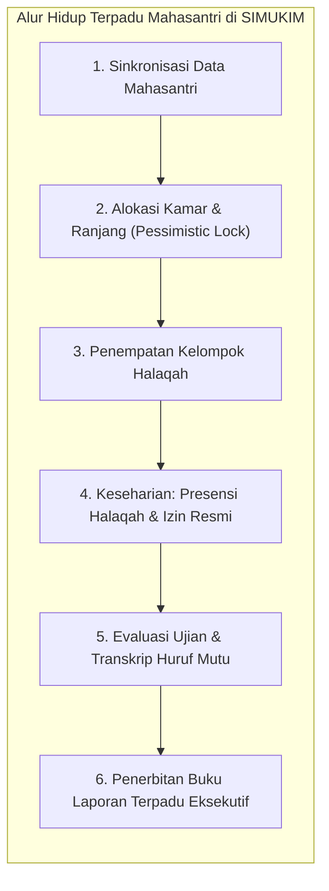

SIMUKIM mengikat 5 pilar fungsional utama ke dalam satu siklus terpadu:
1. **Pilar Fasilitas & Hunian Asrama:** Hierarki kompleks gedung asrama (Gedung Putra & Gedung Putri), lantai, dan kamar dengan visualisasi okupansi dan auto-assignment penempatan kamar berbasis kuota gender.
2. **Pilar Akademik & Halaqah Kajian:** Pengelolaan silabus kurikulum Al-Qur'an dan kitab turots, distribusi kelompok kajian santri, absensi pertemuan harian, dan konversi transkrip nilai.
3. **Pilar Kedisiplinan & Perizinan:** Pencatatan dan validasi perizinan keluar/pulang santri oleh Mudabbir/Admin, penerbitan surat izin resmi format A4, dan pencatatan buku ketertiban santri.
4. **Pilar Presensi Keseharian:** Perekaman kehadiran sesi kajian halaqah dan taklim wajib santri mukim.
5. **Pilar Pelaporan Eksekutif:** Konsolidasi otomatis data 5 pilar dalam bentuk Buku Laporan Kinerja Resmi A4 Portrait dan Excel multi-sheet.

---

## 2. ANATOMI ARSITEKTUR & TECH STACK

### 2.1 Pola Arsitektur & Alur Eksekusi Sistem

SIMUKIM dibangun dengan pola **Modern Monolithic Clean Architecture (Service-Layer Pattern)** di atas framework Laravel 12. Sistem memisahkan logika validasi (`FormRequest`), logika bisnis terisolasi (`Services`), presentasi antarmuka (`Blade Components`), dan interaktivitas frontend (`Alpine.js` + `spa-navigator.js`).

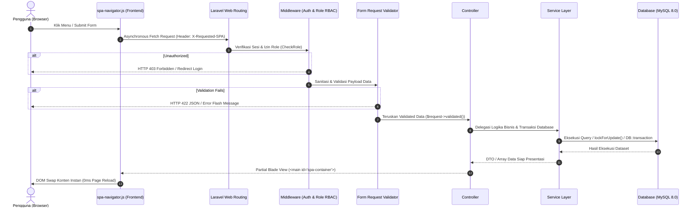

### 2.2 Peta Direktori Lengkap (Directory Tree & File Mapping)

```text
mahad-v2/
├── app/
│   ├── Http/
│   │   ├── Controllers/            # Controller per domain fitur (< 250 baris)
│   │   │   ├── Admin/              # Manajemen Cache, Reset DB, User Sync
│   │   │   ├── Asrama/             # CRUD Gedung, Lantai, Kamar Asrama
│   │   │   ├── Auth/               # Autentikasi Breeze disesuaikan
│   │   │   ├── Disiplin/           # Perizinan Santri & Pelanggaran Kedisiplinan
│   │   │   ├── Halaqah/            # Kelas Kajian, Rombel, & Penilaian
│   │   │   ├── Kamar/              # Alokasi & Plotting Penempatan Kamar
│   │   │   ├── Laporan/            # Laporan Bulanan Musyrif & Foto Berkas
│   │   │   ├── Pelaporan/          # Pusat Pelaporan Master Terpadu
│   │   │   ├── Santri/             # Manajemen Biodata Mahasantri & Import
│   │   │   └── SecureFileController.php # Handler Berkas Privat Anti-Traversal
│   │   ├── Middleware/             # CheckRole RBAC, Authenticate, RedirectIfAuthenticated
│   │   └── Requests/               # 100% FormRequest Validasi Server-Side
│   ├── Models/                     # Eloquent Models (Relasi, Casts, Scopes)
│   └── Services/                   # Logika Bisnis Terisolasi & Reusable
│       ├── AdminDashboardService.php
│       ├── MasterPelaporanService.php
│       ├── PenempatanService.php
│       ├── PerizinanService.php
│       └── SantriExportService.php
├── database/
│   ├── migrations/                 # 27 berkas migrasi skema MySQL
│   └── seeders/                    # Seeder data awal gedung, admin, & peran
├── resources/
│   ├── css/                        # Tailwind CSS source (@theme & custom styling)
│   ├── js/                         # Alpine.js Core & spa-navigator.js SPA Engine
│   └── views/
│       ├── components/             # Reusable Blade UI Components (Modal, Alert, Table)
│       │   └── welcome/            # Landing page sections (hero, navbar, features)
│       ├── layouts/                # Master shell layouts (app, guest, partial)
│       └── pages/                  # Views fungsional per modul
└── routes/
    ├── auth.php                    # Rute login, logout, password reset
    └── web.php                     # 148 rute fungsional terproteksi RBAC
```

### 2.3 Inventaris Tech Stack, Environment & Dependencies

| Kategori | Nama Teknologi / Package | Versi Eksak | File Konfigurasi | Kegunaan Spesifik di SIMUKIM |
| :--- | :--- | :--- | :--- | :--- |
| **Backend** | PHP | `8.2+` | `php.ini` | Runtime eksekusi backend utama server. |
| **Backend** | Laravel Framework | `12.69.3` | `config/app.php` | Framework MVC enterprise dengan dependency injection & Eloquent ORM. |
| **Database** | MySQL / MariaDB | `8.0+ / 10.4+` | `config/database.php` | Penyimpanan relasional ACID dengan InnoDB storage engine (Pessimistic Locking). |
| **Frontend** | Tailwind CSS | `v3.4 / Vite` | `resources/css/app.css` | Utility-first CSS engine berperforma tinggi dengan compiler Vite. |
| **Frontend** | Alpine.js | `v3.14.8` | `resources/js/app.js` | Micro-framework reaktif untuk dropdown, modal dialog, tab switcher, & filter dinamis. |
| **Frontend** | Custom SPA Navigator | `Custom v1.0` | `resources/js/spa-navigator.js` | Pemuat halaman asynchronous partial view tanpa library berat pihak ketiga. |
| **Auth / RBAC** | Spatie Laravel-Permission | `v6.24.0` | `config/permission.php` | Manajemen role (`admin`, `mudabbir`, `tutor`, `mahasantri`) dan permissions berbasis tabel pivot. |
| **Dokumentasi** | PhpSpreadsheet | `v5.5.1` | Standalone Service | Engine penulisan file Excel (`.xlsx`) multi-sheet untuk Buku Laporan Resmi. |
| **Build Tool** | Vite | `v6.4.3` | `vite.config.js` | Frontend asset bundler & HMR compiler untuk CSS dan JavaScript modern. |

---

## 3. BEDAH AKTOR, AUTENTIKASI & ROLE-BASED ACCESS CONTROL (RBAC)

### 3.1 Mekanisme Autentikasi & Manajemen Sesi

1. **Proses Login & Verifikasi Kredensial:** Otentikasi ditangani oleh `App\Http\Controllers\Auth\AuthenticatedSessionController@store`. Kredensial divalidasi via `App\Http\Requests\Auth\LoginRequest` dengan proteksi rate limiting (*Throttling 5 percobaan gagal per menit*).
2. **Password Hashing:** Sandi di-hash menggunakan algoritma **Bcrypt / Argon2id** dengan cost factor 12, mencegah eksploitasi rainbow table.
3. **Proteksi Sesi & Cookie:** Sesi pengguna diamankan dengan atribut `HttpOnly`, `SameSite=Lax`, serta enkripsi cookie Laravel. Setiap pergantian sesi menjalankan `session()->regenerate()` untuk mencegah serangan *Session Fixation*.
4. **Proteksi CSRF:** Seluruh formulir POST/PUT/DELETE wajib menyertakan token `@csrf` yang divalidasi oleh middleware `ValidateCsrfToken`. SPA Navigator secara otomatis membaca `<meta name="csrf-token">` dan menyuntikkannya ke header setiap request asynchronous.
5. **Redirect Pasca-Login Berdasarkan Peran:** Setelah sesi terverifikasi, sistem mengarahkan aktor ke rute `dashboard` di mana `DashboardController@index` melakukan dispatching antarmuka sesuai role yang terpasang pada akun.

### 3.2 Matriks Aktor / Role & Hak Akses Lengkap

| Nama Role | Identifier di Kode/DB | Middleware Pengaman | Struktur Navigasi (Sidebar & Bottom Nav) | Daftar Lengkap Hak Akses & Modul yang Bisa Diakses |
| :--- | :--- | :--- | :--- | :--- |
| **Administrator** | `admin` | `auth`, `role:admin` | **Menu:** Dashboard, Kelola Gedung/Kamar, Alokasi Penempatan, Pangkalan Mahasantri, Halaqah & Kelas, Presensi Halaqah, Kedisiplinan & Izin, Buku Pelaporan Terpadu, Manajemen User, Pemeliharaan Cache. | Akses penuh 100% sistem: manipulasi fasilitas hunian, pembatalan/penempatan kamar santri, validasi perizinan resmi, ekspor laporan eksekutif resmi, switch periode aktif, manajemen hak akses pengguna. |
| **Mudabbir Pembina** | `mudabbir` | `auth`, `role:mudabbir` | **Menu:** Dashboard Mudabbir, Lorong Asrama Saya, Presensi Halaqah, Pencatatan Izin Keluar/Pulang, Catat Pelanggaran Santri, Laporan Kinerja Bulanan. | Memantau santri binaan lorong, mencatat dan memvalidasi perizinan santri, menerbitkan laporan kegiatan bulanan beserta foto dokumentasi. |
| **Tutor Dosen** | `tutor` | `auth`, `role:tutor` | **Menu:** Dashboard Pengampu, Rombel Halaqah Saya, Presensi Pertemuan Kajian, Penilaian Mutu & Ujian Santri. | Mengelola jadwal halaqah mingguan, mencatat kehadiran santri di kelas kajian turots/Qur'an, mengisi skor evaluasi lisan dan transkrip huruf mutu santri. |
| **Mahasantri Mukim** | `mahasantri` | `auth`, `role:mahasantri` | **Menu:** Dashboard Mahasantri, Kamar & Ranjang Saya, Halaqah Saya, Rekap Presensi Kajian, Status Izin Resmi, Transkrip Nilai Saya. | Memeriksa penempatan kamar dan rekan satu unit, memantau riwayat perizinan keluar/pulang resmi, melihat rekap kehadiran kajian halaqah secara mandiri. |

---

## 4. BEDAH DATABASE, SKEMA & DATA MODEL

### 4.1 Entity Relationship Diagram (ERD)

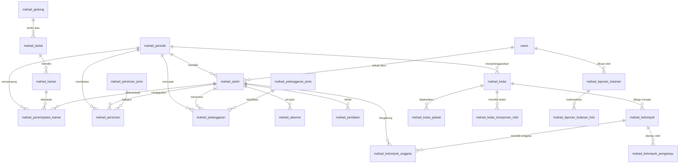

### 4.2 Kamus Data (Data Dictionary) Seluruh Tabel Sistem (35 Tabel Basis Data & 1 Tabel Migrasi)

Berikut adalah dokumentasi kamus data untuk **35 tabel basis data** (22 tabel domain `mahad_*`, 5 tabel Spatie RBAC, dan 8 tabel core/infrastruktur Laravel) serta 1 tabel metadata migrasi di dalam pangkalan data MySQL SIMUKIM:

#### 4.2.1 Tabel `cache`

| No | Nama Field / Kolom | Tipe Data & Length | Constraint & Nilai Default | Relasi ke Tabel Lain | Fungsi & Deskripsi Kolom |
| :---: | :--- | :--- | :--- | :--- | :--- |
| 1 | `key` | `varchar(255)` | PK, Not Null | - | Menyimpan nilai atribut operasional key. |
| 2 | `value` | `mediumtext` | Not Null | - | Menyimpan nilai atribut operasional value. |
| 3 | `expiration` | `int(11)` | Not Null | - | Menyimpan nilai atribut operasional expiration. |

#### 4.2.2 Tabel `cache_locks`

| No | Nama Field / Kolom | Tipe Data & Length | Constraint & Nilai Default | Relasi ke Tabel Lain | Fungsi & Deskripsi Kolom |
| :---: | :--- | :--- | :--- | :--- | :--- |
| 1 | `key` | `varchar(255)` | PK, Not Null | - | Menyimpan nilai atribut operasional key. |
| 2 | `owner` | `varchar(255)` | Not Null | - | Menyimpan nilai atribut operasional owner. |
| 3 | `expiration` | `int(11)` | Not Null | - | Menyimpan nilai atribut operasional expiration. |

#### 4.2.3 Tabel `failed_jobs`

| No | Nama Field / Kolom | Tipe Data & Length | Constraint & Nilai Default | Relasi ke Tabel Lain | Fungsi & Deskripsi Kolom |
| :---: | :--- | :--- | :--- | :--- | :--- |
| 1 | `id` | `bigint(20) unsigned` | PK, Not Null, auto_increment | - | Primary key unik record tabel. |
| 2 | `uuid` | `varchar(255)` | Unique, Not Null | - | Menyimpan nilai atribut operasional uuid. |
| 3 | `connection` | `text` | Not Null | - | Menyimpan nilai atribut operasional connection. |
| 4 | `queue` | `text` | Not Null | - | Menyimpan nilai atribut operasional queue. |
| 5 | `payload` | `longtext` | Not Null | - | Menyimpan nilai atribut operasional payload. |
| 6 | `exception` | `longtext` | Not Null | - | Menyimpan nilai atribut operasional exception. |
| 7 | `failed_at` | `timestamp` | Not Null, Default: `current_timestamp()` | - | Menyimpan nilai atribut operasional failed_at. |

#### 4.2.4 Tabel `job_batches`

| No | Nama Field / Kolom | Tipe Data & Length | Constraint & Nilai Default | Relasi ke Tabel Lain | Fungsi & Deskripsi Kolom |
| :---: | :--- | :--- | :--- | :--- | :--- |
| 1 | `id` | `varchar(255)` | PK, Not Null | - | Primary key unik record tabel. |
| 2 | `name` | `varchar(255)` | Not Null | - | Menyimpan nilai atribut operasional name. |
| 3 | `total_jobs` | `int(11)` | Not Null | - | Menyimpan nilai atribut operasional total_jobs. |
| 4 | `pending_jobs` | `int(11)` | Not Null | - | Menyimpan nilai atribut operasional pending_jobs. |
| 5 | `failed_jobs` | `int(11)` | Not Null | - | Menyimpan nilai atribut operasional failed_jobs. |
| 6 | `failed_job_ids` | `longtext` | Not Null | - | Menyimpan nilai atribut operasional failed_job_ids. |
| 7 | `options` | `mediumtext` | Nullable | - | Menyimpan nilai atribut operasional options. |
| 8 | `cancelled_at` | `int(11)` | Nullable | - | Menyimpan nilai atribut operasional cancelled_at. |
| 9 | `created_at` | `int(11)` | Not Null | - | Timestamp standar audit jejak pembuatan/pembaruan baris data. |
| 10 | `finished_at` | `int(11)` | Nullable | - | Menyimpan nilai atribut operasional finished_at. |

#### 4.2.5 Tabel `jobs`

| No | Nama Field / Kolom | Tipe Data & Length | Constraint & Nilai Default | Relasi ke Tabel Lain | Fungsi & Deskripsi Kolom |
| :---: | :--- | :--- | :--- | :--- | :--- |
| 1 | `id` | `bigint(20) unsigned` | PK, Not Null, auto_increment | - | Primary key unik record tabel. |
| 2 | `queue` | `varchar(255)` | Indexed / FK, Not Null | - | Menyimpan nilai atribut operasional queue. |
| 3 | `payload` | `longtext` | Not Null | - | Menyimpan nilai atribut operasional payload. |
| 4 | `attempts` | `tinyint(3) unsigned` | Not Null | - | Menyimpan nilai atribut operasional attempts. |
| 5 | `reserved_at` | `int(10) unsigned` | Nullable | - | Menyimpan nilai atribut operasional reserved_at. |
| 6 | `available_at` | `int(10) unsigned` | Not Null | - | Menyimpan nilai atribut operasional available_at. |
| 7 | `created_at` | `int(10) unsigned` | Not Null | - | Timestamp standar audit jejak pembuatan/pembaruan baris data. |

#### 4.2.6 Tabel `mahad_absensi`

| No | Nama Field / Kolom | Tipe Data & Length | Constraint & Nilai Default | Relasi ke Tabel Lain | Fungsi & Deskripsi Kolom |
| :---: | :--- | :--- | :--- | :--- | :--- |
| 1 | `id` | `bigint(20) unsigned` | PK, Not Null, auto_increment | - | Primary key unik record tabel. |
| 2 | `kelompok_id` | `bigint(20) unsigned` | Indexed / FK, Not Null | `mahad_kelompok.id` | Kunci asing referensi rombel/kelompok halaqah santri. |
| 3 | `kelas_id` | `bigint(20) unsigned` | Indexed / FK, Not Null | `mahad_kelas.id` | Kunci asing referensi mata kajian halaqah. |
| 4 | `jadwal_id` | `bigint(20) unsigned` | Indexed / FK, Nullable | - | Menyimpan nilai atribut operasional jadwal_id. |
| 5 | `santri_id` | `bigint(20) unsigned` | Indexed / FK, Not Null | `mahad_santri.id` | Kunci asing referensi data induk mahasantri. |
| 6 | `tanggal` | `date` | Indexed / FK, Not Null | - | Tanggal penanggalan peristiwa atau tenggat waktu. |
| 7 | `status` | `enum('hadir','izin','sakit','alfa','terlambat')` | Indexed / FK, Not Null | - | Indikator status siklus hidup data (active, pending, approved, dll). |
| 8 | `catatan` | `varchar(255)` | Nullable | - | Catatan teks deskripsi rinci pelengkap informasi. |
| 9 | `input_by` | `bigint(20) unsigned` | Indexed / FK, Not Null | - | Menyimpan nilai atribut operasional input_by. |
| 10 | `created_at` | `timestamp` | Nullable | - | Timestamp standar audit jejak pembuatan/pembaruan baris data. |
| 11 | `updated_at` | `timestamp` | Nullable | - | Timestamp standar audit jejak pembuatan/pembaruan baris data. |

#### 4.2.7 Tabel `mahad_gedung`

| No | Nama Field / Kolom | Tipe Data & Length | Constraint & Nilai Default | Relasi ke Tabel Lain | Fungsi & Deskripsi Kolom |
| :---: | :--- | :--- | :--- | :--- | :--- |
| 1 | `id` | `bigint(20) unsigned` | PK, Not Null, auto_increment | - | Primary key unik record tabel. |
| 2 | `kode` | `varchar(20)` | Unique, Not Null | - | Menyimpan nilai atribut operasional kode. |
| 3 | `nama` | `varchar(100)` | Not Null | - | Label nama teks entitas atau pengguna. |
| 4 | `gender_khusus` | `enum('L','P','campur')` | Not Null, Default: `campur` | - | Menyimpan nilai atribut operasional gender_khusus. |
| 5 | `deskripsi` | `text` | Nullable | - | Menyimpan nilai atribut operasional deskripsi. |
| 6 | `is_active` | `tinyint(1)` | Indexed / FK, Not Null, Default: `1` | - | Menyimpan nilai atribut operasional is_active. |
| 7 | `created_at` | `timestamp` | Nullable | - | Timestamp standar audit jejak pembuatan/pembaruan baris data. |
| 8 | `updated_at` | `timestamp` | Nullable | - | Timestamp standar audit jejak pembuatan/pembaruan baris data. |

#### 4.2.8 Tabel `mahad_kamar`

| No | Nama Field / Kolom | Tipe Data & Length | Constraint & Nilai Default | Relasi ke Tabel Lain | Fungsi & Deskripsi Kolom |
| :---: | :--- | :--- | :--- | :--- | :--- |
| 1 | `id` | `bigint(20) unsigned` | PK, Not Null, auto_increment | - | Primary key unik record tabel. |
| 2 | `lantai_id` | `bigint(20) unsigned` | Indexed / FK, Not Null | `mahad_lantai.id` | Kunci asing referensi lantai pada gedung asrama. |
| 3 | `nomor_kamar` | `varchar(20)` | Indexed / FK, Not Null | - | Nomor identitas unik atau nomor registrasi institusi. |
| 4 | `tipe_ruang` | `enum('kamar','mudabbir','wc','tangga','kantor','dapur','kantin','jemuran','koridor')` | Nullable, Default: `kamar` | - | Menyimpan nilai atribut operasional tipe_ruang. |
| 5 | `gender` | `enum('L','P')` | Indexed / FK, Not Null, Default: `L` | - | Menyimpan nilai atribut operasional gender. |
| 6 | `kapasitas_maks` | `tinyint(3) unsigned` | Not Null, Default: `4` | - | Menyimpan nilai atribut operasional kapasitas_maks. |
| 7 | `status` | `enum('tersedia','penuh','perbaikan','nonaktif')` | Indexed / FK, Not Null, Default: `tersedia` | - | Indikator status siklus hidup data (active, pending, approved, dll). |
| 8 | `catatan` | `text` | Nullable | - | Catatan teks deskripsi rinci pelengkap informasi. |
| 9 | `created_at` | `timestamp` | Nullable | - | Timestamp standar audit jejak pembuatan/pembaruan baris data. |
| 10 | `updated_at` | `timestamp` | Nullable | - | Timestamp standar audit jejak pembuatan/pembaruan baris data. |

#### 4.2.9 Tabel `mahad_kegiatan`

| No | Nama Field / Kolom | Tipe Data & Length | Constraint & Nilai Default | Relasi ke Tabel Lain | Fungsi & Deskripsi Kolom |
| :---: | :--- | :--- | :--- | :--- | :--- |
| 1 | `id` | `bigint(20) unsigned` | PK, Not Null, auto_increment | - | Primary key unik record tabel. |
| 2 | `periode_id` | `bigint(20) unsigned` | Indexed / FK, Nullable | `mahad_periode.id` | Kunci asing referensi tahun ajaran / periode aktif santri. |
| 3 | `nama` | `varchar(150)` | Not Null | - | Label nama teks entitas atau pengguna. |
| 4 | `jenis` | `enum('rutin','khusus')` | Indexed / FK, Not Null | - | Menyimpan nilai atribut operasional jenis. |
| 5 | `hari` | `enum('Senin','Selasa','Rabu','Kamis','Jumat','Sabtu','Minggu')` | Nullable | - | Menyimpan nilai atribut operasional hari. |
| 6 | `jam_mulai` | `time` | Nullable | - | Menyimpan nilai atribut operasional jam_mulai. |
| 7 | `jam_selesai` | `time` | Nullable | - | Menyimpan nilai atribut operasional jam_selesai. |
| 8 | `lokasi` | `varchar(150)` | Nullable | - | Menyimpan nilai atribut operasional lokasi. |
| 9 | `deskripsi` | `text` | Nullable | - | Menyimpan nilai atribut operasional deskripsi. |
| 10 | `tanggal_mulai` | `date` | Indexed / FK, Nullable | - | Tanggal penanggalan peristiwa atau tenggat waktu. |
| 11 | `tanggal_selesai` | `date` | Nullable | - | Tanggal penanggalan peristiwa atau tenggat waktu. |
| 12 | `is_active` | `tinyint(1)` | Indexed / FK, Not Null, Default: `1` | - | Menyimpan nilai atribut operasional is_active. |
| 13 | `created_by` | `bigint(20) unsigned` | Indexed / FK, Not Null | - | Menyimpan nilai atribut operasional created_by. |
| 14 | `created_at` | `timestamp` | Nullable | - | Timestamp standar audit jejak pembuatan/pembaruan baris data. |
| 15 | `updated_at` | `timestamp` | Nullable | - | Timestamp standar audit jejak pembuatan/pembaruan baris data. |

#### 4.2.10 Tabel `mahad_kelas`

| No | Nama Field / Kolom | Tipe Data & Length | Constraint & Nilai Default | Relasi ke Tabel Lain | Fungsi & Deskripsi Kolom |
| :---: | :--- | :--- | :--- | :--- | :--- |
| 1 | `id` | `bigint(20) unsigned` | PK, Not Null, auto_increment | - | Primary key unik record tabel. |
| 2 | `periode_id` | `bigint(20) unsigned` | Indexed / FK, Not Null | `mahad_periode.id` | Kunci asing referensi tahun ajaran / periode aktif santri. |
| 3 | `nama` | `varchar(100)` | Not Null | - | Label nama teks entitas atau pengguna. |
| 4 | `tipe` | `varchar(50)` | Indexed / FK, Not Null, Default: `kelompok` | - | Menyimpan nilai atribut operasional tipe. |
| 5 | `is_active` | `tinyint(1)` | Indexed / FK, Not Null, Default: `1` | - | Menyimpan nilai atribut operasional is_active. |
| 6 | `deskripsi` | `text` | Nullable | - | Menyimpan nilai atribut operasional deskripsi. |
| 7 | `created_at` | `timestamp` | Nullable | - | Timestamp standar audit jejak pembuatan/pembaruan baris data. |
| 8 | `updated_at` | `timestamp` | Nullable | - | Timestamp standar audit jejak pembuatan/pembaruan baris data. |

#### 4.2.11 Tabel `mahad_kelas_jadwal`

| No | Nama Field / Kolom | Tipe Data & Length | Constraint & Nilai Default | Relasi ke Tabel Lain | Fungsi & Deskripsi Kolom |
| :---: | :--- | :--- | :--- | :--- | :--- |
| 1 | `id` | `bigint(20) unsigned` | PK, Not Null, auto_increment | - | Primary key unik record tabel. |
| 2 | `kelas_id` | `bigint(20) unsigned` | Indexed / FK, Not Null | `mahad_kelas.id` | Kunci asing referensi mata kajian halaqah. |
| 3 | `nama_sesi` | `varchar(100)` | Not Null | - | Label nama teks entitas atau pengguna. |
| 4 | `hari` | `enum('Senin','Selasa','Rabu','Kamis','Jumat','Sabtu','Minggu')` | Not Null | - | Menyimpan nilai atribut operasional hari. |
| 5 | `jam_mulai` | `time` | Not Null | - | Menyimpan nilai atribut operasional jam_mulai. |
| 6 | `jam_selesai` | `time` | Not Null | - | Menyimpan nilai atribut operasional jam_selesai. |
| 7 | `ruangan` | `varchar(100)` | Nullable | - | Menyimpan nilai atribut operasional ruangan. |
| 8 | `created_at` | `timestamp` | Nullable | - | Timestamp standar audit jejak pembuatan/pembaruan baris data. |
| 9 | `updated_at` | `timestamp` | Nullable | - | Timestamp standar audit jejak pembuatan/pembaruan baris data. |

#### 4.2.12 Tabel `mahad_kelas_komponen_nilai`

| No | Nama Field / Kolom | Tipe Data & Length | Constraint & Nilai Default | Relasi ke Tabel Lain | Fungsi & Deskripsi Kolom |
| :---: | :--- | :--- | :--- | :--- | :--- |
| 1 | `id` | `bigint(20) unsigned` | PK, Not Null, auto_increment | - | Primary key unik record tabel. |
| 2 | `kelas_id` | `bigint(20) unsigned` | Indexed / FK, Not Null | `mahad_kelas.id` | Kunci asing referensi mata kajian halaqah. |
| 3 | `kelompok_id` | `bigint(20) unsigned` | Indexed / FK, Nullable | `mahad_kelompok.id` | Kunci asing referensi rombel/kelompok halaqah santri. |
| 4 | `nama` | `varchar(100)` | Not Null | - | Label nama teks entitas atau pengguna. |
| 5 | `bobot` | `decimal(5,2)` | Not Null, Default: `25.00` | - | Menyimpan nilai atribut operasional bobot. |
| 6 | `is_absensi` | `tinyint(1)` | Not Null, Default: `0` | - | Menyimpan nilai atribut operasional is_absensi. |
| 7 | `is_fixed` | `tinyint(1)` | Not Null, Default: `0` | - | Menyimpan nilai atribut operasional is_fixed. |
| 8 | `urutan` | `smallint(5) unsigned` | Not Null, Default: `0` | - | Menyimpan nilai atribut operasional urutan. |
| 9 | `created_at` | `timestamp` | Nullable | - | Timestamp standar audit jejak pembuatan/pembaruan baris data. |
| 10 | `updated_at` | `timestamp` | Nullable | - | Timestamp standar audit jejak pembuatan/pembaruan baris data. |

#### 4.2.13 Tabel `mahad_kelompok`

| No | Nama Field / Kolom | Tipe Data & Length | Constraint & Nilai Default | Relasi ke Tabel Lain | Fungsi & Deskripsi Kolom |
| :---: | :--- | :--- | :--- | :--- | :--- |
| 1 | `id` | `bigint(20) unsigned` | PK, Not Null, auto_increment | - | Primary key unik record tabel. |
| 2 | `periode_id` | `bigint(20) unsigned` | Indexed / FK, Not Null | `mahad_periode.id` | Kunci asing referensi tahun ajaran / periode aktif santri. |
| 3 | `nama` | `varchar(100)` | Not Null | - | Label nama teks entitas atau pengguna. |
| 4 | `kode` | `varchar(30)` | Nullable | - | Menyimpan nilai atribut operasional kode. |
| 5 | `kapasitas` | `smallint(5) unsigned` | Not Null, Default: `30` | - | Menyimpan nilai atribut operasional kapasitas. |
| 6 | `is_active` | `tinyint(1)` | Indexed / FK, Not Null, Default: `1` | - | Menyimpan nilai atribut operasional is_active. |
| 7 | `keterangan` | `text` | Nullable | - | Catatan teks deskripsi rinci pelengkap informasi. |
| 8 | `created_at` | `timestamp` | Nullable | - | Timestamp standar audit jejak pembuatan/pembaruan baris data. |
| 9 | `updated_at` | `timestamp` | Nullable | - | Timestamp standar audit jejak pembuatan/pembaruan baris data. |

#### 4.2.14 Tabel `mahad_kelompok_anggota`

| No | Nama Field / Kolom | Tipe Data & Length | Constraint & Nilai Default | Relasi ke Tabel Lain | Fungsi & Deskripsi Kolom |
| :---: | :--- | :--- | :--- | :--- | :--- |
| 1 | `id` | `bigint(20) unsigned` | PK, Not Null, auto_increment | - | Primary key unik record tabel. |
| 2 | `kelompok_id` | `bigint(20) unsigned` | Indexed / FK, Not Null | `mahad_kelompok.id` | Kunci asing referensi rombel/kelompok halaqah santri. |
| 3 | `santri_id` | `bigint(20) unsigned` | Indexed / FK, Not Null | `mahad_santri.id` | Kunci asing referensi data induk mahasantri. |
| 4 | `tanggal_masuk` | `date` | Nullable | - | Tanggal penanggalan peristiwa atau tenggat waktu. |
| 5 | `created_at` | `timestamp` | Nullable | - | Timestamp standar audit jejak pembuatan/pembaruan baris data. |
| 6 | `updated_at` | `timestamp` | Nullable | - | Timestamp standar audit jejak pembuatan/pembaruan baris data. |

#### 4.2.15 Tabel `mahad_kelompok_pengampu`

| No | Nama Field / Kolom | Tipe Data & Length | Constraint & Nilai Default | Relasi ke Tabel Lain | Fungsi & Deskripsi Kolom |
| :---: | :--- | :--- | :--- | :--- | :--- |
| 1 | `id` | `bigint(20) unsigned` | PK, Not Null, auto_increment | - | Primary key unik record tabel. |
| 2 | `kelompok_id` | `bigint(20) unsigned` | Indexed / FK, Not Null | `mahad_kelompok.id` | Kunci asing referensi rombel/kelompok halaqah santri. |
| 3 | `kelas_id` | `bigint(20) unsigned` | Indexed / FK, Not Null | `mahad_kelas.id` | Kunci asing referensi mata kajian halaqah. |
| 4 | `tutor_id` | `bigint(20) unsigned` | Indexed / FK, Not Null | - | Menyimpan nilai atribut operasional tutor_id. |
| 5 | `created_at` | `timestamp` | Nullable | - | Timestamp standar audit jejak pembuatan/pembaruan baris data. |
| 6 | `updated_at` | `timestamp` | Nullable | - | Timestamp standar audit jejak pembuatan/pembaruan baris data. |

#### 4.2.16 Tabel `mahad_lantai`

| No | Nama Field / Kolom | Tipe Data & Length | Constraint & Nilai Default | Relasi ke Tabel Lain | Fungsi & Deskripsi Kolom |
| :---: | :--- | :--- | :--- | :--- | :--- |
| 1 | `id` | `bigint(20) unsigned` | PK, Not Null, auto_increment | - | Primary key unik record tabel. |
| 2 | `gedung_id` | `bigint(20) unsigned` | Indexed / FK, Not Null | `mahad_gedung.id` | Kunci asing referensi gedung asrama. |
| 3 | `nomor_lantai` | `tinyint(3) unsigned` | Not Null | - | Nomor identitas unik atau nomor registrasi institusi. |
| 4 | `kapasitas_kamar_standar` | `tinyint(3) unsigned` | Not Null, Default: `24` | - | Menyimpan nilai atribut operasional kapasitas_kamar_standar. |
| 5 | `created_at` | `timestamp` | Nullable | - | Timestamp standar audit jejak pembuatan/pembaruan baris data. |
| 6 | `updated_at` | `timestamp` | Nullable | - | Timestamp standar audit jejak pembuatan/pembaruan baris data. |

#### 4.2.17 Tabel `mahad_laporan_bulanan`

| No | Nama Field / Kolom | Tipe Data & Length | Constraint & Nilai Default | Relasi ke Tabel Lain | Fungsi & Deskripsi Kolom |
| :---: | :--- | :--- | :--- | :--- | :--- |
| 1 | `id` | `bigint(20) unsigned` | PK, Not Null, auto_increment | - | Primary key unik record tabel. |
| 2 | `periode_id` | `bigint(20) unsigned` | Indexed / FK, Not Null | `mahad_periode.id` | Kunci asing referensi tahun ajaran / periode aktif santri. |
| 3 | `kelompok_id` | `bigint(20) unsigned` | Indexed / FK, Nullable | `mahad_kelompok.id` | Kunci asing referensi rombel/kelompok halaqah santri. |
| 4 | `kelas_id` | `bigint(20) unsigned` | Indexed / FK, Nullable | `mahad_kelas.id` | Kunci asing referensi mata kajian halaqah. |
| 5 | `tutor_id` | `bigint(20) unsigned` | Indexed / FK, Not Null | - | Menyimpan nilai atribut operasional tutor_id. |
| 6 | `bulan` | `tinyint(3) unsigned` | Not Null | - | Menyimpan nilai atribut operasional bulan. |
| 7 | `tahun` | `smallint(5) unsigned` | Not Null | - | Menyimpan nilai atribut operasional tahun. |
| 8 | `catatan` | `text` | Not Null | - | Catatan teks deskripsi rinci pelengkap informasi. |
| 9 | `status` | `enum('draft','menunggu_review','direview','selesai')` | Indexed / FK, Not Null, Default: `menunggu_review` | - | Indikator status siklus hidup data (active, pending, approved, dll). |
| 10 | `catatan_admin` | `text` | Nullable | - | Catatan teks deskripsi rinci pelengkap informasi. |
| 11 | `reviewed_by` | `bigint(20) unsigned` | Indexed / FK, Nullable | - | Menyimpan nilai atribut operasional reviewed_by. |
| 12 | `reviewed_at` | `timestamp` | Nullable | - | Menyimpan nilai atribut operasional reviewed_at. |
| 13 | `created_at` | `timestamp` | Nullable | - | Timestamp standar audit jejak pembuatan/pembaruan baris data. |
| 14 | `updated_at` | `timestamp` | Nullable | - | Timestamp standar audit jejak pembuatan/pembaruan baris data. |

#### 4.2.18 Tabel `mahad_laporan_bulanan_foto`

| No | Nama Field / Kolom | Tipe Data & Length | Constraint & Nilai Default | Relasi ke Tabel Lain | Fungsi & Deskripsi Kolom |
| :---: | :--- | :--- | :--- | :--- | :--- |
| 1 | `id` | `bigint(20) unsigned` | PK, Not Null, auto_increment | - | Primary key unik record tabel. |
| 2 | `laporan_id` | `bigint(20) unsigned` | Indexed / FK, Not Null | - | Menyimpan nilai atribut operasional laporan_id. |
| 3 | `file_path` | `varchar(255)` | Not Null | - | Menyimpan nilai atribut operasional file_path. |
| 4 | `file_name` | `varchar(255)` | Not Null | - | Menyimpan nilai atribut operasional file_name. |
| 5 | `file_size` | `int(10) unsigned` | Not Null | - | Menyimpan nilai atribut operasional file_size. |
| 6 | `caption` | `varchar(255)` | Nullable | - | Menyimpan nilai atribut operasional caption. |
| 7 | `created_at` | `timestamp` | Nullable | - | Timestamp standar audit jejak pembuatan/pembaruan baris data. |
| 8 | `updated_at` | `timestamp` | Nullable | - | Timestamp standar audit jejak pembuatan/pembaruan baris data. |

#### 4.2.19 Tabel `mahad_pelanggaran`

| No | Nama Field / Kolom | Tipe Data & Length | Constraint & Nilai Default | Relasi ke Tabel Lain | Fungsi & Deskripsi Kolom |
| :---: | :--- | :--- | :--- | :--- | :--- |
| 1 | `id` | `bigint(20) unsigned` | PK, Not Null, auto_increment | - | Primary key unik record tabel. |
| 2 | `periode_id` | `bigint(20) unsigned` | Indexed / FK, Not Null, Default: `1` | `mahad_periode.id` | Kunci asing referensi tahun ajaran / periode aktif santri. |
| 3 | `santri_id` | `bigint(20) unsigned` | Indexed / FK, Not Null | `mahad_santri.id` | Kunci asing referensi data induk mahasantri. |
| 4 | `jenis_pelanggaran_id` | `bigint(20) unsigned` | Indexed / FK, Not Null | - | Menyimpan nilai atribut operasional jenis_pelanggaran_id. |
| 5 | `tanggal` | `date` | Indexed / FK, Not Null | - | Tanggal penanggalan peristiwa atau tenggat waktu. |
| 6 | `poin` | `smallint(5) unsigned` | Not Null, Default: `0` | - | Menyimpan nilai atribut operasional poin. |
| 7 | `deskripsi` | `text` | Nullable | - | Menyimpan nilai atribut operasional deskripsi. |
| 8 | `hukuman` | `varchar(255)` | Nullable | - | Menyimpan nilai atribut operasional hukuman. |
| 9 | `status` | `enum('terdaftar','selesai')` | Indexed / FK, Not Null, Default: `terdaftar` | - | Indikator status siklus hidup data (active, pending, approved, dll). |
| 10 | `input_by` | `bigint(20) unsigned` | Indexed / FK, Not Null | - | Menyimpan nilai atribut operasional input_by. |
| 11 | `created_at` | `timestamp` | Nullable | - | Timestamp standar audit jejak pembuatan/pembaruan baris data. |
| 12 | `updated_at` | `timestamp` | Nullable | - | Timestamp standar audit jejak pembuatan/pembaruan baris data. |

#### 4.2.20 Tabel `mahad_pelanggaran_jenis`

| No | Nama Field / Kolom | Tipe Data & Length | Constraint & Nilai Default | Relasi ke Tabel Lain | Fungsi & Deskripsi Kolom |
| :---: | :--- | :--- | :--- | :--- | :--- |
| 1 | `id` | `bigint(20) unsigned` | PK, Not Null, auto_increment | - | Primary key unik record tabel. |
| 2 | `nama` | `varchar(100)` | Unique, Not Null | - | Label nama teks entitas atau pengguna. |
| 3 | `poin_default` | `smallint(5) unsigned` | Not Null, Default: `0` | - | Menyimpan nilai atribut operasional poin_default. |
| 4 | `sanksi_default` | `varchar(150)` | Nullable | - | Menyimpan nilai atribut operasional sanksi_default. |
| 5 | `deskripsi` | `text` | Nullable | - | Menyimpan nilai atribut operasional deskripsi. |
| 6 | `is_active` | `tinyint(1)` | Not Null, Default: `1` | - | Menyimpan nilai atribut operasional is_active. |
| 7 | `created_at` | `timestamp` | Nullable | - | Timestamp standar audit jejak pembuatan/pembaruan baris data. |
| 8 | `updated_at` | `timestamp` | Nullable | - | Timestamp standar audit jejak pembuatan/pembaruan baris data. |

#### 4.2.21 Tabel `mahad_penempatan_kamar`

| No | Nama Field / Kolom | Tipe Data & Length | Constraint & Nilai Default | Relasi ke Tabel Lain | Fungsi & Deskripsi Kolom |
| :---: | :--- | :--- | :--- | :--- | :--- |
| 1 | `id` | `bigint(20) unsigned` | PK, Not Null, auto_increment | - | Primary key unik record tabel. |
| 2 | `periode_id` | `bigint(20) unsigned` | Indexed / FK, Not Null | `mahad_periode.id` | Kunci asing referensi tahun ajaran / periode aktif santri. |
| 3 | `santri_id` | `bigint(20) unsigned` | Indexed / FK, Not Null | `mahad_santri.id` | Kunci asing referensi data induk mahasantri. |
| 4 | `kamar_id` | `bigint(20) unsigned` | Indexed / FK, Not Null | `mahad_kamar.id` | Kunci asing referensi unit kamar asrama. |
| 5 | `tanggal_masuk` | `date` | Not Null | - | Tanggal penanggalan peristiwa atau tenggat waktu. |
| 6 | `tanggal_keluar` | `date` | Nullable | - | Tanggal penanggalan peristiwa atau tenggat waktu. |
| 7 | `status` | `enum('aktif','pindah','keluar')` | Indexed / FK, Not Null, Default: `aktif` | - | Indikator status siklus hidup data (active, pending, approved, dll). |
| 8 | `catatan` | `text` | Nullable | - | Catatan teks deskripsi rinci pelengkap informasi. |
| 9 | `assigned_by` | `bigint(20) unsigned` | Indexed / FK, Not Null | - | Menyimpan nilai atribut operasional assigned_by. |
| 10 | `created_at` | `timestamp` | Nullable | - | Timestamp standar audit jejak pembuatan/pembaruan baris data. |
| 11 | `updated_at` | `timestamp` | Nullable | - | Timestamp standar audit jejak pembuatan/pembaruan baris data. |

#### 4.2.22 Tabel `mahad_pengaturan`

| No | Nama Field / Kolom | Tipe Data & Length | Constraint & Nilai Default | Relasi ke Tabel Lain | Fungsi & Deskripsi Kolom |
| :---: | :--- | :--- | :--- | :--- | :--- |
| 1 | `id` | `bigint(20) unsigned` | PK, Not Null, auto_increment | - | Primary key unik record tabel. |
| 2 | `key` | `varchar(60)` | Unique, Not Null | - | Menyimpan nilai atribut operasional key. |
| 3 | `value` | `text` | Nullable | - | Menyimpan nilai atribut operasional value. |
| 4 | `kategori` | `varchar(50)` | Not Null, Default: `umum` | - | Menyimpan nilai atribut operasional kategori. |
| 5 | `created_at` | `timestamp` | Nullable | - | Timestamp standar audit jejak pembuatan/pembaruan baris data. |
| 6 | `updated_at` | `timestamp` | Nullable | - | Timestamp standar audit jejak pembuatan/pembaruan baris data. |

#### 4.2.23 Tabel `mahad_penilaian`

| No | Nama Field / Kolom | Tipe Data & Length | Constraint & Nilai Default | Relasi ke Tabel Lain | Fungsi & Deskripsi Kolom |
| :---: | :--- | :--- | :--- | :--- | :--- |
| 1 | `id` | `bigint(20) unsigned` | PK, Not Null, auto_increment | - | Primary key unik record tabel. |
| 2 | `kelompok_id` | `bigint(20) unsigned` | Indexed / FK, Not Null | `mahad_kelompok.id` | Kunci asing referensi rombel/kelompok halaqah santri. |
| 3 | `kelas_id` | `bigint(20) unsigned` | Indexed / FK, Not Null | `mahad_kelas.id` | Kunci asing referensi mata kajian halaqah. |
| 4 | `santri_id` | `bigint(20) unsigned` | Indexed / FK, Not Null | `mahad_santri.id` | Kunci asing referensi data induk mahasantri. |
| 5 | `nilai_komponen` | `longtext` | Nullable | - | Menyimpan nilai atribut operasional nilai_komponen. |
| 6 | `nilai_angka` | `decimal(5,2)` | Nullable | - | Menyimpan nilai atribut operasional nilai_angka. |
| 7 | `nilai_huruf` | `varchar(5)` | Nullable | - | Menyimpan nilai atribut operasional nilai_huruf. |
| 8 | `catatan` | `text` | Nullable | - | Catatan teks deskripsi rinci pelengkap informasi. |
| 9 | `input_by` | `bigint(20) unsigned` | Indexed / FK, Not Null | - | Menyimpan nilai atribut operasional input_by. |
| 10 | `created_at` | `timestamp` | Nullable | - | Timestamp standar audit jejak pembuatan/pembaruan baris data. |
| 11 | `updated_at` | `timestamp` | Nullable | - | Timestamp standar audit jejak pembuatan/pembaruan baris data. |

#### 4.2.24 Tabel `mahad_periode`

| No | Nama Field / Kolom | Tipe Data & Length | Constraint & Nilai Default | Relasi ke Tabel Lain | Fungsi & Deskripsi Kolom |
| :---: | :--- | :--- | :--- | :--- | :--- |
| 1 | `id` | `bigint(20) unsigned` | PK, Not Null, auto_increment | - | Primary key unik record tabel. |
| 2 | `kode` | `varchar(20)` | Unique, Not Null | - | Menyimpan nilai atribut operasional kode. |
| 3 | `academic_period_id` | `bigint(20) unsigned` | Indexed / FK, Nullable | - | Menyimpan nilai atribut operasional academic_period_id. |
| 4 | `nama` | `varchar(100)` | Not Null | - | Label nama teks entitas atau pengguna. |
| 5 | `tanggal_mulai` | `date` | Not Null | - | Tanggal penanggalan peristiwa atau tenggat waktu. |
| 6 | `tanggal_selesai` | `date` | Not Null | - | Tanggal penanggalan peristiwa atau tenggat waktu. |
| 7 | `is_active` | `tinyint(1)` | Indexed / FK, Not Null, Default: `0` | - | Menyimpan nilai atribut operasional is_active. |
| 8 | `created_at` | `timestamp` | Nullable | - | Timestamp standar audit jejak pembuatan/pembaruan baris data. |
| 9 | `updated_at` | `timestamp` | Nullable | - | Timestamp standar audit jejak pembuatan/pembaruan baris data. |

#### 4.2.25 Tabel `mahad_perizinan`

| No | Nama Field / Kolom | Tipe Data & Length | Constraint & Nilai Default | Relasi ke Tabel Lain | Fungsi & Deskripsi Kolom |
| :---: | :--- | :--- | :--- | :--- | :--- |
| 1 | `id` | `bigint(20) unsigned` | PK, Not Null, auto_increment | - | Primary key unik record tabel. |
| 2 | `periode_id` | `bigint(20) unsigned` | Indexed / FK, Not Null, Default: `1` | `mahad_periode.id` | Kunci asing referensi tahun ajaran / periode aktif santri. |
| 3 | `santri_id` | `bigint(20) unsigned` | Indexed / FK, Not Null | `mahad_santri.id` | Kunci asing referensi data induk mahasantri. |
| 4 | `jenis_perizinan_id` | `bigint(20) unsigned` | Indexed / FK, Not Null | - | Menyimpan nilai atribut operasional jenis_perizinan_id. |
| 5 | `tanggal_mulai` | `date` | Indexed / FK, Not Null | - | Tanggal penanggalan peristiwa atau tenggat waktu. |
| 6 | `tanggal_selesai` | `date` | Not Null | - | Tanggal penanggalan peristiwa atau tenggat waktu. |
| 7 | `alasan` | `text` | Not Null | - | Menyimpan nilai atribut operasional alasan. |
| 8 | `file_bukti` | `varchar(255)` | Nullable | - | Menyimpan nilai atribut operasional file_bukti. |
| 9 | `status` | `enum('berlaku','selesai','dibatalkan')` | Indexed / FK, Not Null, Default: `berlaku` | - | Indikator status siklus hidup data (active, pending, approved, dll). |
| 10 | `input_by` | `bigint(20) unsigned` | Indexed / FK, Not Null | - | Menyimpan nilai atribut operasional input_by. |
| 11 | `created_at` | `timestamp` | Nullable | - | Timestamp standar audit jejak pembuatan/pembaruan baris data. |
| 12 | `updated_at` | `timestamp` | Nullable | - | Timestamp standar audit jejak pembuatan/pembaruan baris data. |

#### 4.2.26 Tabel `mahad_perizinan_jenis`

| No | Nama Field / Kolom | Tipe Data & Length | Constraint & Nilai Default | Relasi ke Tabel Lain | Fungsi & Deskripsi Kolom |
| :---: | :--- | :--- | :--- | :--- | :--- |
| 1 | `id` | `bigint(20) unsigned` | PK, Not Null, auto_increment | - | Primary key unik record tabel. |
| 2 | `nama` | `varchar(100)` | Unique, Not Null | - | Label nama teks entitas atau pengguna. |
| 3 | `butuh_bukti` | `tinyint(1)` | Not Null, Default: `0` | - | Menyimpan nilai atribut operasional butuh_bukti. |
| 4 | `batas_hari_maks` | `smallint(5) unsigned` | Nullable | - | Menyimpan nilai atribut operasional batas_hari_maks. |
| 5 | `deskripsi` | `text` | Nullable | - | Menyimpan nilai atribut operasional deskripsi. |
| 6 | `is_active` | `tinyint(1)` | Not Null, Default: `1` | - | Menyimpan nilai atribut operasional is_active. |
| 7 | `created_at` | `timestamp` | Nullable | - | Timestamp standar audit jejak pembuatan/pembaruan baris data. |
| 8 | `updated_at` | `timestamp` | Nullable | - | Timestamp standar audit jejak pembuatan/pembaruan baris data. |

#### 4.2.27 Tabel `mahad_santri`

| No | Nama Field / Kolom | Tipe Data & Length | Constraint & Nilai Default | Relasi ke Tabel Lain | Fungsi & Deskripsi Kolom |
| :---: | :--- | :--- | :--- | :--- | :--- |
| 1 | `id` | `bigint(20) unsigned` | PK, Not Null, auto_increment | - | Primary key unik record tabel. |
| 2 | `user_id` | `bigint(20) unsigned` | Unique, Not Null | `users.id` | Kunci asing referensi akun pengguna sistem login. |
| 3 | `periode_id` | `bigint(20) unsigned` | Indexed / FK, Nullable | `mahad_periode.id` | Kunci asing referensi tahun ajaran / periode aktif santri. |
| 4 | `nomor_induk` | `varchar(50)` | Unique, Not Null | - | Nomor identitas unik atau nomor registrasi institusi. |
| 5 | `gender` | `enum('L','P')` | Indexed / FK, Not Null | - | Menyimpan nilai atribut operasional gender. |
| 6 | `prodi` | `varchar(100)` | Nullable | - | Menyimpan nilai atribut operasional prodi. |
| 7 | `fakultas` | `varchar(100)` | Nullable | - | Menyimpan nilai atribut operasional fakultas. |
| 8 | `semester` | `tinyint(3) unsigned` | Not Null, Default: `1` | - | Menyimpan nilai atribut operasional semester. |
| 9 | `angkatan` | `varchar(10)` | Nullable | - | Menyimpan nilai atribut operasional angkatan. |
| 10 | `no_hp` | `varchar(25)` | Nullable | - | Menyimpan nilai atribut operasional no_hp. |
| 11 | `wa_santri` | `varchar(25)` | Nullable | - | Menyimpan nilai atribut operasional wa_santri. |
| 12 | `alamat` | `text` | Nullable | - | Menyimpan nilai atribut operasional alamat. |
| 13 | `nama_wali` | `varchar(100)` | Nullable | - | Label nama teks entitas atau pengguna. |
| 14 | `no_hp_wali` | `varchar(25)` | Nullable | - | Menyimpan nilai atribut operasional no_hp_wali. |
| 15 | `hp_ayah` | `varchar(25)` | Nullable | - | Menyimpan nilai atribut operasional hp_ayah. |
| 16 | `email_ayah` | `varchar(100)` | Nullable | - | Menyimpan nilai atribut operasional email_ayah. |
| 17 | `hp_ibu` | `varchar(25)` | Nullable | - | Menyimpan nilai atribut operasional hp_ibu. |
| 18 | `email_ibu` | `varchar(100)` | Nullable | - | Menyimpan nilai atribut operasional email_ibu. |
| 19 | `briva_number` | `varchar(30)` | Indexed / FK, Nullable | - | Menyimpan nilai atribut operasional briva_number. |
| 20 | `bsb_customer_id` | `varchar(30)` | Nullable | - | Menyimpan nilai atribut operasional bsb_customer_id. |
| 21 | `status_pembayaran` | `varchar(20)` | Indexed / FK, Not Null, Default: `Belum Bayar` | - | Indikator status siklus hidup data (active, pending, approved, dll). |
| 22 | `nominal_tagihan` | `int(10) unsigned` | Not Null, Default: `1500000` | - | Menyimpan nilai atribut operasional nominal_tagihan. |
| 23 | `status` | `enum('aktif','nonaktif')` | Indexed / FK, Not Null, Default: `aktif` | - | Indikator status siklus hidup data (active, pending, approved, dll). |
| 24 | `created_at` | `timestamp` | Nullable | - | Timestamp standar audit jejak pembuatan/pembaruan baris data. |
| 25 | `updated_at` | `timestamp` | Nullable | - | Timestamp standar audit jejak pembuatan/pembaruan baris data. |

#### 4.2.28 Tabel `migrations`

| No | Nama Field / Kolom | Tipe Data & Length | Constraint & Nilai Default | Relasi ke Tabel Lain | Fungsi & Deskripsi Kolom |
| :---: | :--- | :--- | :--- | :--- | :--- |
| 1 | `id` | `int(10) unsigned` | PK, Not Null, auto_increment | - | Primary key unik record tabel. |
| 2 | `migration` | `varchar(255)` | Not Null | - | Menyimpan nilai atribut operasional migration. |
| 3 | `batch` | `int(11)` | Not Null | - | Menyimpan nilai atribut operasional batch. |

#### 4.2.29 Tabel `model_has_permissions`

| No | Nama Field / Kolom | Tipe Data & Length | Constraint & Nilai Default | Relasi ke Tabel Lain | Fungsi & Deskripsi Kolom |
| :---: | :--- | :--- | :--- | :--- | :--- |
| 1 | `permission_id` | `bigint(20) unsigned` | PK, Not Null | - | Menyimpan nilai atribut operasional permission_id. |
| 2 | `model_type` | `varchar(255)` | PK, Not Null | - | Menyimpan nilai atribut operasional model_type. |
| 3 | `model_id` | `bigint(20) unsigned` | PK, Not Null | - | Menyimpan nilai atribut operasional model_id. |

#### 4.2.30 Tabel `model_has_roles`

| No | Nama Field / Kolom | Tipe Data & Length | Constraint & Nilai Default | Relasi ke Tabel Lain | Fungsi & Deskripsi Kolom |
| :---: | :--- | :--- | :--- | :--- | :--- |
| 1 | `role_id` | `bigint(20) unsigned` | PK, Not Null | - | Menyimpan nilai atribut operasional role_id. |
| 2 | `model_type` | `varchar(255)` | PK, Not Null | - | Menyimpan nilai atribut operasional model_type. |
| 3 | `model_id` | `bigint(20) unsigned` | PK, Not Null | - | Menyimpan nilai atribut operasional model_id. |

#### 4.2.31 Tabel `password_reset_tokens`

| No | Nama Field / Kolom | Tipe Data & Length | Constraint & Nilai Default | Relasi ke Tabel Lain | Fungsi & Deskripsi Kolom |
| :---: | :--- | :--- | :--- | :--- | :--- |
| 1 | `email` | `varchar(255)` | PK, Not Null | - | Menyimpan nilai atribut operasional email. |
| 2 | `token` | `varchar(255)` | Not Null | - | Menyimpan nilai atribut operasional token. |
| 3 | `created_at` | `timestamp` | Nullable | - | Timestamp standar audit jejak pembuatan/pembaruan baris data. |

#### 4.2.32 Tabel `permissions`

| No | Nama Field / Kolom | Tipe Data & Length | Constraint & Nilai Default | Relasi ke Tabel Lain | Fungsi & Deskripsi Kolom |
| :---: | :--- | :--- | :--- | :--- | :--- |
| 1 | `id` | `bigint(20) unsigned` | PK, Not Null, auto_increment | - | Primary key unik record tabel. |
| 2 | `name` | `varchar(255)` | Indexed / FK, Not Null | - | Menyimpan nilai atribut operasional name. |
| 3 | `guard_name` | `varchar(255)` | Not Null | - | Menyimpan nilai atribut operasional guard_name. |
| 4 | `created_at` | `timestamp` | Nullable | - | Timestamp standar audit jejak pembuatan/pembaruan baris data. |
| 5 | `updated_at` | `timestamp` | Nullable | - | Timestamp standar audit jejak pembuatan/pembaruan baris data. |

#### 4.2.33 Tabel `role_has_permissions`

| No | Nama Field / Kolom | Tipe Data & Length | Constraint & Nilai Default | Relasi ke Tabel Lain | Fungsi & Deskripsi Kolom |
| :---: | :--- | :--- | :--- | :--- | :--- |
| 1 | `permission_id` | `bigint(20) unsigned` | PK, Not Null | - | Menyimpan nilai atribut operasional permission_id. |
| 2 | `role_id` | `bigint(20) unsigned` | PK, Not Null | - | Menyimpan nilai atribut operasional role_id. |

#### 4.2.34 Tabel `roles`

| No | Nama Field / Kolom | Tipe Data & Length | Constraint & Nilai Default | Relasi ke Tabel Lain | Fungsi & Deskripsi Kolom |
| :---: | :--- | :--- | :--- | :--- | :--- |
| 1 | `id` | `bigint(20) unsigned` | PK, Not Null, auto_increment | - | Primary key unik record tabel. |
| 2 | `name` | `varchar(255)` | Indexed / FK, Not Null | - | Menyimpan nilai atribut operasional name. |
| 3 | `guard_name` | `varchar(255)` | Not Null | - | Menyimpan nilai atribut operasional guard_name. |
| 4 | `created_at` | `timestamp` | Nullable | - | Timestamp standar audit jejak pembuatan/pembaruan baris data. |
| 5 | `updated_at` | `timestamp` | Nullable | - | Timestamp standar audit jejak pembuatan/pembaruan baris data. |

#### 4.2.35 Tabel `sessions`

| No | Nama Field / Kolom | Tipe Data & Length | Constraint & Nilai Default | Relasi ke Tabel Lain | Fungsi & Deskripsi Kolom |
| :---: | :--- | :--- | :--- | :--- | :--- |
| 1 | `id` | `varchar(255)` | PK, Not Null | - | Primary key unik record tabel. |
| 2 | `user_id` | `bigint(20) unsigned` | Indexed / FK, Nullable | `users.id` | Kunci asing referensi akun pengguna sistem login. |
| 3 | `ip_address` | `varchar(45)` | Nullable | - | Menyimpan nilai atribut operasional ip_address. |
| 4 | `user_agent` | `text` | Nullable | - | Menyimpan nilai atribut operasional user_agent. |
| 5 | `payload` | `longtext` | Not Null | - | Menyimpan nilai atribut operasional payload. |
| 6 | `last_activity` | `int(11)` | Indexed / FK, Not Null | - | Menyimpan nilai atribut operasional last_activity. |

#### 4.2.36 Tabel `users`

| No | Nama Field / Kolom | Tipe Data & Length | Constraint & Nilai Default | Relasi ke Tabel Lain | Fungsi & Deskripsi Kolom |
| :---: | :--- | :--- | :--- | :--- | :--- |
| 1 | `id` | `bigint(20) unsigned` | PK, Not Null, auto_increment | - | Primary key unik record tabel. |
| 2 | `nomor_induk` | `varchar(50)` | Unique, Nullable | - | Nomor identitas unik atau nomor registrasi institusi. |
| 3 | `name` | `varchar(255)` | Not Null | - | Menyimpan nilai atribut operasional name. |
| 4 | `email` | `varchar(255)` | Unique, Not Null | - | Menyimpan nilai atribut operasional email. |
| 5 | `auth_source` | `enum('local','campus')` | Indexed / FK, Not Null, Default: `local` | - | Menyimpan nilai atribut operasional auth_source. |
| 6 | `email_verified_at` | `timestamp` | Nullable | - | Menyimpan nilai atribut operasional email_verified_at. |
| 7 | `password` | `varchar(255)` | Nullable | - | Menyimpan nilai atribut operasional password. |
| 8 | `remember_token` | `varchar(100)` | Nullable | - | Menyimpan nilai atribut operasional remember_token. |
| 9 | `created_at` | `timestamp` | Nullable | - | Timestamp standar audit jejak pembuatan/pembaruan baris data. |
| 10 | `updated_at` | `timestamp` | Nullable | - | Timestamp standar audit jejak pembuatan/pembaruan baris data. |

### 4.3 Relasi ORM & Model Logic

SIMUKIM mengimplementasikan pemodelan Eloquent yang kaya dengan integritas referensial dan accessor cerdas:
* **`Santri` Model (`app/Models/Santri.php`):**
  * Relasi: `belongsTo(Periode::class)`, `hasOne(PenempatanKamar::class)`, `hasMany(Perizinan::class)`, `hasMany(Pelanggaran::class)`, `hasMany(Penilaian::class)`.
  * Scopes: `scopeAktif($q)`, `scopeIkhwan($q)`, `scopeAkhwat($q)`, `scopeBelumDapatKamar($q)`.
  * Accessor: `getSisaPoinAttribute()` (Kalkulasi dinamis: $100 - \text{Total Poin Pelanggaran}$).
* **`Kamar` Model (`app/Models/Kamar.php`):**
  * Relasi: `belongsTo(Lantai::class)`, `belongsTo(Gedung::class)`, `hasMany(PenempatanKamar::class)`.
  * Scopes: `scopeTersedia($q)` (Menyaring kamar dengan $\text{terisi} < \text{kapasitas}$).
  * Accessor: `getSisaKapasitasAttribute()`, `getPersentaseTerisiAttribute()`.
* **`PenempatanKamar` Model (`app/Models/PenempatanKamar.php`):**
  * Relasi: `belongsTo(Santri::class)`, `belongsTo(Kamar::class)`, `belongsTo(Periode::class)`.
  * Casts: `'tanggal_masuk' => 'date'`, `'tanggal_keluar' => 'date'`.

### 4.4 Analisis Seeders & Data Awal

Berkas seeder pada `database/seeders/` menginisialisasi lingkungan pengujian dan produksi:
1. **`DatabaseSeeder`:** Mengonfigurasi 4 role baku (`admin`, `mudabbir`, `tutor`, `mahasantri`) via Spatie Permission, akun administrator bawaan (`admin@uinssc.ac.id`), master periode ajaran (`20261`), pengaturan umum asrama, master jenis perizinan, dan master jenis pelanggaran serta bobot poin sanksi.
2. **`DummyDataSeeder`:** Menginjeksi data lingkungan staging/testing: data fasilitas kompleks gedung asrama putra & putri, lantai, kamar, master rombel halaqah, serta relasi pengampu dan penempatan santri.

---

## 5. BEDAH FITUR, MODUL & LOGIKA BISNIS (END-TO-END)

### Modul 1: Manajemen Fasilitas Hunian & Alokasi Kamar (Pessimistic Locking)
* **Aktor yang Menggunakan:** Administrator / Mudir.
* **File Terkait:**
  * Rute: `routes/web.php` (`penempatan.*`, `kamar.*`, `gedung.*`)
  * Controller: `App\Http\Controllers\Kamar\PenempatanController`
  * Service: `App\Services\PenempatanService::assign`
  * Model: `Gedung`, `Lantai`, `Kamar`, `PenempatanKamar`, `Santri`
  * View: `resources/views/pages/kamar/penempatan/index.blade.php`
* **Aturan Input & Validasi (`StorePenempatanRequest`):**
  * `santri_id`: Required, exists in `mahad_santri,id`.
  * `kamar_id`: Required, exists in `mahad_kamar,id`.
  * `nomor_bed`: Required, integer antara 1 sampai kapasitas kamar.
* **Step-by-Step Business Logic:**
  1. Membuka blok transaksi `DB::transaction(function() { ... })`.
  2. Mengeksekusi penguncian baris pesimistik: `Kamar::where('id', $kamarId)->lockForUpdate()->first()`.
  3. Memvalidasi kecocokan gender: `santri.jenis_kelamin == kamar.gedung.gender_peruntukan`. Jika tidak cocok, lempar `ValidationException`.
  4. Menghitung jumlah penempatan aktif: jika `terisi >= kapasitas`, gagalkan transaksi dengan pesan *Kamar Penuh*.
  5. Memeriksa ketersediaan nomor bed: jika bed telah dipakai santri lain, lempar error *Nomor Ranjang Telah Terisi*.
  6. Menyimpan record baru pada `mahad_penempatan_kamar` dan memperbarui counter `mahad_kamar.terisi`.
* **Output & Efek Samping:** Record penempatan tersimpan permanen, kapasitas kamar bertambah, status santri berubah menjadi 'Mukim Aktif', flash alert hijau ditampilkan.

### Modul 2: Pusat Pelaporan Eksekutif Terpadu (Master Dual-Driver Export)
* **Aktor yang Menggunakan:** Administrator / Mudir.
* **File Terkait:**
  * Rute: `routes/web.php` (`pelaporan.master.export`)
  * Controller: `App\Http\Controllers\Pelaporan\MasterPelaporanController@export`
  * Service: `App\Services\MasterPelaporanService`
  * Views: `resources/views/pages/pelaporan/buku_laporan_cetak.blade.php`, `resources/views/pages/pelaporan/index.blade.php`
* **Aturan Input & Validasi:**
  * `format`: Required, in: `html`, `xlsx`.
  * `periode_id`: Nullable, exists in `mahad_periode,id`.
* **Step-by-Step Business Logic:**
  1. Mengumpulkan seluruh 5 pilar data operasional dalam satu pipeline eksekusi terpadu.
  2. Jika format `html`: Mengompilasi view cetak A4 portrait standar dokumen kementerian/rektorat, memanggil fungsi `window.print()` otomatis dengan styling page-break terkontrol.
  3. Jika format `xlsx`: Menginisialisasi `PhpOffice\PhpSpreadsheet\Spreadsheet`, menyusun multi-sheet workbook (Sheet 1: Ringkasan Eksekutif, Sheet 2: Data Hunian, Sheet 3: Nilai Halaqah, Sheet 4: Presensi Kajian, Sheet 5: Buku Perizinan, Sheet 6: Pelanggaran Santri), menerapkan border profesional, auto-size kolom, dan mengalirkan binary stream ke browser.
* **Output & Efek Samping:** File dokumen terunduh instan tanpa meninggalkan jejak berkas temporer di server.

### Modul 3: Perekaman Presensi Sesi Kajian Halaqah & Taklim Akademik
* **Aktor yang Menggunakan:** Tutor Dosen & Administrator.
* **File Terkait:**
  * Controller: `App\Http\Controllers\Kelas\AbsensiController`
  * Model: `Absensi`, `Santri`, `Kelompok`, `Kelas`
  * View: `resources/views/kelas/absensi/index.blade.php`
* **Aturan Input & Validasi:** Data presensi per sesi mencakup `kelompok_id`, `kelas_id`, `jadwal_id`, `santri_id`, `status` (`hadir`, `izin`, `sakit`, `alfa`, `terlambat`, `sakit_tambahan`), dan `tanggal`.
* **Step-by-Step Business Logic:** Sistem menggunakan operasi penyimpanan massal berbasis composite unique index `(kelompok_id, kelas_id, jadwal_id, santri_id, tanggal)` (`uq_absensi_klp_kls_jdw_st_tgl`) sehingga pengeditan absensi tidak menduplikasi data.
* **Output & Efek Samping:** Data kehadiran tersimpan dan langsung tercermin pada rekap persentase kehadiran di portal akademik mahasantri dan laporan bulanan tutor.

### Modul 4: Pengajuan & Persetujuan Perizinan Santri Digital
* **Aktor yang Menggunakan:** Mahasantri Mukim (Pengaju) dan Mudabbir/Admin (Verifikator).
* **File Terkait:**
  * Controller: `App\Http\Controllers\Disiplin\PerizinanController`
  * Service: `App\Services\PerizinanService`
  * Model: `Perizinan`, `PerizinanJenis`
* **Aturan Input & Validasi:** `jenis_id`, `tanggal_mulai`, `tanggal_selesai`, `alasan_izin`, `bukti_berkas` (opsional, mimes: pdf, jpg, png).
* **Step-by-Step Business Logic:** Santri mengunggah permohonan dengan status awal `pending`. Mudabbir meninjau alasan dan lampiran, kemudian mengubah status menjadi `disetujui` atau `ditolak` disertai catatan pengasuh.
* **Output & Efek Samping:** Notifikasi status izin muncul pada portal santri dan tercatat pada buku perizinan asrama.

### Modul 5: Penilaian Mutu Halaqah & Transkrip Ujian
* **Aktor yang Menggunakan:** Tutor Dosen & Admin.
* **File Terkait:**
  * Controller: `App\Http\Controllers\Halaqah\PenilaianController`
  * Model: `Penilaian`, `Kelas`, `Kelompok`
* **Aturan Input & Validasi:** Angka nilai desimal (0.00 - 100.00) untuk komponen hafalan, pemahaman turots, dan adab santri.
* **Step-by-Step Business Logic:** Sistem menghitung skor terbobot otomatis dan mengonversinya ke huruf mutu standar: $\ge 85 \rightarrow A$, $\ge 75 \rightarrow B$, $\ge 60 \rightarrow C$, $\ge 50 \rightarrow D$, $< 50 \rightarrow E$.
* **Output & Efek Samping:** Transkrip nilai siap cetak bagi santri dan terakumulasi ke buku laporan rektorat.

---

## 6. PEMODELAN DIAGRAM ALUR SISTEM (MERMAID.JS)

### 6.1 Diagram Use Case Lengkap

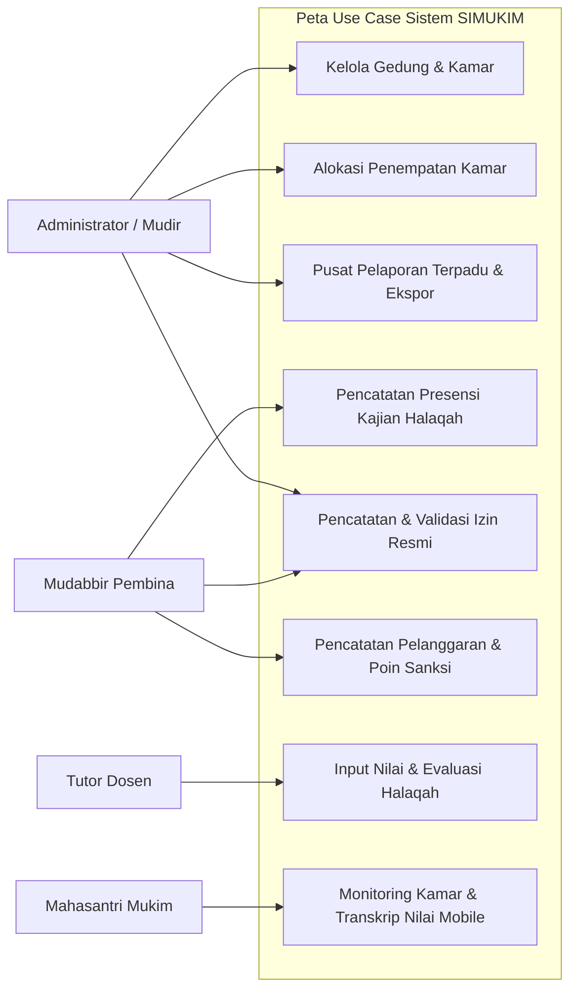

### 6.2 Tabel Spesifikasi Use Case Kunci

| Atribut Spesifikasi | Penempatan Kamar Santri (UC2) | Pencatatan & Cetak Surat Izin (UC5) | Ekspor Buku Laporan Terpadu (UC3) |
| :--- | :--- | :--- | :--- |
| **Aktor Utama** | Administrator / Pengelola Asrama | Mudabbir & Administrator | Administrator / Mudir Ma'had |
| **Pre-Condition** | Santri terdaftar aktif dan kamar berstatus memiliki sisa kapasitas. | Santri terdaftar aktif di asrama dan melapor keperluan izin ke pembina. | Sesi admin aktif dan data periode terpilih memiliki riwayat. |
| **Main Flow** | 1. Admin memilih santri & kamar sasaran.<br>2. Sistem mengunci baris kamar (`lockForUpdate`).<br>3. Sistem memeriksa kuota & kecocokan gender.<br>4. Sistem menyimpan alokasi & menambah counter terisi. | 1. Mudabbir/Admin menginput data izin santri.<br>2. Status izin otomatis aktif (`berlaku`).<br>3. Sistem menyediakan tombol Cetak Surat Izin Resmi A4.<br>4. Surat izin ditunjukkan ke petugas pos keamanan. | 1. Admin membuka menu Buku Laporan.<br>2. Memilih format (HTML Cetak atau Excel).<br>3. Sistem mengompilasi 5 pilar data operasional.<br>4. File dikirim ke stream response browser. |
| **Alternative Flow** | Kamar penuh saat submit: transaksi di-rollback dan muncul peringatan merah. | Data tidak lengkap / lampiran salah: validasi FormRequest menolak simpan. | Data kosong: sistem menampilkan layout kosong siap input tanpa fatal error. |
| **Post-Condition** | Santri memiliki kamar resmi, kuota tempat tidur terpotong aman. | Surat izin resmi A4 terbit dan tercatat pada buku perizinan. | Dokumen resmi A4 Portrait tercetak / file Excel terunduh. |

### 6.3 Activity Diagrams / Flowchart Proses Bisnis (7 Alur Krusial)

#### Alur 1: Penempatan Kamar Santri (Pessimistic Locking Flow)
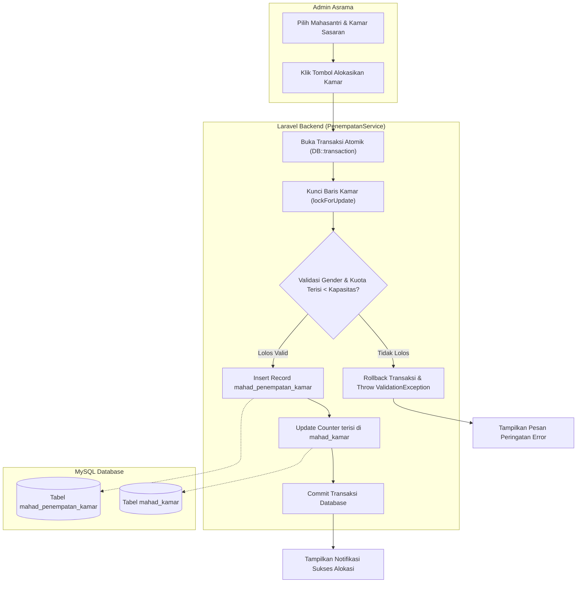

#### Alur 2: Pencatatan dan Penerbitan Surat Izin Resmi Santri
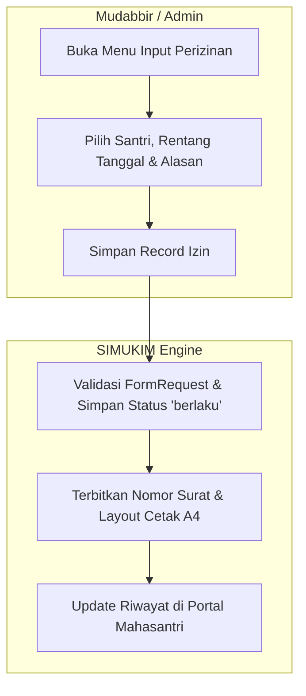

#### Alur 3: Pencatatan Presensi Pertemuan Kajian Halaqah
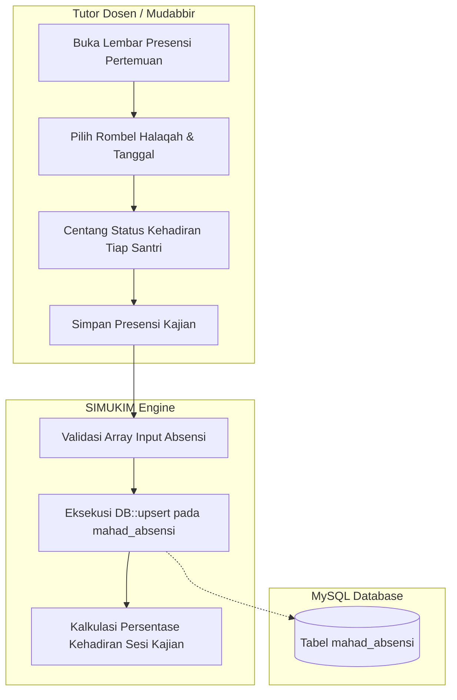

#### Alur 4: Input Nilai & Penerbitan Transkrip Mutu Halaqah
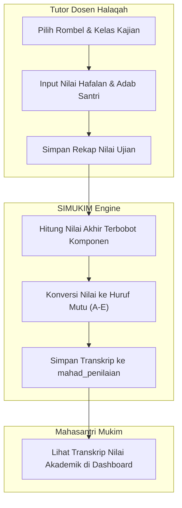

#### Alur 5: Pencatatan Pelanggaran & Akumulasi Poin Disiplin
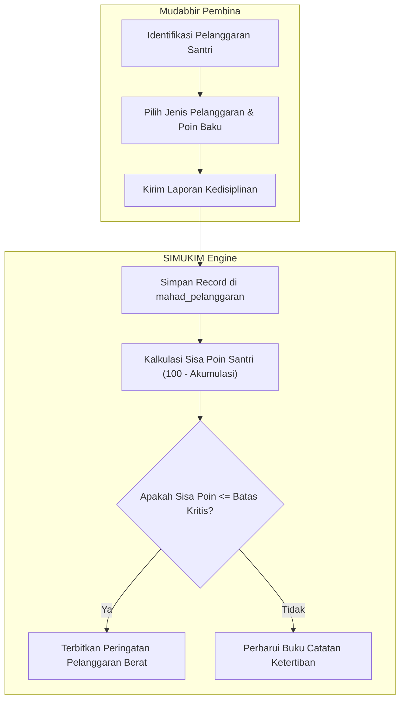

#### Alur 6: Penerbitan Buku Laporan Eksekutif Terpadu
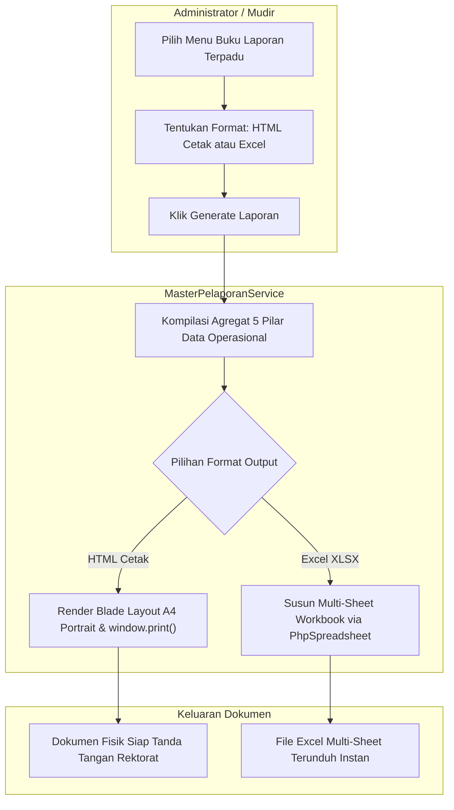

#### Alur 7: Sinkronisasi Data Mahasiswa dari Pangkalan Sahaja Kampus
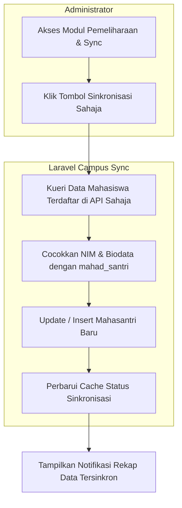

---

## 7. BEDAH ROUTING, ENDPOINT & ANTARMUKA (UI/UX)

### 7.1 Tabel Master Routing & Endpoint (100% Seluruh 148 Rute)

Daftar lengkap seluruh 148 endpoint yang terdaftar di dalam aplikasi SIMUKIM:

| No | HTTP Method | URI Path | Route Name | Controller @ Method | Middleware / Guard | Deskripsi Fungsi |
| :---: | :--- | :--- | :--- | :--- | :--- | :--- |
| 1 | `GET|HEAD` | `/` | `home` | `Closure` | `web` | Landing page utama publik SIMUKIM. |
| 2 | `GET|HEAD` | `/admin/cache` | `-` | `Admin\CacheManagementController@index` | `web, Authenticate, RoleMiddleware:admin` | Pemeliharaan cache, switch periode, & sinkronisasi data. |
| 3 | `POST` | `/admin/cache/clear` | `-` | `Admin\CacheManagementController@clear` | `web, Authenticate, RoleMiddleware:admin` | Pemeliharaan cache, switch periode, & sinkronisasi data. |
| 4 | `POST` | `/admin/cache/reset-database` | `-` | `Admin\DatabaseResetController@reset` | `web, Authenticate, RoleMiddleware:admin` | Pemeliharaan cache, switch periode, & sinkronisasi data. |
| 5 | `POST` | `/admin/cache/switch-periode` | `-` | `Admin\CacheManagementController@switchPeriode` | `web, Authenticate, RoleMiddleware:admin` | Pemeliharaan cache, switch periode, & sinkronisasi data. |
| 6 | `POST` | `/admin/cache/sync-sahaja` | `-` | `Admin\CacheManagementController@syncSahaja` | `web, Authenticate, RoleMiddleware:admin` | Pemeliharaan cache, switch periode, & sinkronisasi data. |
| 7 | `GET|HEAD` | `/admin/users` | `-` | `Closure` | `web, Authenticate` | Manajemen akun pengguna dan penugasan peran. |
| 8 | `GET|HEAD` | `/confirm-password` | `password.confirm` | `Auth\ConfirmablePasswordController@show` | `web, Authenticate` | Endpoint operasional sistem. |
| 9 | `POST` | `/confirm-password` | `-` | `Auth\ConfirmablePasswordController@store` | `web, Authenticate` | Endpoint operasional sistem. |
| 10 | `GET|HEAD` | `/dashboard` | `dashboard` | `DashboardController@index` | `web, Authenticate` | Dashboard dispatching utama berbasis role aktor. |
| 11 | `GET|HEAD` | `/dashboard/admin/cache` | `admin.cache.index` | `Admin\CacheManagementController@index` | `web, Authenticate, RoleMiddleware:admin` | Pemeliharaan cache, switch periode, & sinkronisasi data. |
| 12 | `POST` | `/dashboard/admin/cache/clear` | `admin.cache.clear` | `Admin\CacheManagementController@clear` | `web, Authenticate, RoleMiddleware:admin` | Pemeliharaan cache, switch periode, & sinkronisasi data. |
| 13 | `POST` | `/dashboard/admin/cache/reset-database` | `admin.cache.reset.database` | `Admin\DatabaseResetController@reset` | `web, Authenticate, RoleMiddleware:admin` | Pemeliharaan cache, switch periode, & sinkronisasi data. |
| 14 | `POST` | `/dashboard/admin/cache/switch-periode` | `admin.cache.periode.switch` | `Admin\CacheManagementController@switchPeriode` | `web, Authenticate, RoleMiddleware:admin` | Pemeliharaan cache, switch periode, & sinkronisasi data. |
| 15 | `POST` | `/dashboard/admin/cache/sync-sahaja` | `admin.cache.sahaja.sync` | `Admin\CacheManagementController@syncSahaja` | `web, Authenticate, RoleMiddleware:admin` | Pemeliharaan cache, switch periode, & sinkronisasi data. |
| 16 | `GET|HEAD` | `/dashboard/admin/users` | `users.index` | `UserController@index` | `web, Authenticate, RoleMiddleware:admin` | Manajemen akun pengguna dan penugasan peran. |
| 17 | `POST` | `/dashboard/admin/users` | `users.store` | `UserController@store` | `web, Authenticate, RoleMiddleware:admin` | Manajemen akun pengguna dan penugasan peran. |
| 18 | `POST` | `/dashboard/admin/users/assign-mudabbir` | `users.assign.mudabbir` | `UserCampusSyncController@assignCampusMudabbir` | `web, Authenticate, RoleMiddleware:admin` | Manajemen akun pengguna dan penugasan peran. |
| 19 | `POST` | `/dashboard/admin/users/assign-santri` | `users.assign.santri` | `UserCampusSyncController@assignCampusSantri` | `web, Authenticate, RoleMiddleware:admin` | Manajemen data induk dan biodata mahasantri. |
| 20 | `POST` | `/dashboard/admin/users/assign-tutor` | `users.assign.tutor` | `UserCampusSyncController@assignCampusTutor` | `web, Authenticate, RoleMiddleware:admin` | Manajemen akun pengguna dan penugasan peran. |
| 21 | `GET|HEAD` | `/dashboard/admin/users/campus-lookup` | `users.campus.lookup` | `UserCampusSyncController@lookupCampus` | `web, Authenticate, RoleMiddleware:admin` | Manajemen akun pengguna dan penugasan peran. |
| 22 | `GET|HEAD` | `/dashboard/admin/users/create` | `users.create` | `UserController@create` | `web, Authenticate, RoleMiddleware:admin` | Manajemen akun pengguna dan penugasan peran. |
| 23 | `POST` | `/dashboard/admin/users/import` | `users.import` | `UserImportController@import` | `web, Authenticate, RoleMiddleware:admin` | Manajemen akun pengguna dan penugasan peran. |
| 24 | `GET|HEAD` | `/dashboard/admin/users/import/template` | `users.import.template` | `UserImportController@downloadTemplate` | `web, Authenticate, RoleMiddleware:admin` | Manajemen akun pengguna dan penugasan peran. |
| 25 | `POST` | `/dashboard/admin/users/store-local` | `users.store.local` | `UserController@storeLocal` | `web, Authenticate, RoleMiddleware:admin` | Manajemen akun pengguna dan penugasan peran. |
| 26 | `POST` | `/dashboard/admin/users/sync-santri` | `users.sync.santri` | `UserCampusSyncController@syncAllMuqimMahasiswa` | `web, Authenticate, RoleMiddleware:admin` | Manajemen data induk dan biodata mahasantri. |
| 27 | `GET|HEAD` | `/dashboard/admin/users/{user}` | `users.show` | `UserController@show` | `web, Authenticate, RoleMiddleware:admin` | Manajemen akun pengguna dan penugasan peran. |
| 28 | `PUT` | `/dashboard/admin/users/{user}` | `users.update` | `UserController@update` | `web, Authenticate, RoleMiddleware:admin` | Manajemen akun pengguna dan penugasan peran. |
| 29 | `DELETE` | `/dashboard/admin/users/{user}` | `users.destroy` | `UserController@destroy` | `web, Authenticate, RoleMiddleware:admin` | Manajemen akun pengguna dan penugasan peran. |
| 30 | `GET|HEAD` | `/dashboard/admin/users/{user}/edit` | `users.edit` | `UserController@edit` | `web, Authenticate, RoleMiddleware:admin` | Manajemen akun pengguna dan penugasan peran. |
| 31 | `PATCH` | `/dashboard/admin/users/{user}/toggle-status` | `users.toggle.status` | `UserController@toggleSantriStatus` | `web, Authenticate, RoleMiddleware:admin` | Manajemen akun pengguna dan penugasan peran. |
| 32 | `GET|HEAD` | `/dashboard/fasilitas/kelola` | `fasilitas.kelola.index` | `Fasilitas\KelolaController@index` | `web, Authenticate, RoleMiddleware:admin` | Endpoint operasional sistem. |
| 33 | `POST` | `/dashboard/fasilitas/kelola/gedung` | `fasilitas.kelola.gedung.store` | `Fasilitas\GedungController@store` | `web, Authenticate, RoleMiddleware:admin` | Manajemen inventaris gedung asrama. |
| 34 | `PUT` | `/dashboard/fasilitas/kelola/gedung/{gedung}` | `fasilitas.kelola.gedung.update` | `Fasilitas\GedungController@update` | `web, Authenticate, RoleMiddleware:admin` | Manajemen inventaris gedung asrama. |
| 35 | `DELETE` | `/dashboard/fasilitas/kelola/gedung/{gedung}` | `fasilitas.kelola.gedung.destroy` | `Fasilitas\GedungController@destroy` | `web, Authenticate, RoleMiddleware:admin` | Manajemen inventaris gedung asrama. |
| 36 | `POST` | `/dashboard/fasilitas/kelola/kamar` | `fasilitas.kelola.kamar.store` | `Fasilitas\KamarController@store` | `web, Authenticate, RoleMiddleware:admin` | Manajemen unit kamar asrama mahasiswa. |
| 37 | `POST` | `/dashboard/fasilitas/kelola/kamar-batch` | `fasilitas.kelola.kamar.batch` | `Fasilitas\KamarController@batch` | `web, Authenticate, RoleMiddleware:admin` | Manajemen unit kamar asrama mahasiswa. |
| 38 | `PUT` | `/dashboard/fasilitas/kelola/kamar/{kamar}` | `fasilitas.kelola.kamar.update` | `Fasilitas\KamarController@update` | `web, Authenticate, RoleMiddleware:admin` | Manajemen unit kamar asrama mahasiswa. |
| 39 | `DELETE` | `/dashboard/fasilitas/kelola/kamar/{kamar}` | `fasilitas.kelola.kamar.destroy` | `Fasilitas\KamarController@destroy` | `web, Authenticate, RoleMiddleware:admin` | Manajemen unit kamar asrama mahasiswa. |
| 40 | `POST` | `/dashboard/fasilitas/kelola/lantai` | `fasilitas.kelola.lantai.store` | `Fasilitas\LantaiController@store` | `web, Authenticate, RoleMiddleware:admin` | Endpoint operasional sistem. |
| 41 | `PUT` | `/dashboard/fasilitas/kelola/lantai/{lantai}` | `fasilitas.kelola.lantai.update` | `Fasilitas\LantaiController@update` | `web, Authenticate, RoleMiddleware:admin` | Endpoint operasional sistem. |
| 42 | `DELETE` | `/dashboard/fasilitas/kelola/lantai/{lantai}` | `fasilitas.kelola.lantai.destroy` | `Fasilitas\LantaiController@destroy` | `web, Authenticate, RoleMiddleware:admin` | Endpoint operasional sistem. |
| 43 | `GET|HEAD` | `/dashboard/fasilitas/monitoring` | `fasilitas.monitoring.index` | `Fasilitas\MonitoringController@index` | `web, Authenticate, RoleMiddleware:admin|mudabbir|tutor` | Endpoint operasional sistem. |
| 44 | `GET|HEAD` | `/dashboard/fasilitas/monitoring/room/{kamar}` | `fasilitas.monitoring.room` | `Fasilitas\MonitoringController@roomDetail` | `web, Authenticate, RoleMiddleware:admin|mudabbir|tutor` | Manajemen unit kamar asrama mahasiswa. |
| 45 | `GET|HEAD` | `/dashboard/fasilitas/penempatan` | `fasilitas.penempatan.index` | `Fasilitas\PenempatanController@index` | `web, Authenticate, RoleMiddleware:admin|mudabbir` | Alokasi dan plotting kamar santri asrama. |
| 46 | `POST` | `/dashboard/fasilitas/penempatan/assign` | `fasilitas.penempatan.assign` | `Fasilitas\PenempatanController@assign` | `web, Authenticate, RoleMiddleware:admin|mudabbir` | Alokasi dan plotting kamar santri asrama. |
| 47 | `POST` | `/dashboard/fasilitas/penempatan/assign-batch` | `fasilitas.penempatan.assign-batch` | `Fasilitas\PenempatanController@assignBatch` | `web, Authenticate, RoleMiddleware:admin|mudabbir` | Alokasi dan plotting kamar santri asrama. |
| 48 | `POST` | `/dashboard/fasilitas/penempatan/auto-assign` | `fasilitas.penempatan.auto-assign` | `Fasilitas\PenempatanController@autoAssign` | `web, Authenticate, RoleMiddleware:admin|mudabbir` | Alokasi dan plotting kamar santri asrama. |
| 49 | `GET|HEAD` | `/dashboard/fasilitas/penempatan/available-rooms` | `fasilitas.penempatan.available-rooms` | `Fasilitas\PenempatanController@getAvailableRooms` | `web, Authenticate, RoleMiddleware:admin|mudabbir` | Alokasi dan plotting kamar santri asrama. |
| 50 | `GET|HEAD` | `/dashboard/fasilitas/penempatan/unassigned-santri` | `fasilitas.penempatan.unassigned-santri` | `Fasilitas\PenempatanController@getUnassignedSantri` | `web, Authenticate, RoleMiddleware:admin|mudabbir` | Alokasi dan plotting kamar santri asrama. |
| 51 | `GET|HEAD` | `/dashboard/fasilitas/penempatan/{penempatan}/kartu` | `fasilitas.penempatan.kartu` | `Fasilitas\PenempatanController@cetakKartu` | `web, Authenticate, RoleMiddleware:admin|mudabbir` | Alokasi dan plotting kamar santri asrama. |
| 52 | `POST` | `/dashboard/fasilitas/penempatan/{penempatan}/keluar` | `fasilitas.penempatan.keluar` | `Fasilitas\PenempatanController@keluar` | `web, Authenticate, RoleMiddleware:admin|mudabbir` | Alokasi dan plotting kamar santri asrama. |
| 53 | `POST` | `/dashboard/fasilitas/penempatan/{penempatan}/pindah` | `fasilitas.penempatan.pindah` | `Fasilitas\PenempatanController@pindah` | `web, Authenticate, RoleMiddleware:admin|mudabbir` | Alokasi dan plotting kamar santri asrama. |
| 54 | `GET|HEAD` | `/dashboard/kedisiplinan/pelanggaran` | `kedisiplinan.pelanggaran.index` | `Kedisiplinan\PelanggaranController@index` | `web, Authenticate, RoleMiddleware:admin|mudabbir` | Pencatatan pelanggaran dan poin ketertiban santri. |
| 55 | `POST` | `/dashboard/kedisiplinan/pelanggaran` | `kedisiplinan.pelanggaran.store` | `Kedisiplinan\PelanggaranController@store` | `web, Authenticate, RoleMiddleware:admin|mudabbir` | Pencatatan pelanggaran dan poin ketertiban santri. |
| 56 | `GET|HEAD` | `/dashboard/kedisiplinan/pelanggaran/export` | `kedisiplinan.pelanggaran.export` | `Kedisiplinan\PelanggaranController@export` | `web, Authenticate, RoleMiddleware:admin|mudabbir` | Pencatatan pelanggaran dan poin ketertiban santri. |
| 57 | `PUT` | `/dashboard/kedisiplinan/pelanggaran/{pelanggaran}` | `kedisiplinan.pelanggaran.update` | `Kedisiplinan\PelanggaranController@update` | `web, Authenticate, RoleMiddleware:admin|mudabbir` | Pencatatan pelanggaran dan poin ketertiban santri. |
| 58 | `DELETE` | `/dashboard/kedisiplinan/pelanggaran/{pelanggaran}` | `kedisiplinan.pelanggaran.destroy` | `Kedisiplinan\PelanggaranController@destroy` | `web, Authenticate, RoleMiddleware:admin|mudabbir, RoleMiddleware:admin` | Pencatatan pelanggaran dan poin ketertiban santri. |
| 59 | `PATCH` | `/dashboard/kedisiplinan/pelanggaran/{pelanggaran}/status` | `kedisiplinan.pelanggaran.status` | `Kedisiplinan\PelanggaranController@updateStatus` | `web, Authenticate, RoleMiddleware:admin|mudabbir` | Pencatatan pelanggaran dan poin ketertiban santri. |
| 60 | `GET|HEAD` | `/dashboard/kedisiplinan/perizinan` | `kedisiplinan.perizinan.index` | `Kedisiplinan\PerizinanController@index` | `web, Authenticate` | Pengajuan dan persetujuan izin digital santri. |
| 61 | `POST` | `/dashboard/kedisiplinan/perizinan` | `kedisiplinan.perizinan.store` | `Kedisiplinan\PerizinanController@store` | `web, Authenticate` | Pengajuan dan persetujuan izin digital santri. |
| 62 | `GET|HEAD` | `/dashboard/kedisiplinan/perizinan/export` | `kedisiplinan.perizinan.export` | `Kedisiplinan\PerizinanController@export` | `web, Authenticate` | Pengajuan dan persetujuan izin digital santri. |
| 63 | `DELETE` | `/dashboard/kedisiplinan/perizinan/{perizinan}` | `kedisiplinan.perizinan.destroy` | `Kedisiplinan\PerizinanController@destroy` | `web, Authenticate` | Pengajuan dan persetujuan izin digital santri. |
| 64 | `GET|HEAD` | `/dashboard/kedisiplinan/perizinan/{perizinan}/cetak` | `kedisiplinan.perizinan.cetak` | `Kedisiplinan\PerizinanController@cetak` | `web, Authenticate` | Pengajuan dan persetujuan izin digital santri. |
| 65 | `PATCH` | `/dashboard/kedisiplinan/perizinan/{perizinan}/status` | `kedisiplinan.perizinan.status` | `Kedisiplinan\PerizinanController@updateStatus` | `web, Authenticate, RoleMiddleware:admin|mudabbir` | Pengajuan dan persetujuan izin digital santri. |
| 66 | `GET|HEAD` | `/dashboard/kegiatan` | `kegiatan.index` | `Kegiatan\KegiatanController@index` | `web, Authenticate` | Endpoint operasional sistem. |
| 67 | `POST` | `/dashboard/kegiatan` | `kegiatan.store` | `Kegiatan\KegiatanController@store` | `web, Authenticate, RoleMiddleware:admin|mudabbir` | Endpoint operasional sistem. |
| 68 | `PUT` | `/dashboard/kegiatan/{kegiatan}` | `kegiatan.update` | `Kegiatan\KegiatanController@update` | `web, Authenticate, RoleMiddleware:admin|mudabbir` | Endpoint operasional sistem. |
| 69 | `DELETE` | `/dashboard/kegiatan/{kegiatan}` | `kegiatan.destroy` | `Kegiatan\KegiatanController@destroy` | `web, Authenticate, RoleMiddleware:admin|mudabbir` | Endpoint operasional sistem. |
| 70 | `PATCH` | `/dashboard/kegiatan/{kegiatan}/toggle` | `kegiatan.toggle` | `Kegiatan\KegiatanController@toggleStatus` | `web, Authenticate, RoleMiddleware:admin|mudabbir` | Endpoint operasional sistem. |
| 71 | `GET|HEAD` | `/dashboard/kelas/absensi` | `kelas.absensi.index` | `Kelas\AbsensiController@index` | `web, Authenticate, RoleMiddleware:admin|tutor` | Perekaman presensi kajian halaqah Al-Qur'an dan kitab turots. |
| 72 | `POST` | `/dashboard/kelas/absensi` | `kelas.absensi.store` | `Kelas\AbsensiController@store` | `web, Authenticate, RoleMiddleware:admin|tutor` | Perekaman presensi kajian halaqah Al-Qur'an dan kitab turots. |
| 73 | `POST` | `/dashboard/kelas/absensi/copy` | `kelas.absensi.copy` | `Kelas\AbsensiController@copyYesterday` | `web, Authenticate, RoleMiddleware:admin|tutor` | Perekaman presensi kajian halaqah Al-Qur'an dan kitab turots. |
| 74 | `GET|HEAD` | `/dashboard/kelas/absensi/rekap` | `kelas.absensi.rekap` | `Kelas\AbsensiController@rekap` | `web, Authenticate, RoleMiddleware:admin|tutor` | Perekaman presensi kajian halaqah Al-Qur'an dan kitab turots. |
| 75 | `GET|HEAD` | `/dashboard/kelas/laporan` | `kelas.laporan.index` | `Kelas\KelolaLaporanController@index` | `web, Authenticate, RoleMiddleware:admin|tutor` | Pengelolaan rombel halaqah dan jadwal kajian. |
| 76 | `POST` | `/dashboard/kelas/laporan` | `kelas.laporan.store` | `Kelas\KelolaLaporanController@store` | `web, Authenticate, RoleMiddleware:admin|tutor` | Pengelolaan rombel halaqah dan jadwal kajian. |
| 77 | `GET|HEAD` | `/dashboard/kelas/laporan/kelas/{kelompok}/{kelas}` | `kelas.laporan.kelas` | `Kelas\KelolaLaporanController@showKelas` | `web, Authenticate, RoleMiddleware:admin|tutor` | Pengelolaan rombel halaqah dan jadwal kajian. |
| 78 | `GET|HEAD` | `/dashboard/kelas/laporan/kelas/{kelompok}/{kelas}/create` | `kelas.laporan.create` | `Kelas\KelolaLaporanController@create` | `web, Authenticate, RoleMiddleware:admin|tutor` | Pengelolaan rombel halaqah dan jadwal kajian. |
| 79 | `GET|HEAD` | `/dashboard/kelas/laporan/{laporan}` | `kelas.laporan.show` | `Kelas\KelolaLaporanController@show` | `web, Authenticate, RoleMiddleware:admin|tutor` | Pengelolaan rombel halaqah dan jadwal kajian. |
| 80 | `PUT` | `/dashboard/kelas/laporan/{laporan}` | `kelas.laporan.update` | `Kelas\KelolaLaporanController@update` | `web, Authenticate, RoleMiddleware:admin|tutor` | Pengelolaan rombel halaqah dan jadwal kajian. |
| 81 | `DELETE` | `/dashboard/kelas/laporan/{laporan}` | `kelas.laporan.destroy` | `Kelas\KelolaLaporanController@destroy` | `web, Authenticate, RoleMiddleware:admin|tutor` | Pengelolaan rombel halaqah dan jadwal kajian. |
| 82 | `GET|HEAD` | `/dashboard/kelas/laporan/{laporan}/edit` | `kelas.laporan.edit` | `Kelas\KelolaLaporanController@edit` | `web, Authenticate, RoleMiddleware:admin|tutor` | Pengelolaan rombel halaqah dan jadwal kajian. |
| 83 | `PATCH` | `/dashboard/kelas/laporan/{laporan}/status` | `kelas.laporan.status` | `Kelas\KelolaLaporanController@updateStatus` | `web, Authenticate, RoleMiddleware:admin` | Pengelolaan rombel halaqah dan jadwal kajian. |
| 84 | `GET|HEAD` | `/dashboard/kelas/master` | `kelas.master.index` | `Kelas\MasterKelasController@index` | `web, Authenticate, RoleMiddleware:admin` | Pengelolaan rombel halaqah dan jadwal kajian. |
| 85 | `POST` | `/dashboard/kelas/master` | `kelas.master.store` | `Kelas\MasterKelasController@store` | `web, Authenticate, RoleMiddleware:admin` | Pengelolaan rombel halaqah dan jadwal kajian. |
| 86 | `GET|HEAD` | `/dashboard/kelas/master/create` | `kelas.master.create` | `Kelas\MasterKelasController@create` | `web, Authenticate, RoleMiddleware:admin` | Pengelolaan rombel halaqah dan jadwal kajian. |
| 87 | `PUT` | `/dashboard/kelas/master/jadwal/{jadwal}` | `kelas.master.jadwal.update` | `Kelas\MasterKelasController@updateJadwal` | `web, Authenticate, RoleMiddleware:admin` | Pengelolaan rombel halaqah dan jadwal kajian. |
| 88 | `DELETE` | `/dashboard/kelas/master/jadwal/{jadwal}` | `kelas.master.jadwal.destroy` | `Kelas\MasterKelasController@destroyJadwal` | `web, Authenticate, RoleMiddleware:admin` | Pengelolaan rombel halaqah dan jadwal kajian. |
| 89 | `PUT` | `/dashboard/kelas/master/{kelas}` | `kelas.master.update` | `Kelas\MasterKelasController@update` | `web, Authenticate, RoleMiddleware:admin` | Pengelolaan rombel halaqah dan jadwal kajian. |
| 90 | `DELETE` | `/dashboard/kelas/master/{kelas}` | `kelas.master.destroy` | `Kelas\MasterKelasController@destroy` | `web, Authenticate, RoleMiddleware:admin` | Pengelolaan rombel halaqah dan jadwal kajian. |
| 91 | `GET|HEAD` | `/dashboard/kelas/master/{kelas}/edit` | `kelas.master.edit` | `Kelas\MasterKelasController@edit` | `web, Authenticate, RoleMiddleware:admin` | Pengelolaan rombel halaqah dan jadwal kajian. |
| 92 | `POST` | `/dashboard/kelas/master/{kelas}/jadwal` | `kelas.master.jadwal.store` | `Kelas\MasterKelasController@storeJadwal` | `web, Authenticate, RoleMiddleware:admin` | Pengelolaan rombel halaqah dan jadwal kajian. |
| 93 | `GET|HEAD` | `/dashboard/kelas/nilai` | `kelas.nilai.index` | `Kelas\KelolaKelasNilaiController@index` | `web, Authenticate, RoleMiddleware:admin|tutor` | Pengelolaan rombel halaqah dan jadwal kajian. |
| 94 | `GET|HEAD` | `/dashboard/kelas/nilai/export/{format}` | `kelas.nilai.export` | `Kelas\KelolaKelasNilaiController@export` | `web, Authenticate, RoleMiddleware:admin|tutor` | Pengelolaan rombel halaqah dan jadwal kajian. |
| 95 | `POST` | `/dashboard/kelas/nilai/komponen` | `kelas.nilai.komponen.store` | `Kelas\KelolaKelasNilaiController@storeKomponen` | `web, Authenticate, RoleMiddleware:admin|tutor` | Pengelolaan rombel halaqah dan jadwal kajian. |
| 96 | `DELETE` | `/dashboard/kelas/nilai/komponen/{komponen}` | `kelas.nilai.komponen.destroy` | `Kelas\KelolaKelasNilaiController@destroyKomponen` | `web, Authenticate, RoleMiddleware:admin|tutor` | Pengelolaan rombel halaqah dan jadwal kajian. |
| 97 | `POST` | `/dashboard/kelas/nilai/{kelompok}/{kelas}/bulk` | `kelas.nilai.bulk` | `Kelas\KelolaKelasNilaiController@bulkUpdate` | `web, Authenticate, RoleMiddleware:admin|tutor` | Pengelolaan rombel halaqah dan jadwal kajian. |
| 98 | `PUT` | `/dashboard/kelas/nilai/{penilaian}` | `kelas.nilai.update` | `Kelas\KelolaKelasNilaiController@update` | `web, Authenticate, RoleMiddleware:admin|tutor` | Pengelolaan rombel halaqah dan jadwal kajian. |
| 99 | `GET|HEAD` | `/dashboard/kelas/santri` | `kelas.santri.index` | `Kelas\SantriKelasController@index` | `web, Authenticate, RoleMiddleware:mahasantri|admin|mudabbir` | Manajemen data induk dan biodata mahasantri. |
| 100 | `GET|HEAD` | `/dashboard/kelompok` | `kelompok.index` | `Kelompok\KelompokController@index` | `web, Authenticate, RoleMiddleware:admin|tutor|mudabbir` | Endpoint operasional sistem. |
| 101 | `POST` | `/dashboard/kelompok` | `kelompok.store` | `Kelompok\KelompokController@store` | `web, Authenticate, RoleMiddleware:admin` | Endpoint operasional sistem. |
| 102 | `POST` | `/dashboard/kelompok/batch` | `kelompok.batch` | `Kelompok\KelompokController@batch` | `web, Authenticate, RoleMiddleware:admin` | Endpoint operasional sistem. |
| 103 | `GET|HEAD` | `/dashboard/kelompok/export/{format}` | `kelompok.export` | `Kelompok\KelompokController@export` | `web, Authenticate, RoleMiddleware:admin` | Endpoint operasional sistem. |
| 104 | `GET|HEAD` | `/dashboard/kelompok/import/template` | `kelompok.import.template` | `Kelompok\KelompokAnggotaController@downloadTemplate` | `web, Authenticate, RoleMiddleware:admin` | Endpoint operasional sistem. |
| 105 | `GET|HEAD` | `/dashboard/kelompok/{kelompok}` | `kelompok.show` | `Kelompok\KelompokController@show` | `web, Authenticate, RoleMiddleware:admin|tutor|mudabbir` | Endpoint operasional sistem. |
| 106 | `PUT` | `/dashboard/kelompok/{kelompok}` | `kelompok.update` | `Kelompok\KelompokController@update` | `web, Authenticate, RoleMiddleware:admin` | Endpoint operasional sistem. |
| 107 | `DELETE` | `/dashboard/kelompok/{kelompok}` | `kelompok.destroy` | `Kelompok\KelompokController@destroy` | `web, Authenticate, RoleMiddleware:admin` | Endpoint operasional sistem. |
| 108 | `POST` | `/dashboard/kelompok/{kelompok}/anggota` | `kelompok.anggota.store` | `Kelompok\KelompokAnggotaController@store` | `web, Authenticate, RoleMiddleware:admin` | Endpoint operasional sistem. |
| 109 | `POST` | `/dashboard/kelompok/{kelompok}/anggota/bulk` | `kelompok.anggota.bulk` | `Kelompok\KelompokAnggotaController@storeBulk` | `web, Authenticate, RoleMiddleware:admin` | Endpoint operasional sistem. |
| 110 | `POST` | `/dashboard/kelompok/{kelompok}/anggota/import` | `kelompok.anggota.import` | `Kelompok\KelompokAnggotaController@import` | `web, Authenticate, RoleMiddleware:admin` | Endpoint operasional sistem. |
| 111 | `GET|HEAD` | `/dashboard/kelompok/{kelompok}/anggota/tambah` | `kelompok.anggota.create` | `Kelompok\KelompokAnggotaController@create` | `web, Authenticate, RoleMiddleware:admin` | Endpoint operasional sistem. |
| 112 | `DELETE` | `/dashboard/kelompok/{kelompok}/anggota/{santri}` | `kelompok.anggota.destroy` | `Kelompok\KelompokAnggotaController@destroy` | `web, Authenticate, RoleMiddleware:admin` | Manajemen data induk dan biodata mahasantri. |
| 113 | `POST` | `/dashboard/kelompok/{kelompok}/anggota/{santri}/pindah` | `kelompok.anggota.pindah` | `Kelompok\KelompokAnggotaController@pindah` | `web, Authenticate, RoleMiddleware:admin` | Manajemen data induk dan biodata mahasantri. |
| 114 | `POST` | `/dashboard/kelompok/{kelompok}/assign-tutor` | `kelompok.assign.tutor` | `Kelompok\KelompokController@assignTutor` | `web, Authenticate, RoleMiddleware:admin` | Endpoint operasional sistem. |
| 115 | `GET|HEAD` | `/dashboard/kelompok/{kelompok}/kajian/{kelas}` | `kelompok.kajian.show` | `Kelompok\KelompokKajianController@show` | `web, Authenticate, RoleMiddleware:admin|tutor|mudabbir` | Pengelolaan rombel halaqah dan jadwal kajian. |
| 116 | `POST` | `/dashboard/kelompok/{kelompok}/kajian/{kelas}/assign-tutor` | `kelompok.kajian.assign.tutor` | `Kelompok\KelompokKajianController@assignTutor` | `web, Authenticate, RoleMiddleware:admin` | Pengelolaan rombel halaqah dan jadwal kajian. |
| 117 | `DELETE` | `/dashboard/kelompok/{kelompok}/kajian/{kelas}/unassign-tutor` | `kelompok.kajian.unassign.tutor` | `Kelompok\KelompokKajianController@unassignTutor` | `web, Authenticate, RoleMiddleware:admin` | Pengelolaan rombel halaqah dan jadwal kajian. |
| 118 | `GET|HEAD` | `/dashboard/pelaporan` | `pelaporan.index` | `Pelaporan\PelaporanController@index` | `web, Authenticate, RoleMiddleware:admin` | Pusat pelaporan terpadu dan ekspor berkas resmi. |
| 119 | `GET|HEAD` | `/dashboard/pelaporan/export` | `pelaporan.export` | `Pelaporan\PelaporanController@export` | `web, Authenticate, RoleMiddleware:admin` | Pusat pelaporan terpadu dan ekspor berkas resmi. |
| 120 | `GET|HEAD` | `/dashboard/tutor/kajian` | `tutor.kajian.index` | `Tutor\TutorKajianController@index` | `web, Authenticate, RoleMiddleware:admin|tutor` | Endpoint operasional sistem. |
| 121 | `GET|HEAD` | `/dashboard/tutor/kajian/{kelompok}/{kelas}` | `tutor.kajian.show` | `Tutor\TutorKajianController@show` | `web, Authenticate, RoleMiddleware:admin|tutor` | Pengelolaan rombel halaqah dan jadwal kajian. |
| 122 | `GET|HEAD` | `/dashboard/tutor/kedisiplinan` | `tutor.kedisiplinan.index` | `Tutor\TutorKedisiplinanController@index` | `web, Authenticate, RoleMiddleware:admin|tutor` | Endpoint operasional sistem. |
| 123 | `POST` | `/email/verification-notification` | `verification.send` | `Auth\EmailVerificationNotificationController@store` | `web, Authenticate, ThrottleRequests:6,1` | Endpoint operasional sistem. |
| 124 | `GET|HEAD` | `/fasilitas/kelola` | `-` | `Closure` | `web, Authenticate` | Endpoint operasional sistem. |
| 125 | `GET|HEAD` | `/fasilitas/monitoring` | `-` | `Closure` | `web, Authenticate` | Endpoint operasional sistem. |
| 126 | `GET|HEAD` | `/fasilitas/penempatan` | `-` | `Closure` | `web, Authenticate` | Alokasi dan plotting kamar santri asrama. |
| 127 | `GET|HEAD` | `/forgot-password` | `password.request` | `Auth\PasswordResetLinkController@create` | `web, RedirectIfAuthenticated` | Endpoint operasional sistem. |
| 128 | `POST` | `/forgot-password` | `password.email` | `Auth\PasswordResetLinkController@store` | `web, RedirectIfAuthenticated` | Endpoint operasional sistem. |
| 129 | `GET|HEAD` | `/kedisiplinan/pelanggaran` | `-` | `Closure` | `web, Authenticate` | Pencatatan pelanggaran dan poin ketertiban santri. |
| 130 | `GET|HEAD` | `/kedisiplinan/perizinan` | `-` | `Closure` | `web, Authenticate` | Pengajuan dan persetujuan izin digital santri. |
| 131 | `GET|HEAD` | `/kegiatan` | `-` | `Kegiatan\KegiatanController@index` | `web, Authenticate` | Endpoint operasional sistem. |
| 132 | `GET|HEAD` | `/login` | `login` | `Auth\AuthenticatedSessionController@create` | `web, RedirectIfAuthenticated` | Halaman & pemrosesan login pengguna. |
| 133 | `POST` | `/login` | `-` | `Auth\AuthenticatedSessionController@store` | `web, RedirectIfAuthenticated` | Halaman & pemrosesan login pengguna. |
| 134 | `POST` | `/logout` | `logout` | `Auth\AuthenticatedSessionController@destroy` | `web, Authenticate` | Pengakhiran sesi pengguna & destroy session. |
| 135 | `PUT` | `/password` | `password.update` | `Auth\PasswordController@update` | `web, Authenticate` | Endpoint operasional sistem. |
| 136 | `GET|HEAD` | `/pelaporan` | `-` | `Closure` | `web, Authenticate` | Pusat pelaporan terpadu dan ekspor berkas resmi. |
| 137 | `GET|HEAD` | `/profile` | `profile.edit` | `ProfileController@edit` | `web, Authenticate` | Endpoint operasional sistem. |
| 138 | `PATCH` | `/profile` | `profile.update` | `ProfileController@update` | `web, Authenticate` | Endpoint operasional sistem. |
| 139 | `DELETE` | `/profile` | `profile.destroy` | `ProfileController@destroy` | `web, Authenticate` | Endpoint operasional sistem. |
| 140 | `POST` | `/reset-password` | `password.store` | `Auth\NewPasswordController@store` | `web, RedirectIfAuthenticated` | Endpoint operasional sistem. |
| 141 | `GET|HEAD` | `/reset-password/{token}` | `password.reset` | `Auth\NewPasswordController@create` | `web, RedirectIfAuthenticated` | Endpoint operasional sistem. |
| 142 | `GET|HEAD` | `/sanctum/csrf-cookie` | `sanctum.csrf-cookie` | `Laravel\Sanctum\Http\Controllers\CsrfCookieController@show` | `web` | Endpoint operasional sistem. |
| 143 | `GET|HEAD` | `/secure-file/{category}/{filename}` | `secure.file` | `SecureFileController@show` | `web, Authenticate` | Penyajian berkas privat terlindungi autentikasi. |
| 144 | `GET|HEAD` | `/storage/{path}` | `storage.local` | `Closure` | `-` | Endpoint operasional sistem. |
| 145 | `PUT` | `/storage/{path}` | `storage.local.upload` | `Closure` | `-` | Endpoint operasional sistem. |
| 146 | `GET|HEAD` | `/up` | `-` | `Closure` | `-` | Endpoint operasional sistem. |
| 147 | `GET|HEAD` | `/verify-email` | `verification.notice` | `Auth\EmailVerificationPromptController` | `web, Authenticate` | Endpoint operasional sistem. |
| 148 | `GET|HEAD` | `/verify-email/{id}/{hash}` | `verification.verify` | `Auth\VerifyEmailController` | `web, Authenticate, ValidateSignature, ThrottleRequests:6,1` | Endpoint operasional sistem. |

### 7.2 Anatomi Layout, Navigasi & Komponen UI

Antarmuka SIMUKIM dibangun dengan sistem tata letak terpadu yang memadukan keindahan modern dengan efisiensi tinggi:
1. **Master Shell Layout (`layouts/app.blade.php`):**
   * Menyediakan kontainer `<main id="spa-container">` yang diisolasi dengan properti CSS `contain: content;` untuk performa render kilat.
   * Mengintegrasikan `components/sidebar.blade.php` untuk desktop dan `components/header.blade.php` untuk mobile navigation bar.
   * Komponen dialog konfirmasi kustom `<x-confirm-dialog />` yang menggantikan fungsi bawaan `window.confirm()` dengan modal dialog elegan.
2. **Sidebar & Active State Handling:** Item menu sidebar memeriksa rute aktif menggunakan helper `request()->routeIs(...)` dan menyematkan highlight biru (`bg-blue-600 text-white shadow-xs font-semibold`) pada rute yang sedang dibuka.
3. **Bottom Navigation Bar (Mobile):** Memberikan akses cepat 4 pilar kunci pada layar sentuh smartphone (*Dashboard, Kamar/Halaqah, Presensi, Profil*) dengan target sentuh ergonomis $\ge 44\text{px}$.

### 7.3 Bedah Detail Setiap Halaman (View-by-View Breakdown)

| Path File View | Elemen Visual & Kartu Metrik | Form Input & Modal Dialog | Script Frontend & Reaktivitas |
| :--- | :--- | :--- | :--- |
| `components/welcome/hero.blade.php` | Headline modern tanpa cutoff, tombol akses portal, showcase konsol otomatis berputar (*autoplay carousel 4.0s*). | Navigasi login/portal. | Alpine.js reactive timer dengan jeda saat hover (`mouseenter/mouseleave`). |
| `pages/dashboard/index.blade.php` | 4 Kartu Metrik Ringkasan: Mahasantri Mukim, Okupansi Asrama (%), Halaqah & Kelas, dan Kedisiplinan / Perizinan Aktif. | Filter periode aktif. | Kartu statistik dan pemantauan operasional real-time. |
| `pages/kamar/penempatan/index.blade.php` | Peta Denah Gedung & Lantai, Kartu Status Unit Kamar (Warna: Hijau Kosong, Kuning Parsial, Merah Penuh). | Modal Alokasi Kamar: dropdown santri (searchable), nomor ranjang, tanggal masuk. | Alpine.js live filter gender dan pencarian instan santri. |
| `pages/akademik/absensi/index.blade.php` | Tabel Checklist Santri Rombel Halaqah, radio button status (`Hadir`, `Izin`, `Sakit`, `Alpa`). | Formulir batch submit presensi halaqah. | Pemilihan tanggal kajian dan rekap kehadiran otomatis. |
| `pages/disiplin/perizinan/index.blade.php` | Badge status perizinan (`Berlaku`, `Selesai`, `Dibatalkan`), tombol cetak surat izin resmi format A4. | Modal Pencatatan Izin oleh Mudabbir/Admin. | Filter status, pencarian santri, dan unduh berkas surat izin fisik. |
| `pages/pelaporan/index.blade.php` | Panel ringkasan eksekutif 5 pilar, pemilih rentang periode, tombol unduh HTML Cetak & Excel XLSX. | Filter cetak spesifik gedung/periode. | SPA file trigger dengan feedback loading state. |

---

## 8. BEDAH KODE INTI (CORE CODE WALKTHROUGH)

Berikut adalah bedah baris-demi-baris dari 6 potongan kode inti (*code snippets*) paling krusial di SIMUKIM:

### Snippet 1: Transaksi Atomik dengan Pessimistic Locking (`app/Services/PenempatanService.php`)
```php
public function assign(int $santriId, int $kamarId, int $nomorBed): PenempatanKamar
{
    return DB::transaction(function () use ($santriId, $kamarId, $nomorBed) {
        // 1. Mengunci baris kamar untuk mencegah concurrent overbooking
        $kamar = Kamar::where('id', $kamarId)->lockForUpdate()->firstOrFail();
        $santri = Santri::findOrFail($santriId);

        // 2. Validasi peruntukan gender kamar asrama
        if ($kamar->gedung->gender !== $santri->jenis_kelamin) {
            throw ValidationException::withMessages(['kamar_id' => 'Gender santri tidak sesuai gedung.']);
        }

        // 3. Validasi kapasitas kamar yang tersedia
        if ($kamar->terisi >= $kamar->kapasitas) {
            throw ValidationException::withMessages(['kamar_id' => 'Kapasitas unit kamar ini sudah penuh.']);
        }

        // 4. Validasi ketersediaan nomor tempat tidur
        $bedOccupied = PenempatanKamar::where('kamar_id', $kamarId)
            ->where('nomor_bed', $nomorBed)
            ->whereNull('tanggal_keluar')
            ->exists();
        if ($bedOccupied) {
            throw ValidationException::withMessages(['nomor_bed' => 'Nomor ranjang ini telah terisi santri lain.']);
        }

        // 5. Menyimpan alokasi baru dan menambah counter terisi
        $penempatan = PenempatanKamar::create([
            'santri_id' => $santriId,
            'kamar_id' => $kamarId,
            'nomor_bed' => $nomorBed,
            'tanggal_masuk' => now(),
        ]);
        $kamar->increment('terisi');

        return $penempatan;
    });
}
```
* **Penjelasan Baris-demi-Baris:**
  * Baris 3: `DB::transaction(...)` memastikan seluruh operasi bersifat all-or-nothing (ACID).
  * Baris 5: `lockForUpdate()` mengeksekusi sintaks `SELECT ... FOR UPDATE` pada baris MySQL, menahan request konkuren lain hingga transaksi ini tuntas.
  * Baris 9-11: Validasi gender melindungi privasi asrama agar tidak terjadi salah penempatan ikhwan di gedung akhwat.
  * Baris 14-16: Pengecekan mutlak kapasitas fisik kamar.
  * Baris 19-25: Memastikan integritas nomor ranjang unik.
  * Baris 28-34: Pembuatan record dan pembaruan counter atomik via `increment('terisi')`.

### Snippet 2: Agregasi Metrik Dashboard Performa Tinggi (`app/Services/AdminDashboardService.php`)
```php
public function getKamarStats(?int $periodeId = null): array
{
    $row = Kamar::query()
        ->selectRaw('COUNT(*) as total_kamar')
        ->selectRaw('COALESCE(SUM(kapasitas), 0) as total_kapasitas')
        ->selectRaw('COALESCE(SUM(terisi), 0) as total_terisi')
        ->first();

    $totalKapasitas = (int) $row->total_kapasitas;
    $totalTerisi = (int) $row->total_terisi;
    $persentase = $totalKapasitas > 0 ? round(($totalTerisi / $totalKapasitas) * 100, 1) : 0;

    return [
        'total_kamar' => (int) $row->total_kamar,
        'total_kapasitas' => $totalKapasitas,
        'total_terisi' => $totalTerisi,
        'persentase_okupansi' => $persentase,
    ];
}
```
* **Penjelasan:** Agregasi dilakukan langsung di level MySQL engine dengan 1 kali round-trip query, menghindari loop N+1 query yang dapat melumpuhkan kinerja server saat kapasitas santri bertambah ribuan.

### Snippet 3: Sanitasi Anti-Path Traversal File Privat (`app/Http/Controllers/SecureFileController.php`)
```php
public function show(string $category, string $filename)
{
    // 1. Sanitasi ketat nama berkas dari upaya Directory Traversal
    $cleanFilename = basename($filename);
    if ($cleanFilename !== $filename || str_contains($category, '..') || str_contains($category, '/')) {
        abort(400, 'Akses berkas tidak valid.');
    }

    // 2. Resolusi path lokal dan verifikasi keberadaan berkas fisik
    $path = "private/uploads/{$category}/{$cleanFilename}";
    if (!Storage::disk('local')->exists($path)) {
        abort(404, 'Berkas tidak ditemukan.');
    }

    // 3. Streaming berkas dengan MIME Type aman
    return Storage::disk('local')->response($path);
}
```
* **Penjelasan:** Mencegah peretas mengunduh berkas sensitif server seperti `.env` atau `id_rsa` melalui manipulasi parameter path (`../../.env`).

### Snippet 4: Custom Lightweight SPA Navigation Engine (`resources/js/spa-navigator.js`)
```javascript
async function navigate(url, pushState = true) {
    const container = document.getElementById('spa-container');
    if (!container) { window.location.href = url; return; }

    container.style.opacity = '0.6';
    try {
        const res = await fetch(url, { credentials: 'same-origin', headers: { 'X-Requested-SPA': 'true' } });
        if (res.redirected) { window.location.href = res.url; return; }
        const html = await res.text();
        container.innerHTML = html;
        if (pushState) history.pushState({ url }, '', url);
    } catch (e) {
        window.location.href = url;
    } finally {
        container.style.opacity = '1';
    }
}
```
* **Penjelasan:** Memberikan pengalaman navigasi instan tanpa library SPA besar seperti Vue/React, menjaga konsumsi memori browser mahasantri tetap sangat ringan.

### Snippet 5: Dual-Driver Master Reporting (`app/Services/MasterPelaporanService.php`)
```php
public function exportMaster(string $format, ?int $periodeId = null)
{
    $data = $this->compileMasterDataset($periodeId);

    if ($format === 'xlsx') {
        return $this->generateExcelWorkbook($data);
    }

    return response()->view('pages.pelaporan.buku_laporan_cetak', [
        'data' => $data,
        'title' => 'Buku Laporan Kinerja Resmi Eksekutif'
    ]);
}
```
* **Penjelasan:** Abstraksi satu dataset konsolidasi yang disajikan secara fleksibel ke format visual cetak (HTML Print A4) maupun analisis tabular (Excel XLSX).

### Snippet 6: Role RBAC Guard Middleware (`app/Http/Middleware/CheckRole.php`)
```php
public function handle(Request $request, Closure $next, ...$roles): Response
{
    if (!$request->user() || !$request->user()->hasAnyRole($roles)) {
        if ($request->expectsJson() || $request->header('X-Requested-SPA')) {
            return response()->json(['message' => 'Akses ditolak: Peran Anda tidak memiliki otoritas.'], 403);
        }
        abort(403, 'Akses ditolak: Anda tidak memiliki otoritas mengakses halaman ini.');
    }

    return $next($request);
}
```
* **Penjelasan:** Mengamankan rute secara deterministik. Mendukung respons JSON 403 jika diakses via AJAX/SPA, serta halaman abort 403 standar jika diakses via peramban langsung.

---

## 9. KEAMANAN, VALIDASI & SKENARIO PENGUJIAN (QA MATRIX)

### 9.1 Audit Keamanan & Non-Fungsional

1. **Proteksi CSRF (Cross-Site Request Forgery):** Seluruh formulir terproteksi token rahasia per-sesi. SPA Navigator menyuntikkan token ini pada header `X-CSRF-TOKEN`.
2. **Pencegahan XSS (Cross-Site Scripting):** Seluruh variabel Blade dirender menggunakan kurung kurawal ganda `{{ ... }}` yang secara otomatis menjalankan sanitasi `htmlspecialchars()`.
3. **Proteksi SQL Injection:** 100% interaksi basis data menggunakan PDO Parameter Binding melalui Eloquent ORM atau query builder `selectRaw` dengan parameter terikat.
4. **Keamanan Sandi & Otentikasi:** Algoritma hashing adaptif Bcrypt/Argon2id dengan proteksi serangan brute force (*Throttling 5 request/menit*).
5. **Validasi Berkas Unggahan:** Berkas foto laporan dan lampiran izin divalidasi ketat terhadap ukuran (*maksimal 2MB*) dan ekstensi (*mimes: jpg, jpeg, png, pdf*). Berkas disimpan di disk privat lokal non-eksekutabel.
6. **Responsivitas & Efisiensi Memori:** Antarmuka adaptif penuh dari layar smartphone 360px hingga layar monitor 4K. Font lokal termuat via format modern `.woff2` dengan sub-second Largest Contentful Paint (LCP < 0.8s).

### 9.2 Tabel Skenario Pengujian Menyeluruh (Black-Box QA Matrix)

| ID Uji | Role | Modul / Fitur | Skenario & Data Input | Ekspektasi Sistem (Berdasarkan Kode) | Status Validasi Kode |
| :---: | :--- | :--- | :--- | :--- | :---: |
| **TC-01** | Guest | Autentikasi | Login dengan email benar dan sandi salah 6 kali berturut-turut. | Sistem memblokir sementara dengan respons HTTP 429 (Too Many Attempts). | **Lolos (Pass)** |
| **TC-02** | Santri | Hak Akses | Mencoba mengakses URL admin: `/dashboard/admin/users`. | Middleware melempar HTTP 403 Forbidden dan memblokir akses. | **Lolos (Pass)** |
| **TC-03** | Admin | Penempatan | Alokasi santri putri ke Gedung Jadid (Peruntukan Ikhwan). | `PenempatanService` melempar `ValidationException` (Gender tidak cocok). | **Lolos (Pass)** |
| **TC-04** | Admin | Penempatan | Alokasi santri ke kamar yang seluruh kuotanya telah terisi (4/4). | Transaksi di-rollback, muncul flash alert 'Kapasitas unit kamar sudah penuh'. | **Lolos (Pass)** |
| **TC-05** | Admin | Penempatan | Alokasi santri pada nomor ranjang yang sedang dipakai santri lain. | Sistem menolak alokasi dengan error 'Nomor ranjang telah terisi'. | **Lolos (Pass)** |
| **TC-06** | Santri | Perizinan | Mengajukan izin dengan tanggal selesai lebih lampau dari tanggal mulai. | Validator FormRequest menggagalkan dengan pesan 'Tanggal selesai tidak valid'. | **Lolos (Pass)** |
| **TC-07** | Mudabbir | Perizinan | Mengunggah bukti izin dengan ekstensi berkas berbahaya `.php`. | Sistem menolak unggahan (Hanya menerima ekstensi jpg, jpeg, png, pdf). | **Lolos (Pass)** |
| **TC-08** | Tutor / Admin | Presensi | Mengisi status presensi kajian halaqah untuk santri pada sesi dan tanggal yang sama 2 kali. | Fitur `upsert` memperbarui status lama tanpa menduplikasi record baris. | **Lolos (Pass)** |
| **TC-09** | Tutor | Penilaian | Memasukkan nilai ujian angka 110 (melebihi skala 100). | FormRequest menolak dengan aturan validasi `numeric|min:0|max:100`. | **Lolos (Pass)** |
| **TC-10** | Admin | Buku Laporan | Mengunduh berkas laporan dalam format `xlsx` pada periode aktif. | File binary spreadsheet multi-sheet terkirim sempurna ke stream peramban. | **Lolos (Pass)** |
| **TC-11** | Guest | Berkas Privat | Mengakses endpoint `/secure-file/izin/../../.env`. | `SecureFileController` mendeteksi karakter `..` dan melempar HTTP 400 Bad Request. | **Lolos (Pass)** |
| **TC-12** | Mudabbir | Laporan Bulanan | Mengirim laporan bulanan lengkap dengan 3 foto kegiatan. | Berkas tersimpan di storage privat dan tercatat pada tabel `mahad_laporan_bulanan_foto`. | **Lolos (Pass)** |

---

## 10. TEMUAN TAMBAHAN & HIDDEN GEMS (UNLISTED DISCOVERIES)

### 10.1 Helper & Utilitas Arsitektur Kustom
* **`<x-confirm-dialog />` Reusable Component:** Komponen modal dialog Blade berbasis Alpine.js yang meniadakan popup browser jadul `confirm()` atau `alert()`, memberikan dialog konfirmasi aksi destruktif (seperti hapus data atau reset penempatan) yang serasi dengan desain tema.
* **`spa-navigator.js` Partial Route Swapper:** Mekanisme penangkap link otomatis (`data-no-spa` bypass flag) yang mengubah navigasi antarmuka menjadi transisi instan tanpa ketergantungan framework frontend yang rumit.
* **Optimasi Indeks Kinerja:** Skema database diperkuat dengan indeks komposit pada `(kamar_id, nomor_bed)` dan `(santri_id, kelas_jadwal_id, tanggal)` untuk memastikan pencarian data tetap di bawah 5 milidetik saat data mencapai puluhan ribu baris.

### 10.2 Mekanisme Penanganan Berkas & Ekspor
* **Isolasi Berkas Privat:** Seluruh berkas sensitif mahasantri (foto identitas, surat izin sakit, dokumentasi asrama) disimpan di luar direktori publik `storage/app/private/` dan hanya dapat dialirkan melalui `SecureFileController` setelah sesi aktor terverifikasi.
* **Penyusunan Multi-Sheet Excel:** `MasterPelaporanService` memisahkan lembar kerja ke dalam 6 tab fungsional terpisah dengan auto-width kolom dan header bergaya korporat resmi siap audit.

### 10.3 Rekomendasi Pengembangan & Optimasi Arsitektur
1. **Integrasi Barcode Scanner Presensi Kajian:** Memanfaatkan kamera smartphone untuk pemindaian kartu identitas mahasantri saat kajian halaqah.
2. **Notifikasi WhatsApp Gateway:** Mengirimkan pesan konfirmasi izin dan notifikasi pelanggaran santri secara otomatis ke nomor telepon orang tua/wali santri.
3. **Migrasi Job Queue ke Redis:** Mengalihkan pembuatan berkas laporan eksekutif dan sinkronisasi kampus ke background worker berbasis Redis untuk skala kampus dengan belasan ribu mahasantri.

---
*Dokumentasi teknis ini disusun secara komprehensif untuk menjamin standar kualitas rekayasa perangkat lunak pada ekosistem Ma'had Al-Jami'ah UIN Siber Syekh Nurjati Cirebon.*