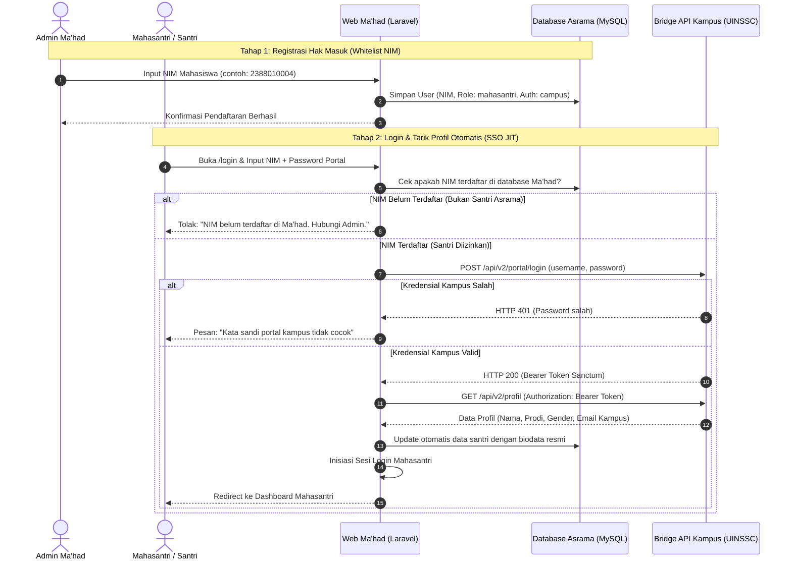

# Dokumentasi Arsitektur & Integrasi Autentikasi Bridge API v2 (SSO)
**Aplikasi**: Muqim Asrama (Ma'had Al-Jami'ah)  
**Institusi Kampus**: UIN Siber Syekh Nurjati Cirebon (`uinssc.ac.id`)  
**Basis Sistem Kampus**: eCampuz SIAKAD Bridge API v2  
**Target Server API**: `https://bridge.uinssc.ac.id`  

---

## 1. Ringkasan Eksekutif & Latar Belakang

Sistem Ma'had Al-Jami'ah V2 terintegrasi langsung dengan pangkalan data universitas melalui **Bridge API v2 (Auth & Profil)**. Integrasi ini menerapkan standar **Single Sign-On (SSO)** dengan konsep **Just-In-Time (JIT) Provisioning** dan **Gatekeeper Keamanan Asrama**.

### 1.1 Perbedaan Server Dummy vs Bridge API Riil

| Aspek | Dummy Mock Lama (`server.py`) | Bridge API v2 Riil Kampus (`uinssc.ac.id`) |
| :--- | :--- | :--- |
| **Status** | Prototype / Mock Dummy Lokal | Server Resmi Universitas UINSSC |
| **Port / Host** | `http://127.0.0.1:8001` | `https://bridge.uinssc.ac.id` |
| **Pencarian Data (Lookup)** | Tersedia `GET /api/v1/lookup` (tanpa password) | **Tidak Tersedia** (dilindungi hak privasi data mahasiswa) |
| **Akses Profil** | Publik tanpa otentikasi | **Hanya via Bearer Token** setelah autentikasi password |
| **Otentikasi Kredensial** | Dummy JSON di memori | Riil terhadap database SIAKAD eCampuz |

---

## 2. Arsitektur & Alur Kerja Otentikasi

Integrasi ini dirancang dengan prinsip **Zero-Manual Data Entry** dan **Zero-Password Storage**:
- Admin asrama **tidak perlu** mengetik Nama, Program Studi, Jenis Kelamin, atau Email santri secara manual.
- Admin hanya mendaftarkan **NIM** sebagai izin hak masuk asrama (*whitelist*).
- Seluruh biodata resmi ditarik secara otomatis langsung dari server kampus saat santri melakukan login pertama kali.
- Kata sandi portal kampus **tidak pernah disimpan** di database Ma'had.

### 2.1 Diagram Alur Autentikasi & Sinkronisasi Biodata



---

## 3. Spesifikasi Teknis Endpoint Bridge API v2

Mengacu pada spesifikasi Postman Collection `Bridge API v2 (Auth & Profil).json`:

### 3.1 Endpoint 1: Login Portal Kampus
- **URL**: `POST https://bridge.uinssc.ac.id/api/v2/portal/login`
- **Headers**:
  ```http
  Accept: application/json
  Content-Type: application/x-www-form-urlencoded
  ```
- **Request Body**:
  | Parameter | Tipe | Deskripsi |
  | :--- | :--- | :--- |
  | `username` | string | NIM Mahasiswa atau NIP Dosen/Pegawai |
  | `password` | string | Kata sandi akun portal akademik kampus |

- **Respon Sukses (HTTP 200)**:
  ```json
  {
    "status": true,
    "message": "Login berhasil",
    "data": {
      "token": "1|sanctum_bearer_token_string..."
    }
  }
  ```

- **Respon Gagal**:
  - HTTP 401: `{"status": false, "message": "Password salah"}`
  - HTTP 404: `{"status": false, "message": "Not Found"}` (NIM tidak terdaftar di SIAKAD)

---

### 3.2 Endpoint 2: Pengambilan Profil Pengguna
- **URL**: `GET https://bridge.uinssc.ac.id/api/v2/profil`
- **Headers**:
  ```http
  Accept: application/json
  Authorization: Bearer <token_hasil_login>
  ```

- **Mapping Atribut ke Database Ma'had**:
  | Atribut Response Bridge API | Kolom Database Ma'had (`users` / `mahad_santri`) | Keterangan |
  | :--- | :--- | :--- |
  | `nim` / `nip` | `users.nomor_induk` | Identitas unik |
  | `nama` / `name` | `users.name` | Nama lengkap resmi |
  | `email_kampus` / `email` | `users.email` | Alamat email civitas |
  | `prodi_nama` / `prodi` | `mahad_santri.prodi` | Program studi aktif |
  | `jenis_kelamin` / `gender` | `mahad_santri.gender` | Normalisasi ke 'L' atau 'P' |
  | `angkatan` / `tahun_masuk` | `mahad_santri.angkatan` | Tahun angkatan kuliah |

---

## 4. Penanganan Masalah SSL (cURL Error 60)

### 4.1 Penyebab Masalah
Pada saat PHP berkomunikasi dengan `https://bridge.uinssc.ac.id`, muncul pesan:
```text
cURL error 60: SSL certificate OpenSSL verify result: self-signed certificate in certificate chain (19)
```
Hal ini terjadi karena server Bridge API kampus menggunakan sertifikat dalam rantai *internal/self-signed*, sedangkan bundle CA `curl.cainfo` standar PHP di Windows/XAMPP belum mempercayai root issuer tersebut.

### 4.2 Solusi yang Diterapkan
1. **Dukungan Konfigurasi Fleksibel** di [.env](file:///c:/xampp/htdocs/mahad/mahad-v2/.env):
   ```env
   CAMPUS_API_BASE_URL=https://bridge.uinssc.ac.id
   CAMPUS_API_VERIFY_SSL=false
   ```
2. **Implementasi HTTP Client Tanpa Verifikasi Ketat** di [CampusApiService.php](file:///c:/xampp/htdocs/mahad/mahad-v2/app/Services/CampusApiService.php):
   ```php
   protected function client()
   {
       $http = Http::timeout($this->timeout)->acceptJson();
       if (!$this->verifySsl) {
           $http = $http->withoutVerifying();
       }
       return $http;
   }
   ```
   Pengaturan ini membuat komunikasi HTTPS ke server Bridge API kampus berjalan mulus di lingkungan lokal maupun staging tanpa terhalang validasi sertifikat lokal.

---

## 5. Struktur Komponen Kode di `mahad-v2`

| Komponen / File | Peran & Tanggung Jawab |
| :--- | :--- |
| [CampusApiService.php](file:///c:/xampp/htdocs/mahad/mahad-v2/app/Services/CampusApiService.php) | Service HTTP client murni untuk memanggil endpoint `POST /login` dan `GET /profil` Bridge API v2 dengan dukungan bypass SSL. |
| [CampusAuthService.php](file:///c:/xampp/htdocs/mahad/mahad-v2/app/Services/CampusAuthService.php) | Logika bisnis autentikasi: Gatekeeper whitelist, sinkronisasi profil santri, dan manajemen penugasan Mudabbir/Tutor. |
| [LoginRequest.php](file:///c:/xampp/htdocs/mahad/mahad-v2/app/Http/Requests/Auth/LoginRequest.php) | Form Request validasi login, rate limiting (anti-bruteforce), dan pemicu alur otentikasi kampus. |
| [modal-santri.blade.php](file:///c:/xampp/htdocs/mahad/mahad-v2/resources/views/components/users/modal-santri.blade.php) | Antarmuka Admin untuk aktivasi hak masuk santri via NIM (satu kolom NIM tanpa input manual). |
| [CampusGatekeeperTest.php](file:///c:/xampp/htdocs/mahad/mahad-v2/tests/Feature/Auth/CampusGatekeeperTest.php) | Automated feature test untuk validasi penolakan mahasiswa liar, login kredensial valid, dan registrasi santri. |

---

## 6. Prosedur Uji Coba Verifikasi Sistem

1. **Uji Coba Hak Masuk (Admin)**:
   - Akses `/admin/users` menggunakan akun Administrator.
   - Klik `+ Santri (NIM)`, masukkan NIM target (misal: `2388010004`), lalu klik `Daftarkan Hak Masuk Asrama`.
   - Data terdaftar dengan status siap login.
2. **Uji Coba Mahasiswa Liar (Penolakan Otomatis)**:
   - Coba login di `/login` menggunakan NIM mahasiswa yang belum pernah didaftarkan Admin.
   - Sistem secara otomatis menolak dengan notifikasi:  
     *"NIM belum terdaftar di Ma'had Al-Jami'ah. Silakan hubungi bagian Administrasi/Pengasuh Asrama."*
3. **Uji Coba Sinkronisasi Profil Asli**:
   - Login menggunakan NIM yang sudah di-whitelist dan password resmi portal kampus UINSSC.
   - Periksa dashboard: Nama lengkap resmi, Program Studi, dan Email kampus akan langsung terisi sesuai data pangkalan data universitas.
