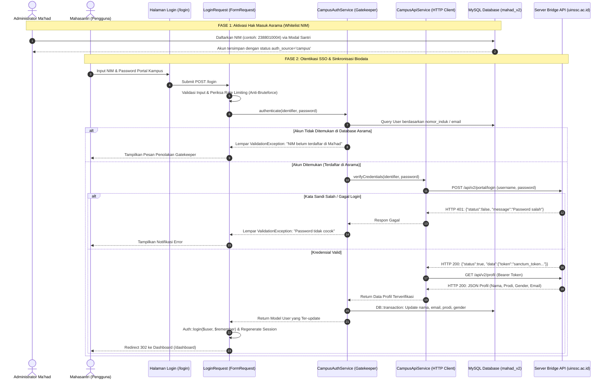

# Dokumentasi Arsitektur Sistem Autentikasi Single Sign-On (SSO) Bridge API v2

**Sistem**: Muqim Asrama (Ma'had Al-Jami'ah V2)  
**Institusi**: UIN Siber Syekh Nurjati Cirebon (`uinssc.ac.id`)  
**Basis Integrasi**: eCampuz SIAKAD Bridge API v2  
**Host Target**: `https://bridge.uinssc.ac.id`  

---

## 1. Ikhtisar Arsitektur Sistem

Aplikasi Ma'had Al-Jami'ah V2 mengimplementasikan sistem autentikasi terpusat berbasis **Single Sign-On (SSO)** yang terhubung langsung ke **eCampuz SIAKAD Bridge API v2** milik UIN Siber Syekh Nurjati Cirebon.

Arsitektur ini beroperasi dengan tiga pilar utama:
1. **Gatekeeper Security**: Hanya mahasiswa/dosen yang telah diberikan hak akses asrama (di-whitelist nomor induknya oleh Admin Ma'had) yang diizinkan masuk ke dalam sistem. Mahasiswa kampus umum yang belum terdaftar di asrama akan otomatis ditolak.
2. **Just-In-Time (JIT) Provisioning**: Data profil (Nama Lengkap, Program Studi, Jenis Kelamin, dan Email Kampus) tidak perlu diisi secara manual oleh Admin. Data tersebut ditarik secara otomatis langsung dari server SIAKAD kampus pada saat pengguna berhasil melakukan login pertama kali.
3. **Zero-Password Storage**: Sistem Ma'had tidak pernah menyimpan kata sandi akun portal kampus di dalam basis data lokal. Otentikasi kata sandi diverifikasi secara *real-time* ke server Bridge API kampus.

---

## 2. Diagram Alur Kerja Autentikasi (End-to-End)



---

## 3. Penjelasan Lengkap Seluruh File yang Digunakan

Berikut adalah rincian mendalam dari setiap berkas yang membangun subsistem autentikasi ini:

### 3.1 Berkas Konfigurasi & Lingkungan

#### 1. `.env`
- **Lokasi**: [c:/xampp/htdocs/mahad/mahad-v2/.env](file:///c:/xampp/htdocs/mahad/mahad-v2/.env)
- **Tanggung Jawab**: Menyimpan variabel lingkungan sensitif yang mengontrol alamat server kampus dan penanganan sertifikat.
- **Konfigurasi Utama**:
  ```env
  CAMPUS_API_BASE_URL=https://bridge.uinssc.ac.id
  CAMPUS_API_VERIFY_SSL=false
  CAMPUS_API_TIMEOUT=5
  ```
- **Cara Kerja**:
  - `CAMPUS_API_BASE_URL`: Menentukan host target endpoint Bridge API v2 eCampuz resmi UINSSC.
  - `CAMPUS_API_VERIFY_SSL=false`: Menginstruksikan client HTTP untuk menonaktifkan verifikasi rantai CA lokal OpenSSL PHP pada XAMPP (*self-signed certificate in chain*), sehingga mencegah terjadinya `cURL error 60`.

#### 2. `config/services.php`
- **Lokasi**: [c:/xampp/htdocs/mahad/mahad-v2/config/services.php](file:///c:/xampp/htdocs/mahad/mahad-v2/config/services.php)
- **Tanggung Jawab**: Mendistribusikan konfigurasi Bridge API dari `.env` ke seluruh container Laravel secara terstruktur.
- **Potongan Kode Penting**:
  ```php
  'campus_api' => [
      'base_url'   => env('CAMPUS_API_BASE_URL', 'https://bridge.uinssc.ac.id'),
      'key'        => env('CAMPUS_API_KEY', ''),
      'timeout'    => (int) env('CAMPUS_API_TIMEOUT', 5),
      'verify_ssl' => (bool) env('CAMPUS_API_VERIFY_SSL', false),
  ],
  ```

---

### 3.2 Berkas Rute (Routing)

#### 3. `routes/auth.php`
- **Lokasi**: [c:/xampp/htdocs/mahad/mahad-v2/routes/auth.php](file:///c:/xampp/htdocs/mahad/mahad-v2/routes/auth.php)
- **Tanggung Jawab**: Mendefinisikan endpoint URL publik autentikasi bagi pengguna guest (tamu).
- **Rute Utama**:
  - `GET /login` $\rightarrow$ `AuthenticatedSessionController@create` (menampilkan form login).
  - `POST /login` $\rightarrow$ `AuthenticatedSessionController@store` (memproses kiriman form kredensial).
  - `POST /logout` $\rightarrow$ `AuthenticatedSessionController@destroy` (mengakhiri sesi login).

#### 4. `routes/web.php`
- **Lokasi**: [c:/xampp/htdocs/mahad/mahad-v2/routes/web.php](file:///c:/xampp/htdocs/mahad/mahad-v2/routes/web.php)
- **Tanggung Jawab**: Menyediakan rute internal bagi Administrator untuk mengelola perizinan pengguna kampus.
- **Rute Terkait**:
  - `POST /admin/users/assign-santri` $\rightarrow$ `UserCampusSyncController@assignCampusSantri` (mendaftarkan hak masuk santri via NIM).
  - `POST /admin/users/assign-mudabbir` $\rightarrow$ `UserCampusSyncController@assignCampusMudabbir` (menetapkan Mudabbir).
  - `POST /admin/users/assign-tutor` $\rightarrow$ `UserCampusSyncController@assignCampusTutor` (menetapkan Tutor).

---

### 3.3 Berkas Lapisan Layanan (Service Layer)

#### 5. `app/Services/CampusApiService.php`
- **Lokasi**: [c:/xampp/htdocs/mahad/mahad-v2/app/Services/CampusApiService.php](file:///c:/xampp/htdocs/mahad/mahad-v2/app/Services/CampusApiService.php)
- **Tanggung Jawab**: Client HTTP murni yang menangani komunikasi jaringan ke server Bridge API kampus UINSSC.
- **Fungsi-Fungsi Kunci**:
  1. `client()`: Membentuk objek `Http` Laravel dengan header `Accept: application/json` serta menerapkan `withoutVerifying()` saat `verify_ssl` bernilai `false`.
  2. `healthCheck()`: Memeriksa ketersediaan koneksi soket TCP port 443 ke domain `bridge.uinssc.ac.id` dengan timeout 0.8 detik dan cache status 60 detik.
  3. `login(string $username, string $password)`:
     - Mengirim request `POST /api/v2/portal/login` dengan format payload `asForm()`.
     - Menangani respon eCampuz:
       - Respon HTTP 200 $\rightarrow$ Mengekstrak Bearer Token dari `data.token`.
       - Respon HTTP 401 $\rightarrow$ Mengembalikan pesan *"Password salah"*.
       - Respon HTTP 404 $\rightarrow$ Mengembalikan pesan *"Nomor Induk tidak ditemukan di pangkalan data kampus"*.
  4. `getProfil(string $token)`:
     - Mengirim request `GET /api/v2/profil` dengan header `Authorization: Bearer <token>`.
     - Mengembalikan array biodata mahasiswa/dosen.
  5. `verifyCredentials(string $identifier, string $password)`:
     - Menggabungkan pemanggilan `login()` dan `getProfil()`.
     - Menormalkan field profil (`nama`, `email_kampus`, `prodi_nama`, `jenis_kelamin`, `angkatan`) menjadi format standar aplikasi asrama.

#### 6. `app/Services/CampusAuthService.php`
- **Lokasi**: [c:/xampp/htdocs/mahad/mahad-v2/app/Services/CampusAuthService.php](file:///c:/xampp/htdocs/mahad/mahad-v2/app/Services/CampusAuthService.php)
- **Tanggung Jawab**: Otak logika bisnis autentikasi asrama (Gatekeeper & Sinkronisasi Database).
- **Fungsi-Fungsi Kunci**:
  1. `authenticate(string $identifier, string $password)`:
     - **Tahap 1**: Mencari data `User` di database lokal berdasarkan `nomor_induk` atau `email`.
     - **Tahap 2 (Akun Lokal)**: Jika `auth_source === 'local'` (Superadmin atau Mitra), memvalidasi kata sandi dengan `Hash::check()`.
     - **Tahap 3 (Gatekeeper Auto-Reject)**: Jika akun **tidak ditemukan** di database lokal, melempar `ValidationException`: *"NIM/NIP Anda belum terdaftar di Ma'had Al-Jami'ah. Silakan hubungi bagian Administrasi/Pengasuh Asrama"*.
     - **Tahap 4 (Verifikasi Kampus)**: Memanggil `CampusApiService::verifyCredentials()`. Jika kata sandi salah, melempar pesan error.
     - **Tahap 5 (JIT Profile Synchronization)**: Mengeksekusi `DB::transaction` untuk memperbarui atribut `User` (`name`, `email`) dan atribut `Santri` (`prodi`, `angkatan`, `no_hp`) dengan data teranyar dari kampus.
  2. `assignSantri(string $nim, array $extra = [])`:
     - Mendaftarkan NIM mahasiswa ke tabel `users` dengan `auth_source = 'campus'`, `password = null`, dan menetapkan role `mahasantri`.
     - Menyiapkan rekaman di tabel `mahad_santri` dengan status `'aktif'`.

---

### 3.4 Berkas Lapisan Pengendali & Validasi (Controller & Form Request)

#### 7. `app/Http/Requests/Auth/LoginRequest.php`
- **Lokasi**: [c:/xampp/htdocs/mahad/mahad-v2/app/Http/Requests/Auth/LoginRequest.php](file:///c:/xampp/htdocs/mahad/mahad-v2/app/Http/Requests/Auth/LoginRequest.php)
- **Tanggung Jawab**: Mengamankan gerbang HTTP login, validasi payload, dan pencegahan serangan *brute-force*.
- **Mekanisme Kerja**:
  - `rules()`: Memastikan `password` terisi serta menerima input identifier dari field `login_id` atau `email`.
  - `getIdentifier()`: Menormalkan input pengenal pengguna (NIM, NIP, atau Email).
  - `ensureIsNotRateLimited()`: Membatasi maksimal 5 kali percobaan gagal berturut-turut menggunakan `RateLimiter::hit()` dan melempar `Lockout` jika batas terlampaui.
  - `authenticate()`: Memanggil `CampusAuthService::authenticate()`, lalu mengautentikasi sesi aplikasi dengan `Auth::login($user, $remember)`.

#### 8. `app/Http/Controllers/Auth/AuthenticatedSessionController.php`
- **Lokasi**: [c:/xampp/htdocs/mahad/mahad-v2/app/Http/Controllers/Auth/AuthenticatedSessionController.php](file:///c:/xampp/htdocs/mahad/mahad-v2/app/Http/Controllers/Auth/AuthenticatedSessionController.php)
- **Tanggung Jawab**:
  - `create()`: Merender tampilan view `auth.login`.
  - `store()`: Mengeksekusi `$request->authenticate()`, meregenerasi session ID dengan `$request->session()->regenerate()` guna mencegah serangan *Session Fixation*, dan mengarahkan pengguna ke rute `/dashboard`.
  - `destroy()`: Mengakhiri sesi pengguna (`Auth::logout()`), menginvaliasi session, meregenerasi CSRF token, dan mengarahkan kembali ke halaman beranda.

#### 9. `app/Http/Controllers/UserCampusSyncController.php`
- **Lokasi**: [c:/xampp/htdocs/mahad/mahad-v2/app/Http/Controllers/UserCampusSyncController.php](file:///c:/xampp/htdocs/mahad/mahad-v2/app/Http/Controllers/UserCampusSyncController.php)
- **Tanggung Jawab**: Menangani aksi Admin saat mendaftarkan izin akses asrama bagi Mahasantri, Mudabbir, atau Tutor.
- **Method Kunci**:
  - `assignCampusSantri(AssignCampusSantriRequest $request)`: Mendaftarkan santri via `CampusAuthService::assignSantri()` dan mengarahkan kembali ke daftar pengguna dengan notifikasi sukses.

#### 10. `app/Http/Requests/User/AssignCampusSantriRequest.php`
- **Lokasi**: [c:/xampp/htdocs/mahad/mahad-v2/app/Http/Requests/User/AssignCampusSantriRequest.php](file:///c:/xampp/htdocs/mahad/mahad-v2/app/Http/Requests/User/AssignCampusSantriRequest.php)
- **Tanggung Jawab**: Memvalidasi bahwa field `nim` wajib diisi dan berupa string yang valid sebelum diproses oleh controller.

---

### 3.5 Berkas Model & Basis Data

#### 11. `app/Models/User.php`
- **Lokasi**: [c:/xampp/htdocs/mahad/mahad-v2/app/Models/User.php](file:///c:/xampp/htdocs/mahad/mahad-v2/app/Models/User.php)
- **Tanggung Jawab**: Entitas pengguna utama sistem.
- **Atribut Terkait**:
  - `nomor_induk`: Menyimpan NIM mahasiswa atau NIP dosen.
  - `auth_source`: Menandai asal otentikasi (`'campus'` untuk pengguna Bridge API, `'local'` untuk Superadmin/Mitra).
  - `password`: Bernilai `null` untuk akun kampus (karena kata sandi tidak disimpan lokal).
  - Menggunakan trait Spatie `HasRoles` untuk pembagian wewenang (`admin`, `tutor`, `mudabbir`, `mahasantri`).
  - Relasi `santri()`: Menghubungkan user ke profil santri di tabel `mahad_santri`.

#### 12. `app/Models/Santri.php`
- **Lokasi**: [c:/xampp/htdocs/mahad/mahad-v2/app/Models/Santri.php](file:///c:/xampp/htdocs/mahad/mahad-v2/app/Models/Santri.php)
- **Tanggung Jawab**: Menyimpan data akademik dan kepengurusan asrama santri (`nomor_induk`, `gender`, `prodi`, `angkatan`, `status`, `kamar_id`).

---

### 3.6 Berkas Antarmuka Pengguna (Views / Blade UI)

#### 13. `resources/views/auth/login.blade.php`
- **Lokasi**: [c:/xampp/htdocs/mahad/mahad-v2/resources/views/auth/login.blade.php](file:///c:/xampp/htdocs/mahad/mahad-v2/resources/views/auth/login.blade.php)
- **Tanggung Jawab**: Antarmuka halaman masuk aplikasi.
- **Fitur Kunci**:
  - Input `login_id` fleksibel (dapat diisi NIM mahasiswa, NIP pegawai, atau email).
  - Input `password` dengan fitur tombol lihat/sembunyikan (*toggle password visibility*).
  - Penanganan alert error terpusat untuk menampilkan pesan validasi maupun penolakan Gatekeeper kampus.
  - Dukungan mode tema gelap/terang otomatis.

#### 14. `resources/views/components/users/modal-santri.blade.php`
- **Lokasi**: [c:/xampp/htdocs/mahad/mahad-v2/resources/views/components/users/modal-santri.blade.php](file:///c:/xampp/htdocs/mahad/mahad-v2/resources/views/components/users/modal-santri.blade.php)
- **Tanggung Jawab**: Modal dialog bagi Admin untuk mendaftarkan santri baru.
- **Desain Efisien**:
  - Hanya meminta **1 kolom input: Nomor Induk Mahasiswa (NIM)**.
  - Tidak memiliki form isian manual nama atau prodi, karena sistem akan menariknya secara otomatis saat santri login.
  - Dilengkapi panel informasi alur keamanan SSO eCampuz.

#### 15. `resources/views/users/index.blade.php`
- **Lokasi**: [c:/xampp/htdocs/mahad/mahad-v2/resources/views/users/index.blade.php](file:///c:/xampp/htdocs/mahad/mahad-v2/resources/views/users/index.blade.php)
- **Tanggung Jawab**: Dasbor manajemen akun pengguna dengan tombol aktivasi `+ Santri (NIM)`, `+ Mudabbir (NIM)`, `+ Tutor (NIP / NIM)`, dan `+ Akun Lokal`.

---

### 3.7 Berkas Pengujian & Spesifikasi

#### 16. `tests/Feature/Auth/CampusGatekeeperTest.php`
- **Lokasi**: [c:/xampp/htdocs/mahad/mahad-v2/tests/Feature/Auth/CampusGatekeeperTest.php](file:///c:/xampp/htdocs/mahad/mahad-v2/tests/Feature/Auth/CampusGatekeeperTest.php)
- **Tanggung Jawab**: Automated Feature Test menyeluruh untuk memastikan integritas logika otentikasi.
- **Skenario Pengujian**:
  1. `test_unregistered_student_is_auto_rejected_at_login`: Memastikan mahasiswa liar otomatis ditolak sebelum menyentuh API kampus.
  2. `test_registered_campus_student_can_login_with_valid_bridge_credentials`: Memastikan santri yang telah terdaftar berhasil login dan diarahkan ke dashboard saat password valid.
  3. `test_registered_campus_student_fails_with_invalid_password`: Memastikan kegagalan otentikasi saat kata sandi salah.
  4. `test_admin_can_register_new_santri_via_nim`: Memastikan Admin dapat mendaftarkan NIM santri baru ke basis data.

#### 17. `campus-api/Bridge API v2 (Auth & Profil).json`
- **Lokasi**: [c:/xampp/htdocs/mahad/campus-api/Bridge API v2 (Auth & Profil).json](file:///c:/xampp/htdocs/mahad/campus-api/Bridge%20API%20v2%20%28Auth%20&%20Profil%29.json)
- **Tanggung Jawab**: Dokumen spesifikasi Postman Collection resmi eCampuz v2 yang mendasari pembentukan kontrak data endpoint `POST /api/v2/portal/login` dan `GET /api/v2/profil`.

---

## 4. Rangkuman Matriks Alur Data

| Tahapan Alur | File yang Mengeksekusi | Input | Output / Dampak |
| :--- | :--- | :--- | :--- |
| **1. Whitelist Santri** | `UserCampusSyncController` $\rightarrow$ `CampusAuthService` | `nim` (misal: 2388010004) | Record baru di `users` (`auth_source: campus`) |
| **2. Submit Form Login** | `login.blade.php` $\rightarrow$ `LoginRequest` | `login_id`, `password` | Validasi format & cek brute-force rate limiter |
| **3. Cek Hak Akses** | `CampusAuthService::authenticate` | `identifier` | Lanjut jika ada di DB, tolak jika belum terdaftar |
| **4. Request Token Login** | `CampusApiService::login` | `username`, `password` | Request HTTPS ke `bridge.uinssc.ac.id/api/v2/portal/login` |
| **5. Request Biodata** | `CampusApiService::getProfil` | Bearer Token | Request HTTPS ke `bridge.uinssc.ac.id/api/v2/profil` |
| **6. Update Otomatis** | `CampusAuthService` (`DB::transaction`) | Profil dari kampus | Update kolom `name`, `email`, `prodi`, `gender` |
| **7. Mulai Sesi** | `AuthenticatedSessionController` | Objek `$user` | `Auth::login()`, regenerate session, redirect ke `/dashboard` |
